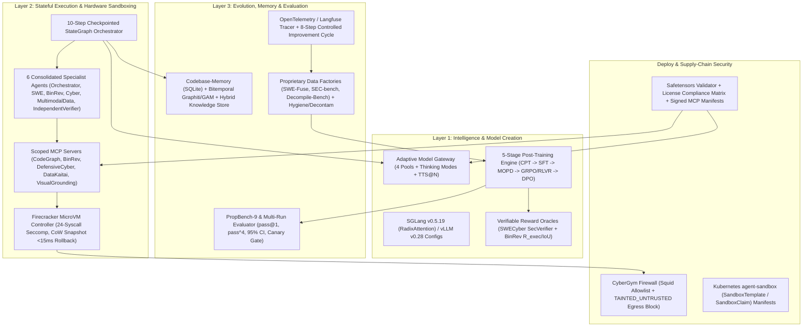

# Architecture Decision Record (`02-adr.md`)

## Status
Accepted — November 2026

## 1. System Topology (Three-Layer Hybrid Intelligence Architecture)

## 2. Component Boundaries & Package Layout
The repository is structured as an installable, strictly typed Python package `platform_core` mirroring Section 10.1 of the architecture specification:
- `src/platform_core/layer1_intelligence/`
  - `models.py`: Model registry, 4-pool definitions, hardware footprint & license metadata, `ThinkingMode` (`NON_THINK`, `THINK_HIGH`, `THINK_MAX`).
  - `router.py`: `AdaptiveModelRouter` (task/modality/complexity routing, entropy-aware thinking token budget calculation, Best-of-N `TTS@N` candidate selection with deterministic verifier pruning).
  - `serving.py`: `SGLangServingConfig`, `VLLMServingConfig`, RadixAttention prefix cache simulation & telemetry.
  - `training.py`: `GRPOTrainer` (critic-free group relative policy optimization with sequence entropy weighting & KL penalty), `SWECyberRewardOracle`, `BinRevDecompileRewardOracle`, `MOPDDistiller`, and `DistributedTrainingSpecBuilder` (PyTorch FSDP2 for 27B–70B, DeepSpeed ZeRO-3 for 100B+ MoE).
- `src/platform_core/layer2_execution/`
  - `state.py`: `PlatformState`, `SubTask`, `ArtifactRef`, `TaintLevel` (`CLEAN`, `TAINTED_UNTRUSTED`), `TaskStatus`, `ApprovalRequest`, and SQLite durable state checkpointer.
  - `sandbox.py`: `FirecrackerSandboxManager` (`SandboxTemplate`, `SandboxClaim`, 24-syscall seccomp profile, CoW memory snapshot creation & `<15ms` rollback restoration, taint-isolated network policy).
  - `mcp_tools.py`:
    - `CodeGraphMCPServer`: Three-Tier Code Intelligence (AST/Tree-sitter structural parser + XXH3/BLAKE2b content hash cache in SQLite, SCIP symbol & inverse call-graph index with `NoConfidentMatch` fallback, Git co-change hotspot/blast-radius calculator, and `str_replace` syntax-checked editor).
    - `BinRevMCPServer`: Binary header magic/section analyzer (ELF, PE, Mach-O, UEFI), `checksec` hardening auditor, string extractor, two-phase SK²Decompile Skeleton-to-Skin + ReCopilot context injector.
    - `DefensiveCyberMCPServer`: CPG source-to-sink taint analyzer, CWE vulnerability scanner, and SecVerifier dual-gate PoC + regression harness.
    - `DataAndVisualMCPServer`: Information-theoretic transformation classifier (Encoding vs Compression vs Encryption vs Hashing via Shannon entropy $H$, chi-square uniformity, and magic bytes), Kaitai Struct `.ksy` compiler/validator, and Dual-Path Epistemic Visual Grounder (separating grounded `[x1, y1, x2, y2]` regions from low-confidence regions requiring zoom/crop).
  - `agents.py`: The 6 consolidated specialist agent nodes (`PrincipalOrchestratorAgent`, `SoftwareEngineeringAgent`, `ReverseEngineeringAgent`, `DefensiveCyberAgent`, `MultimodalDataAgent`, `IndependentVerifierAgent`).
  - `orchestrator.py`: `ExecutionLifecycleOrchestrator` implementing the 10-Step Reliable Agent Execution Lifecycle, human `interrupt()` approval gates, and retry/rollback escalation to `TTS@4`.
- `src/platform_core/layer3_evolution/`
  - `memory.py`: `BitemporalEpisodicMemory` (Graphiti bitemporal `valid_from`/`valid_to`/`invalid_at` + GAM Event Progression Graph vs Topic Associative Network) and `HybridKnowledgeStore` (200K-token direct prefix cache threshold + vector cosine search + prompt injection sanitizer).
  - `data_factory.py`: `SWEFuseFactory`, `SecBenchFactory`, `DecompileBenchFactory`, and `DatasetHygienePipeline` (MinHash LSH deduplication, cyclomatic filter, execution discriminator, and benchmark decontamination blocklist).
  - `evaluation.py`: `PropBench9Suite` & `BenchmarkEvaluator` ($\text{pass}@1$, $\text{pass}^k$, 95% CI, Step Efficiency Ratio, Struct Layout IoU, $R_{\text{exec}}$, and Canary Promotion Gate).
  - `observability.py`: `OTelSpanTracer` and `ControlledImprovementCycle` (the 8-step continuous learning loop).
- `src/platform_core/deploy_security/`
  - `governance.py`: `SafetensorsValidator`, `LicenseComplianceAuditor`, `SignedManifestVerifier`, `CyberGymFirewall`, and `K8sAgentSandboxGenerator`.
- `src/platform_core/cli.py`: Unified CLI entrypoint for evaluating the research blueprint, running the 10-step multi-agent workflow, running the 5-stage model creation & RLVR training pipeline, and inspecting binary/encoded payloads.
