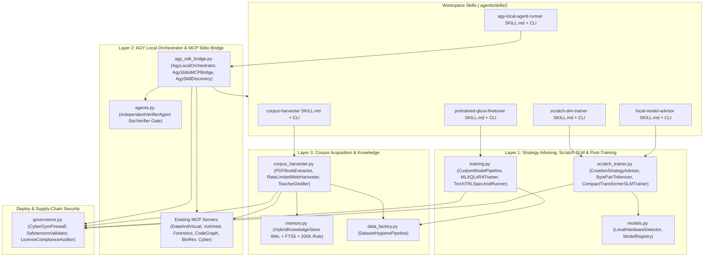

# Architecture Decision Record (`02-adr.md`)

**Feature Slug:** `ultimate-local-model-creator`  
**Status:** Proposed for Phase 3 Implementation (Extending ADR-0001 through ADR-0005)  
**Target Package:** `platform_core`

---

## 1. System Architecture Diagram



---

## 2. Architectural Decisions & Module Boundaries

### Decision 1: Keep Core Zero-Dependency (`dependencies = []`) with Dynamic Optional Dispatch
- **Context:** [`pyproject.toml`](../../../pyproject.toml) enforces `dependencies = []` so `platform_core` installs cleanly in air-gapped or minimal Python 3.11–3.14 environments. Optional packages (`mlx`, `mlx-lm`, `torch`, `transformers`, `pypdf`, `google-antigravity`, `litert-lm`) may or may not be present.
- **Decision:** All three new modules (`corpus_harvester.py`, `scratch_trainer.py`, `agy_sdk_bridge.py`) and all 5 skill scripts use Python standard library only at import time. Optional accelerators (`mlx`, `torch`, `google.antigravity`) are imported lazily inside runtime methods with explicit deterministic stdlib fallbacks.
- **Consequence:** Full unit/integration testing runs in `< 2s` under `-W error` with zero network or GPU dependencies, while real local Apple Silicon / CUDA / LiteRT / Ollama workloads execute natively when optional runtimes exist.

### Decision 2: Compose Existing MCP & Security Primitives (No Reimplementation)
- `PDFBookExtractor` calls `DataAndVisualMCPServer.extract_document_text()` instead of re-implementing PDF stream decompression.
- `RateLimitedWebHarvester` validates every URL through `CyberGymFirewall.evaluate_egress()` and blocks `session_tainted=True` fail-closed.
- `TeacherDistiller` validates teacher & source licenses via `LicenseComplianceAuditor` and filters generated trajectories through `DatasetHygienePipeline`.
- `CompactTransformerSLMTrainer` exports weights exclusively in `.safetensors` format validated by `SafetensorsValidator` (blocking `.pt`/`.pkl`/`.bin`).
- `AgyStdioMCPBridge` wraps existing `DataAndVisualMCPServer`, `VulnIntelMCPServer`, `ForensicsMCPServer`, `CodeGraphMCPServer`, `BinRevMCPServer`, and `DefensiveCyberMCPServer` instances rather than duplicating any domain logic.

### Decision 3: Exact Module Interfaces & Public Signatures

#### 3.1 `src/platform_core/layer3_evolution/corpus_harvester.py`
```python
class RateLimitError(RuntimeError): ...

@dataclass(frozen=True)
class HarvestedDocument:
    doc_id: str
    source_uri: str
    source_type: str          # "pdf_book" | "web_page" | "local_code"
    domain: str
    title: str
    license_id: str
    sha256: str
    raw_char_count: int
    sanitized_text: str
    chunks: tuple[str, ...]
    injection_alerts: tuple[str, ...]
    metadata: dict[str, Any] = field(default_factory=dict)

@dataclass(frozen=True)
class HarvestReport:
    documents: tuple[HarvestedDocument, ...]
    total_chunks: int
    total_tokens_est: int
    rejected_sources: tuple[dict[str, str], ...]
    rag_ingestion_stats: dict[str, Any]

class PromptInjectionSanitizer:
    INJECTION_PATTERNS: tuple[re.Pattern[str], ...]
    @classmethod
    def sanitize(cls, text: str) -> tuple[str, tuple[str, ...]]: ...

class DomainChunker:
    @staticmethod
    def chunk_text(
        text: str,
        chunk_chars: int = 2400,
        overlap_chars: int = 300,
        preserve_code_blocks: bool = True,
    ) -> list[str]: ...

class PDFBookExtractor:
    SUPPORTED_EXTENSIONS: frozenset[str] = frozenset({".pdf", ".md", ".txt", ".rst"})
    def __init__(self, chunk_chars: int = 2400, overlap_chars: int = 300) -> None: ...
    def extract_book(
        self,
        path: str | Path,
        domain: str = "swe",
        license_id: str = "Apache-2.0",
        max_chars: int = 2_000_000,
    ) -> HarvestedDocument: ...
    def extract_directory(
        self,
        root_dir: str | Path,
        domain: str = "swe",
        license_id: str = "Apache-2.0",
        max_files: int = 50,
    ) -> list[HarvestedDocument]: ...

class RateLimitedWebHarvester:
    DEFAULT_REQUESTS_PER_SECOND: float = 1.0
    MAX_RESPONSE_BYTES: int = 5 * 1024 * 1024
    def __init__(
        self,
        allowed_domains: set[str] | frozenset[str] | None = None,
        requests_per_second: float = 1.0,
        max_retries: int = 3,
        timeout_sec: float = 20.0,
        session_tainted: bool = False,
        opener: Callable[..., Any] | None = None,
    ) -> None: ...
    def fetch_url(
        self,
        url: str,
        domain: str = "cyber",
        license_id: str = "Apache-2.0",
    ) -> HarvestedDocument: ...

class TeacherDistiller:
    def __init__(
        self,
        backend: InferenceBackend,
        teacher_model_id: str = "Qwen/Qwen3.5-35B-A3B",
        teacher_license_id: str = "Apache-2.0",
    ) -> None: ...
    def synthesize_trajectories(
        self,
        documents: list[HarvestedDocument],
        target_domain: str = "swe_fuse",
        max_samples_per_doc: int = 3,
    ) -> list[TrainingTrajectoryRecord]: ...
    def export_distilled_jsonl(
        self,
        records: list[TrainingTrajectoryRecord],
        output_path: str | Path,
    ) -> dict[str, Any]: ...

class CorpusHarvesterPipeline:
    def __init__(
        self,
        knowledge_store: HybridKnowledgeStore | None = None,
        web_harvester: RateLimitedWebHarvester | None = None,
        pdf_extractor: PDFBookExtractor | None = None,
    ) -> None: ...
    def run_harvest(
        self,
        pdf_paths: list[str | Path] | None = None,
        book_dirs: list[str | Path] | None = None,
        urls: list[str] | None = None,
        domain: str = "swe",
        license_id: str = "Apache-2.0",
        session_tainted: bool = False,
        ingest_into_rag: bool = True,
    ) -> HarvestReport: ...
    def close(self) -> None: ...
```

#### 3.2 `src/platform_core/layer1_intelligence/scratch_trainer.py`
```python
class ModelCreationPath(str, Enum):
    PRETRAINED_QLORA_FIRST = "PRETRAINED_QLORA_FIRST"
    PRETRAINED_RAG_ONLY = "PRETRAINED_RAG_ONLY"
    FROM_SCRATCH_COMPACT_SLM = "FROM_SCRATCH_COMPACT_SLM"
    MULTI_GPU_FULL_POST_TRAIN = "MULTI_GPU_FULL_POST_TRAIN"

@dataclass(frozen=True)
class StrategyRecommendation:
    recommended_path: ModelCreationPath
    base_model_id: str | None
    rationale: str
    hardware_summary: dict[str, Any]
    estimated_vram_gb: float
    fits_local_budget: bool
    warnings: tuple[str, ...] = ()

class CreationStrategyAdvisor:
    @staticmethod
    def recommend(
        corpus_tokens: int,
        domain: str = "swe",
        hardware_info: LocalHardwareInfo | None = None,
        custom_vocab_required: bool = False,
        target_params_m: int | None = None,
    ) -> StrategyRecommendation: ...

class BytePairTokenizer:
    SPECIAL_TOKENS: tuple[str, ...] = ("<pad>", "<bos>", "<eos>", "<unk>")
    def __init__(
        self,
        vocab: dict[str, int],
        merges: list[tuple[str, str]],
    ) -> None: ...
    @classmethod
    def train(
        cls,
        texts: list[str],
        vocab_size: int = 512,
        min_frequency: int = 2,
    ) -> BytePairTokenizer: ...
    def encode(self, text: str, add_special_tokens: bool = False) -> list[int]: ...
    def decode(self, token_ids: list[int], skip_special_tokens: bool = True) -> str: ...
    def save(self, path: str | Path) -> Path: ...
    @classmethod
    def load(cls, path: str | Path) -> BytePairTokenizer: ...

@dataclass(frozen=True)
class ScratchSLMConfig:
    model_id: str
    vocab_size: int = 512
    d_model: int = 64
    n_layers: int = 2
    n_heads: int = 4
    d_ff: int = 128
    max_seq_len: int = 128
    learning_rate: float = 0.05
    steps: int = 15
    batch_size: int = 4
    seed: int = 42
    license_id: str = "Apache-2.0"
    domain: str = "swe"
    execution_backend: str = "auto"  # "auto" | "stdlib" | "mlx" | "torch"

    @classmethod
    def preset_tier(cls, model_id: str, tier: str = "10M", domain: str = "swe") -> ScratchSLMConfig: ...
    def estimate_param_count(self) -> int: ...
    def validate(self) -> None: ...

@dataclass(frozen=True)
class ScratchSLMArtifact:
    model_id: str
    param_count: int
    vocab_size: int
    backend_used: str
    loss_history: tuple[float, ...]
    initial_loss: float
    final_loss: float
    safetensors_path: str
    tokenizer_path: str
    manifest_path: str
    checkpoint_sha256: str

class CompactTransformerSLMTrainer:
    def train_and_export(
        self,
        config: ScratchSLMConfig,
        corpus_texts: list[str],
        output_dir: str | Path,
    ) -> ScratchSLMArtifact: ...
    @classmethod
    def generate_sample(
        cls,
        manifest_path: str | Path,
        prompt: str,
        max_new_tokens: int = 16,
    ) -> str: ...
    @classmethod
    def load_artifact_manifest(cls, manifest_path: str | Path) -> dict[str, Any]: ...
```

#### 3.3 `src/platform_core/layer2_execution/agy_sdk_bridge.py`
```python
@dataclass(frozen=True)
class AgyLocalAgentSpec:
    agent_name: str
    runtime_kind: str = "local_openai"  # "litert" | "local_openai"
    model_or_path: str = "Qwen/Qwen3.5-35B-A3B"
    base_url: str | None = "http://127.0.0.1:8080/v1"
    litert_backend: str = "gpu"         # "gpu" | "npu"
    enable_speculative_decoding: bool = False
    skills_paths: tuple[str, ...] = (".agents/skills",)
    mcp_servers: tuple[dict[str, Any], ...] = ()
    subagents: tuple[dict[str, Any], ...] = ()
    max_subagent_depth: int = 2
    session_tainted: bool = True
    system_instructions: str = ""

@dataclass(frozen=True)
class AgyExecutionResult:
    agent_name: str
    execution_backend: str              # "google_antigravity_sdk" | "stdlib_fallback"
    sdk_available: bool
    config_snapshot: dict[str, Any]
    loaded_skills: tuple[str, ...]
    bound_mcp_servers: tuple[str, ...]
    subagent_delegations: tuple[str, ...]
    response_text: str
    verified_by_independent_verifier: bool
    status: str

class AgySkillDiscovery:
    @staticmethod
    def discover_skills(skills_paths: list[str | Path]) -> list[dict[str, str]]: ...

class AgyStdioMCPBridge:
    SUPPORTED_SERVERS: frozenset[str] = frozenset(
        {"data_visual", "vuln_intel", "forensics", "code_graph", "binrev", "defensive_cyber"}
    )
    def __init__(
        self,
        vuln_db_path: str | Path = ":memory:",
    ) -> None: ...
    def list_tools(
        self,
        server_names: list[str] | None = None,
        session_tainted: bool = False,
    ) -> list[dict[str, Any]]: ...
    def dispatch_request(
        self,
        request: dict[str, Any],
        session_tainted: bool = False,
    ) -> dict[str, Any]: ...
    def serve_stdio(
        self,
        stdin: TextIO | None = None,
        stdout: TextIO | None = None,
        session_tainted: bool = False,
    ) -> int: ...
    def close(self) -> None: ...
    @staticmethod
    def build_mcp_stdio_config(
        server_names: list[str] | None = None,
        python_executable: str | None = None,
        name: str = "platform_core_mcp",
        enabled_tools: list[str] | None = None,
    ) -> dict[str, Any]: ...

class AgyLocalOrchestrator:
    def __init__(
        self,
        inference_backend: InferenceBackend | None = None,
    ) -> None: ...
    @staticmethod
    def is_sdk_installed() -> bool: ...
    def build_sdk_config(self, spec: AgyLocalAgentSpec) -> Any: ...
    @staticmethod
    def build_default_subagent_specs() -> list[dict[str, Any]]: ...
    def run_local_agent(
        self,
        spec: AgyLocalAgentSpec,
        prompt: str,
        force_fallback: bool = False,
    ) -> AgyExecutionResult: ...
```

---

## 3. Data Formats & Storage Contracts

1. **Distilled Trajectory JSONL (`TrainingTrajectoryRecord`):**
   - Compatible with `CustomModelPipeline.load_trajectories_from_file()`: each line is a JSON object with `record_id`, `domain`, `source_repo`, `license_id`, `cve_id`, `prompt_context`, `target_completion`, `execution_verified`, `metadata`.
2. **Scratch SLM Directory (`output_dir/`):**
   - `<model_id>.safetensors`: Little-endian `<Q` header length + JSON tensor descriptors (`dtype="F32"`, `shape=[...]`, contiguous `data_offsets`) + raw float32 bytes + `__metadata__` (`model_id`, `license`, `param_count`, `vocab_size`, `d_model`, `n_layers`, `n_heads`, `d_ff`, `max_seq_len`). Validated via `SafetensorsValidator.validate_file()`.
   - `<model_id>.tokenizer.json`: JSON object (`schema_version="1.0"`, `special_tokens`, `vocab`, `merges`).
   - `<model_id>.manifest.json`: JSON object (`schema_version="1.0"`, `model_id`, `safetensors_file`, `tokenizer_file`, `checkpoint_sha256`, `config`, `param_count`, `loss_history`, `license_id`, `domain`).
3. **MCP Stdio JSON-RPC 2.0:**
   - Line-delimited JSON objects: `{"jsonrpc": "2.0", "id": <int|str>, "method": "initialize"|"tools/list"|"tools/call", "params": {...}}`.
   - All tool names and parameter keys are valid Python identifiers (e.g., `data_classify_transformation`, `vuln_audit_dependencies`, `forensics_scan_target`), satisfying `google-antigravity-sdk` FastMCP identifier rules.

---

## 4. Security Threat Model & Mitigations

| Threat Vector | Affected Component | Concrete Mitigation |
| :--- | :--- | :--- |
| **SSRF / Cloud Metadata / Tainted Egress** | `RateLimitedWebHarvester`, `harvest_corpus.py` | Every URL passes `CyberGymFirewall.evaluate_egress(url, session_tainted)` BEFORE connection; `session_tainted=True`, direct IP literals (`169.254.169.254`, `127.0.0.1`, RFC1918), and non-allowlisted hosts raise `PermissionError`. |
| **Indirect Prompt Injection in PDFs / Web** | `PDFBookExtractor`, `RateLimitedWebHarvester`, `HybridKnowledgeStore` | `PromptInjectionSanitizer.sanitize()` strips zero-width control chars and redacts `ignore previous instructions`, `<|im_start|>`, `<|im_end|>`, `<|endoftext|>`, `### System:`, `system: override`, and shell exfil snippets before RAG ingestion or distillation. |
| **Zip-Bomb / Decompression DoS / Memory Exhaustion** | `PDFBookExtractor`, `RateLimitedWebHarvester` | PDF extraction delegates to `DataAndVisualMCPServer._extract_pdf_text` (`zlib.decompressobj().decompress(..., max_length=2MB)`); HTTP reads loop in bounded chunks up to `MAX_RESPONSE_BYTES` (5 MiB) and abort on overflow. |
| **Symlink Traversal & Path Escape** | `PDFBookExtractor`, `CompactTransformerSLMTrainer`, `BytePairTokenizer`, `AgySkillDiscovery` | Reject `path.is_symlink()` on all inputs and outputs; verify `resolved.is_relative_to(resolved_root)` on directory scans and manifest asset references (`safetensors_file`, `tokenizer_file`). |
| **Pickle Deserialization / Corrupt Safetensors** | `CompactTransformerSLMTrainer`, `CustomModelPipeline` | Zero `.pt`/`.pth`/`.pkl`/`.bin` emission or loading; all checkpoints use `SafetensorsValidator.create_valid_safetensors_bytes` + `validate_file(expected_sha256=...)` checking exact `shape * dtype` contiguous spans. |
| **SQLite Concurrency Corruption** | `HybridKnowledgeStore`, `VulnIntelMCPServer`, `ForensicsMCPServer` | All SQLite stores use `check_same_thread=False`, `threading.RLock()`, `PRAGMA journal_mode = WAL`, and `PRAGMA busy_timeout = 30000`. |
| **Boolean-as-Integer Confusion** | `ScratchSLMConfig`, `BytePairTokenizer` | Explicit `not isinstance(val, bool) and isinstance(val, int)` validation on all integer config/schema fields. |
| **Executor Self-Certification Bypass** | `AgyLocalOrchestrator` | `AgyExecutionResult` sets `status="COMPLETED"` only after `IndependentVerifierAgent` (`can_mark_completed=True`) validates output; executor subagents cannot self-certify. |
| **Skill Rate-Limit Exhaustion** | `corpus-harvester`, `RateLimitedWebHarvester` | `time.monotonic()` spacing between requests, exponential backoff on 429/5xx logged to `stderr`, and explicit `RateLimitError` on HTTP 429 exhaustion. |
