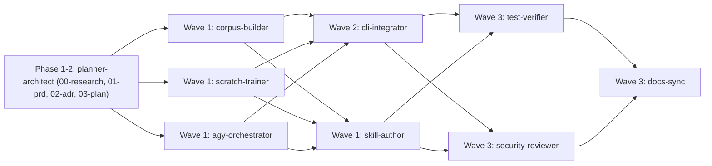

# Implementation Plan & Worker Ownership Map (`03-plan.md`)

**Feature Slug:** `ultimate-local-model-creator`  
**Execution Model:** Parallel Wave 1 (Domain Modules + Skills) -> Wave 2 (CLI Integration) -> Wave 3 (Verification, Security Review & Documentation Sync).

---

## 1. Strict Non-Overlapping File Ownership Matrix

Two agents MUST NEVER edit the same file concurrently. Every worker's exact write boundary is listed below:

| Worker Name | Wave | Exclusive Owned Paths (Create / Modify) | Forbidden Paths |
| :--- | :--- | :--- | :--- |
| `corpus-builder` | Wave 1 | `src/platform_core/layer3_evolution/corpus_harvester.py` | Everything outside `corpus_harvester.py` (do NOT edit `__init__.py`, `cli.py`, `tests/`, `docs/`) |
| `scratch-trainer` | Wave 1 | `src/platform_core/layer1_intelligence/scratch_trainer.py` | Everything outside `scratch_trainer.py` |
| `agy-orchestrator` | Wave 1 | `src/platform_core/layer2_execution/agy_sdk_bridge.py` | Everything outside `agy_sdk_bridge.py` |
| `skill-author` | Wave 1 | `.agents/skills/corpus-harvester/**`, `.agents/skills/local-model-advisor/**`, `.agents/skills/scratch-slm-trainer/**`, `.agents/skills/pretrained-qlora-finetuner/**`, `.agents/skills/agy-local-agent-runner/**` | Everything inside `src/`, `tests/`, `docs/` |
| `cli-integrator` | Wave 2 | `src/platform_core/cli.py`, `src/platform_core/layer1_intelligence/__init__.py`, `src/platform_core/layer2_execution/__init__.py`, `src/platform_core/layer3_evolution/__init__.py` | `corpus_harvester.py`, `scratch_trainer.py`, `agy_sdk_bridge.py`, `.agents/skills/`, `docs/` |
| `test-verifier` | Wave 3 | `tests/test_corpus_and_scratch_trainer.py`, `tests/test_agy_sdk_and_skills.py`, `.agents/artifacts/ultimate-local-model-creator/04-test-report.md` | `src/`, `.agents/skills/`, `docs/` |
| `security-reviewer` | Wave 3 | `.agents/artifacts/ultimate-local-model-creator/05-security-audit.md` | `src/`, `tests/`, `docs/` (reports findings back to owning author if fixes are required) |
| `docs-sync` | Wave 3 | `AGENTS.md`, `docs/DOCUMENTATION_INDEX.md`, `docs/DOCUMENTATION_COVERAGE.md`, `docs/modules/cli.md`, `docs/modules/layer1-intelligence.md`, `docs/modules/layer2-execution.md`, `docs/modules/layer3-evolution.md`, `docs/CUSTOM_MODEL_GUIDE.md`, `docs/architecture/decisions/README.md`, `docs/architecture/decisions/ADR-0006-local-ai-creator-and-antigravity-sdk.md`, `src/platform_core/README.md`, `src/platform_core/layer1_intelligence/README.md`, `src/platform_core/layer2_execution/README.md`, `src/platform_core/layer3_evolution/README.md`, `tests/README.md`, `.agents/README.md`, `.agents/artifacts/ultimate-local-model-creator/STATUS.md` | `src/**/*.py`, `tests/**/*.py`, `.agents/skills/` |

---

## 2. Ordered Task Graph & Dependencies

*(Note: `skill-author` may draft the 5 `SKILL.md` files immediately in Wave 1 and finalize/smoke-test `scripts/*.py` as soon as `corpus-builder`, `scratch-trainer`, and `agy-orchestrator` land their modules, or develop against the exact frozen signatures in `02-adr.md`.)*

---

## 3. Detailed Acceptance Checklist per Worker

### 3.1 `corpus-builder`
- Implement `RateLimitError`, `HarvestedDocument`, `HarvestReport`, `PromptInjectionSanitizer`, `DomainChunker`, `PDFBookExtractor`, `RateLimitedWebHarvester`, `TeacherDistiller`, `CorpusHarvesterPipeline` in `src/platform_core/layer3_evolution/corpus_harvester.py`.
- Reuse `DataAndVisualMCPServer.extract_document_text`, `CyberGymFirewall.evaluate_egress`, `HybridKnowledgeStore`, `LicenseComplianceAuditor`, `DatasetHygienePipeline`.
- Enforce `time.monotonic()` rate limiting, `MAX_RESPONSE_BYTES` bounded HTTP read, HTTP 429 `RateLimitError`, symlink rejection, and zero third-party deps.

### 3.2 `scratch-trainer`
- Implement `ModelCreationPath`, `StrategyRecommendation`, `CreationStrategyAdvisor`, `BytePairTokenizer`, `ScratchSLMConfig`, `ScratchSLMArtifact`, `CompactTransformerSLMTrainer` in `src/platform_core/layer1_intelligence/scratch_trainer.py`.
- Reuse `LocalHardwareDetector`, `ModelRegistry`, `SafetensorsValidator`, `LicenseComplianceAuditor`.
- Implement real pure-stdlib forward/backward training on a compact causal Transformer (embedding + causal self-attention/MLP + linear LM head + cross-entropy SGD) so `final_loss < initial_loss` deterministically, with optional `mlx` / `torch` dispatch when installed.
- Export `.safetensors` (F32, contiguous tensor spans verified by `SafetensorsValidator`), `.tokenizer.json`, and `.manifest.json`.

### 3.3 `agy-orchestrator`
- Implement `AgyLocalAgentSpec`, `AgyExecutionResult`, `AgySkillDiscovery`, `AgyStdioMCPBridge`, `AgyLocalOrchestrator` in `src/platform_core/layer2_execution/agy_sdk_bridge.py`.
- Dynamically probe `google.antigravity` (`LiteRTAgentConfig`, `LocalOpenAIAgentConfig`, `types.McpStdioServer`, `types.SubagentConfig`, `skills_paths`), expand `~` via `os.path.expanduser()` on `model_path`, and provide full stdlib fallback via `InferenceBackend` + `IndependentVerifierAgent` gate.
- `AgyStdioMCPBridge` wraps existing `DataAndVisualMCPServer`, `VulnIntelMCPServer`, `ForensicsMCPServer`, `CodeGraphMCPServer`, `BinRevMCPServer`, `DefensiveCyberMCPServer` over newline-delimited JSON-RPC 2.0 stdin/stdout with valid Python-identifier tool names and `session_tainted` enforcement.

### 3.4 `skill-author`
- Create 5 skills under `.agents/skills/`:
  1. `corpus-harvester` (`SKILL.md` + `scripts/harvest_corpus.py`)
  2. `local-model-advisor` (`SKILL.md` + `scripts/advise_model.py`)
  3. `scratch-slm-trainer` (`SKILL.md` + `scripts/train_slm.py`)
  4. `pretrained-qlora-finetuner` (`SKILL.md` + `scripts/finetune_qlora.py`)
  5. `agy-local-agent-runner` (`SKILL.md` + `scripts/run_agy_agent.py`)
- Follow `workflow-skill-creator` Rule 1–7 (`--output` JSON file, required `--limit`, `time.monotonic()` + `RateLimitError`, reuse `platform_core`, concise `SKILL.md` with YAML frontmatter).

### 3.5 `cli-integrator`
- Wire exports in `layer1_intelligence/__init__.py`, `layer2_execution/__init__.py`, `layer3_evolution/__init__.py`.
- Add `harvest-corpus`, `recommend-strategy`, `train-scratch-slm`, `run-agy-local`, and `mcp-stdio-bridge` to `src/platform_core/cli.py`.
- Preserve all 13 existing subcommands and JSON stdout format.

### 3.6 `test-verifier`
- Write comprehensive tests in `tests/test_corpus_and_scratch_trainer.py` and `tests/test_agy_sdk_and_skills.py` covering:
  - PDF extraction + prompt-injection redaction + symlink rejection + `HybridKnowledgeStore` `< 200K` token rule.
  - Web harvester SSRF/taint block + `time.monotonic()` pacing + `RateLimitError` on HTTP 429.
  - Teacher distillation + `DatasetHygienePipeline` filtering + JSONL export.
  - `CreationStrategyAdvisor` across `< 50K`, `>= 50K`, custom vocab (`10M–350M`), and cluster tiers.
  - `BytePairTokenizer` UTF-8 round-trip + save/load + symlink/bool rejection.
  - `CompactTransformerSLMTrainer` loss reduction + `.safetensors` validation + manifest loading + sample generation.
  - `AgyLocalOrchestrator` (LiteRT + LocalOpenAI config build, `~` expansion, skill discovery, taint isolation, verifier gate, fallback execution).
  - `AgyStdioMCPBridge` JSON-RPC `initialize` / `tools/list` / `tools/call` across DataVisual, VulnIntel, Forensics, plus tainted feed-sync block.
  - Subprocess tests of all 5 skill scripts (`--help`, `--output` JSON files) and all 5 new `platform_core.cli` subcommands.
- Run full suite: `PYTHONPATH=src .venv/bin/python -W error -m unittest discover -s tests -v`.

### 3.7 `security-reviewer`
- Audit all new modules, skill scripts, and CLI handlers against:
  - SSRF / tainted egress (`CyberGymFirewall`, `session_tainted=True`)
  - Prompt injection sanitization
  - Symlink & path traversal checks (`is_symlink()`, `resolve().is_relative_to()`)
  - Safetensors contiguous span & zero-pickle enforcement
  - `bool`-as-`int` validation
  - WAL SQLite + `RLock` thread safety
  - `SecVerifier` (`can_mark_completed=True`) gate preservation
- Produce `.agents/artifacts/ultimate-local-model-creator/05-security-audit.md` with explicit `VERDICT: PASS` (after any remediation loops).

### 3.8 `docs-sync`
- Inspect [docs/DOCUMENTATION_INDEX.md](../../../docs/DOCUMENTATION_INDEX.md) and [docs/DOCUMENTATION_COVERAGE.md](../../../docs/DOCUMENTATION_COVERAGE.md) and synchronize all affected docs, CLI references in `AGENTS.md`, module READMEs, `ADR-0006`, and `STATUS.md`.
- Verify all relative links and ensure zero broken links or stale inventories.
