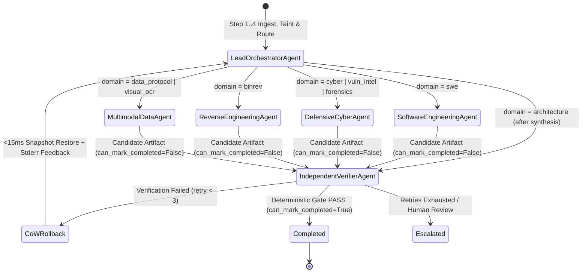

# `platform-core` Project Brain — Persistent Agent Knowledge Base & Second Brain

**Version:** `1.0.0`  
**Last Synchronized:** 2026-11-19  
**Scope:** End-to-end architectural memory, domain playbooks, symbol ontology, bitemporal fact seed, and invariant guardrails for AI agents and human engineers working in `platform-core`.

---

## Table of Contents

1. [Purpose & How Agents Use This Brain](#1-purpose--how-agents-use-this-brain)
2. [Second Brain Directory & Navigation Map](#2-second-brain-directory--navigation-map)
3. [Project Identity & Core Capabilities Snapshot](#3-project-identity--core-capabilities-snapshot)
4. [High-Level Ontology & Cognitive Architecture Graph](#4-high-level-ontology--cognitive-architecture-graph)
5. [Four-Pillar Subsystem Matrix](#5-four-pillar-subsystem-matrix)
6. [Eight Domain Workflows & Routing Matrix](#6-eight-domain-workflows--routing-matrix)
7. [Six Consolidated Specialist Agents & Dual-Gate Topology](#7-six-consolidated-specialist-agents--dual-gate-topology)
8. [Fast-Path Command & Verification Cheat Sheet](#8-fast-path-command--verification-cheat-sheet)
9. [Seeding `BitemporalEpisodicMemory` from the Project Brain](#9-seeding-bitemporalepisodicmemory-from-the-project-brain)

---

## 1. Purpose & How Agents Use This Brain

The **Project Brain** (`.agents/brain/`) is a curated, zero-drift persistent knowledge base designed to give AI coding agents, orchestrators (`ExecutionLifecycleOrchestrator`, `AgyLocalOrchestrator`), and engineers immediate contextual mastery over `platform-core` without scanning thousands of lines of source code.

When starting any task in this workspace:
1. **Load Core Context**: Read this hub ([`.agents/brain/README.md`](README.md)) and [AGENTS.md](../../AGENTS.md) to internalize the 3-layer architecture and 7 mandatory invariants.
2. **Trace Dependencies**: Consult [knowledge-graph.md](knowledge-graph.md) to see how modules, classes, ADRs (`ADR-0001`..`ADR-0009`), and tests interconnect before modifying code.
3. **Verify Domain Rules & Guardrails**: Consult [domain-playbooks-and-invariants.md](domain-playbooks-and-invariants.md) for domain-specific reward oracles, MCP tools, and security invariants.
4. **Locate Exact Symbols & Schemas**: Consult [symbol-and-contract-index.md](symbol-and-contract-index.md) for exact file paths, class signatures, SQLite WAL table schemas, and CLI/MCP contracts.
5. **Ingest Structured Graph Facts**: Load [brain-knowledge-graph.json](brain-knowledge-graph.json) into `BitemporalEpisodicMemory` or `HybridKnowledgeStore` for programmatic RAG and bitemporal point-in-time queries.

> [!IMPORTANT]
> All Markdown files inside `.agents/brain/` enforce workspace link portability: every link uses a repository-relative path (never machine-local home-directory paths or `file:` URIs) and maps directly to verified source files in [`src/platform_core/`](../../src/platform_core/).

---

## 2. Second Brain Directory & Navigation Map

| Brain File | Role in the Second Brain | Primary Consumers |
| :--- | :--- | :--- |
| [`README.md`](README.md) | **Master Hub & Cognitive Map**: System snapshot, 4-layer matrix, 8-domain routing table, 6-agent topology, and CLI quick-reference. | All AI agents, new contributors, `ProjectContextManager` |
| [`knowledge-graph.md`](knowledge-graph.md) | **Architectural Knowledge Graph**: Mermaid entity-relationship graphs, cross-layer dependency chains, lifecycle state machines, and ADR decision registry (`ADR-0001`..`ADR-0009`). | `system-architect`, `tech-lead`, `research` agents |
| [`domain-playbooks-and-invariants.md`](domain-playbooks-and-invariants.md) | **Operational Memory & Guardrails**: Deep-dive into the 7 workspace invariants, 8 domain execution recipes, security gates, and anti-pattern troubleshooting. | `dev-worker`, `security-auditor`, `code-reviewer`, `test-engineer` |
| [`symbol-and-contract-index.md`](symbol-and-contract-index.md) | **Symbol, Schema & Contract Atlas**: File-by-file class/function dictionary, 5 SQLite WAL schemas, 22 CLI subcommands, and 18 MCP stdio tools. | Coding agents performing surgical edits or writing unit tests |
| [`brain-knowledge-graph.json`](brain-knowledge-graph.json) | **Machine-Readable Ontology & Bitemporal Fact Seed**: JSON graph of nodes, directed edges, bitemporal architectural facts (`subject`, `predicate`, `object_val`), and invariant checks. | `ProjectBrainEngine`, `BitemporalEpisodicMemory`, `HybridKnowledgeStore`, interactive visualizers |

---

## 3. Project Identity & Core Capabilities Snapshot

| Attribute | Value / Specification | Source Reference |
| :--- | :--- | :--- |
| **Package & Version** | `platform-core` (`v1.0.0`) / CLI entrypoint `platform-cli` | [`pyproject.toml`](../../pyproject.toml), [`src/platform_core/cli.py`](../../src/platform_core/cli.py) |
| **Runtime Baseline** | Python `>= 3.11`, **zero mandatory third-party dependencies** (`dependencies = []`) | [`pyproject.toml`](../../pyproject.toml) |
| **Optional Extras** | `[mlx]`, `[train]`, `[rag]`, `[vision]`, `[forensics]`, `[agy]`, `[dev]` | [`pyproject.toml`](../../pyproject.toml) |
| **Architecture Pattern** | Three-Layer Hybrid Technical Intelligence (`Layer 1 Intelligence`, `Layer 2 Execution`, `Layer 3 Evolution`) + Cross-Cutting `deploy_security` | [`docs/architecture/system-architecture.md`](../../docs/architecture/system-architecture.md) |
| **Supported Domains (8)** | `swe`, `cyber`, `vuln_intel`, `forensics`, `binrev`, `data_protocol`, `visual_ocr`, `architecture` | [`src/platform_core/layer1_intelligence/router.py`](../../src/platform_core/layer1_intelligence/router.py) |
| **Model Pools (4)** | `PRIMARY_SWE_CYBER`, `SYSTEMS_BINREV`, `MULTIMODAL_DATA_ARCH`, `FAST_DRAFTER_ROUTER` | [`src/platform_core/layer1_intelligence/models.py`](../../src/platform_core/layer1_intelligence/models.py) |
| **Specialist Agents (6)** | `LeadOrchestratorAgent`, `SoftwareEngineeringAgent`, `ReverseEngineeringAgent`, `DefensiveCyberAgent`, `MultimodalDataAgent`, `IndependentVerifierAgent` | [`src/platform_core/layer2_execution/agents.py`](../../src/platform_core/layer2_execution/agents.py) |
| **Deterministic MCP Servers (6)** | `CodeGraphMCPServer`, `BinRevMCPServer`, `DefensiveCyberMCPServer`, `DataAndVisualMCPServer`, `VulnIntelMCPServer`, `ForensicsMCPServer` | [`src/platform_core/layer2_execution/mcp_tools.py`](../../src/platform_core/layer2_execution/mcp_tools.py) |
| **Workspace Skills (5)** | `corpus-harvester`, `local-model-advisor`, `scratch-slm-trainer`, `pretrained-qlora-finetuner`, `agy-local-agent-runner` | [`.agents/skills/`](../skills/) |
| **Verification Suite** | `49/49` unit, integration & security tests under `-W error` across 8 test modules + 5 executable `BenchmarkSuiteRunner` suites | [`tests/`](../../tests/) |

---

## 4. High-Level Ontology & Cognitive Architecture Graph

```mermaid
flowchart TB
    subgraph Brain["Project Brain Ontology (.agents/brain/)"]
        Hub["README.md (Cognitive Hub)"]
        KG["knowledge-graph.md (Entity & ADR Graph)"]
        Playbooks["domain-playbooks-and-invariants.md (7 Invariants & 8 Domains)"]
        Atlas["symbol-and-contract-index.md (20 Modules & 5 SQLite Schemas)"]
        JSON["brain-knowledge-graph.json (Machine-Readable Fact Seed)"]
    end

    subgraph L1["Layer 1: Intelligence & Model Creation (src/platform_core/layer1_intelligence/)"]
        M1["models.py: 4-Pool ModelRegistry & HardwareFeasibilityPlanner"]
        M2["router.py: AdaptiveModelRouter (NON_THINK / THINK_HIGH / THINK_MAX) & TTS@N"]
        M3["inference.py & serving.py: OpenAI/MLX Backends & RadixPrefixCacheSimulator"]
        M4["training.py: 5-Stage CustomModelPipeline & Execution Reward Oracles"]
        M5["scratch_trainer.py: CreationStrategyAdvisor, BytePairTokenizer & CompactTransformerSLMTrainer"]
        M6["heretic.py: HereticAbliterator, GAINAdaptiveScheduler, ColdFusionModelMerger & IMatrixCalibrator"]
    end

    subgraph L2["Layer 2: Stateful Execution & Sandboxing (src/platform_core/layer2_execution/)"]
        E1["orchestrator.py: 10-Step ExecutionLifecycleOrchestrator"]
        E2["agents.py: 5 Executor Agents + IndependentVerifierAgent (SecVerifier Gate)"]
        E3["state.py: PlatformState, EpistemicAssessment & WAL SQLiteStateCheckpointer"]
        E4["sandbox.py: FirecrackerSandboxManager (<15ms CoW Rollback & seccomp-bpf)"]
        E5["mcp_tools.py + vuln_intel_mcp.py + forensics_mcp.py: 6 Deterministic MCP Servers"]
        E6["agy_sdk_bridge.py: AgySkillDiscovery, AgyStdioMCPBridge & AgyLocalOrchestrator"]
    end

    subgraph L3["Layer 3: Evolution, Memory & Benchmarking (src/platform_core/layer3_evolution/)"]
        V1["memory.py: BitemporalEpisodicMemory, 200K-Token HybridKnowledgeStore & ProjectContextManager"]
        V2["corpus_harvester.py: PDF/Web Harvester, PromptInjectionSanitizer & TeacherDistiller"]
        V3["data_factory.py: SWEFuse/SecBench/DecompileBench & 4-Gate DatasetHygienePipeline"]
        V4["evaluation.py & observability.py: PropBench-9, BenchmarkSuiteRunner & 8-Step Improvement Cycle"]
        V5["brain_engine.py: ProjectBrainEngine (Brain Sync, Query & Heretic SLM Pipeline)"]
    end

    subgraph Sec["Deploy & Supply-Chain Security (src/platform_core/deploy_security/)"]
        S1["governance.py: SafetensorsValidator, LicenseComplianceAuditor, SignedManifestVerifier, CyberGymFirewall & K8sAgentSandboxGenerator"]
    end

    Hub --> KG
    Hub --> Playbooks
    Hub --> Atlas
    Hub --> JSON
    JSON --> V5
    V5 --> V1
    V5 --> M5
    V5 --> M6
    E1 --> M1
    E1 --> M2
    E1 --> E2
    E2 --> E5
    E2 --> E4
    E1 --> E3
    E1 --> V1
    V2 --> V1
    V3 --> M4
    V4 --> M4
    S1 --> E1
    S1 --> M4
    S1 --> M5
    S1 --> M6
```



---

## 5. Four-Pillar Subsystem Matrix

| Layer / Package | Directory | Core Responsibility | Key Classes | Primary Documentation |
| :--- | :--- | :--- | :--- | :--- |
| **Layer 1: Intelligence** | [`src/platform_core/layer1_intelligence/`](../../src/platform_core/layer1_intelligence/) | Model registry, hardware ROI/feasibility planning, entropy-bounded adaptive routing, best-of-$N$ verifier pruning, 5-stage post-training (`CPT -> SFT -> MOPD -> GRPO/RLVR -> DPO`), strategy advisory, from-scratch compact Transformer SLM training, Heretic rank-$k$ refusal abliteration, GAIN per-sample scheduling, Cold-Fusion (`dare_ties`/`slerp`) merging, and IMatrix quantization calibration. | `ModelRegistry`, `AdaptiveModelRouter`, `BestOfNVerifierPruner`, `CustomModelPipeline`, `SWECyberRewardOracle`, `BinRevDecompileRewardOracle`, `CreationStrategyAdvisor`, `CompactTransformerSLMTrainer`, `HereticAbliterator`, `GAINAdaptiveScheduler`, `ColdFusionModelMerger`, `ImatrixQuantizationCalibrator` | [`docs/modules/layer1-intelligence.md`](../../docs/modules/layer1-intelligence.md) |
| **Layer 2: Execution** | [`src/platform_core/layer2_execution/`](../../src/platform_core/layer2_execution/) | 10-step verified workflow state machine, 6 specialist agents with `SecVerifier` dual-gate separation, thread-safe WAL SQLite state checkpointing, `<15ms` CoW Firecracker sandbox rollback, 6 deterministic MCP servers, and Google Antigravity SDK stdio bridge. | `ExecutionLifecycleOrchestrator`, `PlatformState`, `SQLiteStateCheckpointer`, `FirecrackerSandboxManager`, `IndependentVerifierAgent`, `AgyLocalOrchestrator`, `AgyStdioMCPBridge` | [`docs/modules/layer2-execution.md`](../../docs/modules/layer2-execution.md) |
| **Layer 3: Evolution** | [`src/platform_core/layer3_evolution/`](../../src/platform_core/layer3_evolution/) | Graphiti/GAM bitemporal episodic memory, 200K-token hybrid prefix/vector knowledge store, Project Brain ontology synchronization & Heretic SLM pipeline (`ProjectBrainEngine`), PDF/web corpus harvesting with prompt-injection sanitization, synthetic data factories, 4-gate dataset hygiene, `PropBench-9` evaluation, and 8-step controlled improvement cycle. | `BitemporalEpisodicMemory`, `HybridKnowledgeStore`, `ProjectContextManager`, `ProjectBrainEngine`, `CorpusHarvesterPipeline`, `DatasetHygienePipeline`, `BenchmarkSuiteRunner`, `ControlledImprovementCycle` | [`docs/modules/layer3-evolution.md`](../../docs/modules/layer3-evolution.md) |
| **Deploy & Security** | [`src/platform_core/deploy_security/`](../../src/platform_core/deploy_security/) | Zero-pickle `.safetensors` validation (with `<Q` header length collision protection), sovereign permissive license enforcement (`Apache-2.0`, `MIT`, `BSD-3-Clause`), HMAC-SHA256 MCP manifest verification, Squid air-gapped firewall generation, and Kubernetes `agent-sandbox` CRDs. | `SafetensorsValidator`, `LicenseComplianceAuditor`, `SignedManifestVerifier`, `CyberGymFirewall`, `K8sAgentSandboxGenerator` | [`docs/modules/deploy-security.md`](../../docs/modules/deploy-security.md) |

---

## 6. Eight Domain Workflows & Routing Matrix

| Domain Key | Executor Agent | Target Model Pool | Default Thinking Mode | Primary MCP Server & Tool | Deterministic Verification Gate (`IndependentVerifierAgent`) |
| :--- | :--- | :--- | :--- | :--- | :--- |
| `swe` | `SoftwareEngineeringAgent` | `PRIMARY_SWE_CYBER` | `THINK_HIGH` (`512..1024` tokens) or `NON_THINK` | `CodeGraphMCPServer.query_impact_cone` | Unit/integration test pass + zero regression in Firecracker CoW sandbox |
| `cyber` | `DefensiveCyberAgent` | `PRIMARY_SWE_CYBER` | `THINK_HIGH` / `THINK_MAX` (`2048` tokens) | `DefensiveCyberMCPServer.run_sast_taint_scan` | Exploit PoC blocked (`r_sec = 1.0`) + functional regression tests green |
| `vuln_intel` | `DefensiveCyberAgent` | `PRIMARY_SWE_CYBER` | `THINK_HIGH` | `VulnIntelMCPServer.audit_project_dependencies` | Rules-of-Engagement (`AuthorizationScope`) validated + KEV/EPSS enrichment verified |
| `forensics` | `DefensiveCyberAgent` | `PRIMARY_SWE_CYBER` | `THINK_HIGH` / `THINK_MAX` | `ForensicsMCPServer.triage_forensic_acquisition` | Anti-fabrication check: every `CONFIRMED_IOC_MATCH` has a real `artifact_path` and 64-hex `artifact_sha256` + `visibility_limitations` preserved |
| `binrev` | `ReverseEngineeringAgent` | `SYSTEMS_BINREV` | `THINK_HIGH` / `THINK_MAX` | `BinRevMCPServer.decompile_and_extract_cfg` | Recompilability (`r_compile`) + behavioral I/O equivalence + DWARF byte-interval IoU |
| `data_protocol` | `MultimodalDataAgent` | `MULTIMODAL_DATA_ARCH` | `THINK_HIGH` | `DataAndVisualMCPServer.classify_transformation` | Finite-sample normalized Shannon entropy + 100% Kaitai Struct byte coverage |
| `visual_ocr` | `MultimodalDataAgent` | `MULTIMODAL_DATA_ARCH` | `THINK_HIGH` | `DataAndVisualMCPServer.inspect_visual_document` | Bounding-box IoU `>= 0.50` + deterministic image/PDF magic-header and dimensions verification |
| `architecture` | `LeadOrchestratorAgent` | `MULTIMODAL_DATA_ARCH` | `THINK_HIGH` | `DataAndVisualMCPServer.verify_mermaid_and_layout` | Valid Mermaid syntax + C4 component boundary & cycle check |

---

## 7. Six Consolidated Specialist Agents & Dual-Gate Topology



---

## 8. Fast-Path Command & Verification Cheat Sheet

| Task | Exact Command |
| :--- | :--- |
| **Run All 49 Tests (Strict Warning Gate)** | `PYTHONPATH=src .venv/bin/python -W error -m unittest discover -s tests -v` |
| **Check Local Hardware & Model Feasibility** | `PYTHONPATH=src .venv/bin/python -m platform_core.cli hardware-check` |
| **Recommend Model Creation Strategy** | `PYTHONPATH=src .venv/bin/python -m platform_core.cli recommend-strategy --corpus-tokens 150000 --domain swe` |
| **Harvest Technical Corpus & Distill JSONL** | `PYTHONPATH=src .venv/bin/python -m platform_core.cli harvest-corpus --pdf docs/ --domain swe --distill-output /tmp/distilled.jsonl` |
| **Train Compact Scratch SLM (`micro` or `10M`..`350M`)** | `PYTHONPATH=src .venv/bin/python -m platform_core.cli train-scratch-slm --model-id my-slm --corpus-file README.md --output-dir /tmp/slm_out` |
| **Create & Package Custom Post-Trained Model** | `PYTHONPATH=src .venv/bin/python -m platform_core.cli create-custom-model --model-id swe-v1 --domain swe --dataset-file examples/sample_swe_dataset.jsonl --output-dir /tmp/custom_swe` |
| **Run 10-Step Verified Domain Workflow** | `PYTHONPATH=src .venv/bin/python -m platform_core.cli run-workflow --domain swe` |
| **Run All 5 Executable Benchmark Suites** | `PYTHONPATH=src .venv/bin/python -m platform_core.cli run-benchmarks` |
| **Run Local Antigravity Agent (`--tainted` default)** | `PYTHONPATH=src .venv/bin/python -m platform_core.cli run-agy-local --prompt "Audit codebase invariants"` |
| **Serve 6 MCP Tool Suites over JSON-RPC Stdio** | `PYTHONPATH=src .venv/bin/python -m platform_core.cli mcp-stdio-bridge` |
| **Query Project Brain (Hybrid RAG + Bitemporal Memory)** | `PYTHONPATH=src .venv/bin/python -m platform_core.cli brain-query --query "SecVerifier taint isolation"` |
| **Run Heretic Rank-$k$ Refusal Subspace Abliteration** | `PYTHONPATH=src .venv/bin/python -m platform_core.cli heretic-abliterate --input-safetensors /tmp/in.safetensors --output-safetensors /tmp/out.safetensors --rank 2` |
| **Merge Checkpoints via Cold-Fusion (`dare_ties` / `slerp`)** | `PYTHONPATH=src .venv/bin/python -m platform_core.cli cold-fusion-merge --checkpoints /tmp/a.safetensors /tmp/b.safetensors --output-safetensors /tmp/merged.safetensors --method dare_ties` |
| **Run End-to-End Brain -> Heretic -> Cold-Fusion -> IMatrix Pipeline** | `PYTHONPATH=src .venv/bin/python -m platform_core.cli brain-pipeline --output-dir /tmp/brain_slm --model-id heretic-brain-slm` |

---

## 9. Seeding `BitemporalEpisodicMemory` from the Project Brain

Any script or agent can load [`.agents/brain/brain-knowledge-graph.json`](brain-knowledge-graph.json) directly into Layer 3's `BitemporalEpisodicMemory` and `HybridKnowledgeStore`:

```python
import json
from pathlib import Path
from platform_core.layer3_evolution.memory import BitemporalEpisodicMemory, HybridKnowledgeStore

brain_data = json.loads(Path(".agents/brain/brain-knowledge-graph.json").read_text(encoding="utf-8"))

memory = BitemporalEpisodicMemory(db_path=":memory:")
for fact in brain_data["bitemporal_facts"]:
    memory.upsert_architectural_fact(
        subject=fact["subject"],
        predicate=fact["predicate"],
        object_val=fact["object_val"],
        commit_sha=fact["commit_sha"],
        valid_from=fact["valid_from"],
    )

store = HybridKnowledgeStore(db_path=":memory:")
for node in brain_data["nodes"]:
    store.ingest_document(
        chunk_id=node["id"],
        source_uri=node["path"],
        content=f"{node['label']} ({node['category']}): {node['summary']}",
    )
```
