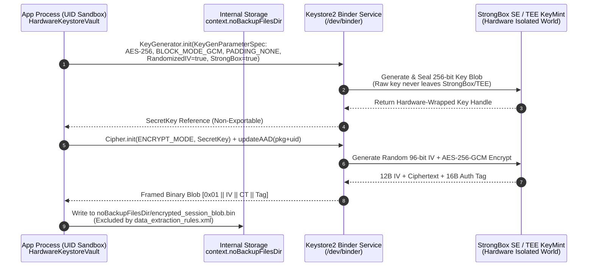
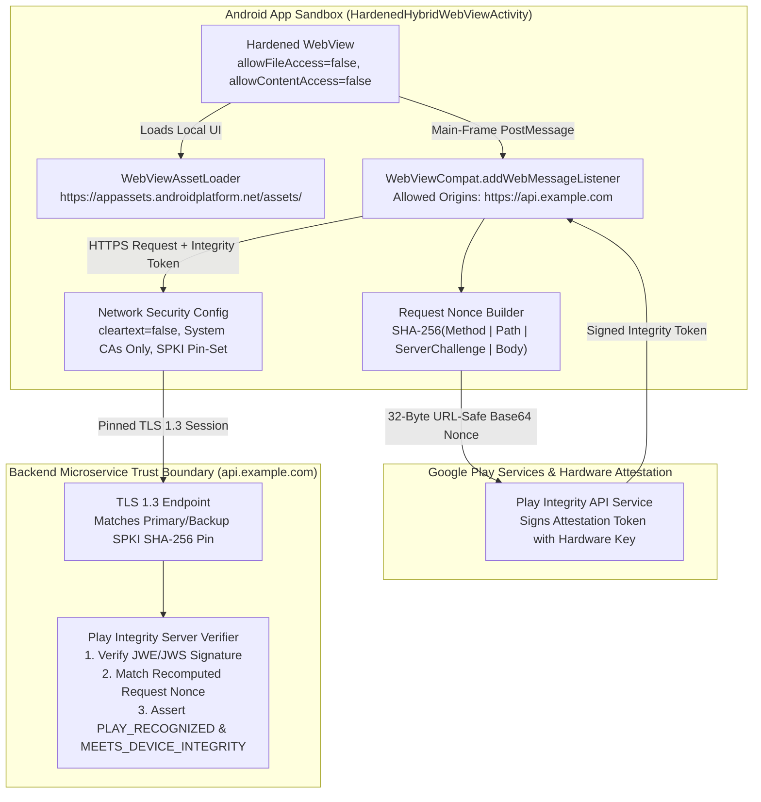
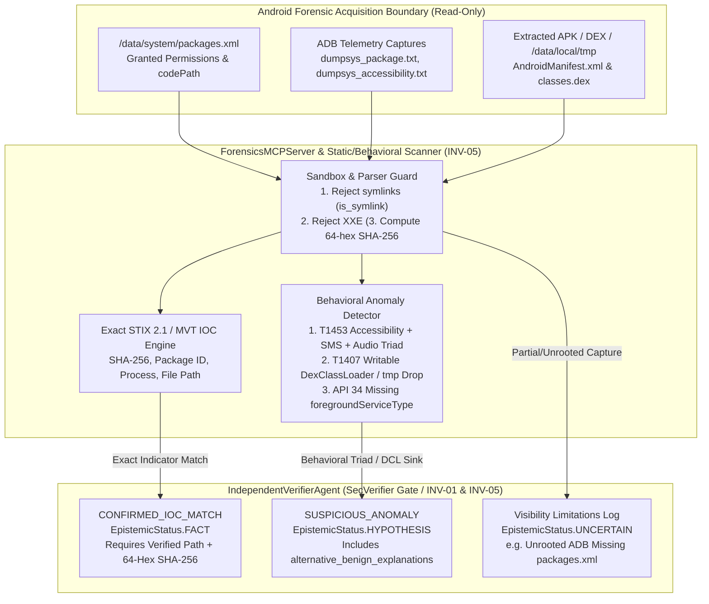

# `platform-core` Domain 3 Training Corpus — Android Security Engineering & Vulnerability Assessment (OWASP MASVS v2 / MASTG Aligned)

**Version:** `1.0.0`  
**Target Platform:** `android`  
**Standards Baseline:** OWASP MASVS v2.1.0, OWASP MASTG v1.7+, Android 12–15 (API 31–35) Security Architecture, MITRE Mobile ATT&CK, `platform-core` Invariants (`INV-01`..`INV-07`)  
**Ground-Truth Verification Oracle:** [`ForensicsMCPServer`](../../src/platform_core/layer2_execution/forensics_mcp.py), [`DefensiveCyberMCPServer`](../../src/platform_core/layer2_execution/mcp_tools.py), [`IndependentVerifierAgent`](../../src/platform_core/layer2_execution/agents.py)

---

## Table of Contents

1. [Corpus Governance, Defensive Posture & Android API Level Evolution Matrix](#1-corpus-governance-defensive-posture--android-api-level-evolution-matrix)
2. [`MOD-AND-01` — Android IPC, Intent Redirection, `PendingIntent` Mutability & Verified App Links](#2-mod-and-01--android-ipc-intent-redirection-pendingintent-mutability--verified-app-links)
3. [`MOD-AND-02` — Android Data Storage, Scoped Storage & Hardware-Backed Keystore (`AES-256-GCM`)](#3-mod-and-02--android-data-storage-scoped-storage--hardware-backed-keystore-aes-256-gcm)
4. [`MOD-AND-03` — WebView Hardening, Network Security Configuration & Certificate Pinning + Play Integrity](#4-mod-and-03--webview-hardening-network-security-configuration--certificate-pinning--play-integrity)
5. [`MOD-AND-04` — Defensive Android Spyware/Malware Behavioral Detection & Lab Triage](#5-mod-and-04--defensive-android-spywaremalware-behavioral-detection--lab-triage)
6. [Cross-Reference to `platform-core` Second Brain & Execution Verification](#6-cross-reference-to-platform-core-second-brain--execution-verification)

---

## 1. Corpus Governance, Defensive Posture & Android API Level Evolution Matrix

This training and evaluation corpus provides high-signal, execution-verifiable instructional modules for **Domain 3: Android Security Engineering & Vulnerability Assessment**. Every module in this document adheres strictly to an **authorized auditing, defensive engineering, and forensic triage posture**:
- All `bad_example` snippets represent vulnerable architectural patterns or high-risk abuse indicators audited by security engineers during static/dynamic code review. No functional exploit payloads, weaponized droppers, or bypass routines are included.
- Every finding emitted during automated or manual forensic triage must obey **Invariant 5 (`INV-05`)** enforced by [`ForensicsMCPServer`](../../src/platform_core/layer2_execution/forensics_mcp.py) and [`IndependentVerifierAgent`](../../src/platform_core/layer2_execution/agents.py): `CONFIRMED_IOC_MATCH` requires an existing `artifact_path` and a verified 64-character lowercase hexadecimal `artifact_sha256` digest, while heuristic detections are classified as `SUSPICIOUS_ANOMALY` with explicit `alternative_benign_explanations` and `visibility_limitations`.
- All repository links comply with **Invariant 6 (`INV-06`)**, using portable repository-relative paths grounded in [`.agents/brain/README.md`](README.md) and [`AGENTS.md`](../../AGENTS.md).

### Mandatory Android OS Version Constraints (API 30 – API 35)

Security controls and vulnerability assessments on modern Android targets must account for platform-enforced behavioral changes across API levels:

| Android Release | API Level | Mandatory Platform Security Enforcement | MASVS / MASTG Control Impact |
| :--- | :--- | :--- | :--- |
| **Android 10 / 11** | `API 29 / 30` | **Scoped Storage Enforcement** (`MANAGE_EXTERNAL_STORAGE` restriction, per-app isolated external directories) and **Package Visibility Filtering** (`<queries>` declaration required for `PackageManager` discovery). | `MASVS-STORAGE-1`, `MASVS-PLATFORM-1` |
| **Android 12** | `API 31` | **Mandatory `PendingIntent` Mutability Flags**: Apps targeting API 31+ must explicitly specify either `PendingIntent.FLAG_IMMUTABLE` or `PendingIntent.FLAG_MUTABLE` (throwing `IllegalArgumentException` if omitted). Exported components with `<intent-filter>` must explicitly declare `android:exported="true|false"`. | `MASVS-PLATFORM-1`, `MASTG-TEST-0028` |
| **Android 13** | `API 33` | **Intent Filter Matching Enforcement & Runtime Notification/Media Permissions**: Non-matching intents sent to exported components of apps targeting API 33+ are blocked if they do not match the declared `<intent-filter>` actions/categories. `Context.registerReceiver()` requires `RECEIVER_EXPORTED` or `RECEIVER_NOT_EXPORTED` (enforced in API 34). | `MASVS-PLATFORM-1`, `MASTG-TEST-0029` |
| **Android 14** | `API 34` | **Read-Only Dynamic Code Loading (DCL) & Mandatory `foregroundServiceType`**: Any dynamically loaded DEX/JAR/SO file via `DexClassLoader` or `PathClassLoader` must be marked read-only (`File.setReadOnly()`) **before** opening or writing completes, otherwise the system throws `SecurityException`. Implicit intents cannot be delivered to internal unexported components, and mutable `PendingIntent` instances require an explicit component or package. Every `<service>` running in the foreground must declare a valid `android:foregroundServiceType` (`camera`, `microphone`, `location`, `dataSync`, etc.) with matching runtime permissions. | `MASVS-RESILIENCE-2`, `MASVS-PLATFORM-1` |
| **Android 15** | `API 35` | **Safer Intents & Background Activity Launch (BAL) Hardening**: Target API 35 enforces `StrictMode` Safer Intents (`VmPolicy.Builder.detectUnsafeIntentLaunch()`), requires explicit opting-in (`ActivityOptions.setPendingIntentCreatorBackgroundActivityStartMode(MODE_BACKGROUND_ACTIVITY_START_ALLOWED)`) to prevent accidental privilege escalation via `PendingIntent` BAL, blocks blank action/category matches on `IntentFilter`, and enforces stricter URI grant validation on `ContentProvider` pathways. | `MASVS-PLATFORM-1`, `CWE-926`, `CWE-940` |

---

## 2. `MOD-AND-01` — Android IPC, Intent Redirection, `PendingIntent` Mutability & Verified App Links

```yaml
module_id: "MOD-AND-01"
domain: "cyber"
target_platform: "android"
standards_and_references:
  - "OWASP MASVS-PLATFORM-1: The app uses IPC mechanisms securely."
  - "OWASP MASTG-TEST-0028: Testing for Sensitive Functionality Exposure Through IPC"
  - "OWASP MASTG-TEST-0029: Testing Deep Links and App Links Verification"
  - "CWE-926: Improper Export of Android Application Components"
  - "CWE-940: Improper Verification of Source of a Communication Channel"
  - "Android 12 (API 31): Mandatory PendingIntent.FLAG_IMMUTABLE / FLAG_MUTABLE"
  - "Android 13 (API 33): Strict Intent-Filter Matching on Exported Targets"
  - "Android 14 (API 34): Restrictions on Implicit Intents & Mutable PendingIntents"
  - "Android 15 (API 35): StrictMode Safer Intents (detectUnsafeIntentLaunch) & Background Activity Launch (BAL) Opt-In"
```

### `core_concepts`

Android Inter-Process Communication (IPC) relies on Binder-mediated `Intent` messages dispatched across `Activity`, `Service`, `BroadcastReceiver`, and `ContentProvider` components. Because any co-resident application running in its own Linux UID sandbox can dispatch an `Intent` to an exported component (`android:exported="true"`) unless gated by a `signature`-level `<permission>`, three primary vulnerability classes emerge in production Android applications:

1. **Intent Redirection (Nested `Intent` Deputy Attack / `CWE-940`)**: When an exported router or proxy `Activity` extracts a parcelable extra (`intent.getParcelableExtra("next_intent", Intent::class.java)`) and passes it directly to `startActivity()`, `startService()`, or `sendBroadcast()`, the attacker inherits the victim application's UID and permissions. An unprivileged caller can pivot into non-exported internal admin activities (`InternalAdminWebViewActivity`) or attach `Intent.FLAG_GRANT_READ_URI_PERMISSION` / `Intent.FLAG_GRANT_WRITE_URI_PERMISSION` pointing to the victim's internal `FileProvider` or SQLite paths, exfiltrating private files via a third-party receiver.
2. **Mutable `PendingIntent` Hijacking (`CWE-926` / API 31–35)**: A `PendingIntent` hands a foreign application (such as the notification manager, an alarm scheduler, or a companion plugin) a capability token to execute an `Intent` with the creator's identity and permissions. If created with `PendingIntent.FLAG_MUTABLE` and an **implicit base `Intent`** (no explicit `ComponentName` or `setPackage()`), a malicious recipient can call `PendingIntent.send(context, code, fillInIntent)` to override the destination component, action, and data URI, escalating privileges or triggering unauthorized Background Activity Launches (BAL). Android 12 (API 31) forces explicit mutability flags; Android 14 (API 34) throws an exception when creating a mutable `PendingIntent` with an implicit intent; and Android 15 (API 35) locks down BAL unless `ActivityOptions.setPendingIntentCreatorBackgroundActivityStartMode()` explicitly permits it and enables `StrictMode.VmPolicy.Builder().detectUnsafeIntentLaunch()` to trap nested unvalidated intent launches.
3. **Unverified Custom Deep-Link Schemes vs. Verified Android App Links (`MASTG-TEST-0029`)**: Custom URI schemes (`myapp://pay?to=attacker&amount=500`) lack cryptographic domain ownership verification. Any co-installed application can declare an identical `<intent-filter>` for `myapp://pay` and intercept OAuth authorization codes or payment callbacks (scheme hijacking). Defensive architecture mandates **Android App Links** (`https://` scheme with `android:autoVerify="true"`), where the Android package manager verifies a server-hosted Digital Asset Links JSON document (`https://<domain>/.well-known/assetlinks.json`) binding the domain to the APK's signing certificate SHA-256 fingerprint, combined with runtime validation via `DomainVerificationManager` (`DomainVerificationUserState.DOMAIN_STATE_VERIFIED`).

### `bad_vs_good_pair`

#### `bad_example` — Vulnerable Exported Router, Nested Intent Redirection, Mutable `PendingIntent` & Custom Scheme

```xml
<!-- BAD AndroidManifest.xml: Over-exported router, custom scheme hijacking, no signature permission -->
<manifest xmlns:android="http://schemas.android.com/apk/res/android"
    package="com.example.fintech">

    <application android:allowBackup="true">
        <!-- 1. Exported proxy activity with unverified custom scheme myapp://pay -->
        <activity
            android:name=".ipc.VulnerableDeepLinkRouterActivity"
            android:exported="true">
            <intent-filter>
                <action android:name="android.intent.action.VIEW" />
                <category android:name="android.intent.category.DEFAULT" />
                <category android:name="android.intent.category.BROWSABLE" />
                <!-- VULNERABLE: Custom URI scheme can be registered by any malicious app on the device -->
                <data android:scheme="myapp" android:host="pay" />
            </intent-filter>
        </activity>

        <!-- 2. Internal sensitive activity (not exported, but reachable via Intent Redirection!) -->
        <activity
            android:name=".internal.InternalWalletAdminActivity"
            android:exported="false" />

        <!-- 3. Exported BroadcastReceiver without android:permission protection -->
        <receiver
            android:name=".ipc.VulnerableSyncReceiver"
            android:exported="true">
            <intent-filter>
                <action android:name="com.example.fintech.ACTION_SYNC_STATUS" />
            </intent-filter>
        </receiver>
    </application>
</manifest>
```

```kotlin
// BAD Kotlin Implementation: VulnerableDeepLinkRouterActivity.kt
package com.example.fintech.ipc

import android.app.Activity
import android.app.PendingIntent
import android.content.Intent
import android.os.Build
import android.os.Bundle

class VulnerableDeepLinkRouterActivity : Activity() {

    override fun onCreate(savedInstanceState: Bundle?) {
        super.onCreate(savedInstanceState)

        // VULNERABILITY 1 (CWE-940 / MASTG-TEST-0028): Direct Intent Redirection!
        // An attacker passes a nested Intent targeting .internal.InternalWalletAdminActivity
        // or attaches FLAG_GRANT_READ_URI_PERMISSION to steal internal FileProvider files.
        @Suppress("DEPRECATION")
        val forwardedIntent: Intent? = if (Build.VERSION.SDK_INT >= Build.VERSION_CODES.TIRAMISU) {
            intent.getParcelableExtra("extra_redirect_intent", Intent::class.java)
        } else {
            intent.getParcelableExtra("extra_redirect_intent")
        }
        if (forwardedIntent != null) {
            startActivity(forwardedIntent) // Confused deputy execution under com.example.fintech UID
        }

        // VULNERABILITY 2 (CWE-926): Mutable PendingIntent wrapping an implicit base Intent.
        // Any recipient of this PendingIntent can call send() with a fillInIntent to hijack destination & URI.
        val baseImplicitIntent = Intent("com.example.fintech.ACTION_COMPLETE_PAYMENT")
        val insecurePendingIntent = PendingIntent.getBroadcast(
            this,
            1001,
            baseImplicitIntent,
            PendingIntent.FLAG_MUTABLE or PendingIntent.FLAG_UPDATE_CURRENT
        )
        intent.putExtra("callback_pi", insecurePendingIntent)

        // VULNERABILITY 3 (MASTG-TEST-0029): Trusting unverified custom deep link parameters directly.
        val dataUri = intent.data
        if (dataUri != null && dataUri.scheme == "myapp" && dataUri.host == "pay") {
            val recipient = dataUri.getQueryParameter("recipient") ?: ""
            val amountCents = dataUri.getQueryParameter("amount")?.toLongOrNull() ?: 0L
            executeAutoTransferWithoutConfirmation(recipient, amountCents)
        }
        finish()
    }

    private fun executeAutoTransferWithoutConfirmation(recipient: String, amountCents: Long) {
        // Sensitive state mutation triggered directly from unverified external deep link
    }
}
```

#### `good_example` — Verified Android App Links, Strict `ComponentName` Allowlist, `FLAG_IMMUTABLE` & Android 15 Safer Intents

```xml
<!-- GOOD AndroidManifest.xml: Signature permission, Verified App Links (autoVerify), non-exported internals -->
<manifest xmlns:android="http://schemas.android.com/apk/res/android"
    package="com.example.fintech">

    <!-- Define a signature-level permission for trusted first-party companion IPC -->
    <permission
        android:name="com.example.fintech.permission.INTERNAL_IPC"
        android:protectionLevel="signature" />

    <application
        android:allowBackup="false"
        android:fullBackupContent="false"
        android:dataExtractionRules="@xml/data_extraction_rules">

        <!-- 1. Verified HTTPS App Link with android:autoVerify="true" -->
        <activity
            android:name=".ipc.HardenedAppLinkRouterActivity"
            android:exported="true"
            android:launchMode="singleTask">
            <intent-filter android:autoVerify="true">
                <action android:name="android.intent.action.VIEW" />
                <category android:name="android.intent.category.DEFAULT" />
                <category android:name="android.intent.category.BROWSABLE" />
                <data
                    android:scheme="https"
                    android:host="pay.example.com"
                    android:pathPrefix="/transfer" />
            </intent-filter>
        </activity>

        <!-- 2. Internal administrative activity remains strictly non-exported -->
        <activity
            android:name=".internal.InternalWalletAdminActivity"
            android:exported="false" />

        <!-- 3. Receiver locked to signature-level permission and explicit export policy -->
        <receiver
            android:name=".ipc.HardenedSyncReceiver"
            android:exported="false"
            android:permission="com.example.fintech.permission.INTERNAL_IPC">
            <intent-filter>
                <action android:name="com.example.fintech.ACTION_SYNC_STATUS" />
            </intent-filter>
        </receiver>
    </application>
</manifest>
```

```json
// Server-Hosted Digital Asset Links: https://pay.example.com/.well-known/assetlinks.json
[
  {
    "relation": ["delegate_permission/common.handle_all_urls"],
    "target": {
      "namespace": "android_app",
      "package_name": "com.example.fintech",
      "sha256_cert_fingerprints": [
        "3A:7F:91:C2:08:B4:5E:19:4D:82:10:AF:66:D3:E0:9C:55:12:4A:8F:B1:70:3D:2E:94:C1:A0:7B:88:11:FE:29"
      ]
    }
  }
]
```

```kotlin
// GOOD Kotlin Implementation: HardenedAppLinkRouterActivity.kt
package com.example.fintech.ipc

import android.app.Activity
import android.app.ActivityOptions
import android.app.PendingIntent
import android.content.ComponentName
import android.content.Intent
import android.content.pm.verify.domain.DomainVerificationManager
import android.content.pm.verify.domain.DomainVerificationUserState
import android.net.Uri
import android.os.Build
import android.os.Bundle
import android.os.StrictMode

class HardenedAppLinkRouterActivity : Activity() {

    companion object {
        private const val TRUSTED_HOST = "pay.example.com"
        private val ALLOWED_DESTINATIONS: Set<ComponentName> = setOf(
            ComponentName("com.example.fintech", "com.example.fintech.ui.PaymentConfirmationActivity"),
            ComponentName("com.example.fintech", "com.example.fintech.ui.ReceiptDetailActivity")
        )
    }

    override fun onCreate(savedInstanceState: Bundle?) {
        enableStrictModeSaferIntents()
        super.onCreate(savedInstanceState)

        // 1. NEVER unparcel and forward arbitrary nested Intents from untrusted callers.
        // Instead, map validated string route keys to an explicit allowlist of ComponentNames.
        val routeTarget = intent.getStringExtra("route_key")
        if (routeTarget != null) {
            dispatchAllowlistedRoute(routeTarget)
            finish()
            return
        }

        // 2. Verify Android App Link domain verification state at runtime (API 31+)
        val uri: Uri? = intent.data
        if (uri != null && isVerifiedAppLink(uri)) {
            val recipientId = uri.getQueryParameter("recipient")?.takeIf { it.matches(Regex("^[A-Za-z0-9_-]{6,32}$")) }
            val amountCents = uri.getQueryParameter("amount")?.toLongOrNull()?.takeIf { it in 1L..100_000_00L }
            if (recipientId != null && amountCents != null) {
                launchInteractiveConfirmation(recipientId, amountCents)
            }
        }
        finish()
    }

    private fun enableStrictModeSaferIntents() {
        // Android 12+ / Android 15 (API 35) StrictMode Safer Intents detection
        if (Build.VERSION.SDK_INT >= Build.VERSION_CODES.S) {
            StrictMode.setVmPolicy(
                StrictMode.VmPolicy.Builder()
                    .detectUnsafeIntentLaunch()
                    .penaltyLog()
                    .build()
            )
        }
    }

    private fun dispatchAllowlistedRoute(routeKey: String) {
        val targetComponent = when (routeKey) {
            "confirm_payment" -> ComponentName(packageName, "com.example.fintech.ui.PaymentConfirmationActivity")
            "view_receipt" -> ComponentName(packageName, "com.example.fintech.ui.ReceiptDetailActivity")
            else -> null
        }
        require(targetComponent != null && targetComponent in ALLOWED_DESTINATIONS) {
            "Rejected unapproved internal navigation route: $routeKey"
        }

        // Construct a fresh Intent with an explicit ComponentName and strip any URI grant flags
        val safeIntent = Intent().apply {
            component = targetComponent
            flags = Intent.FLAG_ACTIVITY_CLEAR_TOP
        }
        safeIntent.removeFlags(
            Intent.FLAG_GRANT_READ_URI_PERMISSION or
                Intent.FLAG_GRANT_WRITE_URI_PERMISSION or
                Intent.FLAG_GRANT_PERSISTABLE_URI_PERMISSION or
                Intent.FLAG_GRANT_PREFIX_URI_PERMISSION
        )
        startActivity(safeIntent)
    }

    private fun isVerifiedAppLink(uri: Uri): Boolean {
        if (uri.scheme != "https" || uri.host != TRUSTED_HOST) return false
        if (Build.VERSION.SDK_INT >= Build.VERSION_CODES.S) {
            val manager = getSystemService(DomainVerificationManager::class.java) ?: return false
            val userState = manager.getDomainVerificationUserState(packageName) ?: return false
            val hostState = userState.hostToStateMap[TRUSTED_HOST]
            return hostState == DomainVerificationUserState.DOMAIN_STATE_VERIFIED
        }
        return true
    }

    private fun launchInteractiveConfirmation(recipientId: String, amountCents: Long) {
        // Always require user interaction in a dedicated confirmation screen; never auto-commit transfers
        val confirmIntent = Intent().apply {
            component = ComponentName(packageName, "com.example.fintech.ui.PaymentConfirmationActivity")
            putExtra("extra_recipient_id", recipientId)
            putExtra("extra_amount_cents", amountCents)
        }
        startActivity(confirmIntent)
    }

    fun createHardenedSyncPendingIntent(): PendingIntent {
        // Explicit ComponentName + FLAG_IMMUTABLE (API 31+) + BAL restriction (API 34/35)
        val explicitIntent = Intent("com.example.fintech.ACTION_SYNC_STATUS").apply {
            component = ComponentName(packageName, "com.example.fintech.ipc.HardenedSyncReceiver")
            setPackage(packageName)
        }
        val optionsBundle: Bundle? = if (Build.VERSION.SDK_INT >= Build.VERSION_CODES.UPSIDE_DOWN_CAKE) {
            ActivityOptions.makeBasic()
                .setPendingIntentCreatorBackgroundActivityStartMode(
                    ActivityOptions.MODE_BACKGROUND_ACTIVITY_START_DENIED
                )
                .toBundle()
        } else {
            null
        }
        return PendingIntent.getBroadcast(
            this,
            2001,
            explicitIntent,
            PendingIntent.FLAG_IMMUTABLE or PendingIntent.FLAG_UPDATE_CURRENT,
            optionsBundle
        )
    }
}
```

### `audit_and_verification_lab`

Perform deterministic static and dynamic verification of `MOD-AND-01` controls using `apkanalyzer`, `jadx`, `adb`, and `pm` on an authorized test emulator or device:

1. **Enumerating Exported Components & Permission Guards (`apkanalyzer` / `aapt2`)**:
   ```bash
   # Extract compiled AndroidManifest.xml and inspect all exported components
   apkanalyzer manifest print app-release.apk | grep -n -C 4 'android:exported="true"'
   ```
   *Pass Criterion*: Every component with `android:exported="true"` either serves an intentional public entry point (`MAIN/LAUNCHER` or verified `https://` App Link) or enforces a `signature`-level `android:permission`.
2. **Static Bytecode Scan for Intent Redirection & Mutable `PendingIntent` Sinks (`jadx` / Semgrep)**:
   - Audit decompiled classes for `getParcelableExtra(..., Intent.class)` or `getExtras().get(...)` flowing into `startActivity`, `startService`, `bindService`, or `sendBroadcast` without explicit `ComponentName` allowlisting and URI permission flag stripping (`removeFlags(Intent.FLAG_GRANT_READ_URI_PERMISSION | Intent.FLAG_GRANT_WRITE_URI_PERMISSION)`).
   - Search for `PendingIntent.getActivity`, `PendingIntent.getBroadcast`, and `PendingIntent.getService` calls lacking `PendingIntent.FLAG_IMMUTABLE` (constant `0x04000000`). Where `FLAG_MUTABLE` (`0x02000000`) is strictly required (e.g., inline notification `RemoteInput` or Bubble APIs), verify that `intent.getComponent()` is non-null.
3. **Dynamic App Link & Digital Asset Links Verification (`adb shell pm`)**:
   ```bash
   # Trigger and inspect Android 12+ (API 31+) Domain Verification status
   adb shell pm verify-app-links --re-verify com.example.fintech
   adb shell pm get-app-links com.example.fintech
   ```
   *Pass Criterion*: Output displays `pay.example.com: verified` (state `1024` / `DOMAIN_STATE_VERIFIED`), and attempting to send a nested parcelable `Intent` extra to `HardenedAppLinkRouterActivity` via `adb shell am start -n com.example.fintech/.ipc.HardenedAppLinkRouterActivity --esa route_key "internal_admin"` is rejected with an `IllegalArgumentException` logged without launching `InternalWalletAdminActivity`.

### `multimodal_specs`

#### `visual_diagram` — Trust Boundary & Android IPC / App Link Verification Architecture

```mermaid
flowchart LR
    subgraph UntrustedZone["Untrusted Sandbox Zone (Third-Party Apps / Browser UID)"]
        CallerApp["Co-Installed App (UID 10245)<br/>Crafts Explicit/Implicit Intent"]
        DeepLinkSource["External Browser / QR Scanner<br/>https://pay.example.com/transfer"]
    end

    subgraph OSBoundary["Android OS Framework & Package Manager (API 31-35)"]
        AMS["ActivityManagerService & Intent Firewall<br/>API 33 Intent-Filter Match + API 35 BAL Gate"]
        DVM["DomainVerificationManager<br/>Verifies /.well-known/assetlinks.json SHA-256"]
    end

    subgraph AppTrustZone["Target App Sandbox (com.example.fintech / UID 10188)"]
        Router["HardenedAppLinkRouterActivity<br/>(android:exported=true, autoVerify=true)"]
        Gate["IPC Validation & Allowlist Gate<br/>1. Reject nested Parcelable Intents<br/>2. Strip FLAG_GRANT_*_URI_PERMISSION<br/>3. Verify DOMAIN_STATE_VERIFIED<br/>4. Enforce ComponentName Allowlist"]
        ConfirmUI["PaymentConfirmationActivity<br/>(android:exported=false, User Confirmation Required)"]
        AdminInternal["InternalWalletAdminActivity<br/>(android:exported=false, Isolated)"]
        ImmPI["Hardened PendingIntent Factory<br/>FLAG_IMMUTABLE + Explicit ComponentName<br/>+ MODE_BACKGROUND_ACTIVITY_START_DENIED"]
    end

    CallerApp -->|"Malicious Nested Intent / Custom Scheme"| AMS
    DeepLinkSource -->|"HTTPS App Link"| DVM
    DVM -->|"Verified Cert SHA-256"| AMS
    AMS -->|"Dispatches Intent"| Router
    Router --> Gate
    Gate -->|"Allowlisted Route + Verified Host"| ConfirmUI
    Gate -.->|"BLOCKED: Unapproved Component / Nested Intent"| AdminInternal
    ConfirmUI --> ImmPI
```



#### `audio_component` — Voice Threat-Modeling Walkthrough (`MOD-AND-01`)

> **Audio Specification**: `16 kHz`, `16-bit mono LPCM WAV`, duration `82s`, peak-normalized `-3.0 dBFS`.  
> **Transcript**:  
> *"Welcome to Module AND-01: Android Inter-Process Communication, Intent Redirection, PendingIntent Mutability, and Verified App Links. When threat-modeling an Android application under OWASP MASVS-PLATFORM-1, always start at the Binder IPC trust boundary. Any component declared with `android:exported="true"` in `AndroidManifest.xml` is reachable by every other app installed on the device, regardless of how few permissions that caller holds. First, check for Intent Redirection: if an exported router Activity extracts a nested `Intent` from its parcelable extras and passes it to `startActivity`, an attacker can pivot into your non-exported internal activities or attach `FLAG_GRANT_READ_URI_PERMISSION` to exfiltrate private files from your internal `FileProvider`. Replace nested Intent forwarding with a strict string-key routing table mapped to an allowlist of explicit `ComponentName` targets, and strip all URI grant flags. Second, enforce `PendingIntent.FLAG_IMMUTABLE` across Android 12 API 31 through Android 15 API 35. Never wrap an implicit base Intent in a mutable `PendingIntent`, and on Android 14 and 15 explicitly set `MODE_BACKGROUND_ACTIVITY_START_DENIED` on `ActivityOptions` to block Background Activity Launch privilege escalation. Finally, eliminate custom URI schemes like `myapp://pay` for sensitive flows; deploy `https://` Android App Links with `android:autoVerify="true"` backed by a signed `/.well-known/assetlinks.json` certificate fingerprint and verify `DomainVerificationUserState.DOMAIN_STATE_VERIFIED` at runtime."*

---

## 3. `MOD-AND-02` — Android Data Storage, Scoped Storage & Hardware-Backed Keystore (`AES-256-GCM`)

```yaml
module_id: "MOD-AND-02"
domain: "cyber"
target_platform: "android"
standards_and_references:
  - "OWASP MASVS-STORAGE-1: The app securely stores sensitive data."
  - "OWASP MASVS-CRYPTO-1: The app employs current strong cryptography."
  - "OWASP MASVS-CRYPTO-2: The app performs key management according to industry best practices."
  - "OWASP MASTG-TEST-0001: Testing Local Storage for Sensitive Data"
  - "OWASP MASTG-TEST-0014: Testing the Configuration of Cryptographic Standard Algorithms"
  - "Android 10+ (API 29-35): Scoped Storage & Cloud/Device-to-Device Backup Exclusion Rules"
  - "Android Keystore System: TEE / StrongBox KeyMint AES-256-GCM & Biometric User Authentication Binding"
```

### `core_concepts`

Mobile applications handle high-value secrets including OAuth 2.0 refresh tokens, session bearer credentials, health/financial PII, and offline cryptographic material. Under OWASP `MASVS-STORAGE-1` and `MASVS-CRYPTO-1/2`, secure storage architecture on Android separates data classification across three layers:

1. **Hardware-Backed Key Isolation (`AndroidKeyStore` TEE & StrongBox KeyMint)**: Cryptographic keys must never exist in application heap memory or be derived from static constants, package names, or `ANDROID_ID`. When a key is generated inside the `"AndroidKeyStore"` provider using `KeyGenParameterSpec.Builder(alias, KeyProperties.PURPOSE_ENCRYPT or KeyProperties.PURPOSE_DECRYPT)`, key material is generated and sealed inside the device's Trusted Execution Environment (TEE) or dedicated **StrongBox Keymaster / KeyMint** tamper-resistant secure element (`setIsStrongBoxBacked(true)` with graceful fallback when `StrongBoxUnavailableException` is thrown). Even if an attacker achieves root execution inside the Android Linux kernel, the raw 256-bit AES key bytes cannot be extracted from `/data/misc/keystore/` without breaking hardware isolation.
2. **Authenticated Encryption (`AES/GCM/NoPadding`) & Randomized IV Enforcement**: Under `MASTG-TEST-0014`, block modes lacking integrity authentication (`AES/ECB/*` or unauthenticated `AES/CBC/PKCS7Padding`) are strictly prohibited due to block replay and padding-oracle vulnerabilities. `AndroidKeyStore` enforces randomized Initialization Vector (IV) generation by default (`setRandomizedEncryptionRequired(true)`), generating a fresh 12-byte (96-bit) nonce per `Cipher.init(Cipher.ENCRYPT_MODE, secretKey)` invocation and producing a 128-bit GCM authentication tag (`GCMParameterSpec(128, iv)`). For high-assurance credentials, `setUserAuthenticationRequired(true)` and `setUserAuthenticationParameters(timeoutSeconds, KeyProperties.AUTH_BIOMETRIC_STRONG or KeyProperties.AUTH_DEVICE_CREDENTIAL)` bind key usage at the hardware gatekeeper level to an active `BiometricPrompt.CryptoObject` session, and `setInvalidatedByBiometricEnrollment(true)` permanently invalidates the key if a new fingerprint or face template is enrolled.
3. **Scoped Storage, Jetpack `DataStore` + Google Tink & Backup Exclusion (`API 29–35`)**: Plaintext `SharedPreferences` writes unencrypted XML files to `/data/data/<pkg>/shared_prefs/*.xml`, and writing files to shared external storage exposes them across app boundaries if Scoped Storage is bypassed. Furthermore, if `android:allowBackup="true"` is left at its default without Android 12+ (`API 31+`) `android:dataExtractionRules` and `android:fullBackupContent`, sensitive internal files can be exfiltrated via `adb backup` or cloud backup sync. Because `androidx.security:security-crypto` (`EncryptedSharedPreferences`) is deprecated in modern Jetpack architectures, current best practice combines an `AndroidKeyStore` master key (`aes256_gcm`) with **Google Tink `AndroidKeysetManager`** and asynchronous, coroutine-safe **Jetpack `DataStore`** stored in `context.noBackupFilesDir`, supplemented by explicit `<data-extraction-rules>` excluding secret directories from both `cloud-backup` and `device-transfer`.

### `bad_vs_good_pair`

#### `bad_example` — Plaintext `SharedPreferences`, Hardcoded AES-ECB Key, Unscoped External File & Backup Leak

```xml
<!-- BAD AndroidManifest.xml: Cloud/ADB backups enabled without dataExtractionRules -->
<manifest xmlns:android="http://schemas.android.com/apk/res/android"
    package="com.example.vault">

    <!-- Legacy broad external storage permissions -->
    <uses-permission android:name="android.permission.WRITE_EXTERNAL_STORAGE" />

    <!-- VULNERABLE: allowBackup="true" exposes /data/data/com.example.vault/shared_prefs/ -->
    <application android:allowBackup="true" />
</manifest>
```

```kotlin
// BAD Kotlin Implementation: InsecureTokenStore.kt
package com.example.vault.storage

import android.annotation.SuppressLint
import android.content.Context
import android.os.Environment
import android.util.Base64
import java.io.File
import javax.crypto.Cipher
import javax.crypto.spec.SecretKeySpec

class InsecureTokenStore(private val context: Context) {

    companion object {
        // VULNERABILITY 1 (MASVS-CRYPTO-2 / MASTG-TEST-0014): Hardcoded static 16-byte AES key in DEX constant pool
        private val HARDCODED_AES_KEY = "0123456789ABCDEF".toByteArray(Charsets.UTF_8)
    }

    @SuppressLint("ApplySharedPref")
    fun saveSessionTokensInsecurely(accessToken: String, refreshToken: String, ssn: String) {
        // VULNERABILITY 2 (MASVS-STORAGE-1 / MASTG-TEST-0001): Plaintext XML in /data/data/<pkg>/shared_prefs/auth.xml
        val prefs = context.getSharedPreferences("auth_tokens", Context.MODE_PRIVATE)
        prefs.edit()
            .putString("oauth_access_token", accessToken)
            .putString("oauth_refresh_token", encryptWithBrokenAesEcb(refreshToken))
            .commit()

        // VULNERABILITY 3 (MASVS-STORAGE-1): Writing sensitive PII to shared external storage
        @Suppress("DEPRECATION")
        val externalDump = File(Environment.getExternalStorageDirectory(), "vault_user_cache.json")
        externalDump.writeText("""{"ssn":"$ssn","refresh":"$refreshToken"}""")
    }

    @SuppressLint("GetInstance")
    private fun encryptWithBrokenAesEcb(plaintext: String): String {
        // VULNERABILITY 4 (MASVS-CRYPTO-1): Deterministic AES/ECB/PKCS5Padding without IV or integrity tag
        val cipher = Cipher.getInstance("AES/ECB/PKCS5Padding")
        val keySpec = SecretKeySpec(HARDCODED_AES_KEY, "AES")
        cipher.init(Cipher.ENCRYPT_MODE, keySpec)
        val ciphertext = cipher.doFinal(plaintext.toByteArray(Charsets.UTF_8))
        return Base64.encodeToString(ciphertext, Base64.NO_WRAP)
    }
}
```

#### `good_example` — Hardware-Backed `AndroidKeyStore` (`AES-256-GCM`, StrongBox Fallback), `noBackupFilesDir` & `data_extraction_rules.xml`

```xml
<!-- GOOD res/xml/data_extraction_rules.xml (Android 12 / API 31+) -->
<?xml version="1.0" encoding="utf-8"?>
<data-extraction-rules>
    <cloud-backup disableIfNoEncryptionCapabilities="true">
        <exclude domain="sharedpref" path="." />
        <exclude domain="file" path="datastore/" />
        <exclude domain="database" path="." />
    </cloud-backup>
    <device-transfer>
        <exclude domain="sharedpref" path="." />
        <exclude domain="file" path="datastore/" />
        <exclude domain="database" path="." />
    </device-transfer>
</data-extraction-rules>
```

```kotlin
// GOOD Kotlin Implementation: HardwareKeystoreVault.kt
package com.example.vault.storage

import android.content.Context
import android.content.pm.PackageManager
import android.os.Build
import android.security.keystore.KeyGenParameterSpec
import android.security.keystore.KeyProperties
import android.security.keystore.StrongBoxUnavailableException
import java.io.File
import java.nio.ByteBuffer
import java.security.KeyStore
import javax.crypto.Cipher
import javax.crypto.KeyGenerator
import javax.crypto.SecretKey
import javax.crypto.spec.GCMParameterSpec

class HardwareKeystoreVault(private val context: Context) {

    companion object {
        private const val ANDROID_KEYSTORE = "AndroidKeyStore"
        private const val KEY_ALIAS = "com.example.vault.master_aes256_gcm_v1"
        private const val TRANSFORMATION = "AES/GCM/NoPadding"
        private const val GCM_IV_LENGTH_BYTES = 12
        private const val GCM_TAG_LENGTH_BITS = 128
        private const val VAULT_FILENAME = "encrypted_session_blob.bin"
    }

    /**
     * Provisions or retrieves a non-exportable 256-bit AES-GCM key inside StrongBox KeyMint
     * (falling back cleanly to hardware TEE if StrongBox is absent on the device).
     */
    fun getOrCreateHardwareKey(requireBiometricAuth: Boolean = false): SecretKey {
        val keyStore = KeyStore.getInstance(ANDROID_KEYSTORE).apply { load(null) }
        val existingEntry = keyStore.getEntry(KEY_ALIAS, null) as? KeyStore.SecretKeyEntry
        if (existingEntry != null) {
            return existingEntry.secretKey
        }

        val hasStrongBox = Build.VERSION.SDK_INT >= Build.VERSION_CODES.P &&
            context.packageManager.hasSystemFeature(PackageManager.FEATURE_STRONGBOX_KEYSTORE)

        return try {
            generateAesGcmKey(useStrongBox = hasStrongBox, requireBiometricAuth = requireBiometricAuth)
        } catch (e: StrongBoxUnavailableException) {
            // Graceful fallback to hardware TEE Keymaster/KeyMint
            generateAesGcmKey(useStrongBox = false, requireBiometricAuth = requireBiometricAuth)
        }
    }

    private fun generateAesGcmKey(useStrongBox: Boolean, requireBiometricAuth: Boolean): SecretKey {
        val keyGenerator = KeyGenerator.getInstance(KeyProperties.KEY_ALGORITHM_AES, ANDROID_KEYSTORE)
        val specBuilder = KeyGenParameterSpec.Builder(
            KEY_ALIAS,
            KeyProperties.PURPOSE_ENCRYPT or KeyProperties.PURPOSE_DECRYPT
        )
            .setKeySize(256)
            .setBlockModes(KeyProperties.BLOCK_MODE_GCM)
            .setEncryptionPaddings(KeyProperties.ENCRYPTION_PADDING_NONE)
            .setRandomizedEncryptionRequired(true)

        if (Build.VERSION.SDK_INT >= Build.VERSION_CODES.P && useStrongBox) {
            specBuilder.setIsStrongBoxBacked(true)
        }

        if (requireBiometricAuth) {
            specBuilder.setUserAuthenticationRequired(true)
            if (Build.VERSION.SDK_INT >= Build.VERSION_CODES.R) {
                specBuilder.setUserAuthenticationParameters(
                    0, // Require authentication on every cryptographic operation
                    KeyProperties.AUTH_BIOMETRIC_STRONG
                )
            }
            if (Build.VERSION.SDK_INT >= Build.VERSION_CODES.N) {
                specBuilder.setInvalidatedByBiometricEnrollment(true)
            }
        }

        keyGenerator.init(specBuilder.build())
        return keyGenerator.generateKey()
    }

    /**
     * Encrypts sensitive payload with hardware-generated 96-bit IV and 128-bit GCM auth tag,
     * binding Associated Authenticated Data (AAD) and persisting only inside context.noBackupFilesDir.
     */
    fun sealAndStoreSecret(plaintextBytes: ByteArray, associatedData: ByteArray) {
        val secretKey = getOrCreateHardwareKey(requireBiometricAuth = false)
        val cipher = Cipher.getInstance(TRANSFORMATION)
        cipher.init(Cipher.ENCRYPT_MODE, secretKey) // Keystore generates a fresh 12-byte random IV
        cipher.updateAAD(associatedData)
        val iv: ByteArray = cipher.iv
        require(iv.size == GCM_IV_LENGTH_BYTES) { "Unexpected GCM IV size: ${iv.size}" }
        val ciphertextWithTag = cipher.doFinal(plaintextBytes)

        // Frame format: [1-byte version = 0x01][12-byte IV][ciphertext + 16-byte GCM tag]
        val framedBuffer = ByteBuffer.allocate(1 + iv.size + ciphertextWithTag.size)
            .put(0x01.toByte())
            .put(iv)
            .put(ciphertextWithTag)
            .array()

        // Store exclusively in noBackupFilesDir so cloud/D2D backups never export the ciphertext file
        val targetFile = File(context.noBackupFilesDir, VAULT_FILENAME)
        targetFile.writeBytes(framedBuffer)
    }

    fun loadAndUnsealSecret(associatedData: ByteArray): ByteArray {
        val targetFile = File(context.noBackupFilesDir, VAULT_FILENAME)
        val raw = targetFile.readBytes()
        require(raw.size > 1 + GCM_IV_LENGTH_BYTES + (GCM_TAG_LENGTH_BITS / 8)) {
            "Truncated or corrupted encrypted vault payload"
        }
        require(raw[0] == 0x01.toByte()) { "Unsupported vault frame version: ${raw[0]}" }

        val iv = raw.copyOfRange(1, 1 + GCM_IV_LENGTH_BYTES)
        val ciphertextWithTag = raw.copyOfRange(1 + GCM_IV_LENGTH_BYTES, raw.size)

        val secretKey = getOrCreateHardwareKey(requireBiometricAuth = false)
        val cipher = Cipher.getInstance(TRANSFORMATION)
        val spec = GCMParameterSpec(GCM_TAG_LENGTH_BITS, iv)
        cipher.init(Cipher.DECRYPT_MODE, secretKey, spec)
        cipher.updateAAD(associatedData)
        return cipher.doFinal(ciphertextWithTag)
    }
}
```

### `audit_and_verification_lab`

Verify storage isolation, backup exclusion, and hardware-backed cryptographic parameters using static and dynamic checks (`MASTG-TEST-0001`, `MASTG-TEST-0014`):

1. **Filesystem & Backup Extraction Audit (`adb shell` / `apkanalyzer`)**:
   ```bash
   # 1. Verify allowBackup="false" and dataExtractionRules presence in compiled manifest
   apkanalyzer manifest print app-release.apk | grep -E "allowBackup|fullBackupContent|dataExtractionRules"

   # 2. On an authorized debug build / rooted test device, trigger token storage and inspect app sandbox
   adb shell run-as com.example.vault ls -la shared_prefs/ files/ no_backup/
   adb shell run-as com.example.vault grep -rnE "eyJ|Bearer|refresh_token|ssn" .
   ```
   *Pass Criterion*: `grep` returns zero plaintext JWTs (`eyJ...`), bearer tokens, or PII across `shared_prefs/`, `databases/`, `cache/`, and external `/sdcard/Android/data/com.example.vault/`. The encrypted blob exists only under `no_backup/encrypted_session_blob.bin`.
2. **Cryptographic Primitive & Finite-Sample Entropy Verification (`platform-core` Invariant 4)**:
   - Audit bytecode for prohibited transformations (`"AES/ECB"`, `"DES"`, `"MD5"`, `"SHA1PRNG"`, static `SecretKeySpec` byte arrays).
   - Extract the sealed payload from `no_backup/encrypted_session_blob.bin` and verify it via `platform-core` CLI (`inspect-data`):
     ```bash
     PYTHONPATH=src .venv/bin/python -m platform_core.cli inspect-data --hex "$(xxd -p -c 256 encrypted_session_blob.bin)"
     ```
     By **Invariant 4 (`INV-04`)**, [`DataAndVisualMCPServer.classify_transformation`](../../src/platform_core/layer2_execution/mcp_tools.py) normalizes Shannon entropy against $\min(8.0, \log_2 N)$ and confirms the ciphertext classifies as `ENCRYPTION` even for short 16B–64B token blocks.
3. **KeyInfo Hardware Attestation Check**:
   - In an instrumentation test, query `SecretKeyFactory.getInstance(secretKey.algorithm, "AndroidKeyStore").getKeySpec(secretKey, KeyInfo::class.java) as KeyInfo` and assert `keyInfo.securityLevel` equals `KeyProperties.SECURITY_LEVEL_STRONGBOX` or `KeyProperties.SECURITY_LEVEL_TRUSTED_ENVIRONMENT` (never `SECURITY_LEVEL_SOFTWARE`).

### `multimodal_specs`

#### `visual_diagram` — Hardware-Backed `AndroidKeyStore` (`StrongBox` / `TEE`) & Scoped Storage Pipeline



#### `audio_component` — Voice Threat-Modeling Walkthrough (`MOD-AND-02`)

> **Audio Specification**: `16 kHz`, `16-bit mono LPCM WAV`, duration `76s`, peak-normalized `-3.0 dBFS`.  
> **Transcript**:  
> *"Welcome to Module AND-02: Android Data Storage, Scoped Storage, and Hardware-Backed Keystore Cryptography. Under OWASP MASVS-STORAGE-1 and MASVS-CRYPTO-1 and 2, storing OAuth tokens or personal data in plaintext `SharedPreferences` or encrypting them with a hardcoded `SecretKeySpec` inside your DEX bytecode fails basic security auditing. Any attacker with backup access or root access on a compromised device can read `/data/data/<package>/shared_prefs/` or decompile the APK with `jadx` to recover static keys. Instead, generate a non-exportable 256-bit AES key inside the `AndroidKeyStore` provider with `KeyProperties.BLOCK_MODE_GCM` and `ENCRYPTION_PADDING_NONE`. Probe for `FEATURE_STRONGBOX_KEYSTORE` on Android 9 and above to seal keys inside a dedicated tamper-resistant StrongBox KeyMint chip, and catch `StrongBoxUnavailableException` to fall back cleanly to the hardware Trusted Execution Environment. Always let the Keystore generate a fresh 12-byte randomized IV for every encryption call, bind context-specific Associated Authenticated Data via `cipher.updateAAD`, and persist the framed ciphertext inside `context.noBackupFilesDir` paired with an Android 12 `data_extraction_rules.xml` policy that excludes credentials from cloud and device-to-device transfers."*

---

## 4. `MOD-AND-03` — WebView Hardening, Network Security Configuration & Certificate Pinning + Play Integrity

```yaml
module_id: "MOD-AND-03"
domain: "cyber"
target_platform: "android"
standards_and_references:
  - "OWASP MASVS-PLATFORM-2: The app uses WebViews securely."
  - "OWASP MASVS-NETWORK-1: The app secures all network traffic according to current best practices."
  - "OWASP MASVS-NETWORK-2: The app performs identity pinning for all remote endpoints under the developer's control."
  - "OWASP MASVS-RESILIENCE-1: The app validates the integrity of the platform."
  - "OWASP MASTG-TEST-0021: Testing Endpoint Identify Verification and Certificate Pinning"
  - "OWASP MASTG-TEST-0031: Testing JavaScript Execution and Java-Bridge Exposure in WebViews"
  - "Google Play Integrity API: Cryptographic Nonce Binding & Server-Side Verdict Verification"
```

### `core_concepts`

Hybrid mobile architectures combine native Kotlin/Java execution with embedded `android.webkit.WebView` instances and HTTPS microservice APIs. Defending this surface requires synchronizing four complementary controls:

1. **WebView Isolation, Local Content Serving & Origin-Bound IPC (`MASVS-PLATFORM-2` / `MASTG-TEST-0031`)**:
   - Enabling `allowFileAccess = true`, `allowFileAccessFromFileURLs = true`, or `allowUniversalAccessFromFileURLs = true` allows an XSS payload or malicious local HTML file loaded via the local `file` URI scheme (`ContentResolver.SCHEME_FILE`) to read arbitrary files inside the app's `/data/data/<pkg>/` directory via `XMLHttpRequest` and exfiltrate them to a remote server. Moreover, if a WebView loads a `content` or `file` scheme URI supplied from an external `Intent`, a malicious app can pass a symlinked path inside its own cache pointing to the victim app's internal database (`symlink` time-of-check/time-of-use exfiltration).
   - **Remediation**: Explicitly disable `allowFileAccess`, `allowContentAccess`, `allowFileAccessFromFileURLs`, and `allowUniversalAccessFromFileURLs`. Serve bundled local assets via `WebViewAssetLoader` under the reserved virtual origin `https://appassets.androidplatform.net/assets/...`. Replace legacy `WebView.addJavascriptInterface()` (which exposes annotated `@JavascriptInterface` methods to **every** frame and origin loaded by the WebView) with `WebViewCompat.addWebMessageListener()`, which enforces an explicit `allowedOriginRules` set (e.g., `setOf("https://api.example.com")`) and rejects sub-frames (`if (!isMainFrame) return`).
2. **Declarative Network Security Configuration & SPKI Pinning (`MASVS-NETWORK-1/2` / `MASTG-TEST-0021`)**:
   - Calling `SslErrorHandler.proceed()` inside `WebViewClient.onReceivedSslError()` or installing a custom `X509TrustManager` with an empty `checkServerTrusted()` completely disables TLS authentication, allowing trivial active Man-in-the-Middle (MITM) interception on public Wi-Fi and triggers automatic Google Play Store rejection.
   - **Remediation**: Configure `android:networkSecurityConfig="@xml/network_security_config"` with `cleartextTrafficPermitted="false"`, trust only `<certificates src="system" />` in production builds, and define an SPKI SHA-256 `<pin-set expiration="YYYY-MM-DD">` containing at least one primary SubjectPublicKeyInfo hash and one offline/backup intermediate CA SPKI hash to prevent bricking clients during leaf certificate rotation.
3. **Server-Verified Play Integrity API Attestation (`MASVS-RESILIENCE-1`)**:
   - Client-side root checks (`File("/system/xbin/su").exists()`) are trivially bypassed using Frida or Magisk Zygisk hooks. Under `MASVS-RESILIENCE-1`, high-value transactions bind a server-issued, single-use cryptographic **nonce** (typically a SHA-256 digest of the canonical request payload plus a server timestamp/challenge) into `IntegrityTokenRequest.builder().setNonce(nonce)`. The signed JWE/JWS token returned by Google Play Services is forwarded to the backend server, which decrypts and verifies the signature and checks `requestDetails.nonce`, `appIntegrity.appRecognitionVerdict == "PLAY_RECOGNIZED"`, `appIntegrity.certificateSha256Digest`, and `deviceIntegrity.deviceRecognitionVerdict` (`MEETS_STRONG_INTEGRITY` or `MEETS_DEVICE_INTEGRITY`).

### `bad_vs_good_pair`

#### `bad_example` — Universal File Access WebView, Unscoped `@JavascriptInterface`, `handler.proceed()` TLS Bypass & Client-Only Root Check

```xml
<!-- BAD AndroidManifest.xml: Cleartext traffic enabled globally -->
<manifest xmlns:android="http://schemas.android.com/apk/res/android"
    package="com.example.hybridbank">
    <uses-permission android:name="android.permission.INTERNET" />
    <application android:usesCleartextTraffic="true" />
</manifest>
```

```kotlin
// BAD Kotlin Implementation: VulnerableHybridWebViewActivity.kt
package com.example.hybridbank.web

import android.annotation.SuppressLint
import android.app.Activity
import android.net.http.SslError
import android.os.Bundle
import android.webkit.JavascriptInterface
import android.webkit.SslErrorHandler
import android.webkit.WebView
import android.webkit.WebViewClient
import java.io.File

class VulnerableHybridWebViewActivity : Activity() {

    @SuppressLint("SetJavaScriptEnabled", "JavascriptInterface")
    override fun onCreate(savedInstanceState: Bundle?) {
        super.onCreate(savedInstanceState)
        val webView = WebView(this)
        setContentView(webView)

        webView.settings.apply {
            javaScriptEnabled = true
            // VULNERABILITY 1 (MASVS-PLATFORM-2): Enables local file-scheme XSS to steal /data/data/<pkg>/ files
            allowFileAccess = true
            @Suppress("DEPRECATION")
            allowFileAccessFromFileURLs = true
            @Suppress("DEPRECATION")
            allowUniversalAccessFromFileURLs = true
        }

        // VULNERABILITY 2 (MASTG-TEST-0031): Exposes NativeBridge to ANY domain the WebView navigates to!
        webView.addJavascriptInterface(InsecureNativeBridge(), "AndroidBridge")

        webView.webViewClient = object : WebViewClient() {
            @SuppressLint("WebViewClientOnReceivedSslError")
            override fun onReceivedSslError(view: WebView?, handler: SslErrorHandler?, error: SslError?) {
                // VULNERABILITY 3 (MASVS-NETWORK-1 / MASTG-TEST-0021): Unconditionally ignores TLS errors (MITM)
                handler?.proceed()
            }
        }

        // VULNERABILITY 4: Loading untrusted URL directly from external Intent without scheme/host validation
        val externalUrl = intent.getStringExtra("target_url") ?: "http://api.example.com/login"
        webView.loadUrl(externalUrl)
    }

    inner class InsecureNativeBridge {
        @JavascriptInterface
        fun getAuthBearerToken(): String {
            // Any third-party page or XSS script can invoke window.AndroidBridge.getAuthBearerToken()
            return "Bearer eyJhbGciOiJIUzI1NiIs..."
        }
    }

    // VULNERABILITY 5 (MASVS-RESILIENCE-1): Trivial client-side root check easily hooked by Frida
    fun isDeviceRootedClientSide(): Boolean = File("/system/xbin/su").exists()
}
```

#### `good_example` — `network_security_config.xml` SPKI Pinning, `WebViewAssetLoader`, Origin-Locked `WebMessageListener` & Nonce-Bound Play Integrity

```xml
<!-- GOOD res/xml/network_security_config.xml -->
<?xml version="1.0" encoding="utf-8"?>
<network-security-config>
    <!-- Block cleartext HTTP across all domains and trust only system CAs -->
    <base-config cleartextTrafficPermitted="false">
        <trust-anchors>
            <certificates src="system" />
        </trust-anchors>
    </base-config>

    <!-- Enforce SPKI SHA-256 Pinning with mandatory backup pin and expiration date -->
    <domain-config cleartextTrafficPermitted="false">
        <domain includeSubdomains="true">api.example.com</domain>
        <pin-set expiration="2027-06-01">
            <!-- Primary Intermediate CA SPKI SHA-256 -->
            <pin digest="SHA-256">YLh1dUR9y6Kja30RrAn7JKnbQG/uEtLMkBgFF2Fuihg=</pin>
            <!-- Backup Offline Root/Intermediate CA SPKI SHA-256 -->
            <pin digest="SHA-256">Vjs8r4z+80wjNcr1YKepWQboSIRi63WsWXhIMN+eWys=</pin>
        </pin-set>
    </domain-config>
</network-security-config>
```

```kotlin
// GOOD Kotlin Implementation: HardenedHybridWebViewActivity.kt
package com.example.hybridbank.web

import android.annotation.SuppressLint
import android.app.Activity
import android.net.Uri
import android.net.http.SslError
import android.os.Bundle
import android.util.Base64
import android.webkit.SslErrorHandler
import android.webkit.WebResourceRequest
import android.webkit.WebResourceResponse
import android.webkit.WebView
import android.webkit.WebViewClient
import androidx.webkit.JavaScriptReplyProxy
import androidx.webkit.WebMessageCompat
import androidx.webkit.WebViewAssetLoader
import androidx.webkit.WebViewCompat
import androidx.webkit.WebViewFeature
import java.security.MessageDigest

class HardenedHybridWebViewActivity : Activity() {

    companion object {
        private val ALLOWED_WEB_ORIGINS = setOf("https://api.example.com", "https://appassets.androidplatform.net")
        private val ALLOWED_HOSTS = setOf("api.example.com", "appassets.androidplatform.net")
    }

    @SuppressLint("SetJavaScriptEnabled")
    override fun onCreate(savedInstanceState: Bundle?) {
        super.onCreate(savedInstanceState)
        val webView = WebView(this)
        setContentView(webView)

        // 1. Lock down WebView settings: disable all local file-scheme and content-scheme access
        webView.settings.apply {
            javaScriptEnabled = true
            allowFileAccess = false
            allowContentAccess = false
            @Suppress("DEPRECATION")
            allowFileAccessFromFileURLs = false
            @Suppress("DEPRECATION")
            allowUniversalAccessFromFileURLs = false
            setSupportMultipleWindows(false)
            javaScriptCanOpenWindowsAutomatically = false
        }
        WebView.setWebContentsDebuggingEnabled(false)

        // 2. Serve local bundled assets over https://appassets.androidplatform.net/assets/
        val assetLoader = WebViewAssetLoader.Builder()
            .addPathHandler("/assets/", WebViewAssetLoader.AssetsPathHandler(this))
            .build()

        // 3. Register origin-restricted WebMessageListener instead of global @JavascriptInterface
        if (WebViewFeature.isFeatureSupported(WebViewFeature.WEB_MESSAGE_LISTENER)) {
            WebViewCompat.addWebMessageListener(
                webView,
                "SecureHostBridge",
                ALLOWED_WEB_ORIGINS
            ) { _: WebView, message: WebMessageCompat, sourceOrigin: Uri, isMainFrame: Boolean, replyProxy: JavaScriptReplyProxy ->
                if (!isMainFrame || sourceOrigin.toString() !in ALLOWED_WEB_ORIGINS) {
                    return@addWebMessageListener
                }
                handleAuthenticatedWebMessage(message.data ?: "", replyProxy)
            }
        }

        // 4. Enforce strict navigation allowlist and fail-closed TLS error handling
        webView.webViewClient = object : WebViewClient() {
            override fun shouldInterceptRequest(view: WebView, request: WebResourceRequest): WebResourceResponse? {
                return assetLoader.shouldInterceptRequest(request.url)
            }

            override fun shouldOverrideUrlLoading(view: WebView, request: WebResourceRequest): Boolean {
                val url = request.url
                // Permit navigation ONLY to HTTPS on explicitly allowlisted hosts
                val isAllowed = url.scheme == "https" && url.host in ALLOWED_HOSTS
                return !isAllowed // Return true to cancel any non-allowlisted navigation
            }

            override fun onReceivedSslError(view: WebView?, handler: SslErrorHandler?, error: SslError?) {
                // Fail closed on any TLS validation or certificate pin failure
                handler?.cancel()
            }
        }

        webView.loadUrl("https://appassets.androidplatform.net/assets/index.html")
    }

    private fun handleAuthenticatedWebMessage(payload: String, replyProxy: JavaScriptReplyProxy) {
        if (payload == "REQUEST_CSRF_NONCE") {
            replyProxy.postMessage("""{"status":"ok"}""")
        }
    }

    /**
     * Computes a deterministic, URL-safe Base64 SHA-256 Play Integrity nonce binding the
     * canonical HTTP action, transaction payload, and server challenge timestamp.
     */
    fun computePlayIntegrityRequestNonce(
        httpMethod: String,
        endpointPath: String,
        requestBodyJson: String,
        serverChallengeId: String
    ): String {
        val canonicalInput = "$httpMethod|$endpointPath|$serverChallengeId|$requestBodyJson"
        val digest = MessageDigest.getInstance("SHA-256").digest(canonicalInput.toByteArray(Charsets.UTF_8))
        return Base64.encodeToString(digest, Base64.URL_SAFE or Base64.NO_WRAP or Base64.NO_PADDING)
    }
}
```

### `audit_and_verification_lab`

Audit WebView isolation, TLS pinning, and Play Integrity attestation (`MASTG-TEST-0021`, `MASTG-TEST-0031`):

1. **Static Inspection of `network_security_config.xml` & WebView Sinks**:
   ```bash
   # Verify networkSecurityConfig attribute and ensure usesCleartextTraffic is not true
   apkanalyzer manifest print app-release.apk | grep -E "networkSecurityConfig|usesCleartextTraffic"

   # Search decompiled bytecode for forbidden SSL bypasses and legacy file-scheme WebView settings
   jadx -d out_jadx app-release.apk
   grep -rnE "onReceivedSslError|allowFileAccessFromFileURLs|allowUniversalAccessFromFileURLs|addJavascriptInterface" out_jadx/
   ```
   *Pass Criterion*: `onReceivedSslError` invokes only `handler.cancel()`, `allowFileAccess` is explicitly `false`, and `WebViewCompat.addWebMessageListener` specifies a strict `Set<String>` of HTTPS origins without wildcards (`"*"`).
2. **Dynamic MITM & SPKI Pin Validation Test (`mitmproxy` / `openssl`)**:
   - Compute the production server's SPKI SHA-256 pin to confirm alignment with `network_security_config.xml`:
     ```bash
     openssl s_client -servername api.example.com -connect api.example.com:443 < /dev/null 2>/dev/null \
       | openssl x509 -pubkey -noout \
       | openssl pkey -pubin -outform der \
       | openssl dgst -sha256 -binary \
       | openssl enc -base64
     ```
   - Route device traffic through an intercepting proxy with a user-installed CA certificate (`mitmproxy`). Confirm that the app rejects the connection with `javax.net.ssl.SSLPeerUnverifiedException` (because `<base-config>` trusts only `<certificates src="system" />` and `<pin-set>` rejects the proxy's SPKI).
3. **Play Integrity Replay & Tamper Check**:
   - Confirm on the backend verifier that modifying 1 byte of `requestBodyJson` after the Play Integrity token is issued causes a mismatch between the recomputed SHA-256 nonce and `tokenPayloadExternal.requestDetails.nonce`, rejecting the transaction with HTTP `403 Forbidden`.

### `multimodal_specs`

#### `visual_diagram` — Origin-Isolated WebView, SPKI Pinning & Play Integrity Attestation Flow



#### `audio_component` — Voice Threat-Modeling Walkthrough (`MOD-AND-03`)

> **Audio Specification**: `16 kHz`, `16-bit mono LPCM WAV`, duration `79s`, peak-normalized `-3.0 dBFS`.  
> **Transcript**:  
> *"Welcome to Module AND-03: WebView Hardening, Network Security Configuration, Certificate Pinning, and Play Integrity Attestation. When auditing hybrid Android apps under OWASP MASVS-PLATFORM-2 and MASVS-NETWORK-1 and 2, three anti-patterns account for the majority of critical findings. First, in WebViews, leaving `allowFileAccess` or `allowFileAccessFromFileURLs` enabled lets an XSS payload or a symlinked external URI read your private SQLite databases and shared preferences. Always set `allowFileAccess` and `allowContentAccess` to `false`, serve local HTML assets through `WebViewAssetLoader` on `https://appassets.androidplatform.net`, and replace global `@JavascriptInterface` bridges with `WebViewCompat.addWebMessageListener` locked to an explicit set of HTTPS origins. Second, never call `handler.proceed()` inside `onReceivedSslError`; configure a declarative `network_security_config.xml` with `cleartextTrafficPermitted="false"`, trust only system CAs in production, and pin at least two SubjectPublicKeyInfo SHA-256 hashes—including an offline backup pin and an expiration date. Finally, under MASVS-RESILIENCE-1, bind high-risk API requests to a server-verified Play Integrity API token whose cryptographic nonce hashes the canonical HTTP method, path, server challenge, and request body."*

---

## 5. `MOD-AND-04` — Defensive Android Spyware/Malware Behavioral Detection & Lab Triage

```yaml
module_id: "MOD-AND-04"
domain: "forensics"
target_platform: "android"
standards_and_references:
  - "OWASP MASVS-RESILIENCE-2: The app implements anti-tampering and runtime integrity defenses."
  - "MITRE Mobile ATT&CK T1453: Abuse Elevation Control Mechanism — Accessibility Features"
  - "MITRE Mobile ATT&CK T1407: Download New Code at Runtime (Dynamic Code Loading)"
  - "MITRE Mobile ATT&CK T1426 / T1629: System Information Discovery & Device Admin Persistence"
  - "Android 14 (API 34): Read-Only Dynamic Code Loading Enforcement (File.setReadOnly()) & Mandatory foregroundServiceType"
  - "platform-core Invariant 5 (INV-05): ForensicsMCPServer Anti-Fabrication & Epistemic Separation (src/platform_core/layer2_execution/forensics_mcp.py)"
```

### `core_concepts`

Defensive mobile threat hunting and forensic acquisition triage examine Android packages (`AndroidManifest.xml`, DEX bytecode constant pools) and system telemetry (`packages.xml`, `dumpsys package`, `dumpsys accessibility`, `/data/local/tmp/`) to identify commercial stalkerware, banking trojans, and mercenary spyware implants (such as Android Predator, Pegasus/Chrysaor, and Graphite) while maintaining strict evidentiary integrity:

1. **Abusive Accessibility Services (`BIND_ACCESSIBILITY_SERVICE` / MITRE `T1453`)**:
   - Legitimate accessibility tools assist users with visual or motor impairments. However, stalkerware and overlay trojans abuse `android.permission.BIND_ACCESSIBILITY_SERVICE` configured with `android:canRetrieveWindowContent="true"`, `flagReportViewIds`, and `typeWindowStateChanged|typeViewTextChanged` to silently scrape 2FA Authenticator codes, read end-to-end encrypted messenger windows, auto-click permission grant dialogs via `AccessibilityNodeInfo.performAction(ACTION_CLICK)`, and prevent the user from opening the Settings app to uninstall the package.
   - As codified in [`ForensicsMCPServer.analyze_android_artifacts`](../../src/platform_core/layer2_execution/forensics_mcp.py) (lines 882–916), any non-system package in `packages.xml` holding the **Stalkerware Permission Triad**—(`BIND_ACCESSIBILITY_SERVICE` or `SYSTEM_ALERT_WINDOW`) combined with `READ_SMS` and `RECORD_AUDIO`—must be flagged as a `SUSPICIOUS_ANOMALY` (`indicator_type="android_permission_triad"`).
2. **Device Administrator Persistence (`BIND_DEVICE_ADMIN`), Stealth Foreground Services & Android 14 (`API 34`) Enforcement**:
   - Abusive apps register a `DeviceAdminReceiver` (`android.permission.BIND_DEVICE_ADMIN`) to block standard uninstallation or invoke `DevicePolicyManager.lockNow()`.
   - Prior to Android 14 (API 34), surveillance implants frequently ran continuous background audio/camera capture inside undeclared foreground services. **Android 14 (API 34)** mandates that every foreground `<service>` declare an explicit `android:foregroundServiceType` (e.g., `microphone`, `camera`, `location`, `mediaProjection`) and hold the corresponding foreground service permission (`FOREGROUND_SERVICE_MICROPHONE`, etc.) plus runtime user consent before `ServiceCompat.startForeground()` succeeds.
3. **Dynamic Code Loading (DCL / MITRE `T1407`) & Android 14 Read-Only Enforcement**:
   - Dropper APKs often ship a minimal benign-looking wrapper to evade Play Protect static scanning and later download and execute secondary `.dex`, `.jar`, or `.so` payloads from writable directories (`/sdcard/`, `getCacheDir()`, or `/data/local/tmp/`) using `dalvik.system.DexClassLoader` or `InMemoryDexClassLoader`.
   - **Android 14 (API 34)** enforces that any file loaded via `DexClassLoader` or `PathClassLoader` must be marked **read-only** (`File.setReadOnly()`) prior to dynamic loading; loading a writable file throws `SecurityException: Writable dex file is not allowed`. Furthermore, packages staged or executed from `/data/local/tmp` in `packages.xml` (`codePath="/data/local/tmp/..."`) or standalone native binaries dropped in `/data/local/tmp/` are high-priority forensic indicators (`indicator_type="tmp_code_path"` and `indicator_type="tmp_binary_drop"` in [`ForensicsMCPServer`](../../src/platform_core/layer2_execution/forensics_mcp.py)).
4. **Forensic Anti-Fabrication & Epistemic Separation (`INV-05`)**:
   - Every defensive scanner in `platform-core` must enforce the three-tier [`ForensicVerdict`](../../src/platform_core/layer2_execution/forensics_mcp.py) taxonomy:
     - `CONFIRMED_IOC_MATCH`: Emitted **only** when a real artifact on disk matches a known threat intelligence indicator (STIX 2.1 / Amnesty MVT SHA-256, domain, process, or package ID) and attaches a verified `artifact_path` and 64-hex `artifact_sha256`.
     - `SUSPICIOUS_ANOMALY`: Emitted for behavioral heuristics (such as the stalkerware permission triad, writable `DexClassLoader` sinks, or `/data/local/tmp` execution) with explicit `alternative_benign_explanations` and `requires_human_verification=True`.
     - `NO_KNOWN_IOC_DETECTED`: Emitted when no indicators match, while preserving `visibility_limitations` (e.g., `"No packages.xml found; unrooted Android backups cannot inspect full system package permissions."`).

### `bad_vs_good_pair`

#### `bad_example` — Audited Stalkerware/Dropper Abuse Signatures (Static Artifact Pattern Examined by Defenders)

```xml
<!-- AUDITED ABUSE ARTIFACT (AndroidManifest.xml pattern detected during defensive triage):
     Combines BIND_ACCESSIBILITY_SERVICE + SYSTEM_ALERT_WINDOW + READ_SMS + RECORD_AUDIO +
     BIND_DEVICE_ADMIN + untyped foreground service -->
<manifest xmlns:android="http://schemas.android.com/apk/res/android"
    package="com.stealth.helper.service">

    <uses-permission android:name="android.permission.BIND_ACCESSIBILITY_SERVICE" />
    <uses-permission android:name="android.permission.SYSTEM_ALERT_WINDOW" />
    <uses-permission android:name="android.permission.READ_SMS" />
    <uses-permission android:name="android.permission.RECORD_AUDIO" />
    <uses-permission android:name="android.permission.RECEIVE_BOOT_COMPLETED" />

    <application android:label="System Service Helper">
        <!-- High-Risk Pattern 1: Accessibility service configured to scrape all window content -->
        <service
            android:name=".ScreenScraperAccessibilityService"
            android:exported="true"
            android:permission="android.permission.BIND_ACCESSIBILITY_SERVICE">
            <intent-filter>
                <action android:name="android.accessibilityservice.AccessibilityService" />
            </intent-filter>
            <meta-data
                android:name="android.accessibilityservice"
                android:resource="@xml/abusive_accessibility_config" />
        </service>

        <!-- High-Risk Pattern 2: Device Admin receiver used to inhibit user uninstallation -->
        <receiver
            android:name=".PersistDeviceAdminReceiver"
            android:exported="true"
            android:permission="android.permission.BIND_DEVICE_ADMIN">
            <meta-data
                android:name="android.app.device_admin"
                android:resource="@xml/device_admin_policies" />
            <intent-filter>
                <action android:name="android.app.action.DEVICE_ADMIN_ENABLED" />
            </intent-filter>
        </receiver>

        <!-- High-Risk Pattern 3 (Violates Android 14 / API 34): Foreground service lacking foregroundServiceType -->
        <service
            android:name=".HiddenAudioCaptureService"
            android:exported="false" />
    </application>
</manifest>
```

```kotlin
// AUDITED ABUSE ARTIFACT (Decompiled DEX pattern inspected during static analysis — DO NOT DEPLOY):
// Demonstrates the writable DexClassLoader sink (MITRE T1407) that violates Android 14 (API 34) DCL rules.
package com.stealth.helper.service

import android.content.Context
import dalvik.system.DexClassLoader
import java.io.File

class UnsafeDynamicPluginLoader(private val context: Context) {
    fun loadExternalWritableDexPattern(): Class<*> {
        // HIGH-RISK SINK (MITRE T1407 / MASVS-RESILIENCE-2):
        // Loading a writable DEX payload from external/cache storage without cryptographic signature
        // verification or File.setReadOnly() (throws SecurityException on Android 14 / API 34+).
        val droppedDex = File(context.externalCacheDir, "update_patch.dex")
        val loader = DexClassLoader(
            droppedDex.absolutePath,
            context.codeCacheDir.absolutePath,
            null,
            context.classLoader
        )
        return loader.loadClass("com.stealth.payload.StageTwoEntry")
    }
}
```

#### `good_example` — Defensive Android Manifest, Bytecode & Acquisition Triage Scanner (`INV-05` Aligned)

```python
"""Defensive Android Manifest, DCL & Acquisition Triage Analyzer (MOD-AND-04).

Aligned with platform_core.layer2_execution.forensics_mcp.ForensicsMCPServer
and Invariant 5 (INV-05): enforces 64-hex SHA-256 evidence chains, XXE rejection,
and strict separation between CONFIRMED_IOC_MATCH and SUSPICIOUS_ANOMALY.
"""

from __future__ import annotations

from dataclasses import dataclass
import hashlib
from pathlib import Path
import re
import xml.etree.ElementTree as ET


ANDROID_NS = "{http://schemas.android.com/apk/res/android}"
SHA256_HEX_RE = re.compile(r"^[0-9a-f]{64}$")
HIGH_SURVEILLANCE_PERMS = frozenset({
    "android.permission.BIND_ACCESSIBILITY_SERVICE",
    "android.permission.SYSTEM_ALERT_WINDOW",
    "android.permission.READ_SMS",
    "android.permission.RECORD_AUDIO",
    "android.permission.BIND_DEVICE_ADMIN",
})
DCL_BYTECODE_SINKS = (
    "Ldalvik/system/DexClassLoader;",
    "Ldalvik/system/InMemoryDexClassLoader;",
    "Ldalvik/system/PathClassLoader;",
    "/data/local/tmp",
)


@dataclass(frozen=True)
class AndroidTriageFinding:
    finding_id: str
    verdict: str  # "CONFIRMED_IOC_MATCH" | "SUSPICIOUS_ANOMALY"
    artifact_path: str
    artifact_sha256: str
    indicator_type: str
    matched_value: str
    rationale: str
    alternative_benign_explanations: tuple[str, ...]
    requires_human_verification: bool = True

    def validate_invariant_5(self) -> None:
        """Enforce platform-core Invariant 5 anti-fabrication guardrails."""
        if not self.artifact_path.strip():
            raise ValueError("INV-05 violation: finding missing real artifact_path")
        if not SHA256_HEX_RE.match(self.artifact_sha256):
            raise ValueError(f"INV-05 violation: invalid 64-hex SHA-256 '{self.artifact_sha256}'")
        if self.verdict == "SUSPICIOUS_ANOMALY" and not self.alternative_benign_explanations:
            raise ValueError("INV-05 violation: SUSPICIOUS_ANOMALY must document benign alternatives")


def compute_file_sha256(path: Path) -> str:
    digest = hashlib.sha256()
    with path.open("rb") as handle:
        for chunk in iter(lambda: handle.read(65536), b""):
            digest.update(chunk)
    return digest.hexdigest()


def audit_android_manifest_and_dex(
    target_dir: Path,
    known_malicious_sha256: dict[str, str] | None = None,
) -> tuple[list[AndroidTriageFinding], list[str]]:
    """Defensively audit extracted APK/acquisition files for stalkerware & DCL indicators."""
    if target_dir.is_symlink():
        raise PermissionError(f"Rejected symlinked target directory: {target_dir}")
    root = target_dir.resolve()
    known_hashes = known_malicious_sha256 or {}
    findings: list[AndroidTriageFinding] = []
    visibility_limitations: list[str] = []

    manifest_path = root / "AndroidManifest.xml"
    if not manifest_path.is_file() or manifest_path.is_symlink():
        visibility_limitations.append("No decoded AndroidManifest.xml present in target directory.")
    else:
        rel_path = str(manifest_path.relative_to(root))
        file_sha = compute_file_sha256(manifest_path)
        raw_xml = manifest_path.read_text(encoding="utf-8", errors="replace")

        # Reject XML External Entity (XXE) / DOCTYPE declarations before parsing
        if "<!ENTITY" in raw_xml or "<!DOCTYPE" in raw_xml:
            visibility_limitations.append(f"Rejected unsafe DOCTYPE/ENTITY in {rel_path}")
        else:
            tree = ET.fromstring(raw_xml)
            pkg_name = tree.attrib.get("package", "unknown.package")
            requested_perms = {
                el.attrib.get(f"{ANDROID_NS}name", "")
                for el in tree.findall(".//uses-permission")
            }

            # Check 1: Stalkerware surveillance permission triad (MITRE T1453)
            has_overlay_or_a11y = (
                "android.permission.BIND_ACCESSIBILITY_SERVICE" in requested_perms
                or "android.permission.SYSTEM_ALERT_WINDOW" in requested_perms
            )
            if (
                has_overlay_or_a11y
                and "android.permission.READ_SMS" in requested_perms
                and "android.permission.RECORD_AUDIO" in requested_perms
            ):
                finding = AndroidTriageFinding(
                    finding_id=f"and-anom-{len(findings) + 1}",
                    verdict="SUSPICIOUS_ANOMALY",
                    artifact_path=rel_path,
                    artifact_sha256=file_sha,
                    indicator_type="stalkerware_permission_triad",
                    matched_value=pkg_name,
                    rationale=(
                        f"Package '{pkg_name}' requests Accessibility/Overlay + READ_SMS + RECORD_AUDIO "
                        "(MITRE Mobile ATT&CK T1453 high-risk surveillance combination)."
                    ),
                    alternative_benign_explanations=(
                        "Authorized screen-reader utility with voice/SMS dictation features (verify developer certificate).",
                    ),
                )
                finding.validate_invariant_5()
                findings.append(finding)

            # Check 2: Android 14 (API 34) undeclared foregroundServiceType on services
            for svc in tree.findall(".//service"):
                svc_name = svc.attrib.get(f"{ANDROID_NS}name", "unknown_service")
                svc_perm = svc.attrib.get(f"{ANDROID_NS}permission", "")
                fgs_type = svc.attrib.get(f"{ANDROID_NS}foregroundServiceType")
                if svc_perm == "android.permission.BIND_ACCESSIBILITY_SERVICE":
                    finding = AndroidTriageFinding(
                        finding_id=f"and-anom-{len(findings) + 1}",
                        verdict="SUSPICIOUS_ANOMALY",
                        artifact_path=rel_path,
                        artifact_sha256=file_sha,
                        indicator_type="accessibility_service_binding",
                        matched_value=f"{pkg_name}/{svc_name}",
                        rationale="Service binds BIND_ACCESSIBILITY_SERVICE capable of UI tree inspection.",
                        alternative_benign_explanations=(
                            "Legitimate assistive technology service declared by accessibility suite.",
                        ),
                    )
                    finding.validate_invariant_5()
                    findings.append(finding)
                if fgs_type is None and "AudioCapture" in svc_name:
                    finding = AndroidTriageFinding(
                        finding_id=f"and-anom-{len(findings) + 1}",
                        verdict="SUSPICIOUS_ANOMALY",
                        artifact_path=rel_path,
                        artifact_sha256=file_sha,
                        indicator_type="missing_api34_foreground_service_type",
                        matched_value=f"{pkg_name}/{svc_name}",
                        rationale="Media/capture service omits mandatory Android 14 (API 34) android:foregroundServiceType.",
                        alternative_benign_explanations=(
                            "Legacy bound background service that never invokes startForeground().",
                        ),
                    )
                    finding.validate_invariant_5()
                    findings.append(finding)

    # Check 3: Scan DEX / Smali files for exact IOC hashes and Dynamic Code Loading (T1407) sinks
    for candidate in sorted(root.rglob("*")):
        if not candidate.is_file() or candidate.is_symlink():
            continue
        rel = str(candidate.relative_to(root))
        fsha = compute_file_sha256(candidate)

        if fsha in known_hashes:
            finding = AndroidTriageFinding(
                finding_id=f"and-ioc-{len(findings) + 1}",
                verdict="CONFIRMED_IOC_MATCH",
                artifact_path=rel,
                artifact_sha256=fsha,
                indicator_type="sha256",
                matched_value=fsha,
                rationale=f"Exact SHA-256 match against verified threat indicator: {known_hashes[fsha]}",
                alternative_benign_explanations=(),
            )
            finding.validate_invariant_5()
            findings.append(finding)

        if candidate.suffix.lower() in {".dex", ".smali", ".kt", ".java"}:
            raw_text = candidate.read_bytes().decode("latin-1", errors="ignore")
            for sink in DCL_BYTECODE_SINKS:
                if sink in raw_text and "setReadOnly" not in raw_text:
                    finding = AndroidTriageFinding(
                        finding_id=f"and-anom-{len(findings) + 1}",
                        verdict="SUSPICIOUS_ANOMALY",
                        artifact_path=rel,
                        artifact_sha256=fsha,
                        indicator_type="unhardened_dynamic_code_loading",
                        matched_value=sink,
                        rationale=(
                            f"Detected dynamic code loader or staging reference '{sink}' without "
                            "Android 14 (API 34) File.setReadOnly() enforcement (MITRE T1407)."
                        ),
                        alternative_benign_explanations=(
                            "First-party modular feature split or hotfix framework (verify code signing & read-only permissions).",
                        ),
                    )
                    finding.validate_invariant_5()
                    findings.append(finding)

    return findings, visibility_limitations
```

### `audit_and_verification_lab`

Execute a full non-destructive Android forensic and behavioral triage workflow using `adb` and `platform-core` CLI (`scan-forensics`):

1. **Non-Destructive Device Telemetry Acquisition (`adb shell dumpsys`)**:
   ```bash
   mkdir -p /tmp/android_forensic_capture
   adb shell dumpsys package > /tmp/android_forensic_capture/dumpsys_package.txt
   adb shell dumpsys accessibility > /tmp/android_forensic_capture/dumpsys_accessibility.txt
   adb shell dumpsys device_policy > /tmp/android_forensic_capture/dumpsys_device_policy.txt
   adb shell pm list packages -f -3 > /tmp/android_forensic_capture/packages.list
   ```
   *(If inspecting an authorized rooted test image or full filesystem extraction, also copy `/data/system/packages.xml` into the capture directory.)*
2. **Automated `ForensicsMCPServer` Triage & Invariant 5 Verification**:
   Run the `platform-core` forensic scanner against the acquisition directory:
   ```bash
   PYTHONPATH=src .venv/bin/python -m platform_core.cli scan-forensics \
     --target-dir /tmp/android_forensic_capture \
     --platform android
   ```
   *Verification Checks*:
   - Confirm `platform` is `"android"` and every finding in `findings` carries a real relative `artifact_path` and a 64-character hex `artifact_sha256`.
   - Confirm that any package in `packages.xml` holding `(BIND_ACCESSIBILITY_SERVICE | SYSTEM_ALERT_WINDOW) + READ_SMS + RECORD_AUDIO` produces a `SUSPICIOUS_ANOMALY` finding (`indicator_type="android_permission_triad"`) with `requires_human_verification=True` and populated `alternative_benign_explanations`.
   - Confirm that if `packages.xml` is absent (standard on unrooted ADB acquisitions), `visibility_limitations` explicitly reports: `"No packages.xml found; unrooted Android backups cannot inspect full system package permissions."`
   - Confirm via [`IndependentVerifierAgent`](../../src/platform_core/layer2_execution/agents.py) that `PlatformState.epistemic_assessment` separates `FACT` (verified file SHA-256 digests and exact STIX/MVT IOC hits) from `HYPOTHESIS` (heuristic permission triad anomalies) and `UNCERTAIN` (uninspected kernel/root partitions).

### `multimodal_specs`

#### `visual_diagram` — Defensive Android Spyware Triage & `INV-05` Epistemic Verification Pipeline



#### `audio_component` — Voice Threat-Modeling Walkthrough (`MOD-AND-04`)

> **Audio Specification**: `16 kHz`, `16-bit mono LPCM WAV`, duration `86s`, peak-normalized `-3.0 dBFS`.  
> **Transcript**:  
> *"Welcome to Module AND-04: Defensive Android Spyware and Malware Behavioral Detection and Lab Triage. When triaging an Android device or APK for commercial stalkerware or mercenary spyware implants such as Predator or Pegasus, defenders combine static bytecode auditing with `ForensicsMCPServer` acquisition analysis. First, examine `AndroidManifest.xml` and `/data/system/packages.xml` for MITRE Mobile ATT&CK T1453 Accessibility abuse: a non-system package holding `BIND_ACCESSIBILITY_SERVICE` or `SYSTEM_ALERT_WINDOW` alongside `READ_SMS` and `RECORD_AUDIO` forms the classic surveillance permission triad capable of scraping two-factor codes and encrypted chat screens. Second, audit services and dynamic loaders against Android 14 API 34 platform rules: any foreground service capturing audio or location must declare an explicit `android:foregroundServiceType`, and any `DexClassLoader` or `PathClassLoader` invocation under MITRE T1407 must mark its target file read-only via `File.setReadOnly()` before loading—or else Android 14 throws a `SecurityException`. Also flag any package or ELF binary staged inside `/data/local/tmp/`. Finally, enforce `platform-core` Invariant 5: never emit a `CONFIRMED_IOC_MATCH` without a real file path and a verified 64-character SHA-256 hash, classify heuristic permission triads as `SUSPICIOUS_ANOMALY` with documented benign alternatives, and explicitly record visibility limitations whenever an unrooted ADB backup lacks `packages.xml`."*

---

## 6. Cross-Reference to `platform-core` Second Brain & Execution Verification

| Module ID | Domain | OWASP MASVS / MASTG Controls | Linked `platform-core` Implementation & Verification Oracles |
| :--- | :--- | :--- | :--- |
| **`MOD-AND-01`** | `cyber` | `MASVS-PLATFORM-1`, `MASTG-TEST-0028`, `MASTG-TEST-0029`, `CWE-926`, `CWE-940` | [`DefensiveCyberMCPServer`](../../src/platform_core/layer2_execution/mcp_tools.py), [`IndependentVerifierAgent`](../../src/platform_core/layer2_execution/agents.py), [`.agents/brain/domain-playbooks-and-invariants.md`](domain-playbooks-and-invariants.md) |
| **`MOD-AND-02`** | `cyber` | `MASVS-STORAGE-1`, `MASVS-CRYPTO-1`, `MASVS-CRYPTO-2`, `MASTG-TEST-0001`, `MASTG-TEST-0014` | [`DataAndVisualMCPServer.classify_transformation`](../../src/platform_core/layer2_execution/mcp_tools.py) (`INV-04`), [`VulnIntelMCPServer`](../../src/platform_core/layer2_execution/vuln_intel_mcp.py) |
| **`MOD-AND-03`** | `cyber` | `MASVS-PLATFORM-2`, `MASVS-NETWORK-1`, `MASVS-NETWORK-2`, `MASVS-RESILIENCE-1`, `MASTG-TEST-0021`, `MASTG-TEST-0031` | [`DefensiveCyberAgent`](../../src/platform_core/layer2_execution/agents.py), [`ExecutionLifecycleOrchestrator`](../../src/platform_core/layer2_execution/orchestrator.py) (`INV-02` `TAINTED_UNTRUSTED`) |
| **`MOD-AND-04`** | `forensics` | `MASVS-RESILIENCE-2`, MITRE `T1453`, `T1407`, Android 14 DCL Read-Only, `INV-05` | [`ForensicsMCPServer.analyze_android_artifacts`](../../src/platform_core/layer2_execution/forensics_mcp.py), [`tests/test_forensics_mcp.py`](../../tests/test_forensics_spyware.py) |
