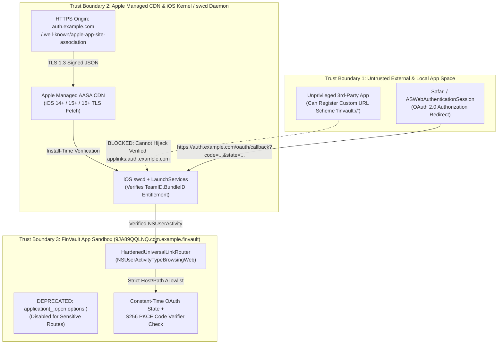
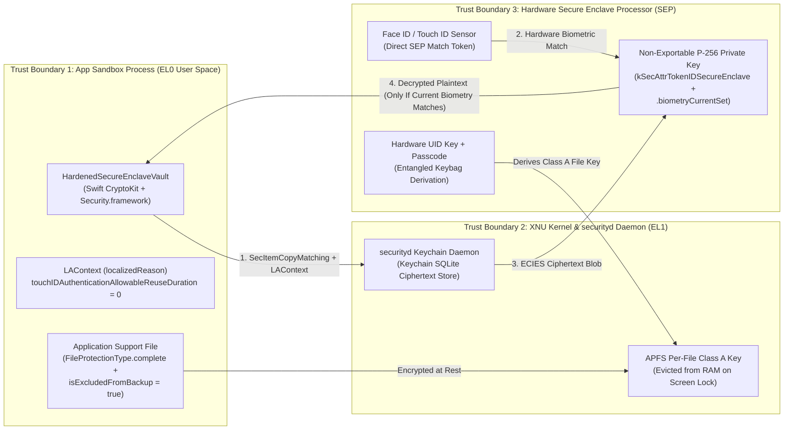
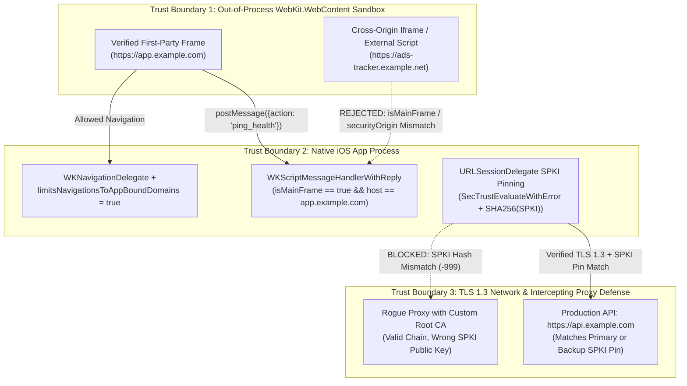
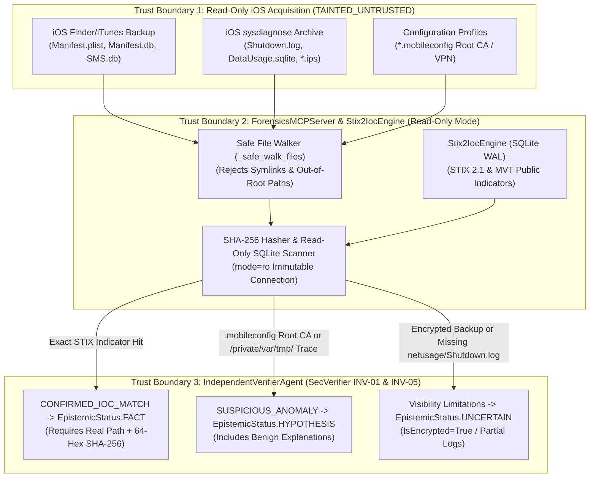

# `platform-core` Project Brain — Domain 4: iOS Security Engineering & Vulnerability Assessment Corpus (OWASP MASVS v2 / MASTG & Apple Platform Security Aligned)

**Version:** `1.0.0`  
**Last Synchronized:** 2026-11-19  
**Target Platform:** `ios` (`iOS 14+`, `iOS 15/16+`, `iOS 17/18+`)  
**Standards Alignment:** OWASP MASVS v2.1.0, OWASP MASTG, Apple Platform Security Guide (Spring 2024 / Fall 2024), NIST SP 800-63B, RFC 7636 (OAuth 2.0 PKCE), RFC 7469 / SPKI Pinning, STIX 2.1, and `platform-core` Architectural Invariants (`INV-01`..`INV-07`).  
**Posture:** Strictly defensive security engineering, static/dynamic compliance verification, and non-destructive forensic artifact triage.

---

## Table of Contents

1. [Executive Scope & iOS Version Constraint Matrix](#1-executive-scope--ios-version-constraint-matrix)
2. [`MOD-IOS-01` — iOS IPC, Custom URL Scheme Hijacking vs. Verified Universal Links (`apple-app-site-association`)](#2-mod-ios-01--ios-ipc-custom-url-scheme-hijacking-vs-verified-universal-links-apple-app-site-association)
3. [`MOD-IOS-02` — iOS Data Storage, Keychain Services, Secure Enclave Biometrics & Data Protection Classes](#3-mod-ios-02--ios-data-storage-keychain-services-secure-enclave-biometrics--data-protection-classes)
4. [`MOD-IOS-03` — `WKWebView` Hardening, App Transport Security (ATS) & `URLSession` SPKI Public-Key Pinning](#4-mod-ios-03--wkwebview-hardening-app-transport-security-ats--urlsession-spki-public-key-pinning)
5. [`MOD-IOS-04` — Defensive iOS Spyware/Malware Behavioral & Forensic Artifact Triage](#5-mod-ios-04--defensive-ios-spywaremalware-behavioral--forensic-artifact-triage)
6. [Cross-Reference to `platform-core` Brain & Verification Invariants](#6-cross-reference-to-platform-core-brain--verification-invariants)

---

## 1. Executive Scope & iOS Version Constraint Matrix

This corpus file curates four production-grade iOS security engineering and forensic triage training modules for the [`platform-core` Project Brain](README.md). Every module is structured according to the canonical `<output_format>` specification (`module_id`, `domain`, `target_platform`, `standards_and_references`, `core_concepts`, `bad_vs_good_pair`, `audit_and_verification_lab`, and `multimodal_specs`) so it can be directly indexed by [`ProjectBrainEngine`](../../src/platform_core/layer3_evolution/brain_engine.py), [`HybridKnowledgeStore`](../../src/platform_core/layer3_evolution/memory.py), and [`ForensicsMCPServer`](../../src/platform_core/layer2_execution/forensics_mcp.py).

### Mandatory iOS OS Version Security & Privacy Evolution Matrix

| iOS Release Gate | Architectural Enforcement & API Changes | Security & Audit Implications |
| :--- | :--- | :--- |
| **`iOS 14+`** | **Local Network Privacy & Pasteboard Transparency Banners**: Mandatory `NSLocalNetworkUsageDescription` and `NSBonjourServices` declarations in `Info.plist` for multicast/local LAN discovery; OS-enforced system toast notification whenever an app reads cross-app `UIPasteboard.general` contents (`UIPasteboard.withDetectionPatterns` introduced for non-reading pattern checks). | Passing OAuth tokens or secrets via `UIPasteboard` triggers user-visible pasteboard banners and exposes credentials to any foregrounded app; inter-app state must use Universal Links or App Groups (`com.apple.security.application-groups`) restricted by Team ID. |
| **`iOS 15 / iOS 16+`** | **Passkeys (FIDO2 / WebAuthn), Managed Associated Domains CDN & Developer Mode Gate**: `ASAuthorizationPlatformPublicKeyCredentialProvider` enables phishing-resistant Passkeys synced via iCloud Keychain with Secure Enclave biometric binding; `applinks:` Associated Domains default to Apple's Managed CDN (`apple-app-site-association` fetched by Apple edge servers); **`iOS 16+` Developer Mode (`AMFI` kernel gate)** blocks local `debugserver`, Instruments, and ad-hoc/development-signed code execution unless explicitly toggled in `Settings -> Privacy & Security -> Developer Mode` with a device reboot. | Custom URL schemes (`myapp://`) remain unauthenticated even on `iOS 16+`; Universal Links with `applinks:` and Passkeys eliminate scheme collision. Dynamic MASTG instrumentation requires authorized test devices with Developer Mode enabled. |
| **`iOS 17 / iOS 18+`** | **Mandatory Privacy Manifests (`PrivacyInfo.xcprivacy`), Required Reason APIs & Code-Signed `XCFrameworks`**: App Store Connect enforces `PrivacyInfo.xcprivacy` property lists declaring `NSPrivacyTracking`, `NSPrivacyTrackingDomains`, `NSPrivacyCollectedDataTypes`, and `NSPrivacyAccessedAPICategories` with approved reason codes (e.g., `NSPrivacyAccessedAPICategoryUserDefaults` reason `CA92.1`, `NSPrivacyAccessedAPICategoryFileTimestamp` reason `C617.1`, `NSPrivacyAccessedAPICategorySystemBootTime` reason `35F9.1`, `NSPrivacyAccessedAPICategoryDiskSpace` reason `E174.1`). Third-party binary SDK `.xcframework` bundles must carry valid Apple cryptographic code signatures verified at build time. | Using `UserDefaults` for sensitive tokens violates both `MASVS-STORAGE-1` (plaintext plist on disk) and `iOS 17/18+` Required Reason API governance if undeclared or abused for fingerprinting. Unsigned or tampered third-party `XCFrameworks` fail supply-chain verification. |

---

## 2. `MOD-IOS-01` — iOS IPC, Custom URL Scheme Hijacking vs. Verified Universal Links (`apple-app-site-association`)

### Structured `<output_format>` Specification (`MOD-IOS-01`)

- **`module_id`**: `"MOD-IOS-01"`
- **`domain`**: `"cyber"`
- **`target_platform`**: `"ios"`
- **`standards_and_references`**:
  - `OWASP MASVS-PLATFORM-1` (The app uses IPC mechanisms securely)
  - `OWASP MASTG-TEST-0075` (Testing Custom URL Schemes)
  - `OWASP MASTG-TEST-0076` (Testing Universal Links)
  - `CWE-939` (Improper Authorization in Handler for Custom URL Scheme)
  - `RFC 7636` (Proof Key for Code Exchange by OAuth Public Clients — PKCE)
  - `Apple Developer Documentation: Supporting Associated Domains & Universal Links (applinks:)`
  - `iOS 14+` (`UIPasteboard` transparency banners), `iOS 15/16+` (Apple Managed CDN for `apple-app-site-association` & Passkeys), `iOS 17/18+` (`PrivacyInfo.xcprivacy` & strict `components` array matching in AASA v2)

### `core_concepts`

On iOS, Inter-Process Communication (IPC) and deep-linking rely primarily on either **Custom URL Schemes** (`CFBundleURLTypes` / `CFBundleURLSchemes` in `Info.plist`) or **Universal Links** backed by the **Associated Domains Entitlement** (`com.apple.developer.associated-domains`).

1. **Why Custom URL Schemes (`myapp://`) Are Inherently Unauthenticated (`CWE-939`)**:
   - Any application installed on an iOS device can declare arbitrary `CFBundleURLSchemes` in its `Info.plist` (e.g., `myapp`, `com.example.oauth`). iOS does not enforce cryptographic ownership over custom schemes across third-party apps in the App Store or enterprise sideloads.
   - When multiple applications register the same custom scheme, the iOS `LaunchServices` daemon resolves the handler non-deterministically (historically influenced by installation order or bundle ID ordering). This enables **Custom URL Scheme Hijacking (Scheme Squatting)**: a malicious app registers `myapp://oauth/callback` and intercepts OAuth 2.0 authorization codes, magic login links, or state-changing deep-link invocations.
   - Furthermore, the `UIApplicationDelegate` callback `application(_:open:options:)` (or `UISceneDelegate.scene(_:openURLContexts:)`) frequently receives `options[.sourceApplication] == nil` when triggered from `SFSafariViewController`, `ASWebAuthenticationSession`, or Universal Link fallbacks, making caller bundle-ID checks unreliable as an authentication boundary.

2. **Cryptographic Domain Binding via Universal Links & `apple-app-site-association` (AASA)**:
   - Universal Links replace unverified custom schemes with standard `https://` URLs cryptographically bound to a specific Apple Developer Team ID (`$(AppIdentifierPrefix)`) and Bundle Identifier (`<TeamID>.<BundleID>`).
   - At app installation time (fetching via Apple's Managed AASA CDN on `iOS 14+` / `iOS 15/16+`), the `swcd` (Shared Web Credentials Daemon) downloads `https://<domain>/.well-known/apple-app-site-association` over strict TLS (no redirects allowed) and verifies that the server explicitly authorizes the app's code-signed `applinks:<domain>` entitlement.
   - Modern AASA v2 files (`iOS 15/16/17/18+`) use the `applinks.details[].components` array to enforce positive path, query, and fragment allowlists (and `"exclude": true` rules for non-app paths) at the OS daemon level before `NSUserActivity` (`NSUserActivityTypeBrowsingWeb`) ever reaches the app process.

3. **Defense-in-Depth for OAuth & Deep-Link Handlers**:
   - Even with Universal Links, incoming URLs represent untrusted external input (`MASVS-PLATFORM-1`). The receiving `UISceneDelegate` / `UIApplicationDelegate` must validate `userActivity.activityType == NSUserActivityTypeBrowsingWeb`, parse `userActivity.webpageURL` via `URLComponents`, enforce an explicit `https` host and path allowlist, reject unexpected query parameters or path traversal segments (`..`), and bind OAuth callbacks to a single-use cryptographic `state` nonce and `S256` PKCE `code_verifier` stored in ephemeral memory or hardware-backed Keychain (`ASWebAuthenticationSession` with `callbackURLScheme` replaced by `ASWebAuthenticationSession.Callback.https(host:path:)` on `iOS 17.4+`).

### `bad_vs_good_pair`

#### `bad_example` — Vulnerable Custom URL Scheme Registration & Unvalidated Deep-Link Parameter Execution (`CWE-939` / `MASTG-TEST-0075`)

```xml
<!-- BAD EXAMPLE: Info.plist registering an unauthenticated custom URL scheme "finvault" -->
<?xml version="1.0" encoding="UTF-8"?>
<!DOCTYPE plist PUBLIC "-//Apple//DTD PLIST 1.0//EN" "http://www.apple.com/DTDs/PropertyList-1.0.dtd">
<plist version="1.0">
<dict>
    <key>CFBundleIdentifier</key>
    <string>com.example.finvault</string>
    <key>CFBundleURLTypes</key>
    <array>
        <dict>
            <key>CFBundleURLName</key>
            <string>com.example.finvault.deeplink</string>
            <key>CFBundleRole</key>
            <string>Editor</string>
            <key>CFBundleURLSchemes</key>
            <array>
                <!-- Any other app can register "finvault://" and hijack callbacks -->
                <string>finvault</string>
            </array>
        </dict>
    </array>
</dict>
</plist>
```

```swift
// BAD EXAMPLE: Vulnerable AppDelegate / SceneDelegate blindly trusting custom URL scheme parameters
import UIKit

final class VulnerableDeepLinkAppDelegate: UIResponder, UIApplicationDelegate {

    // VIOLATION 1 (MASVS-PLATFORM-1 / CWE-939): Custom URL scheme "finvault://" can be
    // squatted by another installed app to intercept OAuth codes or invoked by any web page.
    func application(
        _ app: UIApplication,
        open url: URL,
        options: [UIApplication.OpenURLOptionsKey: Any] = [:]
    ) -> Bool {
        guard url.scheme?.lowercased() == "finvault",
              let components = URLComponents(url: url, resolvingAgainstBaseURL: false) else {
            return false
        }

        let params = Dictionary(
            uniqueKeysWithValues: (components.queryItems ?? []).compactMap { item in
                item.value.map { (item.name, $0) }
            }
        )

        // VIOLATION 2: No OAuth state/PKCE verification; accepts bearer token directly in URL query!
        if url.host == "oauth-callback", let rawToken = params["access_token"] {
            // VIOLATION 3 (iOS 14+ / MASVS-STORAGE-1): Writing sensitive token to UIPasteboard
            // triggers iOS 14+ pasteboard banner and leaks credentials to any foreground app.
            UIPasteboard.general.string = rawToken
            UserDefaults.standard.set(rawToken, forKey: "session_jwt")
            return true
        }

        // VIOLATION 4: Unvalidated redirect_url parameter allows open-redirect / internal WebView SSRF
        if url.host == "transfer",
           let amountStr = params["amount"],
           let recipient = params["to"],
           let autoConfirm = params["auto_confirm"],
           autoConfirm == "true" {
            // Triggers state-changing wire transfer directly from an unauthenticated URL scheme!
            LegacyTransferService.shared.executeImmediateTransfer(
                to: recipient,
                amount: Decimal(string: amountStr) ?? 0
            )
            return true
        }

        return false
    }
}
```

#### `good_example` — Signed Entitlement, AASA v2 Configuration, `PrivacyInfo.xcprivacy` & Verified Universal Link + PKCE Handler (`MASTG-TEST-0076`)

```xml
<!-- GOOD EXAMPLE 1: FinVault.entitlements (Cryptographically bound to Apple Team ID) -->
<?xml version="1.0" encoding="UTF-8"?>
<!DOCTYPE plist PUBLIC "-//Apple//DTD PLIST 1.0//EN" "http://www.apple.com/DTDs/PropertyList-1.0.dtd">
<plist version="1.0">
<dict>
    <key>com.apple.developer.associated-domains</key>
    <array>
        <string>applinks:auth.example.com</string>
        <string>webcredentials:auth.example.com</string>
    </array>
</dict>
</plist>
```

```json
{
  "applinks": {
    "details": [
      {
        "appIDs": [
          "9JA89QQLNQ.com.example.finvault"
        ],
        "components": [
          {
            "/": "/oauth/callback",
            "?": {
              "code": "?*",
              "state": "?*"
            },
            "comment": "Allow OAuth 2.0 Authorization Code + PKCE callback only"
          },
          {
            "/": "/app/account/*",
            "comment": "Allow read-only account navigation routes"
          },
          {
            "/": "/api/*",
            "exclude": true,
            "comment": "Explicitly exclude backend API endpoints from Universal Link interception"
          }
        ]
      }
    ]
  },
  "webcredentials": {
    "apps": [
      "9JA89QQLNQ.com.example.finvault"
    ]
  }
}
```

```xml
<!-- GOOD EXAMPLE 2: PrivacyInfo.xcprivacy (iOS 17/18+ Mandatory Privacy Manifest) -->
<?xml version="1.0" encoding="UTF-8"?>
<!DOCTYPE plist PUBLIC "-//Apple//DTD PLIST 1.0//EN" "http://www.apple.com/DTDs/PropertyList-1.0.dtd">
<plist version="1.0">
<dict>
    <key>NSPrivacyTracking</key>
    <false/>
    <key>NSPrivacyTrackingDomains</key>
    <array/>
    <key>NSPrivacyCollectedDataTypes</key>
    <array/>
    <key>NSPrivacyAccessedAPICategories</key>
    <array>
        <dict>
            <key>NSPrivacyAccessedAPIType</key>
            <string>NSPrivacyAccessedAPICategoryUserDefaults</string>
            <key>NSPrivacyAccessedAPITypeReasons</key>
            <array>
                <!-- CA92.1: Access non-sensitive UI preferences scoped to the app bundle only -->
                <string>CA92.1</string>
            </array>
        </dict>
    </array>
</dict>
</plist>
```

```swift
// GOOD EXAMPLE 3: Hardened Universal Link & OAuth 2.0 PKCE Verifier (iOS 15/16/17/18+)
import AuthenticationServices
import CryptoKit
import Foundation
import UIKit

enum UniversalLinkError: Error {
    case unsupportedActivityType
    case untrustedOriginOrScheme
    case disallowedRoute
    case missingOrMalformedParameters
    case invalidOAuthState
}

struct PKCESessionContext {
    let expectedState: String
    let codeVerifier: String
    let createdAt: Date
    let ttlSeconds: TimeInterval = 180.0

    var isExpired: Bool {
        Date().timeIntervalSince(createdAt) > ttlSeconds
    }
}

final class HardenedUniversalLinkRouter {
    private static let allowedHost = "auth.example.com"
    private static let allowedOAuthPath = "/oauth/callback"
    private static let allowedCodeRegex = try! NSRegularExpression(pattern: "^[A-Za-z0-9._~-]{16,128}$")

    private var activePKCESession: PKCESessionContext?

    /// Generates an RFC 7636 S256 PKCE code_verifier, code_challenge, and 256-bit state nonce.
    func beginPKCEFlow() -> (state: String, codeChallenge: String) {
        var verifierBytes = Array<UInt8>(repeating: 0, count: 32)
        var stateBytes = Array<UInt8>(repeating: 0, count: 32)
        _ = SecRandomCopyBytes(kSecRandomDefault, verifierBytes.count, &verifierBytes)
        _ = SecRandomCopyBytes(kSecRandomDefault, stateBytes.count, &stateBytes)

        let verifier = Data(verifierBytes).base64URLEncodedString()
        let state = Data(stateBytes).base64URLEncodedString()
        let challengeDigest = SHA256.hash(data: Data(verifier.utf8))
        let challenge = Data(challengeDigest).base64URLEncodedString()

        self.activePKCESession = PKCESessionContext(
            expectedState: state,
            codeVerifier: verifier,
            createdAt: Date()
        )
        return (state, challenge)
    }

    /// Processes verified NSUserActivityTypeBrowsingWeb events from swcd / Associated Domains.
    func handleUserActivity(_ userActivity: NSUserActivity) throws -> (authorizationCode: String, codeVerifier: String) {
        guard userActivity.activityType == NSUserActivityTypeBrowsingWeb,
              let incomingURL = userActivity.webpageURL,
              let components = URLComponents(url: incomingURL, resolvingAgainstBaseURL: true) else {
            throw UniversalLinkError.unsupportedActivityType
        }

        // 1. Strict scheme, host, port, and userinfo validation
        guard components.scheme?.lowercased() == "https",
              components.host?.lowercased() == Self.allowedHost,
              components.port == nil,
              components.user == nil,
              components.password == nil else {
            throw UniversalLinkError.untrustedOriginOrScheme
        }

        // 2. Canonical path normalization and strict route allowlist
        let normalizedPath = (components.path as NSString).standardizingPath
        guard normalizedPath == Self.allowedOAuthPath else {
            throw UniversalLinkError.disallowedRoute
        }

        // 3. Reject duplicate query keys and validate character sets
        let queryItems = components.queryItems ?? []
        var queryMap: [String: String] = [:]
        for item in queryItems {
            guard queryMap[item.name] == nil, let val = item.value else {
                throw UniversalLinkError.missingOrMalformedParameters
            }
            queryMap[item.name] = val
        }

        guard let code = queryMap["code"],
              let returnedState = queryMap["state"],
              Self.matches(regex: Self.allowedCodeRegex, input: code) else {
            throw UniversalLinkError.missingOrMalformedParameters
        }

        // 4. Constant-time OAuth state verification & single-use PKCE consumption
        guard let session = activePKCESession, !session.isExpired else {
            activePKCESession = nil
            throw UniversalLinkError.invalidOAuthState
        }
        activePKCESession = nil // Consume immediately to prevent replay

        guard Self.constantTimeEquals(session.expectedState, returnedState) else {
            throw UniversalLinkError.invalidOAuthState
        }

        return (authorizationCode: code, codeVerifier: session.codeVerifier)
    }

    private static func matches(regex: NSRegularExpression, input: String) -> Bool {
        let range = NSRange(input.startIndex..<input.endIndex, in: input)
        return regex.firstMatch(in: input, options: [], range: range) != nil
    }

    private static func constantTimeEquals(_ a: String, _ b: String) -> Bool {
        let aBytes = Array(a.utf8)
        let bBytes = Array(b.utf8)
        guard aBytes.count == bBytes.count else { return false }
        var diff: UInt8 = 0
        for i in 0..<aBytes.count {
            diff |= aBytes[i] ^ bBytes[i]
        }
        return diff == 0
    }
}

private extension Data {
    func base64URLEncodedString() -> String {
        self.base64EncodedString()
            .replacingOccurrences(of: "+", with: "-")
            .replacingOccurrences(of: "/", with: "_")
            .replacingOccurrences(of: "=", with: "")
    }
}
```

### `audit_and_verification_lab`

1. **Static Entitlement & `Info.plist` Inspection (`MASTG-TEST-0075` / `MASTG-TEST-0076`)**:
   ```bash
   # 1. Inspect extracted IPA Info.plist for unauthenticated CFBundleURLSchemes
   plutil -extract CFBundleURLTypes xml1 -o - Payload/FinVault.app/Info.plist

   # 2. Extract embedded code-signing entitlements to verify Associated Domains (applinks:)
   codesign -d --entitlements :- Payload/FinVault.app

   # 3. Verify iOS 17/18+ PrivacyInfo.xcprivacy presence and Required Reason API declarations
   plutil -p Payload/FinVault.app/PrivacyInfo.xcprivacy
   ```
2. **Remote & On-Device Universal Link (`swcd`) Verification**:
   ```bash
   # 4. Validate remote AASA JSON syntax, Content-Type (application/json), and TLS 1.2/1.3 without redirects
   curl -sSI https://auth.example.com/.well-known/apple-app-site-association
   curl -sS https://auth.example.com/.well-known/apple-app-site-association | python3 -m json.tool

   # 5. Inspect swcd (Shared Web Credentials Daemon) domain verification state in a sysdiagnose archive
   grep -i "auth.example.com" sysdiagnose_extract/swcutil_show.txt
   ```
3. **Expected Deterministic Audit Pass Criteria**:
   - `CFBundleURLTypes` either is absent or contains zero OAuth/payment state-changing handlers.
   - `codesign -d --entitlements :-` outputs `com.apple.developer.associated-domains` containing `applinks:auth.example.com` without wildcard `*` domains in production builds.
   - `swcutil_show.txt` reports `Approved` status for `9JA89QQLNQ.com.example.finvault` on `auth.example.com`.

### `multimodal_specs`

#### `visual_diagram` — iOS IPC & Universal Links Trust-Boundary Architecture (`MOD-IOS-01`)



#### `audio_component` — Voice Threat-Modeling Walkthrough Transcript (`MOD-IOS-01`)

> **Audio Segment ID**: `AUDIO-MOD-IOS-01` | **Format**: `16 kHz, 16-bit mono LPCM WAV` | **Duration**: `68s`  
> **Transcript**:  
> *"Welcome to Module IOS-01: iOS Inter-Process Communication and Universal Link Hardening. When threat-modeling an iOS application against OWASP MASVS-PLATFORM-1, our primary boundary is how external URLs cross into the application sandbox. In our vulnerable baseline, the application registers a custom URL scheme in Info.plist. Because iOS allows any installed application to declare the exact same custom scheme, an attacker app on the device can squat on that scheme to intercept OAuth authorization codes—or invoke the scheme directly with unvalidated query parameters to trigger unauthorized actions. Notice also that copying tokens into UIPasteboard triggers the iOS 14 and later pasteboard notification banner and exposes secrets to any foreground app. In our hardened architecture, we eliminate custom schemes for sensitive flows and bind the app's Team ID and Bundle ID to an HTTPS origin using the Associated Domains applinks entitlement and an apple-app-site-association v2 manifest fetched through Apple's Managed CDN on iOS 15 through iOS 18. Inside the app sandbox, the NSUserActivity handler enforces a strict host and canonical path allowlist, rejects duplicate query keys, and verifies a single-use cryptographic state nonce paired with an RFC 7636 S256 PKCE code verifier."*

---

## 3. `MOD-IOS-02` — iOS Data Storage, Keychain Services, Secure Enclave Biometrics & Data Protection Classes

### Structured `<output_format>` Specification (`MOD-IOS-02`)

- **`module_id`**: `"MOD-IOS-02"`
- **`domain`**: `"cyber"`
- **`target_platform`**: `"ios"`
- **`standards_and_references`**:
  - `OWASP MASVS-STORAGE-1` (The app securely stores sensitive data)
  - `OWASP MASVS-CRYPTO-1` (The app employs current strong cryptography)
  - `OWASP MASVS-AUTH-2` (The app performs local authentication securely)
  - `OWASP MASTG-TEST-0052` (Testing Local Data Storage)
  - `OWASP MASTG-TEST-0061` (Testing Biometric Authentication)
  - `Apple Platform Security Guide` (Secure Enclave Processor, Keybags, and APFS Data Protection Classes)
  - `iOS 15/16+` (`ASAuthorizationPlatformPublicKeyCredentialProvider` Passkeys), `iOS 17/18+` (`PrivacyInfo.xcprivacy` Required Reason APIs: `NSPrivacyAccessedAPICategoryUserDefaults` & `NSPrivacyAccessedAPICategoryFileTimestamp`)

### `core_concepts`

iOS hardware security centers on the **Secure Enclave Processor (SEP)**—a dedicated hardware co-processor with an isolated boot ROM, hardware AES engine, True Random Number Generator (TRNG), and encrypted memory—paired with **APFS Per-File Data Protection Classes** derived from the user's passcode entangled with the Secure Enclave's Unique ID (`UID`) key.

1. **Why `UserDefaults`, Plists, and `NSFileProtectionNone` Fail `MASVS-STORAGE-1`**:
   - `UserDefaults.standard` serializes data as an unencrypted binary plist inside `<AppSandbox>/Library/Preferences/<BundleID>.plist`. By default, files in the container default to `NSFileProtectionCompleteUntilFirstUserAuthentication` (`Class C`), meaning their file encryption keys remain in RAM after the user unlocks the device once following a reboot (`Before First Unlock` vs. `After First Unlock`).
   - Worse, unless explicitly excluded (`NSURLIsExcludedFromBackupKey = true`), files in `Documents/` and `Library/` are copied into iTunes/Finder backups or iCloud backups. Additionally, on `iOS 17/18+`, accessing `UserDefaults` requires declaring `NSPrivacyAccessedAPICategoryUserDefaults` in `PrivacyInfo.xcprivacy` and is restricted to legitimate app-state preferences—never cryptographic secrets.
   - Similarly, storing items in the iOS Keychain with legacy accessibility attributes such as `kSecAttrAccessibleAlways` or `kSecAttrAccessibleAfterFirstUnlock` allows secrets to be read while the screen is locked or exported in encrypted backups to another device.

2. **Keychain Protection Classes & Device-Bound `ThisDeviceOnly` Attributes**:
   - Sensitive credentials (session refresh tokens, symmetric master keys) must use `kSecAttrAccessibleWhenUnlockedThisDeviceOnly` or `kSecAttrAccessibleWhenPasscodeSetThisDeviceOnly`.
   - The `ThisDeviceOnly` suffix binds the Keychain item to the hardware Secure Enclave `UID` key so that it is **never migrated** during iCloud or Finder backup restoration to a different physical device.
   - `kSecAttrAccessibleWhenPasscodeSetThisDeviceOnly` goes further: if the user removes their device passcode, the Secure Enclave cryptographically invalidates the item, guaranteeing that secrets never exist on a device lacking passcode entropy.

3. **Hardware-Backed Biometric Key Binding (`biometryCurrentSet`) vs. Boolean `LAContext` Bypass (`MASTG-TEST-0061`)**:
   - A classic iOS vulnerability is calling `LAContext.evaluatePolicy(.deviceOwnerAuthenticationWithBiometrics)` and checking the boolean callback `if success { unlockVault() }`. On a jailbroken device or under dynamic binary instrumentation (Frida/objection) on an authorized test device with `iOS 16+` Developer Mode enabled, hooking the Objective-C/Swift closure to flip `success = true` trivially bypasses boolean biometric gates.
   - True cryptographic biometric enforcement (`MASVS-AUTH-2`) creates a `SecAccessControl` object via `SecAccessControlCreateWithFlags(kCFAllocatorDefault, kSecAttrAccessibleWhenUnlockedThisDeviceOnly, [.privateKeyUsage, .biometryCurrentSet], &error)` and generates a NIST `P-256` elliptic-curve key pair inside the **Secure Enclave** (`kSecAttrTokenID: kSecAttrTokenIDSecureEnclave`).
   - With `.biometryCurrentSet`, the private key never leaves the Secure Enclave, every ECDSA signature or ECIES decryption operation requires a live Face ID / Touch ID verification token delivered directly from the biometric sensor to the SEP over a hardware bus, and enrolling a new face or fingerprint automatically invalidates the key.

### `bad_vs_good_pair`

#### `bad_example` — Plaintext `UserDefaults` Storage, Weak Keychain Accessibility & Boolean `LAContext` Biometric Gate (`MASTG-TEST-0052` / `MASTG-TEST-0061`)

```swift
// BAD EXAMPLE: Violates MASVS-STORAGE-1, MASVS-CRYPTO-1, and MASVS-AUTH-2
import Foundation
import LocalAuthentication
import Security

final class VulnerableCredentialStore {

    // VIOLATION 1 (MASVS-STORAGE-1): Storing bearer/refresh tokens in plaintext UserDefaults plist
    // and writing cache files with FileProtectionType.none without excluding from backups.
    func persistSessionInsecuringly(jwt: String, refreshSecret: Data) throws {
        UserDefaults.standard.set(jwt, forKey: "auth_jwt_token")

        let docsURL = FileManager.default.urls(for: .documentDirectory, in: .userDomainMask)[0]
        let fileURL = docsURL.appendingPathComponent("cached_credentials.json")
        try refreshSecret.write(to: fileURL, options: [.noFileProtection])

        // VIOLATION 2: Using deprecated kSecAttrAccessibleAlways allows reading while locked
        // and migrating secrets across backup restores.
        let query: [String: Any] = [
            kSecClass as String: kSecClassGenericPassword,
            kSecAttrService as String: "com.example.finvault",
            kSecAttrAccount as String: "refresh_token",
            kSecValueData as String: refreshSecret,
            kSecAttrAccessible as String: kSecAttrAccessibleAlways
        ]
        SecItemDelete(query as CFDictionary)
        SecItemAdd(query as CFDictionary, nil)
    }

    // VIOLATION 3 (MASVS-AUTH-2 / MASTG-TEST-0061): Event-bound boolean LAContext check!
    // The secret is not gated by the Secure Enclave; hooking the reply closure bypasses Face ID.
    func unlockVaultWithBooleanBiometrics(completion: @escaping (String?) -> Void) {
        let context = LAContext()
        context.evaluatePolicy(
            .deviceOwnerAuthenticationWithBiometrics,
            localizedReason: "Authenticate to view vault"
        ) { success, _ in
            if success {
                let token = UserDefaults.standard.string(forKey: "auth_jwt_token")
                completion(token)
            } else {
                completion(nil)
            }
        }
    }
}
```

#### `good_example` — Secure Enclave `biometryCurrentSet` Key Pair, `kSecAttrAccessibleWhenUnlockedThisDeviceOnly`, `FileProtectionType.complete` & `PrivacyInfo.xcprivacy` (`MASTG-TEST-0052` / `MASTG-TEST-0061`)

```xml
<!-- GOOD EXAMPLE 1: PrivacyInfo.xcprivacy declaring iOS 17/18+ Required Reason APIs -->
<?xml version="1.0" encoding="UTF-8"?>
<!DOCTYPE plist PUBLIC "-//Apple//DTD PLIST 1.0//EN" "http://www.apple.com/DTDs/PropertyList-1.0.dtd">
<plist version="1.0">
<dict>
    <key>NSPrivacyTracking</key>
    <false/>
    <key>NSPrivacyTrackingDomains</key>
    <array/>
    <key>NSPrivacyCollectedDataTypes</key>
    <array/>
    <key>NSPrivacyAccessedAPICategories</key>
    <array>
        <dict>
            <key>NSPrivacyAccessedAPIType</key>
            <string>NSPrivacyAccessedAPICategoryUserDefaults</string>
            <key>NSPrivacyAccessedAPITypeReasons</key>
            <array>
                <string>CA92.1</string>
            </array>
        </dict>
        <dict>
            <key>NSPrivacyAccessedAPIType</key>
            <string>NSPrivacyAccessedAPICategoryFileTimestamp</string>
            <key>NSPrivacyAccessedAPITypeReasons</key>
            <array>
                <!-- C617.1: Inspect timestamps of files inside app container for cache eviction -->
                <string>C617.1</string>
            </array>
        </dict>
    </array>
</dict>
</plist>
```

```swift
// GOOD EXAMPLE 2: Secure Enclave Biometric-Bound Key Management & Data Protection Wrapper
import CryptoKit
import Foundation
import LocalAuthentication
import Security

enum SecureStorageError: Error {
    case accessControlCreationFailed(CFError?)
    case keyGenerationFailed(CFError?)
    case keychainOperationFailed(OSStatus)
    case encryptionOrDecryptionFailed(CFError?)
}

final class HardenedSecureEnclaveVault {
    private let keyTag: Data
    private let serviceName: String

    init(keyTagString: String = "com.example.finvault.sep.wrappingkey",
         serviceName: String = "com.example.finvault.keychain") {
        self.keyTag = Data(keyTagString.utf8)
        self.serviceName = serviceName
    }

    /// Creates a non-exportable NIST P-256 private key inside the Secure Enclave gated by
    /// kSecAttrAccessibleWhenUnlockedThisDeviceOnly and [.privateKeyUsage, .biometryCurrentSet].
    func getOrCreateSecureEnclavePrivateKey() throws -> SecKey {
        let lookupQuery: [String: Any] = [
            kSecClass as String: kSecClassKey,
            kSecAttrApplicationTag as String: keyTag,
            kSecAttrKeyType as String: kSecAttrKeyTypeECSECPrimeRandom,
            kSecReturnRef as String: true
        ]
        var existingItem: CFTypeRef?
        let status = SecItemCopyMatching(lookupQuery as CFDictionary, &existingItem)
        if status == errSecSuccess, let key = existingItem {
            return (key as! SecKey)
        }

        var accessError: Unmanaged<CFError>?
        guard let accessControl = SecAccessControlCreateWithFlags(
            kCFAllocatorDefault,
            kSecAttrAccessibleWhenUnlockedThisDeviceOnly,
            [.privateKeyUsage, .biometryCurrentSet],
            &accessError
        ) else {
            throw SecureStorageError.accessControlCreationFailed(accessError?.takeRetainedValue())
        }

        let attributes: [String: Any] = [
            kSecAttrKeyType as String: kSecAttrKeyTypeECSECPrimeRandom,
            kSecAttrKeySizeInBits as String: 256,
            kSecAttrTokenID as String: kSecAttrTokenIDSecureEnclave,
            kSecPrivateKeyAttrs as String: [
                kSecAttrIsPermanent as String: true,
                kSecAttrApplicationTag as String: keyTag,
                kSecAttrAccessControl as String: accessControl
            ]
        ]

        var genError: Unmanaged<CFError>?
        guard let privateKey = SecKeyCreateRandomKey(attributes as CFDictionary, &genError) else {
            throw SecureStorageError.keyGenerationFailed(genError?.takeRetainedValue())
        }
        return privateKey
    }

    /// Encrypts sensitive secret using the Secure Enclave public key (ECIES ECDH + AES-GCM)
    /// and stores the ciphertext in Keychain with kSecAttrAccessibleWhenUnlockedThisDeviceOnly.
    func sealAndStoreSecret(_ plaintext: Data, account: String) throws {
        let privateKey = try getOrCreateSecureEnclavePrivateKey()
        guard let publicKey = SecKeyCopyPublicKey(privateKey) else {
            throw SecureStorageError.encryptionOrDecryptionFailed(nil)
        }

        let algorithm: SecKeyAlgorithm = .eciesEncryptionCofactorVariableIVX963SHA256AESGCM
        var encError: Unmanaged<CFError>?
        guard let ciphertext = SecKeyCreateEncryptedData(publicKey, algorithm, plaintext as CFData, &encError) as Data? else {
            throw SecureStorageError.encryptionOrDecryptionFailed(encError?.takeRetainedValue())
        }

        var accessError: Unmanaged<CFError>?
        guard let itemAccess = SecAccessControlCreateWithFlags(
            kCFAllocatorDefault,
            kSecAttrAccessibleWhenUnlockedThisDeviceOnly,
            [.biometryCurrentSet],
            &accessError
        ) else {
            throw SecureStorageError.accessControlCreationFailed(accessError?.takeRetainedValue())
        }

        let deleteQuery: [String: Any] = [
            kSecClass as String: kSecClassGenericPassword,
            kSecAttrService as String: serviceName,
            kSecAttrAccount as String: account
        ]
        SecItemDelete(deleteQuery as CFDictionary)

        let addQuery: [String: Any] = [
            kSecClass as String: kSecClassGenericPassword,
            kSecAttrService as String: serviceName,
            kSecAttrAccount as String: account,
            kSecValueData as String: ciphertext,
            kSecAttrAccessControl as String: itemAccess
        ]
        let addStatus = SecItemAdd(addQuery as CFDictionary, nil)
        guard addStatus == errSecSuccess else {
            throw SecureStorageError.keychainOperationFailed(addStatus)
        }
    }

    /// Decrypts secret via the Secure Enclave private key; hardware SEP enforces Face ID / Touch ID.
    func unsealSecret(account: String, promptReason: String) throws -> Data {
        let authContext = LAContext()
        authContext.localizedReason = promptReason
        authContext.touchIDAuthenticationAllowableReuseDuration = 0

        let query: [String: Any] = [
            kSecClass as String: kSecClassGenericPassword,
            kSecAttrService as String: serviceName,
            kSecAttrAccount as String: account,
            kSecReturnData as String: true,
            kSecMatchLimit as String: kSecMatchLimitOne,
            kSecUseAuthenticationContext as String: authContext
        ]

        var item: CFTypeRef?
        let status = SecItemCopyMatching(query as CFDictionary, &item)
        guard status == errSecSuccess, let ciphertext = item as? Data else {
            throw SecureStorageError.keychainOperationFailed(status)
        }

        let privateKey = try getOrCreateSecureEnclavePrivateKey()
        let algorithm: SecKeyAlgorithm = .eciesEncryptionCofactorVariableIVX963SHA256AESGCM
        var decError: Unmanaged<CFError>?
        guard let plaintext = SecKeyCreateDecryptedData(privateKey, algorithm, ciphertext as CFData, &decError) as Data? else {
            throw SecureStorageError.encryptionOrDecryptionFailed(decError?.takeRetainedValue())
        }
        return plaintext
    }

    /// Writes an encrypted on-disk file with NSFileProtectionComplete and excludes it from backups.
    func writeProtectedContainerFile(data: Data, filename: String) throws -> URL {
        let appSupport = try FileManager.default.url(
            for: .applicationSupportDirectory,
            in: .userDomainMask,
            appropriateFor: nil,
            create: true
        )
        var fileURL = appSupport.appendingPathComponent(filename)
        try data.write(to: fileURL, options: [.atomic, .completeFileProtection])

        var resourceValues = URLResourceValues()
        resourceValues.isExcludedFromBackup = true
        try fileURL.setResourceValues(resourceValues)
        return fileURL
    }
}
```

### `audit_and_verification_lab`

1. **Static Binary & Source Audit for Keychain Accessibility & `LAContext` Misuse (`MASTG-TEST-0052` / `MASTG-TEST-0061`)**:
   ```bash
   # 1. Scan Mach-O binary symbol table and strings for insecure Keychain accessibility constants
   rabin2 -zz Payload/FinVault.app/FinVault | grep -E "kSecAttrAccessibleAlways|kSecAttrAccessibleAfterFirstUnlock$|NSFileProtectionNone"

   # 2. Verify presence of Secure Enclave token binding and biometryCurrentSet symbols
   nm -gU Payload/FinVault.app/FinVault | grep -E "SecAccessControlCreateWithFlags|SecKeyCreateEncryptedData"
   ```
2. **Sandbox Container & Backup Extraction Audit**:
   ```bash
   # 3. Inspect app sandbox Preferences plist to confirm zero bearer tokens or PII are stored in UserDefaults
   plutil -p AppContainer/Library/Preferences/com.example.finvault.plist

   # 4. Verify backup Manifest.db excludes sensitive application files (NSURLIsExcludedFromBackupKey = true)
   sqlite3 BackupDir/Manifest.db "SELECT domain, relativePath FROM Files WHERE domain LIKE '%com.example.finvault%';"
   ```
3. **Expected Deterministic Audit Pass Criteria**:
   - Zero occurrences of `kSecAttrAccessibleAlways`, `NSFileProtectionNone`, or unencrypted JWTs in `Library/Preferences/*.plist` or `Caches/Snapshots/`.
   - All biometric-protected items require `kSecAttrTokenIDSecureEnclave` + `kSecAccessControlBiometryCurrentSet` (verified by enrolling a new biometric template and confirming `errSecItemNotFound` / key invalidation).

### `multimodal_specs`

#### `visual_diagram` — iOS Secure Enclave & APFS Data Protection Architecture (`MOD-IOS-02`)



#### `audio_component` — Voice Threat-Modeling Walkthrough Transcript (`MOD-IOS-02`)

> **Audio Segment ID**: `AUDIO-MOD-IOS-02` | **Format**: `16 kHz, 16-bit mono LPCM WAV` | **Duration**: `72s`  
> **Transcript**:  
> *"Welcome to Module IOS-02: iOS Data Storage, Keychain Services, and Secure Enclave Biometrics. A frequent high-severity finding in iOS security assessments is storing session tokens in UserDefaults or protecting sensitive views with a boolean LocalAuthentication callback. First, UserDefaults writes an unencrypted plist to the app container that is backed up unless excluded, and under iOS 17 and iOS 18, accessing UserDefaults is a Required Reason API that must be declared in PrivacyInfo.xcprivacy under category CA92.1 exclusively for non-sensitive preferences. Second, checking a boolean flag from evaluatePolicy is an event-bound check: on an instrumented device, hooking that closure bypasses Face ID without ever touching a cryptographic key. In our hardened implementation, we generate a non-exportable NIST P-256 key pair directly inside the hardware Secure Enclave using kSecAttrTokenIDSecureEnclave, kSecAttrAccessibleWhenUnlockedThisDeviceOnly, and SecAccessControlFlags.biometryCurrentSet. The secret is encrypted with ECIES AES-GCM, so decryption physically cannot occur unless the Secure Enclave validates a live biometric match from the sensor and confirms that no new face or fingerprint was added to the device."*

---

## 4. `MOD-IOS-03` — `WKWebView` Hardening, App Transport Security (ATS) & `URLSession` SPKI Public-Key Pinning

### Structured `<output_format>` Specification (`MOD-IOS-03`)

- **`module_id`**: `"MOD-IOS-03"`
- **`domain`**: `"cyber"`
- **`target_platform`**: `"ios"`
- **`standards_and_references`**:
  - `OWASP MASVS-PLATFORM-2` (The app uses WebViews securely)
  - `OWASP MASVS-NETWORK-1` (The app secures all network traffic according to current best practices)
  - `OWASP MASVS-NETWORK-2` (The app performs identity pinning for all remote endpoints under the developer's control)
  - `OWASP MASTG-TEST-0066` (Testing App Transport Security)
  - `OWASP MASTG-TEST-0067` (Testing Custom Certificate Stores and Certificate Pinning)
  - `OWASP MASTG-TEST-0077` (Testing WebView Native Bridges)
  - `iOS 14+` (`WKContentWorld`, `WKScriptMessageHandlerWithReply`, `limitsNavigationsToAppBoundDomains`, `NSLocalNetworkUsageDescription`)

### `core_concepts`

Hybrid mobile surfaces (`WKWebView`) and custom network stacks (`URLSession`) represent the two highest-exposure network trust boundaries in an iOS application.

1. **App Transport Security (ATS) Enforcement (`MASVS-NETWORK-1` / `MASTG-TEST-0066`)**:
   - Enabled by default since iOS 9, **App Transport Security (ATS)** enforces TLS 1.2+ (and TLS 1.3 by default on modern endpoints), forward secrecy (`ECDHE` cipher suites), SHA-256+ certificates with at least 2048-bit RSA or 256-bit ECC keys, and Certificate Transparency (`CT`) verification.
   - Setting `NSAllowsArbitraryLoads = true` or `NSAllowsArbitraryLoadsInWebContent = true` inside `NSAppTransportSecurity` in `Info.plist` disables ATS globally or across all `WKWebView` instances, permitting cleartext HTTP downgrades and triggering App Store review justification gates.
   - Additionally, on `iOS 14+`, any connection to local LAN IP ranges or Bonjour services triggers the Local Network Privacy permission prompt (`NSLocalNetworkUsageDescription`) and requires explicit justification.

2. **`WKWebView` Native Bridge Isolation (`MASVS-PLATFORM-2` / `MASTG-TEST-0077`)**:
   - Unlike legacy `UIWebView` (permanently rejected by App Store Connect), `WKWebView` runs web content out-of-process (`com.apple.WebKit.WebContent`). However, registering a JavaScript-to-Native bridge via `userContentController.add(_:name:)` exposes `window.webkit.messageHandlers.<name>.postMessage(...)` to **every frame** loaded in the `WKWebView` unless restricted.
   - If the `WKWebView` follows a navigation or embeds an `<iframe>` from an untrusted third-party origin and the native `userContentController(_:didReceive:)` delegate does not verify `message.frameInfo.isMainFrame` and `message.frameInfo.securityOrigin`, any cross-origin script can invoke privileged native Swift methods.
   - On `iOS 14+`, hardened `WKWebView` deployments enforce four defense layers:
     1. **`WKAppBoundDomains`** in `Info.plist` paired with `configuration.limitsNavigationsToAppBoundDomains = true` to prevent the WebView from navigating outside a declared allowlist of up to 10 first-party domains.
     2. **`WKContentWorld.defaultClient`** (or a dedicated named `WKContentWorld.world(name:)`) to isolate injected native bridge scripts from page JavaScript (`WKContentWorld.page`).
     3. **`WKScriptMessageHandlerWithReply`** validating `message.frameInfo.isMainFrame == true`, `message.frameInfo.securityOrigin.protocol == "https"`, and `message.frameInfo.securityOrigin.host` against an explicit origin allowlist before parsing typed JSON payloads.
     4. **`WKNavigationDelegate.webView(_:decidePolicyFor:decisionHandler:)`** rejecting local filesystem schemes, `javascript:`, and off-origin navigations, while never enabling `allowFileAccessFromFileURLs` or `allowUniversalAccessFromFileURLs`.

3. **`URLSession` SPKI Public-Key Pinning with Backup Pin (`MASVS-NETWORK-2` / `MASTG-TEST-0067`)**:
   - Standard X.509 validation trusts any root CA installed in the iOS system or user trust store (including enterprise MDM or user-installed `.mobileconfig` proxy roots).
   - **Subject Public Key Info (SPKI) Pinning** validates the server certificate chain via `SecTrustEvaluateWithError(serverTrust, &error)` first, extracts the leaf or intermediate public key via `SecTrustCopyKey` (or `SecCertificateCopyKey` across `SecTrustCopyCertificateChain` on `iOS 15+`), Prepends the ASN.1 DER SPKI header (or hashes the external key representation via CryptoKit `SHA256.hash(data:)`), and compares the resulting Base64 SHA-256 digest against at least **two pinned hashes** (a primary active key pin + an offline backup key pin to prevent operational bricking during certificate rotation).

### `bad_vs_good_pair`

#### `bad_example` — Disabled ATS, Origin-Blind `WKScriptMessageHandler` & Broken TLS Trust Override (`MASTG-TEST-0066` / `MASTG-TEST-0067` / `MASTG-TEST-0077`)

```xml
<!-- BAD EXAMPLE: Info.plist globally disabling App Transport Security (ATS) -->
<?xml version="1.0" encoding="UTF-8"?>
<!DOCTYPE plist PUBLIC "-//Apple//DTD PLIST 1.0//EN" "http://www.apple.com/DTDs/PropertyList-1.0.dtd">
<plist version="1.0">
<dict>
    <key>NSAppTransportSecurity</key>
    <dict>
        <!-- VIOLATION 1 (MASVS-NETWORK-1): Disables ATS cleartext & weak TLS protections globally -->
        <key>NSAllowsArbitraryLoads</key>
        <true/>
        <key>NSAllowsArbitraryLoadsInWebContent</key>
        <true/>
    </dict>
</dict>
</plist>
```

```swift
// BAD EXAMPLE: Vulnerable WKWebView Bridge & Unconditional TLS Trust Acceptance
import Foundation
import WebKit

final class VulnerableWebViewAndTLSController: NSObject, WKScriptMessageHandler, URLSessionDelegate {

    func makeInsecureWebView(frame: CGRect) -> WKWebView {
        let config = WKWebViewConfiguration()
        // VIOLATION 2 (MASVS-PLATFORM-2): Exposes native bridge in shared page world to all frames
        config.userContentController.add(self, name: "nativeVaultBridge")
        // VIOLATION 3: Enabling undocumented file URL access enables local sandbox file exfiltration
        config.preferences.setValue(true, forKey: "allowFileAccessFromFileURLs")
        return WKWebView(frame: frame, configuration: config)
    }

    // VIOLATION 4 (MASTG-TEST-0077): Does NOT verify message.frameInfo.isMainFrame or securityOrigin!
    // Any cross-origin iframe or XSS payload can request the user's native token.
    func userContentController(_ userContentController: WKUserContentController, didReceive message: WKScriptMessage) {
        if message.name == "nativeVaultBridge", let jsCallback = message.body as? String {
            let token = UserDefaults.standard.string(forKey: "auth_jwt_token") ?? ""
            // VIOLATION 5: Unsanitized string interpolation into evaluateJavaScript -> DOM XSS!
            message.webView?.evaluateJavaScript("\(jsCallback)('\(token)')", completionHandler: nil)
        }
    }

    // VIOLATION 6 (MASVS-NETWORK-1 / MASTG-TEST-0067): Unconditionally trusts any self-signed or MITM cert!
    func urlSession(
        _ session: URLSession,
        didReceive challenge: URLAuthenticationChallenge,
        completionHandler: @escaping (URLSession.AuthChallengeDisposition, URLCredential?) -> Void
    ) {
        if let trust = challenge.protectionSpace.serverTrust {
            completionHandler(.useCredential, URLCredential(trust: trust))
        } else {
            completionHandler(.performDefaultHandling, nil)
        }
    }
}
```

#### `good_example` — Strict ATS + `WKAppBoundDomains`, Origin-Verified `WKScriptMessageHandlerWithReply` & `URLSessionDelegate` SPKI SHA-256 Pinning (`MASTG-TEST-0066` / `MASTG-TEST-0067` / `MASTG-TEST-0077`)

```xml
<!-- GOOD EXAMPLE 1: Info.plist with Strict ATS (TLS 1.3) and WKAppBoundDomains (iOS 14+) -->
<?xml version="1.0" encoding="UTF-8"?>
<!DOCTYPE plist PUBLIC "-//Apple//DTD PLIST 1.0//EN" "http://www.apple.com/DTDs/PropertyList-1.0.dtd">
<plist version="1.0">
<dict>
    <key>NSAppTransportSecurity</key>
    <dict>
        <key>NSAllowsArbitraryLoads</key>
        <false/>
        <key>NSAllowsArbitraryLoadsInWebContent</key>
        <false/>
        <key>NSExceptionDomains</key>
        <dict>
            <key>api.example.com</key>
            <dict>
                <key>NSIncludesSubdomains</key>
                <true/>
                <key>NSExceptionMinimumTLSVersion</key>
                <string>TLSv1.3</string>
                <key>NSRequiresCertificateTransparency</key>
                <true/>
            </dict>
        </dict>
    </dict>
    <key>WKAppBoundDomains</key>
    <array>
        <string>app.example.com</string>
    </array>
</dict>
</plist>
```

```swift
// GOOD EXAMPLE 2: Hardened WKWebView Controller & SPKI SHA-256 Public-Key Pinning Delegate
import CryptoKit
import Foundation
import Security
import WebKit

final class HardenedWebViewAndPinningController: NSObject, WKScriptMessageHandlerWithReply, WKNavigationDelegate, URLSessionDelegate {

    private static let allowedWebOriginHost = "app.example.com"
    private static let pinnedAPIHost = "api.example.com"

    // SPKI ASN.1 DER header for NIST P-256 (secp256r1) uncompressed public key (26 bytes)
    private static let ecDsaSecp256r1Asn1Header = Data([
        0x30, 0x59, 0x30, 0x13, 0x06, 0x07, 0x2a, 0x86, 0x48, 0xce, 0x3d, 0x02, 0x01,
        0x06, 0x08, 0x2a, 0x86, 0x48, 0xce, 0x3d, 0x03, 0x01, 0x07, 0x03, 0x42, 0x00
    ])

    // Primary active SPKI SHA-256 pin + Offline Backup SPKI SHA-256 pin (RFC 7469 format)
    private let pinnedSPKIHashes: Set<String> = [
        "47DEQpj8HBSa+/TImW+5JCeuQeRkm5NMpJWZG3hSuFU=", // Primary Leaf/Intermediate Key Pin
        "YLh1dUR9y6Kja30RrAn7JKnbQG/uEtLMkBgFF2Fuihg="  // Backup Disaster-Recovery Key Pin
    ]

    /// Creates a hardened WKWebView restricted to WKAppBoundDomains with JavaScript bridge isolation.
    func makeHardenedWebView(frame: CGRect) -> WKWebView {
        let config = WKWebViewConfiguration()
        config.limitsNavigationsToAppBoundDomains = true
        config.websiteDataStore = .nonPersistent()
        config.defaultWebpagePreferences.allowsContentJavaScript = true

        // Register message handler with structured reply in an isolated content world
        config.userContentController.addScriptMessageHandler(
            self,
            contentWorld: .page,
            name: "vaultTelemetryBridge"
        )

        let webView = WKWebView(frame: frame, configuration: config)
        webView.navigationDelegate = self
        webView.isInspectable = false // Explicitly disable Safari Web Inspector in Release builds
        return webView
    }

    // 1. Strict WKNavigationDelegate enforcing HTTPS and exact host allowlist
    func webView(
        _ webView: WKWebView,
        decidePolicyFor navigationAction: WKNavigationAction,
        decisionHandler: @escaping (WKNavigationActionPolicy) -> Void
    ) {
        guard let url = navigationAction.request.url,
              url.scheme?.lowercased() == "https",
              url.host?.lowercased() == Self.allowedWebOriginHost else {
            decisionHandler(.cancel)
            return
        }
        decisionHandler(.allow)
    }

    // 2. Origin-verified WKScriptMessageHandlerWithReply (never interpolates strings into evaluateJavaScript)
    func userContentController(
        _ userContentController: WKUserContentController,
        didReceive message: WKScriptMessage,
        replyHandler: @escaping (Any?, String?) -> Void
    ) {
        let origin = message.frameInfo.securityOrigin
        guard message.frameInfo.isMainFrame,
              origin.`protocol`.lowercased() == "https",
              origin.host.lowercased() == Self.allowedWebOriginHost,
              origin.port == 0 else {
            replyHandler(nil, "Untrusted frame origin rejected.")
            return
        }

        guard let payload = message.body as? [String: String],
              let action = payload["action"],
              action == "ping_health" else {
            replyHandler(nil, "Unsupported bridge action.")
            return
        }

        replyHandler(["status": "ok", "origin_verified": true], nil)
    }

    // 3. URLSessionDelegate enforcing system X.509 validation + SPKI SHA-256 public key pinning
    func urlSession(
        _ session: URLSession,
        didReceive challenge: URLAuthenticationChallenge,
        completionHandler: @escaping (URLSession.AuthChallengeDisposition, URLCredential?) -> Void
    ) {
        guard challenge.protectionSpace.authenticationMethod == NSURLAuthenticationMethodServerTrust,
              challenge.protectionSpace.host.lowercased() == Self.pinnedAPIHost,
              let serverTrust = challenge.protectionSpace.serverTrust else {
            completionHandler(.cancelAuthenticationChallenge, nil)
            return
        }

        // Step A: Standard RFC 5280 / Apple System Trust store evaluation
        let policy = SecPolicyCreateSSL(true, Self.pinnedAPIHost as CFString)
        SecTrustSetPolicies(serverTrust, policy)

        var trustError: CFError?
        guard SecTrustEvaluateWithError(serverTrust, &trustError) else {
            completionHandler(.cancelAuthenticationChallenge, nil)
            return
        }

        // Step B: Extract public keys across the certificate chain (iOS 15+ SecTrustCopyCertificateChain)
        guard let certChain = SecTrustCopyCertificateChain(serverTrust) as? [SecCertificate] else {
            completionHandler(.cancelAuthenticationChallenge, nil)
            return
        }

        for certificate in certChain {
            guard let publicKey = SecCertificateCopyKey(certificate),
                  let rawKeyData = SecKeyCopyExternalRepresentation(publicKey, nil) as Data? else {
                continue
            }

            var spkiData = Self.ecDsaSecp256r1Asn1Header
            spkiData.append(rawKeyData)
            let spkiHashBase64 = Data(SHA256.hash(data: spkiData)).base64EncodedString()

            if pinnedSPKIHashes.contains(spkiHashBase64) {
                completionHandler(.useCredential, URLCredential(trust: serverTrust))
                return
            }
        }

        // Reject connection if neither primary nor backup SPKI pin matched
        completionHandler(.cancelAuthenticationChallenge, nil)
    }
}
```

### `audit_and_verification_lab`

1. **App Transport Security & `WKAppBoundDomains` Static Audit (`MASTG-TEST-0066`)**:
   ```bash
   # 1. Inspect Info.plist for NSAppTransportSecurity and WKAppBoundDomains
   plutil -extract NSAppTransportSecurity xml1 -o - Payload/FinVault.app/Info.plist
   plutil -extract WKAppBoundDomains xml1 -o - Payload/FinVault.app/Info.plist

   # 2. Run nscurl ATS diagnostics against the production endpoint to verify TLS 1.3 & PFS compliance
   /usr/bin/nscurl --ats-diagnostics --verbose https://api.example.com
   ```
2. **SPKI Pin Generation & Dynamic MITM Rejection Test (`MASTG-TEST-0067`)**:
   ```bash
   # 3. Compute the canonical SPKI SHA-256 Base64 pin from the server's live TLS certificate
   openssl s_client -servername api.example.com -connect api.example.com:443 </dev/null 2>/dev/null \
     | openssl x509 -pubkey -noout \
     | openssl pkey -pubin -outform der \
     | openssl dgst -sha256 -binary \
     | openssl enc -base64
   ```
3. **Expected Deterministic Audit Pass Criteria**:
   - `NSAllowsArbitraryLoads` and `NSAllowsArbitraryLoadsInWebContent` are `false` (or omitted).
   - `WKWebView.isInspectable` is `false` in Release builds, `limitsNavigationsToAppBoundDomains` is `true`, and cross-origin iframe messages are rejected by the `message.frameInfo.securityOrigin` check.
   - Routing traffic through an intercepting proxy with a custom user-installed root CA fails with `NSURLErrorCancelled` (`-999`) because the proxy's public key does not match `pinnedSPKIHashes`.

### `multimodal_specs`

#### `visual_diagram` — `WKWebView` Isolation & `URLSession` SPKI Pinning Trust Boundaries (`MOD-IOS-03`)



#### `audio_component` — Voice Threat-Modeling Walkthrough Transcript (`MOD-IOS-03`)

> **Audio Segment ID**: `AUDIO-MOD-IOS-03` | **Format**: `16 kHz, 16-bit mono LPCM WAV` | **Duration**: `75s`  
> **Transcript**:  
> *"Welcome to Module IOS-03: WKWebView Hardening, App Transport Security, and URLSession SPKI Public-Key Pinning. Here we defend two critical boundaries: the hybrid JavaScript-to-Native bridge under MASVS-PLATFORM-2 and remote TLS transport under MASVS-NETWORK-1 and NETWORK-2. First, in Info.plist, we keep NSAllowsArbitraryLoads set to false, enforce TLS 1.3 with Certificate Transparency, and declare WKAppBoundDomains. Inside our WKWebView configuration, we set limitsNavigationsToAppBoundDomains to true, use a non-persistent data store, disable Safari Web Inspector in release builds, and validate message.frameInfo.isMainFrame and message.frameInfo.securityOrigin.host inside WKScriptMessageHandlerWithReply—never interpolating raw strings into evaluateJavaScript. Second, for URLSession, calling URLCredential with an unverified serverTrust disables TLS authentication completely. Instead, our hardened delegate first evaluates the standard system X.509 policy via SecTrustEvaluateWithError, then iterates SecTrustCopyCertificateChain to extract each certificate's public key, hashes its ASN.1 Subject Public Key Info with CryptoKit SHA-256, and requires a match against either our primary pin or our offline backup pin."*

---

## 5. `MOD-IOS-04` — Defensive iOS Spyware/Malware Behavioral & Forensic Artifact Triage

### Structured `<output_format>` Specification (`MOD-IOS-04`)

- **`module_id`**: `"MOD-IOS-04"`
- **`domain`**: `"forensics"`
- **`target_platform`**: `"ios"`
- **`standards_and_references`**:
  - `OWASP MASVS-RESILIENCE-1` (The app validates the integrity of the platform)
  - `Apple Platform Security Guide` (System Integrity, Lockdown Mode on `iOS 16/17/18+`, Configuration Profiles)
  - `MVT (Mobile Verification Toolkit)` iOS Forensic Methodology (Amnesty Tech)
  - `OASIS STIX 2.1` Indicator Pattern Specification
  - `platform-core` Invariant 5 (`INV-05`: Forensic Anti-Fabrication & Epistemic Separation in [`src/platform_core/layer2_execution/forensics_mcp.py`](../../src/platform_core/layer2_execution/forensics_mcp.py), [`src/platform_core/layer2_execution/agents.py`](../../src/platform_core/layer2_execution/agents.py), and [`src/platform_core/layer2_execution/state.py`](../../src/platform_core/layer2_execution/state.py))

### `core_concepts`

Because iOS enforces mandatory kernel code signing (`AMFI`), sandbox profiles (`Seatbelt`), and read-only signed system volumes (`SSV` on `iOS 15+`), third-party applications cannot scan other apps' sandboxes or read global process tables on a non-jailbroken device. Consequently, defensive detection of advanced mobile threats—including commercial mercenary spyware (such as Pegasus, Predator, or Operation Triangulation / `TriangleDB`) and unauthorized stalkerware/MDM profiles—relies on **offline, non-destructive forensic artifact triage** of an iOS backup (`Info.plist`, `Manifest.plist`, `Manifest.db`) combined with a **`sysdiagnose` archive** (`Shutdown.log`, `DataUsage.sqlite` / `netusage.sqlite`, `CrashReporter/*.ips`, and `.mobileconfig` profiles).

1. **Key iOS Forensic Artifacts & Behavioral Indicators**:
   - **Configuration Profiles (`.mobileconfig`)**: Unauthorized MDM enrollment, rogue root CA payloads (`PayloadType = com.apple.security.root`), or always-on VPN / DNS proxy payloads (`com.apple.vpn.managed`) can enable persistent HTTPS traffic interception outside the app sandbox.
   - **`Shutdown.log` (`/private/var/db/diagnostics/Shutdown.log`)**: Records process POSIX paths and Mach-O timestamps surviving across device reboots. Historical mercenary spyware campaigns leave execution traces of transient binaries staged in world-writable temporary paths such as `/private/var/tmp/` (e.g., `/private/var/tmp/osanalyticshelper`) or masquerading system daemon names (e.g., `roleaboutd`, `bridgedp`).
   - **`DataUsage.sqlite` & `netusage.sqlite`**: SQLite tables (`ZPROCESS`, `ZLIVEUSAGE`) recording per-process cellular and Wi-Fi byte counters (`ZPROCNAME`, `ZBUNDLENAME`) even after an ephemeral implant binary has been deleted from `/private/var/tmp/`.
   - **`SMS.db` / `iMessage` (`sms.db`) & `WebKit` Crash Logs (`*.ips`)**: Zero-click or one-click delivery chains frequently correlate anomalous `IMTransferAgent`, `BlastDoor`, or `WebKit` crash reports with specific timestamped network connections or STIX 2.1 domain/IPv4 indicators.

2. **`platform-core` Invariant 5 (`INV-05`) — Forensic Anti-Fabrication & Epistemic Separation**:
   - Automated LLM or script-based forensic analyzers must **never fabricate compromise verdicts** or conflate heuristic anomalies with confirmed Indicators of Compromise (IOCs).
   - In [`ForensicsMCPServer`](../../src/platform_core/layer2_execution/forensics_mcp.py) and [`IndependentVerifierAgent`](../../src/platform_core/layer2_execution/agents.py):
     - Three-tier verdict separation is strictly enforced: `ForensicVerdict.CONFIRMED_IOC_MATCH` (exact STIX 2.1 / MVT indicator match), `ForensicVerdict.SUSPICIOUS_ANOMALY` (heuristic anomaly such as a `.mobileconfig` root CA or `/private/var/tmp/` binary trace requiring human review with explicit `alternative_benign_explanations`), and `ForensicVerdict.NO_KNOWN_IOC_DETECTED`.
     - Every `CONFIRMED_IOC_MATCH` finding **must** reference a real, non-symlink file path (`artifact_path`) inside the acquisition directory and a verified 64-character lowercase hexadecimal SHA-256 hash (`artifact_sha256`). Any finding lacking cryptographic file provenance is rejected by the `SecVerifier` gate (`INV-01`, `INV-05`).
     - Encrypted or partial backups (`Manifest.plist` with `IsEncrypted = True`, or missing `DataUsage.sqlite` / `Shutdown.log`) must explicitly populate `visibility_limitations` and calibrate confidence downward rather than claiming a device is 100% clean or fabricating findings.
     - On [`PlatformState.epistemic_assessment`](../../src/platform_core/layer2_execution/state.py), findings are partitioned by `EpistemicStatus` (`FACT`, `HYPOTHESIS`, `UNCERTAIN`).

### `bad_vs_good_pair`

#### `bad_example` — Compromise / Misconfiguration Artifact Patterns & Unsafe Anti-Pattern Triage Script (Violating `INV-05`)

```xml
<!-- BAD EXAMPLE 1 (Compromise / Misconfiguration Artifact Audited by Defenders):
     Unauthorized .mobileconfig installing a rogue Root CA and forced proxy payload -->
<?xml version="1.0" encoding="UTF-8"?>
<!DOCTYPE plist PUBLIC "-//Apple//DTD PLIST 1.0//EN" "http://www.apple.com/DTDs/PropertyList-1.0.dtd">
<plist version="1.0">
<dict>
    <key>PayloadContent</key>
    <array>
        <dict>
            <key>PayloadType</key>
            <string>com.apple.security.root</string>
            <key>PayloadIdentifier</key>
            <string>com.unverified.intercept.rootca</string>
            <key>PayloadDisplayName</key>
            <string>Unverified Telemetry Root Certificate</string>
        </dict>
    </array>
    <key>PayloadRemovalDisallowed</key>
    <true/>
</dict>
</plist>
```

```python
# BAD EXAMPLE 2: Flawed Forensic Script that Violates Invariant 5 (INV-05)
# - Follows symlinks blindly (path traversal risk)
# - Emits CONFIRMED_IOC_MATCH on a heuristic "/tmp/" substring without STIX 2.1 corroboration
# - Fabricates a placeholder SHA-256 hash ("N/A") and ignores encrypted backup visibility limits
from pathlib import Path
from typing import Any


def flawed_ios_triage_anti_pattern(backup_dir: str) -> dict[str, Any]:
    root = Path(backup_dir)
    findings: list[dict[str, Any]] = []

    # VIOLATION 1: Does not check IsEncrypted in Manifest.plist or reject symlinks!
    for file_path in root.rglob("*"):
        if not file_path.is_file():
            continue
        text = file_path.read_text(encoding="utf-8", errors="ignore")

        # VIOLATION 2 (INV-05): Conflates a generic "/private/var/tmp/" path or custom root CA
        # with CONFIRMED_IOC_MATCH and fabricates a dummy artifact_sha256!
        if "/private/var/tmp/" in text or "com.apple.security.root" in text:
            findings.append(
                {
                    "verdict": "CONFIRMED_IOC_MATCH",
                    "threat_family": "Pegasus",
                    "artifact_path": str(file_path.name),
                    "artifact_sha256": "0000" * 16,  # Fabricated hash rejected by SecVerifier!
                    "rationale": "Assumed spyware infection without STIX indicator match.",
                }
            )

    # VIOLATION 3: Reports 100% confidence with zero visibility_limitations even when encrypted
    return {
        "overall_verdict": "CONFIRMED_IOC_MATCH" if findings else "NO_KNOWN_IOC_DETECTED",
        "confidence": 1.0,
        "findings": findings,
        "visibility_limitations": [],
    }
```

#### `good_example` — Non-Destructive iOS Backup & `sysdiagnose` Audit Pipeline Using `ForensicsMCPServer` & `Stix2IocEngine` (`INV-05` Compliant)

```python
# GOOD EXAMPLE: Deterministic, Anti-Fabricating iOS Forensic Triage Pipeline
# Grounded in src/platform_core/layer2_execution/forensics_mcp.py and state.py (INV-01 & INV-05)
from __future__ import annotations

import re
from pathlib import Path
from typing import Any

from platform_core.layer2_execution.forensics_mcp import (
    ForensicAssessment,
    ForensicVerdict,
    ForensicsMCPServer,
    Stix2IocEngine,
)
from platform_core.layer2_execution.state import (
    EpistemicAssessment,
    EpistemicClaim,
    EpistemicStatus,
)

_SHA256_HEX_RE = re.compile(r"^[0-9a-f]{64}$")


def triage_forensic_acquisition(
    acquisition_dir: str | Path,
    stix_bundle: dict[str, Any] | None = None,
) -> dict[str, Any]:
    """Execute non-destructive iOS backup/sysdiagnose triage with INV-05 provenance verification.

    Wraps `ForensicsMCPServer.analyze_ios_backup` (and `analyze_forensic_target`) alongside
    `Stix2IocEngine`, enforcing real on-disk `artifact_path`, 64-hex `artifact_sha256`,
    visibility limitation preservation, and FACT / HYPOTHESIS / UNCERTAIN epistemic separation.
    """
    ioc_engine = Stix2IocEngine(db_path=":memory:", preload_public_baseline=True)
    if stix_bundle is not None:
        ioc_engine.ingest_stix2_bundle(stix_bundle)

    server = ForensicsMCPServer(ioc_engine=ioc_engine)
    assessment: ForensicAssessment = server.analyze_ios_backup(
        backup_dir=acquisition_dir,
        use_mvt_cli=False,
    )

    root = Path(acquisition_dir).resolve()
    facts: list[EpistemicClaim] = []
    hypotheses: list[EpistemicClaim] = []
    uncertainties: list[EpistemicClaim] = []

    # Deterministic SecVerifier Gate (INV-01 & INV-05): verify every finding's file & SHA-256
    for finding in assessment.findings:
        candidate_path = (root / finding.artifact_path).resolve()
        if (
            not candidate_path.is_relative_to(root)
            or candidate_path.is_symlink()
            or not candidate_path.is_file()
            or not _SHA256_HEX_RE.match(finding.artifact_sha256)
        ):
            raise ValueError(
                f"INV-05 Violation: Finding {finding.finding_id} lacks verified on-disk "
                f"artifact provenance ({finding.artifact_path}, sha256={finding.artifact_sha256})."
            )

        if finding.verdict == ForensicVerdict.CONFIRMED_IOC_MATCH:
            facts.append(
                EpistemicClaim(
                    claim_id=finding.finding_id,
                    statement=(
                        f"Artifact '{finding.artifact_path}' (SHA-256: {finding.artifact_sha256}) "
                        f"matched STIX/MVT {finding.indicator_type} indicator '{finding.matched_value}' "
                        f"attributed to {finding.threat_family}."
                    ),
                    status=EpistemicStatus.FACT,
                    evidence_refs=(f"{finding.artifact_path}#sha256:{finding.artifact_sha256}",),
                    confidence=finding.confidence,
                )
            )
        elif finding.verdict == ForensicVerdict.SUSPICIOUS_ANOMALY:
            hypotheses.append(
                EpistemicClaim(
                    claim_id=finding.finding_id,
                    statement=(
                        f"Heuristic anomaly '{finding.indicator_type}' ({finding.matched_value}) "
                        f"observed in '{finding.artifact_path}'; requires human examiner review. "
                        f"Benign alternatives: {', '.join(finding.alternative_benign_explanations)}"
                    ),
                    status=EpistemicStatus.HYPOTHESIS,
                    evidence_refs=(f"{finding.artifact_path}#sha256:{finding.artifact_sha256}",),
                    confidence=finding.confidence,
                    falsification_criteria=(
                        "Corroborate against code signature, MDM inventory, and sysdiagnose timeline."
                    ),
                )
            )

    for idx, limit in enumerate(assessment.visibility_limitations, start=1):
        uncertainties.append(
            EpistemicClaim(
                claim_id=f"vis-limit-{idx}",
                statement=limit,
                status=EpistemicStatus.UNCERTAIN,
                evidence_refs=("Manifest.plist",),
                confidence=0.50,
            )
        )

    epistemic = EpistemicAssessment(
        facts=tuple(facts),
        hypotheses=tuple(hypotheses),
        uncertainties=tuple(uncertainties),
    )

    return {
        "assessment": assessment.to_dict(),
        "epistemic_assessment": epistemic.to_dict(),
    }
```

### `audit_and_verification_lab`

1. **Running `platform-core` Deterministic iOS Forensic Triage CLI**:
   ```bash
   # 1. Execute non-destructive iOS backup / sysdiagnose scan via platform-core CLI
   PYTHONPATH=src .venv/bin/python -m platform_core.cli scan-forensics \
     --target-dir ./forensic_acquisition/ios_backup_sample \
     --platform ios

   # 2. Run the unit & integration test suite verifying INV-05 anti-fabrication & epistemic separation
   PYTHONPATH=src .venv/bin/python -W error -m unittest \
     tests/test_forensics_spyware.py \
     tests/test_benchmarks_and_epistemic.py -v
   ```
2. **Manual Corroboration of `DataUsage.sqlite`, `Manifest.db`, and `Shutdown.log`**:
   ```bash
   # 3. Query DataUsage.sqlite in read-only mode for process names without modifying WAL/journal state
   sqlite3 -readonly forensic_acquisition/ios_backup_sample/DataUsage.sqlite \
     "SELECT ZPROCNAME, ZBUNDLENAME, ZTIMESTAMP FROM ZPROCESS ORDER BY ZTIMESTAMP DESC LIMIT 25;"

   # 4. Compute SHA-256 evidence chain hash on Shutdown.log and inspect /private/var/tmp/ entries
   shasum -a 256 forensic_acquisition/ios_backup_sample/Shutdown.log
   grep -n "/private/var/tmp/" forensic_acquisition/ios_backup_sample/Shutdown.log
   ```
3. **Expected Deterministic Audit Pass Criteria**:
   - Every `CONFIRMED_IOC_MATCH` in `assessment["findings"]` contains a valid relative `artifact_path` and 64-hex `artifact_sha256` matching `shasum -a 256`.
   - Custom `.mobileconfig` root CA profiles or unmatched `/private/var/tmp/` entries are classified as `SUSPICIOUS_ANOMALY` (`EpistemicStatus.HYPOTHESIS`) with explicit `alternative_benign_explanations`—never falsely escalated to `CONFIRMED_IOC_MATCH`.
   - Encrypted backups (`IsEncrypted = true` in `Manifest.plist`) record explicit `visibility_limitations` (`EpistemicStatus.UNCERTAIN`) and cap baseline confidence at `0.50` when no IOC is detected.

### `multimodal_specs`

#### `visual_diagram` — Defensive iOS Forensic Triage & `INV-05` Epistemic Verification Pipeline (`MOD-IOS-04`)



#### `audio_component` — Voice Threat-Modeling Walkthrough Transcript (`MOD-IOS-04`)

> **Audio Segment ID**: `AUDIO-MOD-IOS-04` | **Format**: `16 kHz, 16-bit mono LPCM WAV` | **Duration**: `78s`  
> **Transcript**:  
> *"Welcome to Module IOS-04: Defensive iOS Spyware and Forensic Artifact Triage. Because iOS sandboxing prevents third-party apps from inspecting system processes at runtime, reliable detection of mercenary spyware or rogue configuration profiles relies on offline forensic triage of an iOS backup and a sysdiagnose archive. In our anti-pattern example, a naive script searches for temporary directory substrings, fabricates a placeholder hash, and immediately declares a confirmed spyware infection—violating forensic integrity and ignoring whether the backup was encrypted. In our hardened platform-core pipeline, ForensicsMCPServer and Stix2IocEngine enforce Invariant 5: anti-fabrication and epistemic separation. First, we reject symlinks, open SQLite artifacts such as Manifest.db and DataUsage.sqlite in read-only URI mode, and compute a 64-character SHA-256 digest for every inspected file. Second, only an exact match against a verified STIX 2.1 or MVT indicator—such as a known Shutdown.log process or staging path—produces a CONFIRMED_IOC_MATCH mapped to EpistemicStatus.FACT. Heuristic findings, like a custom root CA in a mobileconfig profile, are classified as SUSPICIOUS_ANOMALY under EpistemicStatus.HYPOTHESIS with benign enterprise MDM explanations, while encrypted backups explicitly record visibility limitations under EpistemicStatus.UNCERTAIN."*

---

## 6. Cross-Reference to `platform-core` Brain & Verification Invariants

| Module ID | Primary MASVS v2 / MASTG Controls | `platform-core` Implementation & Invariant Links |
| :--- | :--- | :--- |
| **`MOD-IOS-01`** | `MASVS-PLATFORM-1`, `MASTG-TEST-0075`, `MASTG-TEST-0076`, `CWE-939` | [domain-playbooks-and-invariants.md](domain-playbooks-and-invariants.md), [`src/platform_core/layer2_execution/mcp_tools.py`](../../src/platform_core/layer2_execution/mcp_tools.py) |
| **`MOD-IOS-02`** | `MASVS-STORAGE-1`, `MASVS-CRYPTO-1`, `MASVS-AUTH-2`, `MASTG-TEST-0052`, `MASTG-TEST-0061` | [symbol-and-contract-index.md](symbol-and-contract-index.md), [`src/platform_core/deploy_security/governance.py`](../../src/platform_core/deploy_security/governance.py) |
| **`MOD-IOS-03`** | `MASVS-PLATFORM-2`, `MASVS-NETWORK-1`, `MASVS-NETWORK-2`, `MASTG-TEST-0066`, `MASTG-TEST-0067`, `MASTG-TEST-0077` | [knowledge-graph.md](knowledge-graph.md), [`src/platform_core/layer2_execution/agents.py`](../../src/platform_core/layer2_execution/agents.py) |
| **`MOD-IOS-04`** | `MASVS-RESILIENCE-1`, MVT Methodology, STIX 2.1, `INV-01`, `INV-05` | [`src/platform_core/layer2_execution/forensics_mcp.py`](../../src/platform_core/layer2_execution/forensics_mcp.py), [`src/platform_core/layer2_execution/state.py`](../../src/platform_core/layer2_execution/state.py), [`tests/test_forensics_spyware.py`](../../tests/test_forensics_spyware.py) |
