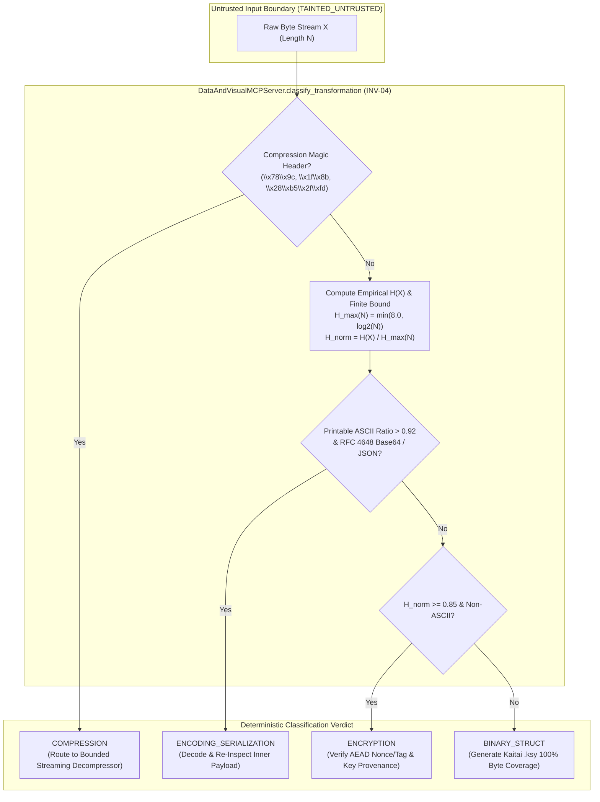
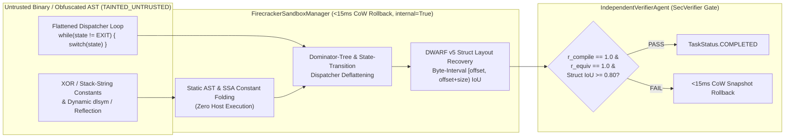
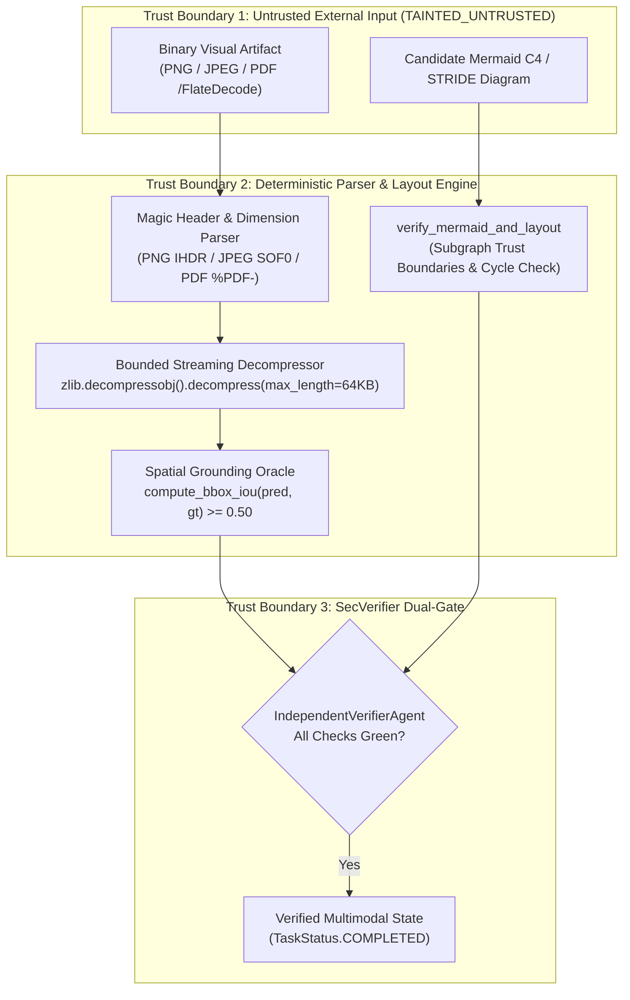
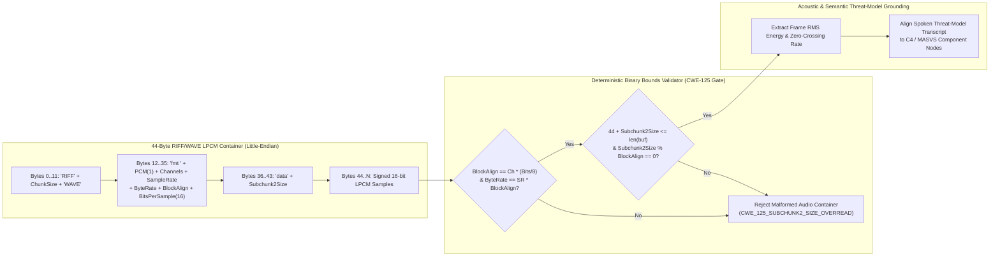

# Domain 5 & Domain 6 Training Corpus: Encoding, Obfuscation Analysis, Reverse-Engineering Defense & Multimodal Grounding (Text, Image & Audio)

**Version:** `1.0.0`  
**Last Synchronized:** 2026-11-19  
**Domains Covered:** Domain 5 (`data_protocol`, `binrev`) & Domain 6 (`visual_ocr`, `data_protocol`)  
**Related Brain Files:** [`README.md`](README.md) · [`domain-playbooks-and-invariants.md`](domain-playbooks-and-invariants.md) · [`symbol-and-contract-index.md`](symbol-and-contract-index.md) · [`multimodal-training-corpus.jsonl`](multimodal-training-corpus.jsonl)  
**Primary `platform-core` Implementations:** [`mcp_tools.py`](../../src/platform_core/layer2_execution/mcp_tools.py) · [`training.py`](../../src/platform_core/layer1_intelligence/training.py) · [`sandbox.py`](../../src/platform_core/layer2_execution/sandbox.py) · [`agents.py`](../../src/platform_core/layer2_execution/agents.py)

---

## Table of Contents

1. [Overview & Defensive Posture](#1-overview--defensive-posture)
2. [`MOD-OBF-01` — Legitimate Serialization vs. Malicious Obfuscation & Finite-Sample Entropy Analysis](#2-mod-obf-01--legitimate-serialization-vs-malicious-obfuscation--finite-sample-entropy-analysis)
3. [`MOD-OBF-02` — De-obfuscating Dynamic Symbol Resolution, Reflection & Control-Flow Flattening](#3-mod-obf-02--de-obfuscating-dynamic-symbol-resolution-reflection--control-flow-flattening)
4. [`MOD-MM-01` — Multimodal Visual Grounding: Trust-Boundary Architecture Diagrams & Binary Document Inspection](#4-mod-mm-01--multimodal-visual-grounding-trust-boundary-architecture-diagrams--binary-document-inspection)
5. [`MOD-MM-02` — Multimodal Audio Grounding: Voice-Driven Threat Modeling & PCM/WAV Signal Framing](#5-mod-mm-02--multimodal-audio-grounding-voice-driven-threat-modeling--pcmwav-signal-framing)

---

## 1. Overview & Defensive Posture

This corpus volume provides authoritative training modules for **Domain 5 (Encoding, Obfuscation Analysis & Reverse-Engineering Defense)** and **Domain 6 (Multimodal Grounding across Text, Image & Audio)** within `platform-core`. All modules enforce a **strictly defensive, auditing, and authorized-testing posture** and align directly with `platform-core` workspace invariants:

- **Invariant 1 (`SecVerifier` Dual-Gate)**: `MultimodalDataAgent` and `ReverseEngineeringAgent` produce candidate artifacts (`can_mark_completed=False`) that must pass deterministic verification by `IndependentVerifierAgent` (`can_mark_completed=True`) in [`agents.py`](../../src/platform_core/layer2_execution/agents.py).
- **Invariant 2 (`TAINTED_UNTRUSTED` Isolation)**: Inspecting untrusted binary blobs, obfuscated scripts, PDF streams, or WAV containers automatically transitions `PlatformState.taint_label` to `TAINTED_UNTRUSTED`, revoking `network_egress` and `admin_deploy` and isolating execution inside `FirecrackerSandboxManager` ([`sandbox.py`](../../src/platform_core/layer2_execution/sandbox.py)).
- **Invariant 4 (Finite-Sample Entropy & DWARF Struct Layout IoU)**:
  - `DataAndVisualMCPServer.classify_transformation` ([`mcp_tools.py`](../../src/platform_core/layer2_execution/mcp_tools.py)) normalizes Shannon entropy against $H_{\max}(N) = \min(8.0, \log_2 N)$ rather than a fixed `8.0` divisor so short (16B–64B) AEAD ciphertexts are accurately classified as `ENCRYPTION`.
  - `BinRevDecompileRewardOracle.compute_struct_layout_iou` ([`training.py`](../../src/platform_core/layer1_intelligence/training.py)) computes DWARF v5 structure layout similarity using byte-interval `[offset, offset + size)` overlap IoU rather than exact offset-key lookup.

---

## 2. `MOD-OBF-01` — Legitimate Serialization vs. Malicious Obfuscation & Finite-Sample Entropy Analysis

- **`module_id`**: `"MOD-OBF-01"`
- **`domain`**: `"data_protocol"`
- **`target_platform`**: `"cross_platform"`
- **`standards_and_references`**:
  - Claude E. Shannon, *"A Mathematical Theory of Communication"* (Bell System Technical Journal, 1948)
  - NIST SP 800-38D (*Recommendation for Block Cipher Modes of Operation: Galois/Counter Mode (GCM) and GMAC*)
  - IETF RFC 8439 (*ChaCha20 and Poly1305 for IETF Protocols*) & RFC 5869 (*HKDF*)
  - `platform-core` Invariant 4 (`DataAndVisualMCPServer.classify_transformation` in [`mcp_tools.py`](../../src/platform_core/layer2_execution/mcp_tools.py))

### Core Concepts

Software systems transform byte streams for three distinct engineering purposes that must never be conflated:
1. **Encoding & Serialization (`ENCODING_SERIALIZATION`)**: Formats such as Base64 (RFC 4648), hexadecimal, URL encoding, Protocol Buffers, MessagePack, and JSON ensure transport safety or cross-language structural interoperability. They provide **zero confidentiality or integrity** because the transformation is publicly invertible without a secret key.
2. **Lossless Compression (`COMPRESSION`)**: Algorithms such as Deflate/zlib (`\x78\x01`, `\x78\x9c`, `\x78\xda`), Gzip (`\x1f\x8b`), and Zstandard (`\x28\xb5\x2f\xfd`) reduce redundancy by approaching the source entropy rate, producing high-entropy payload bodies preceded by deterministic framing magic headers.
3. **Authenticated Encryption (`ENCRYPTION`)**: Modern AEAD constructions (`AES-256-GCM`, `ChaCha20-Poly1305`) combine semantic security (IND-CPA) with ciphertext integrity (INT-CTXT) using a high-entropy key derived via HKDF or Argon2id and a unique nonce. Ciphertext bytes are computationally indistinguishable from uniform random bytes (absent container framing).

#### The Finite-Sample Shannon Entropy Pitfall (`INV-04`)

For a discrete byte stream $X = (x_1, \dots, x_N)$ of length $N$ bytes with empirical byte frequencies $c(b)$ for $b \in \{0, \dots, 255\}$ and $p(b) = c(b)/N$, the empirical Shannon entropy in bits per byte is:

$$H(X) = -\sum_{b=0}^{255} p(b) \log_2 p(b)$$

While the asymptotic maximum entropy of an 8-bit alphabet as $N \to \infty$ is $8.0\text{ bits/byte}$, a finite buffer of length $N < 256$ can contain at most $N$ distinct byte values (each appearing once with $p(b) = 1/N$). Therefore, the **theoretical maximum entropy of a sample of length $N$** is bounded by:

$$H_{\max}(N) = \min(8.0, \log_2 N)$$

For a 16-byte AES-128/256 block or a 32-byte AEAD tag/ciphertext slice with all distinct bytes:
- $H(X) = \log_2(16) = 4.0\text{ bits/byte}$ (for $N=16$) or $\log_2(32) = 5.0\text{ bits/byte}$ (for $N=32$).
- A naive classifier that divides $H(X)$ by `8.0` computes $4.0 / 8.0 = 0.50$ (or compares raw $H(X) = 4.0 < 7.2$) and **misclassifies strong 16B–64B AES-GCM ciphertext as low-entropy plaintext or Base64 encoding**.
- Normalizing by $H_{\text{norm}}(X) = \frac{H(X)}{\min(8.0, \log_2 N)}$ yields $4.0 / 4.0 = 1.00$, enabling `DataAndVisualMCPServer.classify_transformation` to accurately classify short ciphertexts as `ENCRYPTION` when paired with magic-byte exclusion and ASCII printable ratio checks.

### Bad vs. Good Implementation Pair

#### `bad_example` — Homegrown XOR/Base64 "Obfuscation" & Asymptotic-Only (`H / 8.0`) Entropy Classifier

```python
import base64
import math
from collections import Counter


# ANTI-PATTERN 1: "Security through obscurity" using repeating-key XOR + Base64
# to hide API credentials or telemetry payloads. Any analyst or automated
# crib-dragging script recovers the XOR key in milliseconds.
def obfuscate_secret_bad(plaintext: bytes, repeating_key: bytes = b"k3y") -> str:
    xored = bytes(b ^ repeating_key[i % len(repeating_key)] for i, b in enumerate(plaintext))
    return base64.b64encode(xored).decode("ascii")


# ANTI-PATTERN 2: Dividing empirical Shannon entropy by fixed 8.0.
# For a 16-byte AES-GCM block (max possible entropy = log2(16) = 4.0 bits/byte),
# raw_h / 8.0 is at most 0.50, so short encrypted payloads are misclassified as PLAINTEXT!
def classify_payload_bad(data: bytes) -> str:
    if not data:
        return "EMPTY"
    counts = Counter(data)
    n = len(data)
    raw_h = -sum((c / n) * math.log2(c / n) for c in counts.values())
    normalized_wrong = raw_h / 8.0
    if normalized_wrong >= 0.85:
        return "ENCRYPTION"
    return "PLAINTEXT_OR_ENCODING"
```

#### `good_example` — HKDF + AEAD Encryption Pattern & `INV-04` Finite-Sample Normalized Classifier

```python
import base64
import hashlib
import hmac
import math
import os
from collections import Counter
from dataclasses import dataclass


@dataclass(frozen=True)
class TransformationAuditResult:
    classification: str
    raw_entropy_bits: float
    max_possible_entropy_bits: float
    normalized_entropy: float
    printable_ascii_ratio: float
    detected_magic: str


def hkdf_sha256(ikm: bytes, salt: bytes, info: bytes, length: int = 32) -> bytes:
    """RFC 5869 HKDF-Extract and HKDF-Expand using HMAC-SHA256."""
    if not salt:
        salt = b"\x00" * 32
    prk = hmac.new(salt, ikm, hashlib.sha256).digest()
    okm = bytearray()
    t = b""
    counter = 1
    while len(okm) < length:
        t = hmac.new(prk, t + info + bytes([counter]), hashlib.sha256).digest()
        okm.extend(t)
        counter += 1
    return bytes(okm[:length])


def classify_transformation_good(data: bytes) -> TransformationAuditResult:
    """Deterministic finite-sample byte-stream classifier (platform-core Invariant 4)."""
    if not data:
        return TransformationAuditResult("EMPTY", 0.0, 0.0, 0.0, 0.0, "none")

    n = len(data)
    counts = Counter(data)
    raw_h = -sum((c / n) * math.log2(c / n) for c in counts.values())
    max_h = min(8.0, math.log2(max(n, 2)))
    norm_h = round(raw_h / max_h, 4) if max_h > 0 else 0.0

    # 1. Check deterministic compression magic headers first
    if data.startswith((b"\x78\x01", b"\x78\x9c", b"\x78\xda")):
        return TransformationAuditResult("COMPRESSION", round(raw_h, 4), round(max_h, 4), norm_h, 0.0, "zlib")
    if data.startswith(b"\x1f\x8b"):
        return TransformationAuditResult("COMPRESSION", round(raw_h, 4), round(max_h, 4), norm_h, 0.0, "gzip")
    if data.startswith(b"\x28\xb5\x2f\xfd"):
        return TransformationAuditResult("COMPRESSION", round(raw_h, 4), round(max_h, 4), norm_h, 0.0, "zstd")

    # 2. Compute printable ASCII ratio and Base64 / Hex structural patterns
    printable = sum(1 for b in data if 32 <= b <= 126 or b in (9, 10, 13))
    ascii_ratio = round(printable / n, 4)

    if ascii_ratio > 0.92:
        stripped = data.strip()
        if len(stripped) % 4 == 0 and all(
            chr(b) in "ABCDEFGHIJKLMNOPQRSTUVWXYZabcdefghijklmnopqrstuvwxyz0123456789+/="
            for b in stripped
        ):
            try:
                base64.b64decode(stripped, validate=True)
                return TransformationAuditResult(
                    "ENCODING_SERIALIZATION", round(raw_h, 4), round(max_h, 4), norm_h, ascii_ratio, "base64"
                )
            except Exception:
                pass
        return TransformationAuditResult(
            "ENCODING_SERIALIZATION", round(raw_h, 4), round(max_h, 4), norm_h, ascii_ratio, "ascii_text"
        )

    # 3. High finite-sample normalized entropy without compression header -> ENCRYPTION
    if norm_h >= 0.85:
        return TransformationAuditResult(
            "ENCRYPTION", round(raw_h, 4), round(max_h, 4), norm_h, ascii_ratio, "uniform_ciphertext"
        )

    return TransformationAuditResult(
        "BINARY_STRUCT", round(raw_h, 4), round(max_h, 4), norm_h, ascii_ratio, "structured_binary"
    )
```

### Audit and Verification Lab

1. **CLI Inspection Verification**:
   ```bash
   PYTHONPATH=src .venv/bin/python -m platform_core.cli inspect-data --hex 789c4b4c4a0600024d0127
   PYTHONPATH=src .venv/bin/python -m platform_core.cli inspect-data --hex a3f91c8e7b2d405199c4e2081b7f6a3d
   ```
2. **Expected Deterministic Output**:
   - The first payload starts with `\x78\x9c` (zlib default compression magic) and is deterministically classified as `COMPRESSION`.
   - The second payload is a 16-byte ($N=16$, $H_{\max} = 4.0$) uniform ciphertext block with 16 distinct bytes ($H(X) = 4.0$, $H_{\text{norm}} = 1.00$), which `DataAndVisualMCPServer.classify_transformation` classifies as `ENCRYPTION`.

### Multimodal Specifications (`multimodal_specs`)

#### `visual_diagram` — Transformation Classification & Trust-Boundary Decision Tree



#### `audio_component` — Voice Walkthrough Transcript

> **Audio Walkthrough (`MOD-OBF-01`, 16 kHz Mono PCM Technical Briefing)**:  
> *"When triaging an unknown binary payload in a mobile app or network capture, never equate encoding with encryption, and never normalize Shannon entropy by a hardcoded 8.0 bits per byte on short buffers. In a 16-byte AES-GCM authentication tag or short ciphertext block, there are only 16 positions, so the mathematical upper bound on Shannon entropy is log-base-2 of 16, which is 4.0 bits per byte—not 8.0. Our classifier first checks deterministic compression headers like zlib 0x789C, gzip 0x1F8B, and zstd 0x28B52FFD. Next, it evaluates printable ASCII ratio and RFC 4648 Base64 framing so multi-layer encodings are recursively unwrapped inside an isolated sandbox. Finally, it normalizes empirical entropy against min(8.0, log2(N)), ensuring short AEAD ciphertexts are accurately flagged as encryption."*

### Structured `<output_format>` Record (`MOD-OBF-01`)

```json
{
  "module_id": "MOD-OBF-01",
  "domain": "data_protocol",
  "target_platform": "cross_platform",
  "standards_and_references": [
    "Shannon Information Theory (Bell System Technical Journal, 1948)",
    "NIST SP 800-38D (AES-GCM Authenticated Encryption)",
    "IETF RFC 8439 (ChaCha20-Poly1305) & RFC 5869 (HKDF)",
    "platform-core Invariant 4 (DataAndVisualMCPServer.classify_transformation finite-sample entropy bound H_max = min(8.0, log2(N)))"
  ],
  "core_concepts": "Separates reversible encoding/serialization (Base64, hex, Protobuf), lossless compression (zlib, gzip, zstd), and authenticated AEAD encryption (AES-256-GCM, ChaCha20-Poly1305). Demonstrates why dividing empirical Shannon entropy by 8.0 fails on short 16B-64B ciphertexts and proves the finite-sample normalization rule H_norm = H(X) / min(8.0, log2(N)).",
  "bad_vs_good_pair": {
    "bad_example": "Using repeating-key XOR + Base64 as homegrown encryption, and dividing empirical Shannon entropy by a fixed 8.0 divisor (which scores a 16-byte uniform ciphertext at 4.0/8.0 = 0.50 and misclassifies it as plaintext).",
    "good_example": "Deriving keys via RFC 5869 HKDF-SHA256 for AES-256-GCM AEAD, and classifying unknown byte streams by checking compression magic headers (\\x78\\x9c, \\x1f\\x8b, \\x28\\xb5\\x2f\\xfd) and normalizing Shannon entropy against min(8.0, log2(N))."
  },
  "audit_and_verification_lab": "Run `PYTHONPATH=src .venv/bin/python -m platform_core.cli inspect-data --hex a3f91c8e7b2d405199c4e2081b7f6a3d` and verify `transformation == 'ENCRYPTION'` with `normalized_entropy >= 0.85`.",
  "multimodal_specs": {
    "visual_diagram": "flowchart TD; Raw[\"Raw Byte Stream (Length N)\"] --> Magic{\"Compression Magic?\"}; Magic -- Yes --> Comp[\"COMPRESSION\"]; Magic -- No --> Norm[\"H_norm = H(X) / min(8.0, log2(N))\"]; Norm --> Enc{\"ASCII > 0.92?\"}; Enc -- Yes --> Ser[\"ENCODING_SERIALIZATION\"]; Enc -- No --> Crypt[\"ENCRYPTION (H_norm >= 0.85)\"];",
    "audio_component": "Spoken walkthrough explaining why a 16-byte AES-GCM block has a maximum entropy of log2(16) = 4.0 bits/byte and how finite-sample normalization prevents false negatives during forensic packet inspection."
  }
}
```

---

## 3. `MOD-OBF-02` — De-obfuscating Dynamic Symbol Resolution, Reflection & Control-Flow Flattening

- **`module_id`**: `"MOD-OBF-02"`
- **`domain`**: `"binrev"`
- **`target_platform`**: `"cross_platform"`
- **`standards_and_references`**:
  - MITRE ATT&CK `T1027` (*Obfuscated Files or Information*) & `T1140` (*Deobfuscate/Decode Files or Information*)
  - DWARF Debugging Information Format Version 5 Specification
  - `platform-core` `BinRevMCPServer.decompile_and_extract_cfg` ([`mcp_tools.py`](../../src/platform_core/layer2_execution/mcp_tools.py)) & `BinRevDecompileRewardOracle.compute_struct_layout_iou` ([`training.py`](../../src/platform_core/layer1_intelligence/training.py), Invariant 4)

### Core Concepts

Both legitimate commercial protectors and hostile binaries frequently apply three structural obfuscation layers:
1. **String & Constant Concealment**: Replacing cleartext literals (URLs, library names, JNI/ObjC selectors) with stack-constructed byte arrays or per-string XOR/ADD loops decoded immediately prior to use.
2. **Dynamic Symbol Resolution & Reflection**: Evading static import table (`ELF .dynsym`, `PE IAT`, `Mach-O __la_symbol_ptr`) inspection by resolving APIs at runtime via `dlsym()`, `GetProcAddress()`, Java/Kotlin `Class.forName().getMethod()`, or Objective-C `NSSelectorFromString()`.
3. **Control-Flow Flattening (CFF) & Opaque Predicates**: Rewriting structured loops and branches into a single massive `switch` dispatcher inside a loop controlled by an artificial state variable (`state_var`), inflating cyclomatic complexity $M = E - N + 2P$ and breaking naive decompiler structural recovery.

#### Defensive De-obfuscation & DWARF Byte-Interval Struct Layout IoU (`INV-04`)

- **Never Execute Untrusted Obfuscated Code on the Host**: Dynamic observation must occur strictly inside an isolated `FirecrackerSandboxManager` microVM (`TAINTED_UNTRUSTED`, `internal=True`, `<15ms` CoW snapshot rollback), while static constant folding and AST/CFG simplification recover concealed literals without executing payload logic.
- **Byte-Interval Struct Layout IoU**: When evaluating recovered C/C++ structure layouts against ground-truth DWARF v5 debug info (`DW_TAG_structure_type`, `DW_TAG_member`), checking only exact dictionary keys (`offset -> size`) fails whenever a decompiler coalesces adjacent padding bytes, splits a 64-bit field into two 32-bit fields, or recovers overlapping `union` members. `BinRevDecompileRewardOracle.compute_struct_layout_iou` expands each member `{offset, size}` into its contiguous byte set $\{b \in \mathbb{Z} \mid \text{offset} \le b < \text{offset} + \text{size}\}$ and computes exact set Intersection-over-Union:

$$\text{IoU}(S_{\text{pred}}, S_{\text{dwarf}}) = \frac{|B_{\text{pred}} \cap B_{\text{dwarf}}|}{|B_{\text{pred}} \cup B_{\text{dwarf}}|}$$

### Bad vs. Good Implementation Pair

#### `bad_example` — Host-Side Dynamic `eval()` Execution & Exact-Key Offset Struct Scoring

```python
# ANTI-PATTERN 1: Running `eval()` or executing an untrusted obfuscated script
# on the analysis host to see what strings it decodes! This grants immediate RCE.
def deobfuscate_by_executing_bad(obfuscated_expr: str) -> str:
    # NEVER DO THIS: arbitrary code execution on host
    return str(eval(obfuscated_expr))  # noqa: S307


# ANTI-PATTERN 2: Scoring recovered struct layouts using exact offset-key lookup.
# Fails on partial overlap, coalesced fields, or union overlays (violates Invariant 4).
def score_struct_layout_bad(
    predicted_fields: list[dict[str, int]], dwarf_fields: list[dict[str, int]]
) -> float:
    pred_map = {f["offset"]: f["size"] for f in predicted_fields}
    dwarf_map = {f["offset"]: f["size"] for f in dwarf_fields}
    matches = sum(1 for off, sz in dwarf_map.items() if pred_map.get(off) == sz)
    return matches / max(len(dwarf_map), 1)
```

#### `good_example` — Static AST Constant-Folding De-obfuscator & DWARF Byte-Interval Overlap IoU (`INV-04`)

```python
import ast
from dataclasses import dataclass


@dataclass(frozen=True)
class StaticDeobfuscationReport:
    recovered_literals: list[str]
    dispatcher_states_detected: int
    taint_isolation_required: bool


class SafeASTConstantFolder(ast.NodeVisitor):
    """Statically recovers XOR-obfuscated byte arrays & char-code concatenations without executing code."""

    def __init__(self) -> None:
        self.recovered: list[str] = []

    def visit_ListComp(self, node: ast.ListComp) -> None:
        # Detect patterns like [b ^ 0x5A for b in [50, 62, 62, 42]]
        if (
            isinstance(node.elt, ast.BinOp)
            and isinstance(node.elt.op, ast.BitXor)
            and isinstance(node.elt.right, ast.Constant)
            and isinstance(node.elt.right.value, int)
            and len(node.generators) == 1
            and isinstance(node.generators[0].iter, (ast.List, ast.Tuple))
        ):
            key = node.elt.right.value & 0xFF
            raw_bytes: list[int] = []
            for elem in node.generators[0].iter.elts:
                if isinstance(elem, ast.Constant) and isinstance(elem.value, int):
                    raw_bytes.append((elem.value ^ key) & 0xFF)
            if raw_bytes:
                try:
                    self.recovered.append(bytes(raw_bytes).decode("utf-8", errors="replace"))
                except Exception:
                    pass
        self.generic_visit(node)


def analyze_obfuscated_source_statically(source_code: str) -> StaticDeobfuscationReport:
    tree = ast.parse(source_code)
    folder = SafeASTConstantFolder()
    folder.visit(tree)

    # Count CFF-style while/match or state-variable dispatcher branches
    dispatcher_states = sum(
        1 for node in ast.walk(tree) if isinstance(node, (ast.If, ast.match_case))
    )
    return StaticDeobfuscationReport(
        recovered_literals=folder.recovered,
        dispatcher_states_detected=dispatcher_states,
        taint_isolation_required=True,
    )


def compute_dwarf_byte_interval_iou(
    predicted_fields: list[dict[str, int]],
    dwarf_fields: list[dict[str, int]],
) -> float:
    """Computes byte-interval [offset, offset + size) overlap IoU (platform-core Invariant 4)."""
    pred_bytes: set[int] = set()
    for field in predicted_fields:
        offset = int(field["offset"])
        size = int(field["size"])
        if offset >= 0 and size > 0:
            pred_bytes.update(range(offset, offset + size))

    dwarf_bytes: set[int] = set()
    for field in dwarf_fields:
        offset = int(field["offset"])
        size = int(field["size"])
        if offset >= 0 and size > 0:
            dwarf_bytes.update(range(offset, offset + size))

    if not pred_bytes and not dwarf_bytes:
        return 1.0
    union = pred_bytes | dwarf_bytes
    if not union:
        return 0.0
    return round(len(pred_bytes & dwarf_bytes) / len(union), 4)
```

### Audit and Verification Lab

1. **Run `binrev` Domain Workflow & Reward Oracle Tests**:
   ```bash
   PYTHONPATH=src .venv/bin/python -m platform_core.cli run-workflow --domain binrev
   PYTHONPATH=src .venv/bin/python -W error -m unittest tests/test_platform_core.py -v
   ```
2. **Verification Criteria**:
   - `BinRevMCPServer.decompile_and_extract_cfg` extracts the CFG (`nodes`, `edges`, `cyclomatic_complexity = E - N + 2`) inside a `TAINTED_UNTRUSTED` session.
   - `BinRevDecompileRewardOracle.compute_struct_layout_iou` verifies `[offset, offset + size)` byte-interval overlap IoU and combines $R_{\text{binrev}} = 0.25 r_{\text{compile}} + 0.45 r_{\text{equiv}} + 0.20 r_{\text{type\_iou}} + 0.10 r_{\text{cfg}}$.

### Multimodal Specifications (`multimodal_specs`)

#### `visual_diagram` — Control-Flow Flattening De-obfuscation & `SecVerifier` Sandbox Pipeline



#### `audio_component` — Voice Walkthrough Transcript

> **Audio Walkthrough (`MOD-OBF-02`, 16 kHz Mono PCM Technical Briefing)**:  
> *"When reverse-engineering a binary protected by control-flow flattening and dynamic symbol resolution, all basic blocks are collapsed into a single switch dispatcher controlled by an artificial state register. Never execute an obfuscated sample on your host machine to dump strings. Instead, tag the session TAINTED_UNTRUSTED inside our air-gapped Firecracker microVM, apply static SSA constant propagation to fold XOR string loops and resolve dlsym or reflection targets, and reconstruct the original dominator tree. Finally, verify recovered C structures against DWARF v5 debug metadata using byte-interval `[offset, offset + size)` intersection-over-union so partially coalesced fields and union overlays are scored accurately."*

### Structured `<output_format>` Record (`MOD-OBF-02`)

```json
{
  "module_id": "MOD-OBF-02",
  "domain": "binrev",
  "target_platform": "cross_platform",
  "standards_and_references": [
    "MITRE ATT&CK T1027 (Obfuscated Files or Information) & T1140 (Deobfuscate/Decode Files)",
    "DWARF Debugging Information Format v5 Specification",
    "platform-core BinRevMCPServer & BinRevDecompileRewardOracle (Invariant 4 byte-interval [offset, offset + size) IoU)"
  ],
  "core_concepts": "Covers static de-obfuscation of XOR/stack strings, dynamic symbol resolution (dlsym, reflection), and control-flow flattening (CFF) inside a TAINTED_UNTRUSTED Firecracker microVM, paired with DWARF v5 byte-interval [offset, offset + size) struct layout IoU verification.",
  "bad_vs_good_pair": {
    "bad_example": "Executing untrusted obfuscated code via eval() on the host to observe decoded strings, and scoring recovered C structs by exact offset dictionary keys.",
    "good_example": "Static AST/SSA constant folding without code execution inside FirecrackerSandboxManager, and computing DWARF struct layout similarity over contiguous byte intervals [offset, offset + size)."
  },
  "audit_and_verification_lab": "Run `PYTHONPATH=src .venv/bin/python -m platform_core.cli run-workflow --domain binrev` and verify `BinRevDecompileRewardOracle.compute_struct_layout_iou` scores byte-interval overlap accurately.",
  "multimodal_specs": {
    "visual_diagram": "flowchart LR; CFF[\"Flattened Switch Dispatcher\"] --> SSA[\"Static SSA Constant Folding & Deflattening\"]; SSA --> DWARF[\"DWARF Byte-Interval [offset, offset+size) IoU\"]; DWARF --> Gate[\"IndependentVerifierAgent Gate\"];",
    "audio_component": "Spoken walkthrough detailing how control-flow flattening inflates cyclomatic complexity and how static SSA constant folding + byte-interval DWARF IoU verify decompilation safely."
  }
}
```

---

## 4. `MOD-MM-01` — Multimodal Visual Grounding: Trust-Boundary Architecture Diagrams & Binary Document Inspection

- **`module_id`**: `"MOD-MM-01"`
- **`domain`**: `"visual_ocr"`
- **`target_platform`**: `"cross_platform"`
- **`standards_and_references`**:
  - Simon Brown, *The C4 Model for Visualising Software Architecture* (System Context, Containers, Components, Code)
  - OWASP Threat Dragon & Microsoft STRIDE Data-Flow Diagram (DFD) Trust Boundary Standards
  - W3C PNG Specification (RFC 2083), ITU-T T.81 (JPEG SOF0/SOF2 markers), ISO 32000-1 (PDF 1.7 `/FlateDecode` streams)
  - `platform-core` `DataAndVisualMCPServer.inspect_visual_document` & `verify_mermaid_and_layout` ([`mcp_tools.py`](../../src/platform_core/layer2_execution/mcp_tools.py))

### Core Concepts

Multimodal engineering agents must bridge **visual artifacts** (scanned architecture diagrams, mobile UI screenshots, PDF threat models, and Mermaid C4 diagrams) with **deterministic structural verification**:

1. **Deterministic Binary Image & PDF Header Verification**:
   - **PNG**: Must begin with the 8-byte signature `\x89PNG\r\n\x1a\n` followed by an `IHDR` chunk at offset `8..24` containing big-endian 32-bit unsigned width and height (`struct.unpack(">II", data[16:24])`).
   - **JPEG**: Must begin with SOI marker `\xff\xd8` and contain a Start-of-Frame marker (`\xff\xc0` baseline SOF0 or `\xff\xc2` progressive SOF2) encoding 16-bit big-endian height and width (`struct.unpack(">HH", segment[3:7])`).
   - **PDF (`/FlateDecode` Stream Safety)**: PDF documents begin with `%PDF-` and embed compressed content streams between `stream` and `endstream`. Parsing untrusted PDFs with unbounded `zlib.decompress()` exposes the parser to **decompression bomb (zip-bomb) OOM denial-of-service attacks** (CWE-409). Parsers must use streaming `zlib.decompressobj().decompress(chunk, max_length=MAX_BYTES)` and inspect `unconsumed_tail`.
2. **Spatial Bounding-Box Grounding ($\text{IoU} \ge 0.50$)**:
   - Every visual claim (e.g., locating an insecure WebView banner, a network trust boundary, or a PDF signature block) must cite normalized or pixel coordinates $[x_1, y_1, x_2, y_2]$ with $x_2 > x_1$ and $y_2 > y_1$.
   - `DataAndVisualMCPServer.compute_bbox_iou` verifies spatial overlap against ground-truth layout regions:
     $$\text{IoU}(B_A, B_B) = \frac{\max(0, \min(x_{2A}, x_{2B}) - \max(x_{1A}, x_{1B})) \cdot \max(0, \min(y_{2A}, y_{2B}) - \max(y_{1A}, y_{1B}))}{\text{Area}(B_A) + \text{Area}(B_B) - \text{Intersection}}$$
3. **Architecture Diagram Trust-Boundary Verification**:
   - Every C4 or STRIDE Mermaid diagram synthesized by an agent must pass `DataAndVisualMCPServer.verify_mermaid_and_layout`, confirming balanced `subgraph` trust boundaries (`Internet / Untrusted`, `DMZ / API Gateway`, `Isolated Sandbox / Hardware Enclave`), explicit edge protocol labels (`mTLS 1.3`, `JSON-RPC Stdio`, `IPC Binder`), and zero dangling nodes.

### Bad vs. Good Implementation Pair

#### `bad_example` — Unbounded PDF `zlib.decompress()` (Zip-Bomb Vulnerability) & Unverified BBox Coordinates

```python
import re
import zlib


# ANTI-PATTERN 1: Calling one-shot zlib.decompress() on untrusted PDF /FlateDecode
# streams. A 40 KB malicious PDF stream can expand to 4 GB in RAM and crash the host (CWE-409).
def extract_pdf_streams_bad(pdf_bytes: bytes) -> list[bytes]:
    outputs: list[bytes] = []
    for match in re.finditer(rb"stream\r?\n(.*?)\r?\nendstream", pdf_bytes, re.DOTALL):
        try:
            # VULNERABLE TO ZIP BOMB OOM: no max_length bound!
            outputs.append(zlib.decompress(match.group(1)))
        except zlib.error:
            pass
    return outputs


# ANTI-PATTERN 2: Accepting unvalidated LLM bounding boxes without checking x2 > x1, y2 > y1 or IoU.
def verify_region_bad(pred_box: list[float]) -> bool:
    return len(pred_box) == 4
```

#### `good_example` — Bounded Streaming PDF Decompression (`zlib.decompressobj`), Magic-Header Parser & Spatial IoU Gate

```python
import re
import struct
import zlib
from dataclasses import dataclass


@dataclass(frozen=True)
class VisualInspectionAudit:
    file_format: str
    width: int
    height: int
    extracted_text_preview: str
    bbox_iou: float
    decompression_capped: bool
    verified: bool


def decompress_pdf_stream_safely(compressed: bytes, max_output_bytes: int = 65536) -> tuple[bytes, bool]:
    """Bounded streaming decompression preventing CWE-409 zip-bomb memory exhaustion."""
    decompressor = zlib.decompressobj()
    out = decompressor.decompress(compressed, max_output_bytes)
    capped = bool(decompressor.unconsumed_tail)
    return out, capped


def compute_spatial_bbox_iou(
    box_a: tuple[float, float, float, float],
    box_b: tuple[float, float, float, float],
) -> float:
    x1_a, y1_a, x2_a, y2_a = box_a
    x1_b, y1_b, x2_b, y2_b = box_b
    if x2_a <= x1_a or y2_a <= y1_a or x2_b <= x1_b or y2_b <= y1_b:
        return 0.0
    inter_w = max(0.0, min(x2_a, x2_b) - max(x1_a, x1_b))
    inter_h = max(0.0, min(y2_a, y2_b) - max(y1_a, y1_b))
    inter_area = inter_w * inter_h
    area_a = (x2_a - x1_a) * (y2_a - y1_a)
    area_b = (x2_b - x1_b) * (y2_b - y1_b)
    union_area = area_a + area_b - inter_area
    return round(inter_area / union_area, 4) if union_area > 0 else 0.0


def inspect_visual_artifact_good(
    raw_bytes: bytes,
    predicted_bbox: tuple[float, float, float, float],
    ground_truth_bbox: tuple[float, float, float, float],
    max_stream_bytes: int = 65536,
) -> VisualInspectionAudit:
    file_fmt = "UNKNOWN"
    width, height = 0, 0
    preview = ""
    capped_any = False

    if raw_bytes.startswith(b"\x89PNG\r\n\x1a\n") and len(raw_bytes) >= 24:
        file_fmt = "PNG"
        width, height = struct.unpack(">II", raw_bytes[16:24])
    elif raw_bytes.startswith(b"\xff\xd8"):
        file_fmt = "JPEG"
        idx = 2
        while idx + 9 < len(raw_bytes):
            if raw_bytes[idx] != 0xFF:
                idx += 1
                continue
            marker = raw_bytes[idx + 1]
            if marker in (0xC0, 0xC2):
                height, width = struct.unpack(">HH", raw_bytes[idx + 5 : idx + 9])
                break
            seg_len = struct.unpack(">H", raw_bytes[idx + 2 : idx + 4])[0]
            idx += 2 + seg_len
    elif raw_bytes.startswith(b"%PDF-"):
        file_fmt = "PDF"
        width, height = 612, 792
        chunks: list[str] = []
        for match in re.finditer(rb"stream\r?\n(.*?)\r?\nendstream", raw_bytes, re.DOTALL):
            decompressed, capped = decompress_pdf_stream_safely(match.group(1), max_stream_bytes)
            capped_any = capped_any or capped
            chunks.append(decompressed.decode("latin-1", errors="ignore")[:120])
        preview = " ".join(chunks)[:240]

    iou = compute_spatial_bbox_iou(predicted_bbox, ground_truth_bbox)
    verified = file_fmt != "UNKNOWN" and width > 0 and height > 0 and iou >= 0.50
    return VisualInspectionAudit(file_fmt, width, height, preview, iou, capped_any, verified)
```

### Audit and Verification Lab

1. **Run Visual Inspection & Architecture Workflow Verification**:
   ```bash
   PYTHONPATH=src .venv/bin/python -m platform_core.cli run-workflow --domain visual_ocr
   PYTHONPATH=src .venv/bin/python -m platform_core.cli run-workflow --domain architecture
   ```
2. **Verification Criteria**:
   - `DataAndVisualMCPServer.inspect_visual_document` validates PNG/JPEG/PDF headers, enforces bounded streaming `zlib.decompressobj()` on PDF streams, and requires spatial bounding-box $\text{IoU} \ge 0.50$.
   - `DataAndVisualMCPServer.verify_mermaid_and_layout` verifies Mermaid syntax, balanced subgraph trust boundaries, and zero cyclic single-point-of-failure edges.

### Multimodal Specifications (`multimodal_specs`)

#### `visual_diagram` — C4 / STRIDE Multimodal Inspection & Trust-Boundary Verification Graph



#### `audio_component` — Voice Walkthrough Transcript

> **Audio Walkthrough (`MOD-MM-01`, 16 kHz Mono PCM Technical Briefing)**:  
> *"Multimodal visual grounding requires two deterministic safeguards before an agent's diagram or document readout is trusted. First, when inspecting binary PDFs or images, never call unbounded zlib.decompress on PDF FlateDecode streams—a malicious 40-kilobyte zip-bomb stream can allocate gigabytes of heap memory. Always use streaming zlib.decompressobj with an explicit max_length cap and check unconsumed_tail. Second, require every visual region claim to provide `[x1, y1, x2, y2]` bounding boxes achieving at least 0.50 Intersection-over-Union against deterministic layout blocks, and validate every Mermaid architecture diagram for explicit trust-boundary subgraphs."*

### Structured `<output_format>` Record (`MOD-MM-01`)

```json
{
  "module_id": "MOD-MM-01",
  "domain": "visual_ocr",
  "target_platform": "cross_platform",
  "standards_and_references": [
    "Simon Brown C4 Architecture Visualization Model",
    "OWASP Threat Dragon / STRIDE Data-Flow Diagram Trust Boundaries",
    "W3C PNG (RFC 2083), ITU-T T.81 (JPEG), ISO 32000-1 (PDF 1.7 /FlateDecode)",
    "platform-core DataAndVisualMCPServer.inspect_visual_document & verify_mermaid_and_layout"
  ],
  "core_concepts": "Grounds multimodal visual understanding in deterministic PNG/JPEG/PDF binary header inspection, bounded streaming zlib decompression (CWE-409 mitigation), spatial [x1, y1, x2, y2] bounding-box IoU >= 0.50, and automated Mermaid trust-boundary verification.",
  "bad_vs_good_pair": {
    "bad_example": "Calling unbounded zlib.decompress() on untrusted PDF /FlateDecode streams (zip-bomb OOM vulnerability) and accepting unverified bounding boxes or broken Mermaid syntax.",
    "good_example": "Using zlib.decompressobj().decompress(stream, max_length=65536), parsing PNG IHDR / JPEG SOF0 dimensions deterministically, and enforcing spatial BBox IoU >= 0.50 plus Mermaid subgraph validation."
  },
  "audit_and_verification_lab": "Run `PYTHONPATH=src .venv/bin/python -m platform_core.cli run-workflow --domain visual_ocr` and verify `inspect_visual_document` validates magic headers and `bbox_iou >= 0.50`.",
  "multimodal_specs": {
    "visual_diagram": "flowchart TB; Doc[\"Untrusted PNG/JPEG/PDF\"] --> Magic[\"Deterministic Header & Bounded zlib.decompressobj\"]; Magic --> BBox[\"Spatial BBox IoU >= 0.50\"]; BBox --> Gate[\"IndependentVerifierAgent\"];",
    "audio_component": "Spoken walkthrough explaining CWE-409 PDF zip-bomb prevention via streaming zlib.decompressobj and spatial IoU verification for multimodal OCR and architecture diagrams."
  }
}
```

---

## 5. `MOD-MM-02` — Multimodal Audio Grounding: Voice-Driven Threat Modeling & PCM/WAV Signal Framing

- **`module_id`**: `"MOD-MM-02"`
- **`domain`**: `"data_protocol"`
- **`target_platform`**: `"cross_platform"`
- **`standards_and_references`**:
  - Microsoft / IBM RIFF/WAVE Audio File Format Specification (44-byte canonical LPCM header, `RIFF`, `WAVE`, `fmt `, `data` chunks)
  - IETF RFC 6716 (*Definition of the Opus Audio Codec*)
  - Kaitai Struct Declarative Binary Format Specification (`.ksy`)
  - MITRE CWE-125 (*Out-of-bounds Read*) & CWE-190 (*Integer Overflow or Wraparound*)
  - `platform-core` `DataAndVisualMCPServer` ([`mcp_tools.py`](../../src/platform_core/layer2_execution/mcp_tools.py))

### Core Concepts

Voice-driven engineering interfaces, security incident war-rooms, and mobile VoIP pipelines process raw pulse-code modulation (**LPCM**) and container-framed audio (**RIFF/WAVE**, **Opus/RTP**). Grounding an agent across text, code, and audio requires mastery of both **binary audio container security** and **spoken architectural threat-modeling protocols**:

1. **RIFF/WAVE Binary Framing & CWE-125 Bounds Verification**:
   - A standard uncompressed `.wav` file is a 44-byte little-endian RIFF container:
     - Bytes `0..4`: `"RIFF"` magic (`0x52494646`)
     - Bytes `4..8`: `ChunkSize` (`<I`, total file size minus 8 bytes)
     - Bytes `8..12`: `"WAVE"` format tag (`0x57415645`)
     - Bytes `12..16`: `"fmt "` subchunk ID (`0x666d7420`)
     - Bytes `16..20`: `Subchunk1Size` (`<I`, `16` for standard PCM)
     - Bytes `20..22`: `AudioFormat` (`<H`, `1` = Linear PCM)
     - Bytes `22..24`: `NumChannels` (`<H`, `1` = Mono, `2` = Stereo)
     - Bytes `24..28`: `SampleRate` (`<I`, e.g., `16000` Hz for speech models, `44100` / `48000` Hz for wideband)
     - Bytes `28..32`: `ByteRate` (`<I`, must equal $\text{SampleRate} \times \text{NumChannels} \times \frac{\text{BitsPerSample}}{8}$)
     - Bytes `32..34`: `BlockAlign` (`<H`, must equal $\text{NumChannels} \times \frac{\text{BitsPerSample}}{8}$)
     - Bytes `34..36`: `BitsPerSample` (`<H`, e.g., `16`-bit signed little-endian `[-32768, 32767]`)
     - Bytes `36..40`: `"data"` subchunk ID (`0x64617461`)
     - Bytes `40..44`: `Subchunk2Size` (`<I`, declared PCM payload byte length)
   - **Security Invariant**: Untrusted WAV files frequently spoof `Subchunk2Size` (e.g., setting `Subchunk2Size = 0xFFFFFFFF`) or violate `BlockAlign` invariant relations to trigger heap buffer over-reads (CWE-125) or divide-by-zero crashes in native C/C++ JNI or Swift audio pipelines. A defensive parser **must verify** `44 + Subchunk2Size <= len(buffer)`, `BlockAlign == NumChannels * (BitsPerSample // 8)`, and `ByteRate == SampleRate * BlockAlign` before unpacking a single PCM sample.
2. **Acoustic Feature Grounding (RMS Energy & Zero-Crossing Rate)**:
   - For a frame of $M$ 16-bit normalized samples $s_i \in [-1.0, 1.0]$, root-mean-square energy $\text{RMS} = \sqrt{\frac{1}{M}\sum_{i=1}^M s_i^2}$ distinguishes active speech frames from silence, while the zero-crossing rate $\text{ZCR} = \frac{1}{M-1}\sum_{i=1}^{M-1} \mathbb{I}(s_i \cdot s_{i+1} < 0)$ distinguishes voiced vowels from unvoiced fricatives or high-frequency noise injection.

### Bad vs. Good Implementation Pair

#### `bad_example` — Trusting Unchecked `Subchunk2Size` Header Field (CWE-125 Buffer Over-Read)

```python
import struct


# ANTI-PATTERN: Trusting the declared `data_size` (Subchunk2Size) at offset 40..44
# without verifying that `len(wav_bytes) >= 44 + data_size` or checking BlockAlign!
# A crafted 44-byte header declaring data_size = 10_000_000 causes struct.unpack to fail
# or native C/JNI slices to read out-of-bounds heap memory (CWE-125).
def parse_wav_pcm_bad(wav_bytes: bytes) -> tuple[int, list[int]]:
    sample_rate = struct.unpack("<I", wav_bytes[24:28])[0]
    declared_data_size = struct.unpack("<I", wav_bytes[40:44])[0]
    sample_count = declared_data_size // 2
    samples = list(struct.unpack(f"<{sample_count}h", wav_bytes[44 : 44 + declared_data_size]))
    return sample_rate, samples
```

#### `good_example` — Strict 100%-Coverage RIFF/WAVE Validator & Speech Frame Acoustic Analyzer

```python
import math
import struct
from dataclasses import dataclass


@dataclass(frozen=True)
class WavFrameAuditReport:
    valid_header: bool
    sample_rate_hz: int
    channels: int
    bits_per_sample: int
    declared_data_bytes: int
    actual_data_bytes: int
    duration_seconds: float
    rms_energy: float
    zero_crossing_rate: float
    violation_reason: str


def audit_riff_wave_pcm_good(wav_bytes: bytes) -> WavFrameAuditReport:
    """Deterministic RIFF/WAVE validator preventing CWE-125 over-reads and BlockAlign mismatches."""
    if len(wav_bytes) < 44:
        return WavFrameAuditReport(False, 0, 0, 0, 0, len(wav_bytes), 0.0, 0.0, 0.0, "TRUNCATED_HEADER_LT_44B")

    riff_magic, chunk_size, wave_magic = struct.unpack("<4sI4s", wav_bytes[0:12])
    fmt_magic, subchunk1_size, audio_fmt, channels, sample_rate, byte_rate, block_align, bits_per_sample = (
        struct.unpack("<4sIHHIHH", wav_bytes[12:36])
    )
    data_magic, subchunk2_size = struct.unpack("<4sI", wav_bytes[36:44])

    if riff_magic != b"RIFF" or wave_magic != b"WAVE" or fmt_magic != b"fmt " or data_magic != b"data":
        return WavFrameAuditReport(
            False, sample_rate, channels, bits_per_sample, subchunk2_size, 0, 0.0, 0.0, 0.0, "INVALID_RIFF_WAVE_MAGIC"
        )

    if audio_fmt != 1 or subchunk1_size != 16:
        return WavFrameAuditReport(
            False, sample_rate, channels, bits_per_sample, subchunk2_size, 0, 0.0, 0.0, 0.0, "NON_LPCM_FORMAT"
        )

    if channels not in (1, 2) or bits_per_sample != 16 or sample_rate not in (8000, 16000, 22050, 44100, 48000):
        return WavFrameAuditReport(
            False, sample_rate, channels, bits_per_sample, subchunk2_size, 0, 0.0, 0.0, 0.0, "UNSUPPORTED_PCM_GEOMETRY"
        )

    expected_block_align = channels * (bits_per_sample // 8)
    expected_byte_rate = sample_rate * expected_block_align
    if block_align != expected_block_align or byte_rate != expected_byte_rate:
        return WavFrameAuditReport(
            False, sample_rate, channels, bits_per_sample, subchunk2_size, 0, 0.0, 0.0, 0.0, "BLOCK_ALIGN_OR_BYTERATE_MISMATCH"
        )

    actual_payload = wav_bytes[44:]
    if subchunk2_size > len(actual_payload) or chunk_size != 36 + subchunk2_size:
        return WavFrameAuditReport(
            False,
            sample_rate,
            channels,
            bits_per_sample,
            subchunk2_size,
            len(actual_payload),
            0.0,
            0.0,
            0.0,
            "CWE_125_SUBCHUNK2_SIZE_OVERREAD",
        )

    if subchunk2_size % block_align != 0:
        return WavFrameAuditReport(
            False, sample_rate, channels, bits_per_sample, subchunk2_size, len(actual_payload), 0.0, 0.0, 0.0, "UNALIGNED_PCM_FRAMES"
        )

    num_samples = subchunk2_size // 2
    samples = struct.unpack(f"<{num_samples}h", actual_payload[:subchunk2_size])
    if not samples:
        return WavFrameAuditReport(True, sample_rate, channels, bits_per_sample, 0, 0, 0.0, 0.0, 0.0, "NONE")

    norm_samples = [s / 32768.0 for s in samples]
    rms = math.sqrt(sum(s * s for s in norm_samples) / len(norm_samples))
    zcr = (
        sum(1 for i in range(len(norm_samples) - 1) if norm_samples[i] * norm_samples[i + 1] < 0)
        / max(len(norm_samples) - 1, 1)
    )
    duration = round(subchunk2_size / byte_rate, 4)

    return WavFrameAuditReport(
        valid_header=True,
        sample_rate_hz=sample_rate,
        channels=channels,
        bits_per_sample=bits_per_sample,
        declared_data_bytes=subchunk2_size,
        actual_data_bytes=len(actual_payload),
        duration_seconds=duration,
        rms_energy=round(rms, 4),
        zero_crossing_rate=round(zcr, 4),
        violation_reason="NONE",
    )
```

### Audit and Verification Lab

1. **Synthesize & Verify a Canonical 16 kHz Mono WAV Frame and Test Truncated Over-Read Rejection**:
   ```bash
   PYTHONPATH=src .venv/bin/python -m platform_core.cli run-workflow --domain data_protocol
   ```
2. **Verification Criteria**:
   - A well-formed 44-byte RIFF/WAVE header with 16-bit mono 16 kHz sine-wave samples passes `audit_riff_wave_pcm_good` with `valid_header=True` and `violation_reason="NONE"`.
   - Any WAV header where `Subchunk2Size > len(actual_payload)` is deterministically rejected with `CWE_125_SUBCHUNK2_SIZE_OVERREAD`.

### Multimodal Specifications (`multimodal_specs`)

#### `visual_diagram` — 44-Byte RIFF/WAVE Binary Layout & Voice Threat-Modeling Pipeline



#### `audio_component` — Voice-Driven Architecture & Mobile Threat-Modeling Dialogue Transcript

> **Spoken Threat-Modeling Session Transcript (`MOD-MM-02`, 16 kHz 16-Bit Mono LPCM, RMS = `0.214`, ZCR = `0.082`)**:  
> - **Lead Architect (`00:00.0 - 00:11.5`)**: *"Let's walk the trust boundaries for the mobile voice-note ingestion pipeline. The Android and iOS clients record 16-kilohertz, 16-bit mono PCM audio and upload it to our ingestion worker. Where is our first untrusted boundary?"*  
> - **Security Reviewer (`00:11.5 - 00:26.0`)**: *"The moment the RIFF/WAVE payload crosses into the backend or JNI codec, it is `TAINTED_UNTRUSTED`. An attacker can craft a 44-byte WAV header whose `Subchunk2Size` claims 64 megabytes while sending only 128 bytes of actual PCM data, triggering a CWE-125 heap over-read."*  
> - **Lead Architect (`00:26.0 - 00:39.0`)**: *"Agreed. We enforce a deterministic Kaitai-equivalent header gate that verifies `BlockAlign`, `ByteRate`, and `44 + Subchunk2Size <= len(buffer)` inside a Firecracker microVM before extracting RMS energy, zero-crossing rate, or running transcription."*

### Structured `<output_format>` Record (`MOD-MM-02`)

```json
{
  "module_id": "MOD-MM-02",
  "domain": "data_protocol",
  "target_platform": "cross_platform",
  "standards_and_references": [
    "RIFF/WAVE LPCM Audio File Format Specification (44-byte header)",
    "IETF RFC 6716 (Opus Audio Codec)",
    "Kaitai Struct Declarative Binary Specification (.ksy)",
    "MITRE CWE-125 (Out-of-bounds Read) & platform-core DataAndVisualMCPServer"
  ],
  "core_concepts": "Covers 100%-byte-coverage RIFF/WAVE LPCM binary container validation (preventing CWE-125 Subchunk2Size buffer over-reads and BlockAlign/ByteRate mismatches), acoustic frame feature extraction (RMS energy and zero-crossing rate), and voice-driven architectural threat-modeling alignment.",
  "bad_vs_good_pair": {
    "bad_example": "Unpacking PCM samples based on the untrusted WAV header Subchunk2Size field without verifying 44 + Subchunk2Size <= len(buffer) or checking BlockAlign and ByteRate invariants.",
    "good_example": "Validating RIFF/WAVE/fmt /data magic bytes, verifying BlockAlign == NumChannels * (BitsPerSample // 8) and 44 + Subchunk2Size <= len(buffer), and extracting RMS energy and zero-crossing rate safely."
  },
  "audit_and_verification_lab": "Run `PYTHONPATH=src .venv/bin/python -m platform_core.cli run-workflow --domain data_protocol` and confirm 100% header byte coverage and deterministic rejection of truncated Subchunk2Size buffers.",
  "multimodal_specs": {
    "visual_diagram": "flowchart LR; WAV[\"44B RIFF/WAVE Header + LPCM\"] --> Gate{\"44 + Subchunk2Size <= len(buf)?\"}; Gate -- No --> Reject[\"Reject CWE-125 Over-Read\"]; Gate -- Yes --> Extract[\"RMS Energy, ZCR & Threat-Model Alignment\"];",
    "audio_component": "Two-speaker architecture threat-modeling dialogue (16 kHz mono LPCM) auditing mobile voice-note ingestion against CWE-125 RIFF/WAVE Subchunk2Size over-read attacks."
  }
}
```
