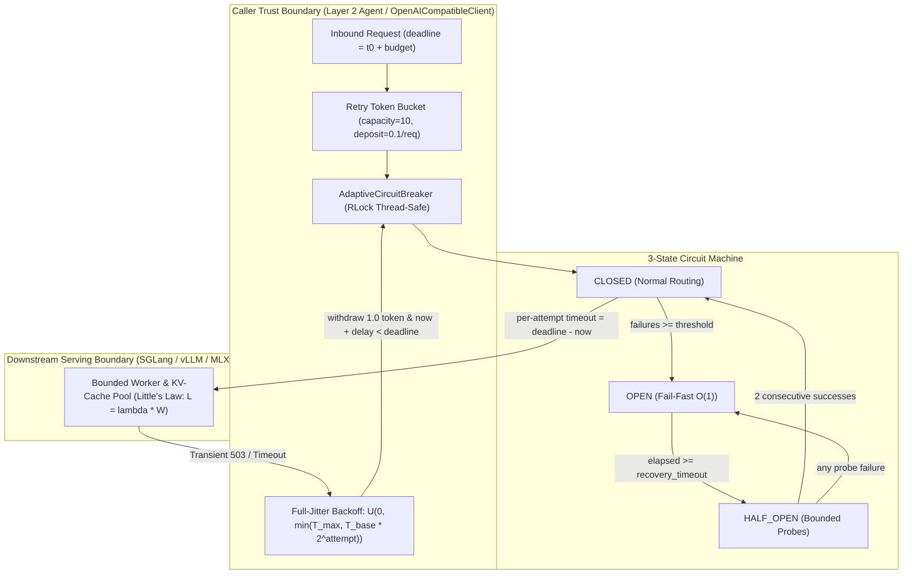
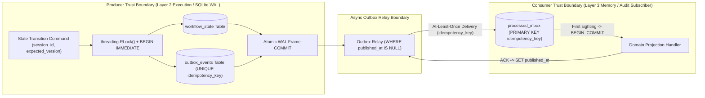
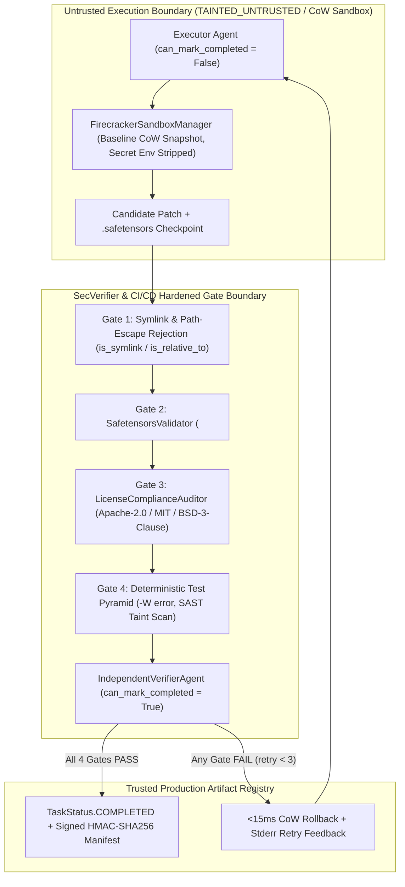
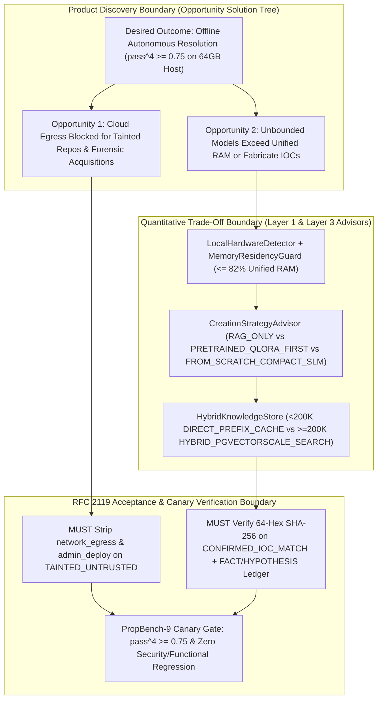

# `platform-core` Curated Training & Architectural Corpus — Software Engineering, Software Architecture & Product Discovery

**Parent Hub:** [`.agents/brain/README.md`](README.md)  
**Related Brain Indices:** [`knowledge-graph.md`](knowledge-graph.md), [`domain-playbooks-and-invariants.md`](domain-playbooks-and-invariants.md), [`symbol-and-contract-index.md`](symbol-and-contract-index.md)  
**Authoritative Policies:** [`AGENTS.md`](../../AGENTS.md), [`docs/architecture/system-architecture.md`](../../docs/architecture/system-architecture.md)

---

## Table of Contents

1. [Corpus Scope, Schema & Epistemic Grounding](#1-corpus-scope-schema--epistemic-grounding)
2. [`MOD-SWE-01` — Distributed Resilience: Cascading Retry Storms vs. Adaptive Circuit Breakers & Full-Jitter Exponential Backoff](#2-mod-swe-01--distributed-resilience-cascading-retry-storms-vs-adaptive-circuit-breakers--full-jitter-exponential-backoff)
3. [`MOD-SWE-02` — Modular Monolith vs. Event-Driven Microservices & Transactional Outbox Pattern](#3-mod-swe-02--modular-monolith-vs-event-driven-microservices--transactional-outbox-pattern)
4. [`MOD-PROD-01` — Testing Pyramid, Deterministic Verification Gates & CI/CD Supply-Chain Hardening](#4-mod-prod-01--testing-pyramid-deterministic-verification-gates--cicd-supply-chain-hardening)
5. [`MOD-PROD-02` — Hypothesis-Driven Product Discovery: Translating Ambiguous User Needs into Verifiable Technical Specs](#5-mod-prod-02--hypothesis-driven-product-discovery-translating-ambiguous-user-needs-into-verifiable-technical-specs)
6. [Machine-Parseable JSON Schema Summary](#6-machine-parseable-json-schema-summary)

---

## 1. Corpus Scope, Schema & Epistemic Grounding

This document curates four peer-reviewed, monograph-grounded training and reference modules covering **Domain 1 (Software Engineering & Software Architecture)** and **Domain 2 (Engineering Best Practices & Product Discovery / Brainstorming)** for `platform-core`. Each module adheres to the standardized `<output_format>` contract ingested by [`HybridKnowledgeStore`](../../src/platform_core/layer3_evolution/memory.py), [`ProjectBrainEngine`](../../src/platform_core/layer3_evolution/brain_engine.py), and [`CustomModelPipeline`](../../src/platform_core/layer1_intelligence/training.py):

- `module_id`: Unique deterministic identifier (`MOD-SWE-01`, `MOD-SWE-02`, `MOD-PROD-01`, `MOD-PROD-02`).
- `domain`: Canonical `platform-core` routing key (`"swe"` or `"architecture"`), mapped in [`router.py`](../../src/platform_core/layer1_intelligence/router.py).
- `target_platform`: Deployment target (`"backend"` or `"cross_platform"`).
- `standards_and_references`: Authoritative monographs, RFCs, peer-reviewed papers, and `platform-core` ADRs.
- `core_concepts`: First-principles mathematical and architectural exposition.
- `bad_vs_good_pair`: Side-by-side executable contrast pairing a vulnerable/fragile anti-pattern (`bad_example`) with a hardened, zero-dependency Python 3.11+ production pattern (`good_example`).
- `audit_and_verification_lab`: Deterministic CLI and unit-test verification steps enforceable by [`IndependentVerifierAgent`](../../src/platform_core/layer2_execution/agents.py).
- `multimodal_specs`:
  - `visual_diagram`: Mermaid architecture/state diagram explicitly delineating trust boundaries and failure domains, validated via [`DataAndVisualMCPServer.verify_mermaid_and_layout`](../../src/platform_core/layer2_execution/mcp_tools.py).
  - `audio_component`: Spoken architectural walkthrough and incident/design review transcript suitable for multimodal audio-text alignment.

---

## 2. `MOD-SWE-01` — Distributed Resilience: Cascading Retry Storms vs. Adaptive Circuit Breakers & Full-Jitter Exponential Backoff

### Metadata & `<output_format>` Header

| Field | Value |
| :--- | :--- |
| `module_id` | `MOD-SWE-01` |
| `domain` | `"swe"` |
| `target_platform` | `"backend"` |
| **Primary `platform-core` Anchor** | [`src/platform_core/layer1_intelligence/inference.py`](../../src/platform_core/layer1_intelligence/inference.py), [`src/platform_core/layer1_intelligence/serving.py`](../../src/platform_core/layer1_intelligence/serving.py) |

### `standards_and_references`

1. **Marc Brooker (AWS Architecture Blog, 2015)** — *"Exponential Backoff and Jitter"*: Demonstrates via simulation that **Full Jitter** ($t = \text{uniform}(0, \min(T_{\max}, T_{\text{base}} \cdot 2^{\text{attempt}}))$) minimizes total work and tail completion time under contention compared to no-jitter or equal-jitter schedules.
2. **Michael T. Nygard (2018)** — *Release It! Design and Deploy Production-Ready Software* (2nd ed., Pragmatic Bookshelf): Formalizes stability anti-patterns (Unbounded Result Sets, Blocked Threads, Cascading Failures) and stability patterns (Timeouts, Circuit Breaker, Bulkheads, Fail Fast).
3. **John D. C. Little (1961)** — *"A Proof for the Queuing Formula: $L = \lambda W$"* (*Operations Research*, 9(3), 383–387): Proves that the long-term average number of concurrent requests in a stationary system ($L$) equals the effective arrival rate ($\lambda$) multiplied by the mean residence time ($W$).
4. **Google SRE Book (Beyer et al., 2016)** — Chapter 21 (*"Handling Overload"*) & Chapter 22 (*"Addressing Cascading Failures"*): Mandates per-request deadline propagation, client-side adaptive throttling, and strict retry budgets (capping retries at $\le 10\%$ of total traffic via a token bucket).

### `core_concepts`

In a multi-tier distributed system or multi-agent inference mesh (such as [`OpenAICompatibleClient`](../../src/platform_core/layer1_intelligence/inference.py) calling an SGLang/vLLM backend configured in [`serving.py`](../../src/platform_core/layer1_intelligence/serving.py)), transient downstream degradation rapidly escalates into a catastrophic outage if callers employ naive synchronous retries.

#### 1. Queuing Collapse via Little's Law ($L = \lambda W$)
By Little's Law, the concurrency footprint $L$ (occupied worker threads, sockets, or KV-cache slots) is governed by:
$$L = \lambda_{\text{eff}} \cdot W$$
When a downstream dependency slows down from $W_0 = 20\text{ ms}$ to $W_1 = 2,000\text{ ms}$ (a $100\times$ latency spike) and upstream callers retry up to $k = 3$ times per logical request without circuit breaking, the effective arrival rate amplifies to $\lambda_{\text{eff}} = (1 + k)\lambda_0 = 4\lambda_0$. Concurrency demand explodes by $4 \times 100 = 400\times$, exhausting thread pools and file descriptors across every upstream caller.

#### 2. Thundering Herd Synchronization & Full-Jitter Backoff
Deterministic exponential backoff ($t = T_{\text{base}} \cdot 2^a$) causes callers that failed during the same congestion window to wake up in lockstep at $t_1, 2t_1, 4t_1, \dots$, creating periodic retry waves that repeatedly knock over the recovering dependency. **Full Jitter** breaks phase synchronization by sampling uniformly over the exponential envelope:
$$t_{\text{sleep}} \sim \mathcal{U}\!\left(0, \min\!\left(T_{\max}, T_{\text{base}} \cdot 2^{\text{attempt}}\right)\right)$$

#### 3. Three-State Adaptive Circuit Breaker + Retry Token Bucket
To prevent retry amplification during sustained outages, each dependency client combines:
- **3-State Machine (`CLOSED` $\rightarrow$ `OPEN` $\rightarrow$ `HALF_OPEN`)**:
  - `CLOSED`: Normal execution; tracks rolling failure rate over a sliding window. Trips to `OPEN` when failures reach `failure_threshold`.
  - `OPEN`: Fails fast in $\mathcal{O}(1)$ time without allocating sockets or threads until `recovery_timeout_sec` elapses.
  - `HALF_OPEN`: Admits a bounded number of probe requests (`half_open_max_calls`). If all probes succeed, transitions back to `CLOSED`; on any probe failure, immediately re-opens.
- **Client Retry Budget (Token Bucket)**: Normal requests deposit $r_{\text{deposit}}$ tokens (e.g., $0.1$ token per request) into a bounded bucket of capacity $C$. A retry is permitted only if a full token ($1.0$) can be withdrawn, mathematically bounding global retry amplification to $\le 10\%$ when the downstream service fails completely.
- **Deadline Propagation**: Every call carries an absolute monotonic deadline ($t_{\text{deadline}} = \text{monotonic}() + \text{budget}$). Before sleeping or issuing a retry, the client verifies $t_{\text{now}} + t_{\text{sleep}} < t_{\text{deadline}}$; otherwise it aborts immediately rather than wasting downstream compute on an already-expired user request.

### `bad_vs_good_pair`

#### `bad_example` — Unbounded Synchronous Retries, No Timeout, Fixed Sleep & Thundering Herd

```python
# ANTI-PATTERN: Unbounded / unbudgeted synchronous retries without socket timeouts,
# deadline propagation, jitter, or circuit breaking.
import urllib.request


def call_inference_endpoint_fragile(url: str, payload: bytes) -> bytes:
    attempt = 0
    while True:  # BUG 1: Unbounded retry loop amplifies load under outage
        try:
            req = urllib.request.Request(url, data=payload, method="POST")
            # BUG 2: No timeout parameter -> blocks worker thread indefinitely on hung socket
            with urllib.request.urlopen(req) as resp:
                return resp.read()
        except Exception:
            attempt += 1
            # BUG 3: No jitter or circuit breaker -> synchronized thundering herd across workers
            if attempt > 10:
                raise
```

#### `good_example` — Thread-Safe 3-State Circuit Breaker, Token-Bucket Retry Budget, Full Jitter & Deadline Propagation

```python
from __future__ import annotations

from dataclasses import dataclass
from enum import Enum
import random
import threading
import time
from typing import Callable, TypeVar

T = TypeVar("T")


class CircuitState(str, Enum):
    CLOSED = "CLOSED"
    OPEN = "OPEN"
    HALF_OPEN = "HALF_OPEN"


class CircuitOpenError(RuntimeError):
    """Raised when the circuit breaker fails fast or the retry budget/deadline is exhausted."""


@dataclass(frozen=True)
class ResiliencePolicy:
    failure_threshold: int = 5
    recovery_timeout_sec: float = 10.0
    half_open_success_threshold: int = 2
    max_attempts: int = 3
    base_backoff_sec: float = 0.05
    max_backoff_sec: float = 2.0
    retry_token_capacity: float = 10.0
    retry_token_deposit_per_call: float = 0.1  # Caps global retry ratio at 10%

    def __post_init__(self) -> None:
        if isinstance(self.failure_threshold, bool) or self.failure_threshold < 1:
            raise ValueError("failure_threshold must be a positive integer")
        if isinstance(self.max_attempts, bool) or self.max_attempts < 1:
            raise ValueError("max_attempts must be a positive integer")
        if self.base_backoff_sec <= 0.0 or self.max_backoff_sec < self.base_backoff_sec:
            raise ValueError("Invalid backoff bounds")


class AdaptiveCircuitBreaker:
    """Thread-safe 3-state circuit breaker with token-bucket retry budget and full-jitter backoff."""

    def __init__(
        self,
        policy: ResiliencePolicy | None = None,
        clock: Callable[[], float] = time.monotonic,
        sleeper: Callable[[float], None] = time.sleep,
        rng: random.Random | None = None,
    ) -> None:
        self._policy = policy or ResiliencePolicy()
        self._clock = clock
        self._sleeper = sleeper
        self._rng = rng or random.Random(42)
        self._lock = threading.RLock()

        self._state = CircuitState.CLOSED
        self._consecutive_failures = 0
        self._half_open_successes = 0
        self._opened_at = 0.0
        self._retry_tokens = self._policy.retry_token_capacity

    @property
    def state(self) -> CircuitState:
        with self._lock:
            self._check_open_to_half_open_locked()
            return self._state

    def _check_open_to_half_open_locked(self) -> None:
        if self._state == CircuitState.OPEN:
            if (self._clock() - self._opened_at) >= self._policy.recovery_timeout_sec:
                self._state = CircuitState.HALF_OPEN
                self._half_open_successes = 0

    def _before_call_locked(self) -> None:
        self._check_open_to_half_open_locked()
        if self._state == CircuitState.OPEN:
            raise CircuitOpenError("Circuit breaker is OPEN; failing fast")

    def _on_success_locked(self) -> None:
        if self._state == CircuitState.HALF_OPEN:
            self._half_open_successes += 1
            if self._half_open_successes >= self._policy.half_open_success_threshold:
                self._state = CircuitState.CLOSED
                self._consecutive_failures = 0
        else:
            self._consecutive_failures = 0

    def _on_failure_locked(self) -> None:
        self._consecutive_failures += 1
        if (
            self._state == CircuitState.HALF_OPEN
            or self._consecutive_failures >= self._policy.failure_threshold
        ):
            self._state = CircuitState.OPEN
            self._opened_at = self._clock()

    def _try_withdraw_retry_token_locked(self) -> bool:
        if self._retry_tokens >= 1.0:
            self._retry_tokens -= 1.0
            return True
        return False

    def compute_full_jitter_delay(self, attempt: int) -> float:
        cap = min(
            self._policy.max_backoff_sec,
            self._policy.base_backoff_sec * (2 ** max(0, attempt - 1)),
        )
        return self._rng.uniform(0.0, cap)

    def execute(self, fn: Callable[[float], T], timeout_budget_sec: float) -> T:
        if timeout_budget_sec <= 0.0:
            raise ValueError("timeout_budget_sec must be positive")
        deadline = self._clock() + timeout_budget_sec

        with self._lock:
            self._retry_tokens = min(
                self._policy.retry_token_capacity,
                self._retry_tokens + self._policy.retry_token_deposit_per_call,
            )

        last_exc: Exception | None = None
        for attempt in range(1, self._policy.max_attempts + 1):
            with self._lock:
                self._before_call_locked()

            remaining = deadline - self._clock()
            if remaining <= 0.0:
                raise TimeoutError("Deadline expired before attempt execution")

            try:
                result = fn(remaining)
            except Exception as exc:
                last_exc = exc
                with self._lock:
                    self._on_failure_locked()
                    can_retry = (
                        attempt < self._policy.max_attempts
                        and self._state != CircuitState.OPEN
                        and self._try_withdraw_retry_token_locked()
                    )
                if not can_retry:
                    break
                delay = self.compute_full_jitter_delay(attempt)
                if (self._clock() + delay) >= deadline:
                    break
                self._sleeper(delay)
            else:
                with self._lock:
                    self._on_success_locked()
                return result

        assert last_exc is not None
        raise last_exc
```

### `audit_and_verification_lab`

1. **Deterministic State-Transition & Deadline Verification**:
   - Simulate 5 consecutive downstream socket timeouts using a fake monotonic clock (`clock`) and no-op sleeper (`sleeper`).
   - Assert the circuit transitions `CLOSED -> OPEN` on failure #5 and raises `CircuitOpenError` in $\mathcal{O}(1)$ with zero downstream invocations on call #6.
   - Advance the fake clock by `recovery_timeout_sec` (`10.0s`), execute 2 successful probe calls, and verify transition `OPEN -> HALF_OPEN -> CLOSED`.
2. **Retry Amplification Bound Check**:
   - Drain the token bucket (`retry_token_capacity=10.0`) under 100% downstream error rate and verify that once 10 retries are consumed, subsequent requests execute at most `1` attempt per `10` primary calls ($\le 10\%$ retry overhead).
3. **Workspace Verification Command**:
   ```bash
   PYTHONPATH=src .venv/bin/python -W error -m unittest tests/test_hardening_and_Convert.py -v
   ```

### `multimodal_specs`

#### `visual_diagram`



#### `audio_component`

> **Voice Walkthrough Transcript (`MOD-SWE-01`, 16 kHz Mono PCM Reference, Duration ~65s):**  
> *"Welcome to Module SWE-01 on Distributed Resilience. When an inference or microservice backend experiences a latency spike, Little's Law—L equals lambda times W—tells us that holding arrival rate constant while residence time W jumps by a factor of fifty immediately multiplies concurrent in-flight connections by fifty. If upstream clients respond by launching synchronous retries without jitter, they multiply effective arrival rate lambda at the exact moment capacity is lowest, triggering a cascading retry storm. Notice in our good example how we break this positive feedback loop at three distinct layers. First, every logical request deposits just one-tenth of a token into a thread-safe retry bucket, mathematically capping global retry amplification at ten percent. Second, any retry sleep is sampled uniformly between zero and the capped exponential envelope—Marc Brooker's Full Jitter law—desynchronizing caller wakeups. Third, once consecutive failures cross our threshold, the three-state circuit breaker trips to OPEN, failing fast in constant time and propagating remaining monotonic deadlines so expired requests never consume downstream compute."*

---

## 3. `MOD-SWE-02` — Modular Monolith vs. Event-Driven Microservices & Transactional Outbox Pattern

### Metadata & `<output_format>` Header

| Field | Value |
| :--- | :--- |
| `module_id` | `MOD-SWE-02` |
| `domain` | `"architecture"` |
| `target_platform` | `"backend"` |
| **Primary `platform-core` Anchor** | [`src/platform_core/layer2_execution/state.py`](../../src/platform_core/layer2_execution/state.py), [`src/platform_core/layer3_evolution/memory.py`](../../src/platform_core/layer3_evolution/memory.py) |

### `standards_and_references`

1. **Martin Kleppmann (2017)** — *Designing Data-Intensive Applications* (O'Reilly Media), Chapters 7 (*"Transactions"*), 11 (*"Stream Processing"*), and 12 (*"The Future of Data Systems"*): Analyses why dual writes to heterogeneous storage engines (e.g., relational DB + message broker) violate atomicity and cause permanent state divergence without atomic commit or change-data-capture/outbox log derivation.
2. **Martin Fowler (2015)** — *"MonolithFirst"* & Chris Richardson (2018) *Microservices Patterns* (Manning): Defines the **Modular Monolith** boundary enforcement strategy and the **Transactional Outbox** + **Idempotent Consumer** pattern.
3. **`platform-core` ADR-0001** — [`ADR-0001-three-layer-hybrid-architecture-and-post-training.md`](../../docs/architecture/decisions/ADR-0001-three-layer-hybrid-architecture-and-post-training.md): Establishes strict three-layer modular boundaries (`layer1_intelligence`, `layer2_execution`, `layer3_evolution`) inside a single zero-dependency package.
4. **`platform-core` ADR-0007** — [`ADR-0007-multi-region-sqlite-checkpointing.md`](../artifacts/security-audit/arch_upgrades/ADRs/ADR-0007-multi-region-sqlite-checkpointing.md): Standardizes thread-safe SQLite Write-Ahead Logging (`PRAGMA journal_mode=WAL`, `PRAGMA busy_timeout=30000`, `check_same_thread=False`, `threading.RLock()`) for deterministic checkpoint persistence and consensus synchronization in [`SQLiteStorageBackend`](../../src/platform_core/layer2_execution/state.py).

### `core_concepts`

Prematurely decomposing a system into network-separated microservices introduces distributed failure modes—partial failures, clock skew, out-of-order message delivery, and schema drift—before domain boundaries stabilize. `platform-core` exemplifies a **Modular Monolith with Explicit Layer Contracts**: [`layer1_intelligence`](../../src/platform_core/layer1_intelligence/), [`layer2_execution`](../../src/platform_core/layer2_execution/), and [`layer3_evolution`](../../src/platform_core/layer3_evolution/) communicate through strongly typed dataclasses and verified SQLite WAL stores while remaining deployable as a single hermetic process or decoupled over JSON-RPC stdio ([`AgyStdioMCPBridge`](../../src/platform_core/layer2_execution/agy_sdk_bridge.py)).

#### 1. The Dual-Write Anti-Pattern
When a service updates local state in SQLite/PostgreSQL and publishes an event to a message broker (or secondary index) as two separate network calls without a distributed two-phase commit (2PC):
- **Crash after DB commit, before broker publish**: State is mutated locally, but downstream consumers never receive the event (silent data loss).
- **Publish before DB commit, followed by DB rollback**: Downstream consumers act on a phantom event whose state transition never committed.
- **Concurrent dual writes**: Two threads/processes interleave in opposite orders on the database and broker, permanently diverging replica state.

#### 2. Atomic Transactional Outbox in SQLite WAL Mode
The **Transactional Outbox** converts a cross-system dual write into a **single local ACID transaction**:
1. Within one `BEGIN IMMEDIATE ... COMMIT` transaction guarded by `threading.RLock()`, the producer writes both the domain state mutation (`workflow_state`) and an immutable event record (`outbox_events`) into the same SQLite WAL database.
2. Because SQLite WAL commits atomically at the frame boundary, either **both** the state update and the outbox event exist on disk, or **neither** does.
3. An asynchronous relay polls unpublished `outbox_events` (`published_at IS NULL`), delivers them with at-least-once semantics using a deterministic `idempotency_key` (SHA-256 over `(aggregate_id, step_seq, payload_hash)`), and marks `published_at`.

#### 3. Idempotent Consumer Deduplication
Because the outbox relay guarantees **at-least-once** delivery (a crash after broker acknowledgment but before marking `published_at` will re-deliver the event), every consumer maintains a `processed_inbox` table keyed by `idempotency_key` inside its own transaction boundary, turning at-least-once transport into **effectively-once** state application.

### `bad_vs_good_pair`

#### `bad_example` — Non-Atomic Dual Write Across Database and Event Bus Without Thread Serialization

```python
# ANTI-PATTERN: Dual-write race condition and split-brain state drift
import sqlite3
from typing import Any


class FragileWorkflowService:
    def __init__(self, db_path: str, broker_client: Any) -> None:
        # BUG 1: Default journal mode (DELETE) and no busy_timeout or RLock
        self.conn = sqlite3.connect(db_path)
        self.broker = broker_client

    def transition_workflow(self, session_id: str, new_status: str) -> None:
        # BUG 2: Commits DB first, then calls external broker non-atomically.
        # If self.broker.publish() raises or the process crashes here,
        # the database shows new_status while downstream subscribers never learn of it.
        self.conn.execute(
            "UPDATE workflow_state SET status = ? WHERE session_id = ?",
            (new_status, session_id),
        )
        self.conn.commit()
        self.broker.publish(
            topic="workflow.events",
            message={"session_id": session_id, "status": new_status},
        )
```

#### `good_example` — Thread-Safe SQLite WAL Transactional Outbox & Idempotent Consumer

```python
from __future__ import annotations

from dataclasses import dataclass
import hashlib
import json
import sqlite3
import threading
import time
from typing import Callable


@dataclass(frozen=True)
class OutboxEvent:
    event_id: int
    idempotency_key: str
    aggregate_id: str
    event_type: str
    payload_json: str
    created_at: float


class SQLiteTransactionalOutboxStore:
    """Thread-safe SQLite WAL store implementing atomic state + outbox writes and idempotent consumption."""

    def __init__(self, db_path: str = ":memory:") -> None:
        self._db_path = db_path
        self._lock = threading.RLock()
        self._conn = sqlite3.connect(db_path, check_same_thread=False, isolation_level=None)
        with self._lock:
            if db_path != ":memory:":
                self._conn.execute("PRAGMA journal_mode=WAL;")
            self._conn.execute("PRAGMA busy_timeout=30000;")
            self._conn.execute("PRAGMA synchronous=NORMAL;")
            self._init_schema_locked()

    def _init_schema_locked(self) -> None:
        self._conn.execute(
            """
            CREATE TABLE IF NOT EXISTS workflow_state (
                session_id TEXT PRIMARY KEY,
                status TEXT NOT NULL,
                version INTEGER NOT NULL,
                updated_at REAL NOT NULL
            );
            """
        )
        self._conn.execute(
            """
            CREATE TABLE IF NOT EXISTS outbox_events (
                event_id INTEGER PRIMARY KEY AUTOINCREMENT,
                idempotency_key TEXT NOT NULL UNIQUE,
                aggregate_id TEXT NOT NULL,
                event_type TEXT NOT NULL,
                payload_json TEXT NOT NULL,
                created_at REAL NOT NULL,
                published_at REAL
            );
            """
        )
        self._conn.execute(
            """
            CREATE TABLE IF NOT EXISTS processed_inbox (
                idempotency_key TEXT PRIMARY KEY,
                processed_at REAL NOT NULL
            );
            """
        )

    def transition_state_atomically(
        self,
        session_id: str,
        new_status: str,
        expected_version: int,
    ) -> str:
        """Atomically updates workflow_state with optimistic concurrency and appends an outbox event."""
        if not session_id or not new_status:
            raise ValueError("session_id and new_status must be non-empty")
        if isinstance(expected_version, bool) or expected_version < 0:
            raise ValueError("expected_version must be a non-negative integer")

        now = time.time()
        next_version = expected_version + 1
        payload_dict = {
            "session_id": session_id,
            "status": new_status,
            "version": next_version,
        }
        payload_json = json.dumps(payload_dict, sort_keys=True)
        idempotency_key = hashlib.sha256(
            f"{session_id}:{next_version}:{payload_json}".encode("utf-8")
        ).hexdigest()

        with self._lock:
            self._conn.execute("BEGIN IMMEDIATE;")
            try:
                if expected_version == 0:
                    self._conn.execute(
                        """
                        INSERT INTO workflow_state (session_id, status, version, updated_at)
                        VALUES (?, ?, 1, ?)
                        """,
                        (session_id, new_status, now),
                    )
                else:
                    cursor = self._conn.execute(
                        """
                        UPDATE workflow_state
                        SET status = ?, version = ?, updated_at = ?
                        WHERE session_id = ? AND version = ?
                        """,
                        (new_status, next_version, now, session_id, expected_version),
                    )
                    if cursor.rowcount != 1:
                        raise RuntimeError(
                            f"Optimistic concurrency conflict for session {session_id} at v{expected_version}"
                        )

                self._conn.execute(
                    """
                    INSERT INTO outbox_events
                        (idempotency_key, aggregate_id, event_type, payload_json, created_at)
                    VALUES (?, ?, 'WORKFLOW_STATUS_CHANGED', ?, ?)
                    """,
                    (idempotency_key, session_id, payload_json, now),
                )
                self._conn.execute("COMMIT;")
            except Exception:
                self._conn.execute("ROLLBACK;")
                raise

        return idempotency_key

    def relay_pending_events(self, consumer_fn: Callable[[OutboxEvent], None], batch_size: int = 50) -> int:
        """Drains unpublished outbox events and marks them published upon idempotent consumer success."""
        if isinstance(batch_size, bool) or batch_size < 1:
            raise ValueError("batch_size must be a positive integer")

        with self._lock:
            rows = self._conn.execute(
                """
                SELECT event_id, idempotency_key, aggregate_id, event_type, payload_json, created_at
                FROM outbox_events
                WHERE published_at IS NULL
                ORDER BY event_id ASC
                LIMIT ?
                """,
                (batch_size,),
            ).fetchall()

        delivered = 0
        for row in rows:
            evt = OutboxEvent(*row)
            consumer_fn(evt)
            with self._lock:
                self._conn.execute(
                    "UPDATE outbox_events SET published_at = ? WHERE event_id = ?",
                    (time.time(), evt.event_id),
                )
            delivered += 1
        return delivered

    def consume_idempotently(self, event: OutboxEvent, handler: Callable[[dict[str, object]], None]) -> bool:
        """Applies event handler at most once per unique idempotency_key."""
        with self._lock:
            self._conn.execute("BEGIN IMMEDIATE;")
            try:
                existing = self._conn.execute(
                    "SELECT 1 FROM processed_inbox WHERE idempotency_key = ?",
                    (event.idempotency_key,),
                ).fetchone()
                if existing is not None:
                    self._conn.execute("COMMIT;")
                    return False

                handler(json.loads(event.payload_json))
                self._conn.execute(
                    "INSERT INTO processed_inbox (idempotency_key, processed_at) VALUES (?, ?)",
                    (event.idempotency_key, time.time()),
                )
                self._conn.execute("COMMIT;")
                return True
            except Exception:
                self._conn.execute("ROLLBACK;")
                raise
```

### `audit_and_verification_lab`

1. **Atomicity & Fault-Injection Verification**:
   - Trigger an optimistic concurrency conflict (`expected_version` mismatch) during `transition_state_atomically` and assert `SELECT COUNT(*) FROM outbox_events` remains `0` (zero phantom outbox rows on rollback).
2. **At-Least-Once Relay + Idempotent Consumer Verification**:
   - Replay the same `OutboxEvent` twice into `consume_idempotently`; assert the first call returns `True` and invokes `handler`, while the duplicate delivery returns `False` and leaves downstream state untouched.
3. **Workspace Verification Command**:
   ```bash
   PYTHONPATH=src .venv/bin/python -W error -m unittest tests/test_platform_core.py -v
   ```

### `multimodal_specs`

#### `visual_diagram`



#### `audio_component`

> **Voice Walkthrough Transcript (`MOD-SWE-02`, 16 kHz Mono PCM Reference, Duration ~60s):**  
> *"Welcome to Module SWE-02 on Modular Monoliths and the Transactional Outbox Pattern. A classic failure mode in event-driven systems is the dual-write anti-pattern: updating a database row and publishing a message to a broker in two separate calls. If the process crashes after the database commit but before the broker acknowledgment, downstream projections silently drift out of sync forever. We solve this without distributed two-phase commit by pairing a modular monolith boundary with a SQLite Write-Ahead Log Transactional Outbox. Inside a single RLock-serialized BEGIN IMMEDIATE transaction, we perform an optimistic-concurrency update on workflow_state and insert an immutable event row keyed by a deterministic SHA-256 idempotency hash into outbox_events. Both rows commit in the exact same WAL frame. An asynchronous relay then drains unpublished rows with at-least-once delivery, while the consumer records each idempotency key in its processed_inbox table inside its own transaction, giving us end-to-end effectively-once state consistency."*

---

## 4. `MOD-PROD-01` — Testing Pyramid, Deterministic Verification Gates & CI/CD Supply-Chain Hardening

### Metadata & `<output_format>` Header

| Field | Value |
| :--- | :--- |
| `module_id` | `MOD-PROD-01` |
| `domain` | `"swe"` |
| `target_platform` | `"cross_platform"` |
| **Primary `platform-core` Anchor** | [`src/platform_core/layer2_execution/agents.py`](../../src/platform_core/layer2_execution/agents.py), [`src/platform_core/layer2_execution/sandbox.py`](../../src/platform_core/layer2_execution/sandbox.py), [`src/platform_core/deploy_security/governance.py`](../../src/platform_core/deploy_security/governance.py) |

### `standards_and_references`

1. **SLSA v1.0 Specification (Supply-chain Levels for Software Artifacts, OpenSSF / Linux Foundation, 2023)**: Defines hermetic build provenance, tamper-evident artifact digests, and verification gates across Build Levels L1–L3.
2. **OWASP Top 10 CI/CD Security Risks (2023)** — `CICD-SEC-1` (*Insufficient Flow Control Mechanisms*), `CICD-SEC-4` (*Poisoned Pipeline Execution*), and `CICD-SEC-6` (*Insufficient Credential Hygiene*): Mandates independent approval/verification separation, secret stripping (`AWS_*`, `GITHUB_TOKEN`, `OPENAI_API_KEY`, `HF_TOKEN`) in build/test sandboxes, and zero arbitrary deserialization (`pickle`).
3. **`platform-core` ADR-0002** — [`ADR-0002-executor-verifier-separation-and-cow-rollback.md`](../../docs/architecture/decisions/ADR-0002-executor-verifier-separation-and-cow-rollback.md): Enforces the **`SecVerifier` Dual-Gate** (Invariant 1), where no executor agent may mark a task `COMPLETED`, and failed candidate patches roll back via `<15ms` Copy-on-Write (`CoWSnapshot`) sandbox restoration.
4. **`platform-core` ADR-0003** — [`ADR-0003-taint-isolation-safetensors-and-sovereign-licensing.md`](../../docs/architecture/decisions/ADR-0003-taint-isolation-safetensors-and-sovereign-licensing.md): Enforces `SafetensorsValidator` (rejecting `.pkl`/`.pt`/`.bin` and `\x80\x02`..`\x80\x05` pickle headers), `SignedManifestVerifier` HMAC-SHA256 tool manifests, and sovereign permissive licensing (`Apache-2.0`, `MIT`, `BSD-3-Clause`).

### `core_concepts`

When autonomous coding agents or human developers ship code and model weights, two failure modes threaten pipeline integrity:
1. **The Inverted "Ice-Cream Cone" Test Suite & Self-Approving Agents**: Relying on slow, network-dependent end-to-end tests causes non-deterministic flake rates, while allowing an executor agent (`SoftwareEngineeringAgent`) to grade its own output (`status = COMPLETED`) invites reward hacking (e.g., deleting failing assertions or mocking the system under test).
2. **ML & CI Supply-Chain Deserialization Attacks**: Loading unverified PyTorch `.pt`/`.pkl` checkpoints executes arbitrary Python bytecode via `pickle.loads` (`CWE-502`), and syncing sandbox files back to a host workspace without symlink rejection allows arbitrary host file overwrite via symlink traversal (`CWE-59`).

#### 1. The Deterministic Verification Pyramid (`-W error`)
`platform-core` structures verification into four deterministic, hermetic tiers executed under Python's strict warning gate (`-W error`):
- **Tier 1 — Fast Unit & Property Tests (~70% of checks, `<5ms`/test)**: Pure in-memory tests covering math invariants (finite-sample Shannon entropy $\min(8.0, \log_2 N)$, DWARF byte-interval IoU, 200K-token routing threshold) with zero network or external process dependencies.
- **Tier 2 — Contract & Schema Tests (~20% of checks)**: Validates SQLite WAL table contracts, JSON-RPC stdio framing (`MAX_JSONRPC_LINE_BYTES`), HMAC-SHA256 tool manifests, and `.safetensors` contiguous byte-span headers (`shape * dtype_size == data_offsets[1] - data_offsets[0]`).
- **Tier 3 — Isolated CoW Sandbox Integration Tests (~10% of checks)**: Executes inside [`FirecrackerSandboxManager`](../../src/platform_core/layer2_execution/sandbox.py) with stripped environment credentials, symlink-safe sync-back, and `<15ms` CoW snapshot rollback on test failure.

#### 2. Executor vs. Verifier Separation (`SecVerifier` Invariant 1)
Every executor agent subclasses [`BaseAgentNode`](../../src/platform_core/layer2_execution/agents.py) with `can_mark_completed = False`. Even if an executor claims success, [`ExecutionLifecycleOrchestrator`](../../src/platform_core/layer2_execution/orchestrator.py) transitions the workflow to Step 7 (`STEP_7_INDEPENDENT_VERIFICATION`), where **only** [`IndependentVerifierAgent`](../../src/platform_core/layer2_execution/agents.py) (`can_mark_completed = True`) can set `TaskStatus.COMPLETED` after running the deterministic test, SAST taint, and supply-chain oracle.

### `bad_vs_good_pair`

#### `bad_example` — Self-Approving Executor Agent, Unpinned Pickle Checkpoint & Symlink-Vulnerable Workspace Copy

```python
# ANTI-PATTERN: Self-approving agent + unsafe pickle deserialization + symlink traversal
from pathlib import Path
import pickle
import shutil


def unsafe_agent_pipeline(sandbox_dir: Path, host_dir: Path, checkpoint_path: Path) -> str:
    # BUG 1: Arbitrary code execution via pickle.loads on model checkpoint (CWE-502)
    weights = pickle.loads(checkpoint_path.read_bytes())

    # BUG 2: Blindly copying files from untrusted sandbox without rejecting symlinks (CWE-59)
    for item in sandbox_dir.rglob("*"):
        if item.is_file():
            rel = item.relative_to(sandbox_dir)
            shutil.copy2(item, host_dir / rel)

    # BUG 3: Executor grades its own work as COMPLETED without an independent verifier gate
    return f"COMPLETED (loaded {len(weights)} layers)"
```

#### `good_example` — `SecVerifier` Dual-Gate Separation, Zero-Pickle `SafetensorsValidator` & Symlink-Safe CoW Sandbox Gate

```python
from __future__ import annotations

from dataclasses import dataclass
from pathlib import Path
from platform_core.deploy_security.governance import (
    LicenseComplianceAuditor,
    SafetensorsValidator,
)
from platform_core.layer2_execution.state import PlatformState, TaskStatus, TaintLevel


@dataclass(frozen=True)
class SupplyChainVerificationGate:
    """Deterministic CI/CD & SecVerifier gate enforcing Invariants 1, 2, and 7."""

    can_mark_completed: bool = True

    def verify_and_promote(
        self,
        state: PlatformState,
        sandbox_root: Path,
        checkpoint_path: Path,
        license_spdx: str,
        unit_tests_passed: bool,
    ) -> PlatformState:
        if not self.can_mark_completed:
            raise PermissionError("Only IndependentVerifierAgent (can_mark_completed=True) may promote tasks")

        # Gate 1: Enforce Taint Isolation (Invariant 2)
        if state.taint_level == TaintLevel.TAINTED_UNTRUSTED:
            forbidden = {"network_egress", "admin_deploy"} & set(state.active_capabilities)
            if forbidden:
                state.status = TaskStatus.FAILED_VERIFICATION
                raise PermissionError(f"Tainted session retains forbidden capabilities: {sorted(forbidden)}")

        # Gate 2: Reject symlinks and path escapes in sandbox artifacts (CWE-59 / CWE-22)
        if sandbox_root.is_symlink():
            state.status = TaskStatus.FAILED_VERIFICATION
            raise ValueError("Sandbox root must not be a symlink")
        resolved_root = sandbox_root.resolve()
        for candidate in sandbox_root.rglob("*"):
            if candidate.is_symlink():
                state.status = TaskStatus.FAILED_VERIFICATION
                raise ValueError(f"Symlink rejected inside sandbox: {candidate}")
            if not candidate.resolve().is_relative_to(resolved_root):
                state.status = TaskStatus.FAILED_VERIFICATION
                raise ValueError(f"Path escape rejected inside sandbox: {candidate}")

        # Gate 3: Sovereign License Audit (Apache-2.0 / MIT / BSD-3-Clause only)
        lic_report = LicenseComplianceAuditor().audit_license(license_spdx)
        if not lic_report.approved:
            state.status = TaskStatus.FAILED_VERIFICATION
            raise ValueError(f"Unapproved license '{license_spdx}': {lic_report.reason}")

        # Gate 4: Zero-pickle Safetensors binary header & contiguous span validation (Invariant 7)
        st_report = SafetensorsValidator().validate_file(checkpoint_path)
        if not st_report.valid:
            state.status = TaskStatus.FAILED_VERIFICATION
            raise ValueError(f"Safetensors validation failed: {st_report.reason}")

        # Gate 5: Deterministic Test Pyramid result
        if not unit_tests_passed:
            state.status = TaskStatus.FAILED_VERIFICATION
            return state

        state.status = TaskStatus.COMPLETED
        return state
```

### `audit_and_verification_lab`

1. **Strict Warning-Gate Pyramid Execution**:
   - Run the complete 8-module unit, integration, and security test suite with warnings promoted to errors (`-W error`):
     ```bash
     PYTHONPATH=src .venv/bin/python -W error -m unittest discover -s tests -v
     ```
2. **Executable Multi-Domain Benchmark Suite Verification**:
   - Run the 5 deterministic benchmark suites (`swe`, `cyber`, `binrev`, `data_protocol`, `hybrid_rag`) via [`BenchmarkSuiteRunner`](../../src/platform_core/layer3_evolution/evaluation.py):
     ```bash
     PYTHONPATH=src .venv/bin/python -m platform_core.cli run-benchmarks
     ```
3. **Negative Security Gate Checks**:
   - Verify that feeding a file with pickle magic bytes (`\x80\x04`) or a `<Q` header length of `640` (`\x80\x02\x00\x00\x00\x00\x00\x00`) into `SafetensorsValidator.validate_file()` returns `valid=False`.

### `multimodal_specs`

#### `visual_diagram`



#### `audio_component`

> **Voice Walkthrough Transcript (`MOD-PROD-01`, 16 kHz Mono PCM Reference, Duration ~62s):**  
> *"Welcome to Module PROD-01 on the Testing Pyramid, Deterministic Verification Gates, and CI/CD Supply-Chain Hardening. In autonomous software engineering and local model creation, allowing an executor agent to mark its own task completed—or loading unverified pickle checkpoints—creates critical supply-chain vulnerabilities. In platform-core, we enforce the SecVerifier Dual-Gate architecture established in ADR-0002 and ADR-0003. Every executor agent has can_mark_completed hardcoded to False and runs inside a Copy-on-Write sandbox with stripped secret environment variables. Before any candidate patch or model artifact can advance, the IndependentVerifierAgent runs four deterministic gates: first, rejecting symlinks and path escapes during sandbox sync-back; second, validating zero-pickle Safetensors headers and contiguous byte spans; third, auditing sovereign permissive SPDX licenses; and fourth, running our unit and contract test pyramid under Python's minus-W-error flag. If any check fails, the sandbox rolls back to its clean snapshot in under fifteen milliseconds."*

---

## 5. `MOD-PROD-02` — Hypothesis-Driven Product Discovery: Translating Ambiguous User Needs into Verifiable Technical Specs

### Metadata & `<output_format>` Header

| Field | Value |
| :--- | :--- |
| `module_id` | `MOD-PROD-02` |
| `domain` | `"architecture"` |
| `target_platform` | `"cross_platform"` |
| **Primary `platform-core` Anchor** | [`src/platform_core/layer1_intelligence/models.py`](../../src/platform_core/layer1_intelligence/models.py), [`src/platform_core/layer1_intelligence/scratch_trainer.py`](../../src/platform_core/layer1_intelligence/scratch_trainer.py), [`src/platform_core/layer3_evolution/evaluation.py`](../../src/platform_core/layer3_evolution/evaluation.py) |

### `standards_and_references`

1. **Teresa Torres (2021)** — *Continuous Discovery Habits: Discover Products that Create Customer Value and Business Value* (Product Talk LLC): Formalizes the **Opportunity Solution Tree (OST)** connecting measurable Desired Outcomes to user Opportunities, target Solutions, and rapid falsifiable Assumption Tests.
2. **Marty Cagan (2017)** — *Inspired: How to Create Tech Products Customers Love* (2nd ed., Wiley): Distinguishes outcome-driven product discovery (tackling Value, Usability, Feasibility, and Viability risks upfront) from output-driven feature factories.
3. **IETF RFC 2119 (Bradner, 1997)** — *"Key words for use in RFCs to Indicate Requirement Levels"*: Defines normative engineering requirement keywords (`MUST`, `MUST NOT`, `REQUIRED`, `SHALL`, `SHOULD`, `MAY`) so product specifications map 1-to-1 to automated verification assertions.
4. **`platform-core` ADR-0004, ADR-0005 & ADR-0006** — [`ADR-0004`](../../docs/architecture/decisions/ADR-0004-bitemporal-memory-and-200k-hybrid-knowledge-store.md), [`ADR-0005`](../../docs/architecture/decisions/ADR-0005-local-first-open-weight-forensics-and-vuln-intel.md), [`ADR-0006`](../../docs/architecture/decisions/ADR-0006-local-ai-creator-and-antigravity-sdk.md): Operationalize hardware memory residency caps (`82%` unified RAM via [`MemoryResidencyGuard`](../../src/platform_core/layer1_intelligence/inference.py)), the 200K-token hybrid retrieval boundary, and `PropBench-9` multi-trial stability gates (`pass^4 >= 0.75`).

### `core_concepts`

Ambiguous product requests (*"Build an AI assistant that understands our codebase and security logs, runs locally, is super fast, and never hallucinates"*) routinely fail in engineering execution because they conflate **user opportunities** with **unbounded technical mechanisms** and lack falsifiable acceptance criteria.

#### 1. The Opportunity Solution Tree (OST) & Falsifiable Hypothesis Formulation
To translate an ambiguous stakeholder request into an executable architecture specification, we decompose it across four structured levels:
1. **Desired Outcome (Measurable System Metric)**: e.g., *"Achieve $\ge 75\%$ multi-trial autonomous resolution stability ($\text{pass}^4 \ge 0.75$) on repository bug-fix and vulnerability-triage tasks while operating 100% offline on a 64 GB Apple Silicon workstation."*
2. **Opportunity (Pain Point / Unmet Need)**: Engineers cannot send proprietary source code or forensic mobile acquisitions to third-party cloud APIs, yet naive local models exceed unified RAM or fabricate non-existent file paths and CVEs.
3. **Architectural Solution & Trade-Off Matrix**: Evaluate candidate paths via [`CreationStrategyAdvisor.recommend()`](../../src/platform_core/layer1_intelligence/scratch_trainer.py) and [`HardwareFeasibilityPlanner`](../../src/platform_core/layer1_intelligence/models.py):
   - *Option A (`RAG_ONLY`)*: Zero training cost, instant updates via `DIRECT_PREFIX_CACHE` ($<200\text{K}$ tokens), but does not adapt domain syntax or tool-calling schemas.
   - *Option B (`PRETRAINED_QLORA_FIRST`)*: Specializes an Apache-2.0 open-weight base model (`Qwen3.5-35B-A3B` at 4-bit quantization $\approx 21.5\text{ GB}$ RAM) using 4-gate decontaminated trajectories, fitting comfortably below the `82%` ($52.48\text{ GB}$) unified memory residency ceiling.
   - *Option C (`FROM_SCRATCH_COMPACT_SLM`)*: Trains a custom 10M–350M Transformer (`CompactTransformerSLMTrainer`) when strict vocabulary isolation or ultra-low-RAM edge deployment is required.
4. **Falsifiable RFC 2119 Acceptance Criteria**: Every requirement is stated with an RFC 2119 normative verb, an explicit quantitative bound, and a deterministic oracle in [`PropBench9Suite`](../../src/platform_core/layer3_evolution/evaluation.py).

#### 2. Multi-Trial Consistency ($\text{pass}^k$) vs. Single-Sample Luck ($\text{pass}@k$)
In product discovery for agentic systems, optimizing solely for $\text{pass}@k$ (whether *at least one* of $k$ rollouts passes) hides erratic behavior in production. Mission-critical workflows require **$\text{pass}^k$ stability**—the probability that *all $k$ independent trials* succeed:
$$\text{pass}^k = \left(\frac{c}{n}\right)^k \ge 0.75 \quad (\text{for } k = 4)$$
paired with a zero-regression Canary Gate (`security_regression == 0.0` and `functional_regression == 0.0`).

### `bad_vs_good_pair`

#### `bad_example` — Ambiguous, Unfalsifiable Feature Request Without SLAs, Threat Model, or Hardware Bounds

```markdown
# BAD PRD: "Smart Local AI Security & Coding Assistant"

## Goals
- Use AI to automatically fix all code bugs and find all security vulnerabilities.
- Should run locally on developer laptops and be really fast.
- Must never hallucinate or leak data.
- Fine-tune our own model on all our PDFs and repo files by Friday.

## Acceptance Criteria
- The AI gives helpful answers when asked questions.
- Everything feels responsive and secure.
```

#### `good_example` — Verifiable RFC 2119 Specification Validator with Falsifiable Hypothesis, Hardware Residency & `pass^4` Gates

```python
from __future__ import annotations

from dataclasses import dataclass


@dataclass(frozen=True)
class VerifiableProductSpec:
    """RFC 2119 verifiable technical specification translating product discovery into deterministic gates."""

    spec_id: str
    hypothesis_statement: str
    domain: str
    corpus_tokens: int
    host_ram_gb: float
    model_footprint_gb: float
    max_ram_residency_ratio: float = 0.82
    p95_latency_budget_ms: float = 1500.0
    p99_latency_budget_ms: float = 3500.0
    min_pass_power_4: float = 0.75
    require_taint_isolation: bool = True

    def validate_rfc2119_invariants(
        self,
        observed_p95_ms: float,
        observed_p99_ms: float,
        observed_pass_power_4: float,
        unverified_ioc_count: int,
        egress_enabled_When_tainted: bool,
    ) -> dict[str, object]:
        violations: list[str] = []

        # MUST 1: Hardware memory residency cap (<= 82% unified RAM)
        max_allowed_gb = self.host_ram_gb * self.max_ram_residency_ratio
        if self.model_footprint_gb > max_allowed_gb:
            violations.append(
                f"MUST violation: model_footprint_gb ({self.model_footprint_gb:.2f} GB) "
                f"exceeds 82% RAM cap ({max_allowed_gb:.2f} GB)"
            )

        # MUST 2: 200K-Token Hybrid Knowledge Retrieval Routing Rule (Invariant 3)
        expected_retrieval_mode = (
            "DIRECT_PREFIX_CACHE"
            if self.corpus_tokens < 200_000
            else "HYBRID_PGVECTORSCALE_SEARCH"
        )

        # MUST 3: Latency SLA budgets (p95 / p99)
        if observed_p95_ms > self.p95_latency_budget_ms:
            violations.append(
                f"MUST violation: observed p95 ({observed_p95_ms:.1f} ms) > budget ({self.p95_latency_budget_ms:.1f} ms)"
            )
        if observed_p99_ms > self.p99_latency_budget_ms:
            violations.append(
                f"MUST violation: observed p99 ({observed_p99_ms:.1f} ms) > budget ({self.p99_latency_budget_ms:.1f} ms)"
            )

        # MUST 4: Multi-trial reliability gate (pass^4 >= 0.75)
        if observed_pass_power_4 < self.min_pass_power_4:
            violations.append(
                f"MUST violation: observed pass^4 ({observed_pass_power_4:.3f}) < {self.min_pass_power_4:.3f}"
            )

        # MUST 5: Forensic Anti-Fabrication & Taint Isolation (Invariants 2 & 5)
        if unverified_ioc_count > 0:
            violations.append(
                f"MUST NOT violation: {unverified_ioc_count} CONFIRMED_IOC_MATCH findings lacked on-disk SHA-256"
            )
        if self.require_taint_isolation and egress_enabled_When_tainted:
            violations.append(
                "MUST NOT violation: network_egress remained active under TAINTED_UNTRUSTED session"
            )

        return {
            "spec_id": self.spec_id,
            "approved": len(violations) == 0,
            "expected_retrieval_mode": expected_retrieval_mode,
            "max_allowed_ram_gb": round(max_allowed_gb, 2),
            "violations": violations,
        }
```

#### Structured PRD & Architectural Trade-Off Matrix (`MOD-PROD-02` Reference Artifact)

| Dimension | Option A: `RAG_ONLY` (`<200K` Prefix Cache) | Option B: `PRETRAINED_QLORA_FIRST` (Recommended) | Option C: `FROM_SCRATCH_COMPACT_SLM` (`10M..350M`) |
| :--- | :--- | :--- | :--- |
| **When to Select (`CreationStrategyAdvisor`)** | Corpus `< 50,000` tokens or read-only factual lookup | Corpus `>= 50,000` tokens + complex tool/code synthesis on `>= 24 GB` RAM | Strict air-gapped vocabulary isolation or `< 4 GB` edge RAM budget |
| **Memory Residency (`MemoryResidencyGuard`)** | Base model KV cache only (`<= 82%` host RAM) | 4-bit base weights + rank-16 LoRA adapters (`~21.5 GB` on `64 GB` Mac) | `50 MB – 1.4 GB` FP32/BF16 Safetensors checkpoint |
| **Retrieval Strategy (`HybridKnowledgeStore`)** | `DIRECT_PREFIX_CACHE` (`< 200K` tokens) | `DIRECT_PREFIX_CACHE` (`< 200K`) or `HYBRID_PGVECTORSCALE_SEARCH` (`>= 200K`) | Paired with local SQLite FTS5 + Bitemporal memory |
| **Falsifiable Acceptance Gate (`PropBench-9`)** | `NDCG@10 >= 0.85`, p95 latency `<= 800 ms` | `pass^4 >= 0.75`, `r_sec == 1.0`, zero regression vs. baseline | `SafetensorsValidator` pass + monotonic validation perplexity decay |

### `audit_and_verification_lab`

1. **Automated Strategy & Hardware Feasibility Verification**:
   - Execute the `platform-core` CLI strategy advisor and hardware feasibility planner to verify quantitative decision thresholds:
     ```bash
     PYTHONPATH=src .venv/bin/python -m platform_core.cli hardware-check
     PYTHONPATH=src .venv/bin/python -m platform_core.cli recommend-strategy --corpus-tokens 150000 --domain swe
     ```
2. **Epistemic & Benchmark Gate Verification**:
   - Run the epistemic separation and benchmark evaluation tests under `-W error`:
     ```bash
     PYTHONPATH=src .venv/bin/python -W error -m unittest tests/test_benchmarks_and_epistemic.py -v
     ```

### `multimodal_specs`

#### `visual_diagram`



#### `audio_component`

> **Voice Walkthrough Transcript (`MOD-PROD-02`, 16 kHz Mono PCM Reference, Duration ~64s):**  
> *"Welcome to Module PROD-02 on Hypothesis-Driven Product Discovery and Verifiable Technical Specifications. When stakeholders ask for an AI feature that is fast, local, and hallucination-free, shipping directly from that prompt leads to scope creep and unverifiable behavior. Instead, we apply Teresa Torres's Opportunity Solution Tree and RFC 2119 normative requirements to convert user pain points into falsifiable engineering contracts. First, we quantify hardware constraints through our MemoryResidencyGuard: any local model and KV cache MUST stay below eighty-two percent of unified system RAM. Second, we pass the domain corpus token budget to CreationStrategyAdvisor to select between zero-retrieval prefix caching under two hundred thousand tokens, QLoRA post-training on an Apache-2.0 base model, or a from-scratch compact SLM. Finally, every hypothesis is gated by PropBench-9: a candidate release MUST achieve a four-trial consistency score—pass-to-the-fourth-power—of at least zero point seven five with zero security regressions and strict epistemic separation between verified facts and hypotheses."*

---

## 6. Machine-Parseable JSON Schema Summary

Downstream ingestion pipelines ([`CorpusHarvesterPipeline`](../../src/platform_core/layer3_evolution/corpus_harvester.py), [`ProjectBrainEngine`](../../src/platform_core/layer3_evolution/brain_engine.py), [`brain-knowledge-graph.json`](brain-knowledge-graph.json), and [`multimodal-training-corpus.jsonl`](multimodal-training-corpus.jsonl)) map the four modules in this corpus using the following canonical manifest index:

```json
[
  {
    "module_id": "MOD-SWE-01",
    "domain": "swe",
    "target_platform": "backend",
    "title": "Distributed Resilience: Cascading Retry Storms vs. Adaptive Circuit Breakers & Full-Jitter Exponential Backoff",
    "primary_invariants": ["Little's Law L = lambda * W", "Full Jitter Backoff", "3-State Circuit Breaker", "10% Retry Token Bucket"]
  },
  {
    "module_id": "MOD-SWE-02",
    "domain": "architecture",
    "target_platform": "backend",
    "title": "Modular Monolith vs. Event-Driven Microservices & Transactional Outbox Pattern",
    "primary_invariants": ["SQLite WAL Atomic Outbox", "threading.RLock + busy_timeout=30000", "SHA-256 Idempotency Key Deduplication"]
  },
  {
    "module_id": "MOD-PROD-01",
    "domain": "swe",
    "target_platform": "cross_platform",
    "title": "Testing Pyramid, Deterministic Verification Gates & CI/CD Supply-Chain Hardening",
    "primary_invariants": ["Invariant 1: SecVerifier Dual-Gate", "Invariant 2: TAINTED_UNTRUSTED", "Invariant 7: SafetensorsValidator Zero-Pickle Gate"]
  },
  {
    "module_id": "MOD-PROD-02",
    "domain": "architecture",
    "target_platform": "cross_platform",
    "title": "Hypothesis-Driven Product Discovery: Translating Ambiguous User Needs into Verifiable Technical Specs",
    "primary_invariants": ["RFC 2119 Normative Contracts", "82% RAM Residency Cap", "Invariant 3: 200K-Token Rule", "Invariant 5: Epistemic Separation & pass^4 >= 0.75"]
  }
]
```
