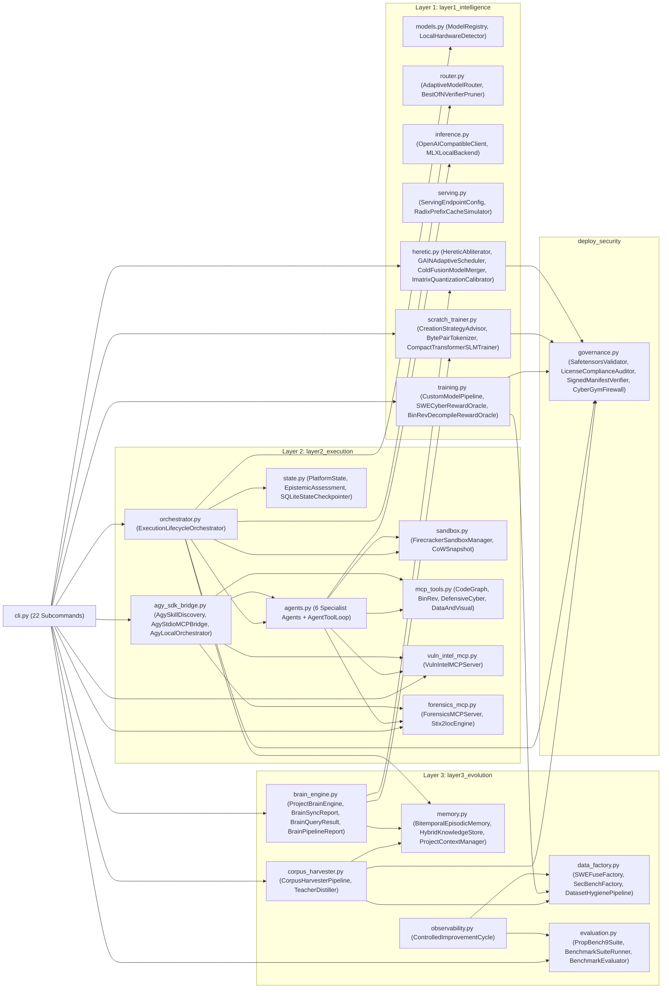
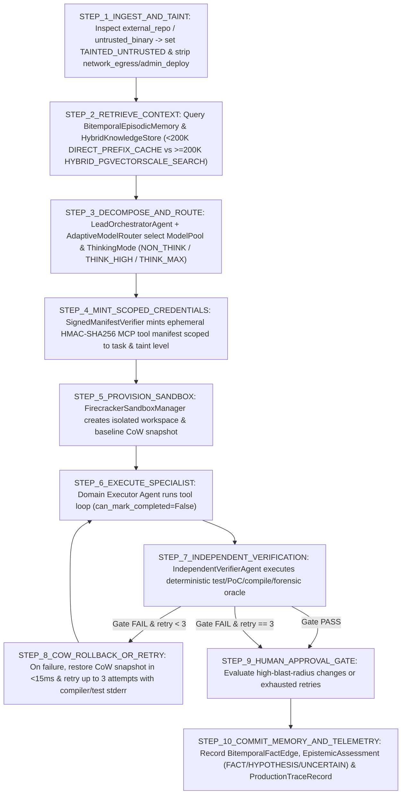
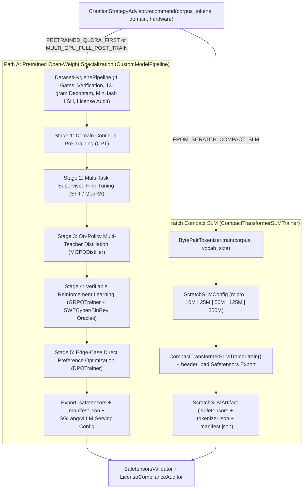

# `platform-core` Architectural Knowledge Graph & Entity-Relationship Map

**Parent Hub:** [`.agents/brain/README.md`](README.md)  
**Machine-Readable Graph:** [`.agents/brain/brain-knowledge-graph.json`](brain-knowledge-graph.json)  
**Authoritative Architecture Docs:** [`docs/architecture/system-architecture.md`](../../docs/architecture/system-architecture.md), [`docs/architecture/component-architecture.md`](../../docs/architecture/component-architecture.md), [`docs/architecture/data-flow.md`](../../docs/architecture/data-flow.md)

---

## Table of Contents

1. [Cross-Layer Component Dependency Graph](#1-cross-layer-component-dependency-graph)
2. [Subsystem Entity & Relationship Registry](#2-subsystem-entity--relationship-registry)
3. [10-Step Execution Lifecycle State Graph](#3-10-step-execution-lifecycle-state-graph)
4. [5-Stage Custom Model & Scratch SLM Creation Graph](#4-5-stage-custom-model--scratch-slm-creation-graph)
5. [8-Step Controlled Improvement & Bitemporal Memory Graph](#5-8-step-controlled-improvement--bitemporal-memory-graph)
6. [Architecture Decision Record (ADR-0001..ADR-0009) Traceability Matrix](#6-architecture-decision-record-adr-0001adr-0009-traceability-matrix)

---

## 1. Cross-Layer Component Dependency Graph

The following graph traces how the CLI, Layer 1 Intelligence, Layer 2 Execution, Layer 3 Evolution, and Deploy/Supply-Chain Security modules depend on one another at runtime.

---

## 2. Subsystem Entity & Relationship Registry

| Node ID | Category | Source File | Primary Exports | Outbound Edges (Depends On) | Enforced Invariants |
| :--- | :--- | :--- | :--- | :--- | :--- |
| `L1.models` | Layer 1 | [`src/platform_core/layer1_intelligence/models.py`](../../src/platform_core/layer1_intelligence/models.py) | `ModelRegistry`, `ModelPool`, `ModelSpec`, `ThinkingMode`, `HardwareProfile`, `LocalHardwareDetector`, `HardwareFeasibilityPlanner`, `HardwareBreakEvenPlanner` | `deploy_security.governance` (`LicenseComplianceAuditor`) | Sovereign License Gate (`Apache-2.0`, `MIT`, `BSD-3-Clause`); `heretic-llm` & `annihilation-llm` aliases |
| `L1.router` | Layer 1 | [`src/platform_core/layer1_intelligence/router.py`](../../src/platform_core/layer1_intelligence/router.py) | `AdaptiveModelRouter`, `BestOfNVerifierPruner`, `RoutingRequest`, `RoutingDecision`, `CandidateRollout` | `L1.models` | Entropy-bounded thinking token caps (`0`, `512..1024`, `2048`); early stop on first `verifier_passed=True` rollout |
| `L1.inference` | Layer 1 | [`src/platform_core/layer1_intelligence/inference.py`](../../src/platform_core/layer1_intelligence/inference.py) | `InferenceBackend`, `OpenAICompatibleClient`, `MLXLocalBackend`, `DeterministicMockBackend`, `MemoryResidencyGuard`, `ModelDownloadManager` | `L1.models`, `deploy_security.governance` | Loopback enforcement on tainted sessions; memory residency cap (`82%` unified RAM); pre-download license & Safetensors check |
| `L1.serving` | Layer 1 | [`src/platform_core/layer1_intelligence/serving.py`](../../src/platform_core/layer1_intelligence/serving.py) | `ServingEndpointConfig`, `ServingHealthChecker`, `RadixPrefixCacheSimulator` | `L1.models` | Prefix cache hit estimation across `sglang`, `vllm`, `mlx_lm`, `llama_cpp` |
| `L1.training` | Layer 1 | [`src/platform_core/layer1_intelligence/training.py`](../../src/platform_core/layer1_intelligence/training.py) | `CustomModelPipeline`, `TrainingExecutionMode`, `MLXQLoRATrainer`, `TorchTRLSpecAndRunner`, `SWECyberRewardOracle`, `BinRevDecompileRewardOracle`, `GRPOTrainer`, `MOPDDistiller`, `DPOTrainer`, `DistributedTrainingSpecBuilder` | `L1.models`, `L3.data_factory`, `deploy_security.governance` | DWARF byte-interval `[offset, offset + size)` IoU; 4-gate dataset hygiene; Safetensors checkpoint validation |
| `L1.scratch` | Layer 1 | [`src/platform_core/layer1_intelligence/scratch_trainer.py`](../../src/platform_core/layer1_intelligence/scratch_trainer.py) | `CreationStrategyAdvisor`, `ModelCreationPath`, `BytePairTokenizer`, `ScratchSLMConfig`, `CompactTransformerSLMTrainer`, `ScratchSLMArtifact` | `L1.models`, `deploy_security.governance` | `<Q` Safetensors header padding (`header_pad`) avoiding `\x80\x02`..`\x80\x05` pickle false-positives |
| `L1.heretic` | Layer 1 | [`src/platform_core/layer1_intelligence/heretic.py`](../../src/platform_core/layer1_intelligence/heretic.py) | `HereticConfig`, `AbliterationLayerResult`, `HereticAbliterationReport`, `HereticAbliterator`, `GAINSampleWeight`, `GAINAdaptiveScheduler`, `ColdFusionMergeConfig`, `ColdFusionMergeReport`, `ColdFusionModelMerger`, `ImatrixCalibrationReport`, `ImatrixQuantizationCalibrator` | `deploy_security.governance` (`SafetensorsValidator`) | KL-bounded (`<= 0.05`) rank-$k$ refusal subspace abliteration; GAIN `[0.5, 1.5]` dynamic scaling; `<Q` `header_pad` Safetensors verification |
| `L2.state` | Layer 2 | [`src/platform_core/layer2_execution/state.py`](../../src/platform_core/layer2_execution/state.py) | `PlatformState`, `TaskStatus`, `TaintLevel`, `EpistemicStatus`, `EpistemicClaim`, `EpistemicAssessment`, `SubTask`, `ArtifactRef`, `ApprovalRequest`, `SQLiteStateCheckpointer` | Python stdlib `sqlite3`, `threading.RLock` | Thread-safe WAL mode (`check_same_thread=False`, `busy_timeout=30000`); `FACT` / `HYPOTHESIS` / `UNCERTAIN` epistemic separation |
| `L2.sandbox` | Layer 2 | [`src/platform_core/layer2_execution/sandbox.py`](../../src/platform_core/layer2_execution/sandbox.py) | `FirecrackerSandboxManager`, `CoWSnapshot`, `SandboxExecutionResult`, `ALLOWED_SECCOMP_SYSCALLS` | Python stdlib `subprocess`, `tempfile` | `<15ms` CoW snapshot rollback; symlink rejection & path traversal protection on sync-back; secret env stripping |
| `L2.mcp_tools` | Layer 2 | [`src/platform_core/layer2_execution/mcp_tools.py`](../../src/platform_core/layer2_execution/mcp_tools.py) | `CodeGraphMCPServer`, `BinRevMCPServer`, `DefensiveCyberMCPServer`, `DataAndVisualMCPServer` | `L2.sandbox` | Streaming `zlib.decompressobj` bounded decompression; finite-sample Shannon entropy normalized by $\min(8.0, \log_2 N)$ |
| `L2.vuln_intel` | Layer 2 | [`src/platform_core/layer2_execution/vuln_intel_mcp.py`](../../src/platform_core/layer2_execution/vuln_intel_mcp.py) | `VulnIntelMCPServer`, `AuthorizationScope`, `VulnFindingClassification`, `VulnerabilityIntelligenceRecord` | Python stdlib `sqlite3`, `urllib.request` | Blocks `sync_live_feeds()` when `session_tainted=True`; enforces authorized target scope (RoE) |
| `L2.forensics` | Layer 2 | [`src/platform_core/layer2_execution/forensics_mcp.py`](../../src/platform_core/layer2_execution/forensics_mcp.py) | `ForensicsMCPServer`, `Stix2IocEngine`, `ForensicVerdict`, `ForensicIndicator`, `ForensicFinding`, `ForensicAssessment` | Python stdlib `hashlib`, `plistlib`, `sqlite3` | Rejects `CONFIRMED_IOC_MATCH` without real `artifact_path` + 64-hex `artifact_sha256`; records `visibility_limitations` |
| `L2.agents` | Layer 2 | [`src/platform_core/layer2_execution/agents.py`](../../src/platform_core/layer2_execution/agents.py) | `BaseAgentNode`, `LeadOrchestratorAgent`, `SoftwareEngineeringAgent`, `ReverseEngineeringAgent`, `DefensiveCyberAgent`, `MultimodalDataAgent`, `IndependentVerifierAgent`, `AgentToolLoop` | `L1.inference`, `L2.state`, `L2.mcp_tools`, `L2.vuln_intel`, `L2.forensics`, `L2.sandbox` | Executor vs. Verifier separation: only `IndependentVerifierAgent` has `can_mark_completed=True` |
| `L2.orchestrator` | Layer 2 | [`src/platform_core/layer2_execution/orchestrator.py`](../../src/platform_core/layer2_execution/orchestrator.py) | `ExecutionLifecycleOrchestrator`, `LifecycleStep` | `L1.models`, `L1.router`, `L2.agents`, `L2.state`, `L2.sandbox`, `L3.memory`, `deploy_security.governance` | 10-step execution state machine; automatic `TAINTED_UNTRUSTED` propagation at Step 1; HMAC tool signing at Step 4 |
| `L2.agy_bridge` | Layer 2 | [`src/platform_core/layer2_execution/agy_sdk_bridge.py`](../../src/platform_core/layer2_execution/agy_sdk_bridge.py) | `AgySkillDiscovery`, `AgyStdioMCPBridge`, `AgyLocalOrchestrator`, `AgyLocalAgentSpec`, `AgyExecutionResult` | `L1.inference`, `L2.agents`, `L2.mcp_tools`, `L2.vuln_intel`, `L2.forensics` | Rejects symlinked skills; defaults `session_tainted=True`; bounded JSON-RPC stdio lines (`MAX_JSONRPC_LINE_BYTES`); runs `IndependentVerifierAgent` before marking `COMPLETED` |
| `L3.memory` | Layer 3 | [`src/platform_core/layer3_evolution/memory.py`](../../src/platform_core/layer3_evolution/memory.py) | `BitemporalEpisodicMemory`, `HybridKnowledgeStore`, `ProjectContextManager`, `DeterministicHashEmbedder`, `InferenceBackendEmbedder` | Python stdlib `sqlite3`, `L1.inference` | 200K-token rule (`< 200,000` -> `DIRECT_PREFIX_CACHE`; `>= 200,000` -> `HYBRID_PGVECTORSCALE_SEARCH`); bitemporal valid/transaction time |
| `L3.harvester` | Layer 3 | [`src/platform_core/layer3_evolution/corpus_harvester.py`](../../src/platform_core/layer3_evolution/corpus_harvester.py) | `CorpusHarvesterPipeline`, `PDFBookExtractor`, `RateLimitedWebHarvester`, `TeacherDistiller`, `PromptInjectionSanitizer`, `DomainChunker` | `L3.memory`, `L3.data_factory`, `deploy_security.governance` | `CyberGymFirewall` domain allowlist check; indirect prompt-injection sanitization; distilled trajectories default to `execution_verified=False` |
| `L3.data_factory` | Layer 3 / Ingestion | [`src/platform_core/data_ingestion/data_factory.py`](../../src/platform_core/data_ingestion/data_factory.py) | `SWEFuseFactory`, `SecBenchFactory`, `DecompileBenchFactory`, `DatasetHygienePipeline` | `deploy_security.governance` | 4-Gate Hygiene: Execution Verification, 13-gram Benchmark Decontamination, MinHash LSH Deduplication, Sovereign License Audit |
| `L3.evaluation` | Layer 3 | [`src/platform_core/layer3_evolution/evaluation.py`](../../src/platform_core/layer3_evolution/evaluation.py) | `PropBench9Suite`, `BenchmarkEvaluator`, `BenchmarkSuiteRunner` | `L2.mcp_tools`, `L2.vuln_intel`, `L2.forensics`, `L3.memory` | 95% confidence interval (`pass@k` & `pass^4 >= 0.75`); Canary Gate blocks any security or functional regression |
| `L3.observability` | Layer 3 | [`src/platform_core/layer3_evolution/observability.py`](../../src/platform_core/layer3_evolution/observability.py) | `ControlledImprovementCycle`, `ProductionTraceRecord`, `FailureRootCauseBucket` | `L3.data_factory`, `L3.evaluation` | 8-step closed-loop telemetry curation, decontamination, and canary promotion |
| `L3.brain_engine` | Layer 3 | [`src/platform_core/layer3_evolution/brain_engine.py`](../../src/platform_core/layer3_evolution/brain_engine.py) | `ProjectBrainEngine`, `BrainSyncReport`, `BrainQueryResult`, `BrainPipelineReport` | `L3.memory`, `L1.scratch`, `L1.heretic`, `deploy_security.governance` | Symlink rejection on `brain_dir`; 200K-token hybrid RAG + bitemporal fact sync; end-to-end Brain -> GAIN -> Heretic -> Cold-Fusion -> IMatrix pipeline |
| `Sec.governance` | Security | [`src/platform_core/deploy_security/governance.py`](../../src/platform_core/deploy_security/governance.py) | `SafetensorsValidator`, `LicenseComplianceAuditor`, `SignedManifestVerifier`, `CyberGymFirewall`, `K8sAgentSandboxGenerator` | Python stdlib `hmac`, `hashlib`, `struct`, `json` | Rejects `.pkl`/`.pt`/`.bin` & pickle magic bytes; verifies exact `shape * dtype` contiguous tensor spans; HMAC-SHA256 tool manifests |

---

## 3. 10-Step Execution Lifecycle State Graph

Every task processed by `ExecutionLifecycleOrchestrator.run_workflow()` traverses 10 deterministic steps persisted in `SQLiteStateCheckpointer`:

---

## 4. 5-Stage Custom Model & Scratch SLM Creation Graph

`platform-core` provides two complementary model creation pipelines in Layer 1, selected via `CreationStrategyAdvisor`:

---

## 5. 8-Step Controlled Improvement & Bitemporal Memory Graph

---

## 6. Architecture Decision Record (ADR-0001..ADR-0009) Traceability Matrix

| ADR ID | Decision Title | Document Path | Implementing Modules | Key Invariant Established |
| :--- | :--- | :--- | :--- | :--- |
| **ADR-0001** | Three-Layer Hybrid Architecture & Scenario-B Post-Training | [`docs/architecture/decisions/ADR-0001-three-layer-hybrid-architecture-and-post-training.md`](../../docs/architecture/decisions/ADR-0001-three-layer-hybrid-architecture-and-post-training.md) | `models.py`, `training.py` | 4 specialized open-weight pools + 5-stage post-training instead of \$50M+ scratch pretraining |
| **ADR-0002** | Executor vs. Verifier Separation & `<15ms` CoW Rollback | [`docs/architecture/decisions/ADR-0002-executor-verifier-separation-and-cow-rollback.md`](../../docs/architecture/decisions/ADR-0002-executor-verifier-separation-and-cow-rollback.md) | `agents.py`, `orchestrator.py`, `sandbox.py` | `SecVerifier` Dual-Gate (`can_mark_completed=False` on all executors) + CoW snapshot rollback |
| **ADR-0003** | Taint Isolation, Safetensors & Sovereign Licensing | [`docs/architecture/decisions/ADR-0003-taint-isolation-safetensors-and-sovereign-licensing.md`](../../docs/architecture/decisions/ADR-0003-taint-isolation-safetensors-and-sovereign-licensing.md) | `governance.py`, `state.py`, `orchestrator.py` | `TAINTED_UNTRUSTED` capability stripping, zero-pickle `SafetensorsValidator`, `Apache-2.0`/`MIT`/`BSD-3-Clause` gate |
| **ADR-0004** | Bitemporal Memory & 200K-Token Hybrid Knowledge Store | [`docs/architecture/decisions/ADR-0004-bitemporal-memory-and-200k-hybrid-knowledge-store.md`](../../docs/architecture/decisions/ADR-0004-bitemporal-memory-and-200k-hybrid-knowledge-store.md) | `memory.py`, `mcp_tools.py` | Valid-time/transaction-time `BitemporalFactEdge` + `< 200,000` token `DIRECT_PREFIX_CACHE` threshold |
| **ADR-0005** | Local-First Open-Weight Forensics, Vuln Intel & Epistemic Ledger | [`docs/architecture/decisions/ADR-0005-local-first-open-weight-forensics-and-vuln-intel.md`](../../docs/architecture/decisions/ADR-0005-local-first-open-weight-forensics-and-vuln-intel.md) | `forensics_mcp.py`, `vuln_intel_mcp.py`, `state.py`, `inference.py` | Anti-fabrication forensic SHA-256 requirement, RoE scope enforcement, `FACT`/`HYPOTHESIS`/`UNCERTAIN` ledger |
| **ADR-0006** | Local AI Model Creator, Corpus Harvester & Google Antigravity SDK Bridge | [`docs/architecture/decisions/ADR-0006-local-ai-creator-and-antigravity-sdk.md`](../../docs/architecture/decisions/ADR-0006-local-ai-creator-and-antigravity-sdk.md) | `corpus_harvester.py`, `scratch_trainer.py`, `agy_sdk_bridge.py`, `.agents/skills/` | `CreationStrategyAdvisor`, `CompactTransformerSLMTrainer`, `AgyLocalOrchestrator`, 5 workspace skills |
| **ADR-0007** | Multi-Region SQLite Checkpointing | [`.agents/artifacts/security-audit/arch_upgrades/ADRs/ADR-0007-multi-region-sqlite-checkpointing.md`](../artifacts/security-audit/arch_upgrades/ADRs/ADR-0007-multi-region-sqlite-checkpointing.md) | `state.py` | WAL checkpoint replication and deterministic recovery boundaries |
| **ADR-0008** | Cross-Platform Hardware Abstraction for Layer 1 Pools | [`.agents/artifacts/security-audit/arch_upgrades/ADRs/ADR-0008-cross-platform-hardware-abstraction-l1-pools.md`](../artifacts/security-audit/arch_upgrades/ADRs/ADR-0008-cross-platform-hardware-abstraction-l1-pools.md) | `models.py`, `inference.py` | Unified Apple Silicon (`mlx`) and Multi-GPU (`cuda`/`rocm`) hardware profile abstraction |
| **ADR-0009** | Asynchronous Model Rollout in the Evolution Layer | [`.agents/artifacts/security-audit/arch_upgrades/ADRs/ADR-0009-asynchronous-model-rollout-evolution-layer.md`](../artifacts/security-audit/arch_upgrades/ADRs/ADR-0009-asynchronous-model-rollout-evolution-layer.md) | `observability.py`, `evaluation.py` | Non-blocking shadow rollout & canary promotion in Layer 3 |
