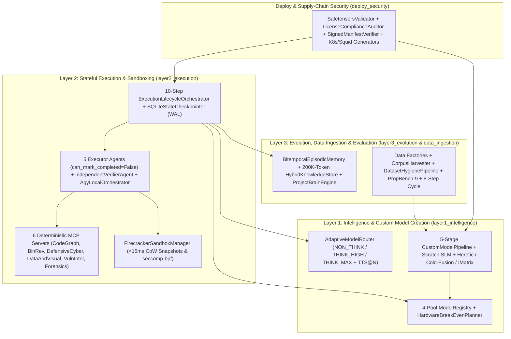
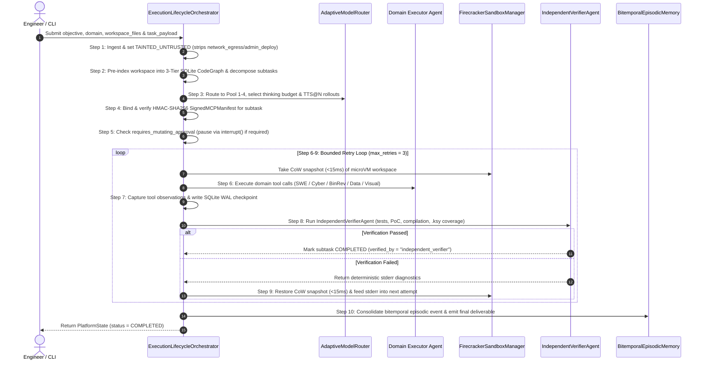

# Proprietary Technical Intelligence Platform (`platform-core`)

> **End-to-end, local-first Python 3.11+ platform for developing, post-training (LoRA/QLoRA & TRL specs), validating, routing, and executing verifiable multi-agent AI models across Software Engineering, Cybersecurity, Vulnerability Intelligence, Digital Forensics & Spyware Detection, Binary Reverse Engineering, Protocol Forensics, Multimodal Document/Image Analysis, and System Architecture.**

| Specification | Details |
| :--- | :--- |
| **Package / CLI** | `platform-core` (`v1.0.0`) / `platform-cli` (`python -m platform_core.cli`) |
| **Python Requirement** | `>= 3.11` (zero-dependency Python Standard Library core; optional `[mlx]`, `[train]`, `[rag]`, `[vision]`, `[forensics]`, `[agy]` extras) |
| **Architecture Blueprint** | Three-Layer Hybrid Technical Intelligence Architecture (`Scenario-B` Post-Training + Local Apple Silicon / Multi-GPU Hardware Profiles) |
| **Supported Domains** | `swe`, `cyber`, `vuln_intel`, `forensics`, `binrev`, `data_protocol`, `visual_ocr`, `architecture` |
| **Sovereign License Gate** | `Apache-2.0`, `MIT`, `BSD-3-Clause` enforced; copyleft & EU-restricted weights blocked |
| **Verification Gate** | `211/211` automated tests (`59` unit/integration tests across 10 modules + `152` 4-tier E2E tests in `tests/e2e/`) passing under `-W error` + 5 executable `BenchmarkSuiteRunner` suites |

---

## Table of Contents

1. [What This Project Does](#1-what-this-project-does)
2. [How the Architecture Works](#2-how-the-architecture-works)
3. [Technology Stack & Prerequisites](#3-technology-stack--prerequisites)
4. [Quickstart: Installation & Setup](#4-quickstart-installation--setup)
5. [How to Achieve Every Core Workflow (Step-by-Step)](#5-how-to-achieve-every-core-workflow-step-by-step)
   - [5.1 Goal 1: Evaluate Architecture Economics & Hardware ROI](#51-goal-1-evaluate-architecture-economics--hardware-roi)
   - [5.2 Goal 2: Create, Post-Train & Package a Custom Domain AI Model](#52-goal-2-create-post-train--package-a-custom-domain-ai-model)
   - [5.3 Goal 3: Run Verified 10-Step Agent Workflows Across All 8 Domains](#53-goal-3-run-verified-10-step-agent-workflows-across-all-8-domains)
   - [5.4 Goal 4: Execute Your Custom Model on a Live Security or Engineering Task](#54-goal-4-execute-your-custom-model-on-a-live-security-or-engineering-task)
   - [5.5 Goal 5: Inspect Unknown Binary Streams & Synthesize Kaitai Schemas](#55-goal-5-inspect-unknown-binary-streams--synthesize-kaitai-schemas)
   - [5.6 Goal 6: Run the Full 5-Stage Post-Training & Canary Gate Pipeline](#56-goal-6-run-the-full-5-stage-post-training--canary-gate-pipeline)
6. [Programmatic Python SDK Examples](#6-programmatic-python-sdk-examples)
7. [Project Structure](#7-project-structure)
8. [Testing, Benchmarking & Quality Assurance](#8-testing-benchmarking--quality-assurance)
9. [Documentation Navigation](#9-documentation-navigation)
10. [Contributing & Continuous Documentation Governance](#10-contributing--continuous-documentation-governance)

---

## 1. What This Project Does

Modern engineering organizations need AI systems that can autonomously patch software defects, remediate security vulnerabilities, decompile stripped binaries, reverse-engineer unknown binary protocols, and ground technical diagrams—**without leaking proprietary IP to external APIs, introducing regressions, or executing untrusted code on host networks**.

`platform-core` solves this by combining **neural open-weight model specialization** with **deterministic systems verification** across four core pillars:

1. **Creates & Specializes Custom Open-Weight Models (`Layer 1 — layer1_intelligence`)**:
   - Replaces \$5.6M–\$50M+ scratch pretraining with a **5-stage post-training pipeline** (`Domain CPT -> Multi-Task SFT -> On-Policy MOPD -> Verifiable GRPO/RLVR -> Edge-Case DPO`) on permissive open checkpoints (`Qwen/Qwen3.8-27B`, `DeepSeek-V4-Flash`).
   - Scores candidate rollouts using **deterministic execution reward oracles** (`SWECyberRewardOracle` for bug/vulnerability fixes; `BinRevDecompileRewardOracle` for compilation, unit test equivalence, and DWARF struct byte-interval IoU).
   - Exports cryptographically verified `.safetensors` checkpoints, `.manifest.json` metadata, SGLang/vLLM serving flags, and PyTorch FSDP2 / DeepSpeed ZeRO-3 distributed training specs.
   - Advises on optimal creation paths (`CreationStrategyAdvisor`: `PRETRAINED_RAG_ONLY`, `PRETRAINED_QLORA_FIRST`, `FROM_SCRATCH_COMPACT_SLM`, `MULTI_GPU_FULL_POST_TRAIN`), trains custom byte-level BPE tokenizers (`BytePairTokenizer`) plus compact causal Transformer SLMs (`CompactTransformerSLMTrainer`, `10M`–`350M` presets or micro defaults), and performs pure-stdlib `.safetensors` post-training weight surgery (`HereticAbliterator`, `GAINAdaptiveScheduler`, `ColdFusionModelMerger`, `ImatrixQuantizationCalibrator`).
2. **Executes Taint-Isolated, Verifier-Gated Multi-Agent Workflows (`Layer 2 — layer2_execution`)**:
   - Routes tasks across **4 specialized model pools** and **6 consolidated agents** (`PrincipalOrchestratorAgent`, `SoftwareEngineeringAgent`, `ReverseEngineeringAgent`, `DefensiveCyberAgent`, `MultimodalDataAgent`, `IndependentVerifierAgent`), backed by **6 deterministic MCP servers** (`CodeGraph`, `BinRev`, `DefensiveCyber`, `DataAndVisual`, `VulnIntel`, `Forensics`), plus local Google Antigravity SDK orchestration (`AgyLocalOrchestrator`, `AgyStdioMCPBridge`, `AgySkillDiscovery` across 5 workspace skills in [`.agents/skills/`](.agents/skills/)).
   - Enforces the **`SecVerifier` Dual-Gate**: executor agents (`can_mark_completed=False`) can never self-approve their own output. Only `IndependentVerifierAgent` (`can_mark_completed=True`) can mark a workflow `COMPLETED` after deterministic test, PoC, compilation, forensic SHA-256 anti-fabrication, or byte-coverage verification inside an isolated Firecracker microVM sandbox.
   - Restores workspace state in **`<15ms` via Copy-on-Write (CoW) snapshots** whenever a candidate patch fails verification, feeding exact compiler/test stderr back to the executor agent for up to 3 bounded retries.
3. **Maintains Bitemporal Memory, Project Brain & Continuous Evolution (`Layer 3 — layer3_evolution` & `data_ingestion`)**:
   - Tracks evolving architectural facts across both **valid time** `[t_valid, t_invalid)` and **transaction time** `[t_tx, t_retract)` (`BitemporalEpisodicMemory`) so agents can query what was true at any historical timestamp.
   - Automatically selects between **`DIRECT_PREFIX_CACHE`** (`< 200,000` corpus tokens) and **`HYBRID_PGVECTORSCALE_SEARCH`** (`>= 200,000` tokens) via `HybridKnowledgeStore`.
   - Synchronizes structured workspace knowledge into RAG + bitemporal memory and drives Brain -> GAIN -> Heretic -> Cold-Fusion -> IMatrix SLM creation (`ProjectBrainEngine`).
   - Synthesizes and filters clean training data (`platform_core.data_ingestion` factories + 4-gate `DatasetHygienePipeline`) and curates verified production traces through an **8-step `ControlledImprovementCycle`** with benchmark decontamination, MinHash LSH deduplication, `PropBench-9` evaluation (`pass@k` and `pass^k`), `BenchmarkSuiteRunner`, and `CanaryDeploymentGate` promotion.
   - Harvests technical PDFs, Markdown/reST books, and firewall-gated URLs (`CorpusHarvesterPipeline`, `PDFBookExtractor`, `RateLimitedWebHarvester`, `PromptInjectionSanitizer`, `DomainChunker`, `TeacherDistiller`) directly into `HybridKnowledgeStore` and license-audited JSONL trajectories.
4. **Enforces Supply-Chain, License & Sandbox Security (`deploy_security`)**:
   - Rejects unsafe Python pickle checkpoints (`.pkl`, `.pt`, `.bin`, or disguised pickle magic bytes) via `SafetensorsValidator`.
   - Enforces commercial/EU-compliant model licensing (`Apache-2.0`, `MIT`, `BSD-3-Clause`) via `LicenseComplianceAuditor`.
   - Tags any session ingesting external repositories or untrusted binaries at Step 1 as **`TAINTED_UNTRUSTED`**, stripping `network_egress` and `admin_deploy` capabilities and enforcing HMAC-SHA256 signed MCP tool manifests (`SignedManifestVerifier`).

> [!IMPORTANT]
> **Zero-Dependency Local Execution:** Everything in `platform-core`—including the 10-step orchestrator, SQLite WAL state checkpointer, 3-tier polyglot code graph, Firecracker CoW sandbox runtime, custom model training pipeline, Heretic/Cold-Fusion/IMatrix engines, and all 8 domain workflows—runs locally using **only the Python 3.11+ standard library**.

---

## 2. How the Architecture Works

### 2.1 Three-Layer Hybrid System Topology



### 2.2 The 10-Step Verified Execution Lifecycle

Every workflow invoked via `platform-cli run-workflow`, `platform-cli run-custom-model`, or `ExecutionLifecycleOrchestrator.run_workflow()` executes a deterministic 10-step state machine:



### 2.3 Model Pools, Specialist Agents & MCP Servers

| Model Pool | Default Registered Models | Consolidated Agents Routed | Deterministic MCP Server |
| :--- | :--- | :--- | :--- |
| **`POOL_1_ORCHESTRATOR`** | `DeepSeek-V4-Flash` (MIT), `Qwen3.5-397B-A17B` (Apache-2.0) | `PrincipalOrchestratorAgent`, `SoftwareEngineeringAgent` (`architecture`), `IndependentVerifierAgent` | `CodeGraphMCPServer` |
| **`POOL_2_SWE_CYBER`** | DavidAU Qwen3.8-27B GGUF (`heretic-llm` / `annihilation-llm` aliases, Apache-2.0) & custom overrides | `SoftwareEngineeringAgent` (`swe`), `DefensiveCyberAgent` (`cyber`, `vuln_intel`, `forensics`), `MultimodalDataAgent` (`data_protocol`) | `CodeGraphMCPServer`, `DefensiveCyberMCPServer`, `VulnIntelMCPServer`, `ForensicsMCPServer`, `DataAndVisualMCPServer` |
| **`POOL_3_BINREV`** | `Qwen3.8-27B-BinRev` (Apache-2.0) | `ReverseEngineeringAgent` (`binrev`) | `BinRevMCPServer` |
| **`POOL_4_VISUAL_OCR`** | `OmniParser-V2-UI-TARS-GOT-OCR` (Apache-2.0) | `MultimodalDataAgent` (`visual_ocr`) | `DataAndVisualMCPServer` |

---

## 3. Technology Stack & Prerequisites

### 3.1 Local Development & Execution (Zero Third-Party Dependencies)
- **Operating System**: macOS or Linux.
- **Python**: `Python 3.11+` (`sqlite3`, `zlib`, `gzip`, `hashlib`, `hmac`, `ast`, `struct`, `subprocess`, `tempfile`, `unittest` from the standard library).
- **External Packages Required Locally**: **None for core** (`dependencies = []` in [pyproject.toml](pyproject.toml)); optional extras `[mlx]`, `[train]`, `[rag]`, `[vision]`, `[forensics]`, `[agy]`, `[all]`.

### 3.2 Optional Production & Local Acceleration Targets
When executing live inference or fine-tuning beyond the zero-dependency core, `platform-core` supports:
- **Hardware-Aware Model Profiles**: Auto-detects host CPU/GPU/Unified Memory via `LocalHardwareDetector.detect()` (`APPLE_SILICON_36GB` profile registers `Qwen/Qwen3.5-35B-A3B`, `Qwen/Qwen3-Coder-30B-A3B-Instruct`, `fdtn-ai/Foundation-Sec-8B-Reasoning`, `Qwen/Qwen3.8-27B`, `Qwen/Qwen3-VL-8B-Thinking` under `MemoryResidencyGuard`).
- **Inference Clients & Serving**: `OpenAICompatibleClient` (HTTP `/v1/chat/completions` + tool calling + vision), `MLXLocalBackend`, `DeterministicMockBackend`, plus launch configs for `SGLang v0.5.19+`, `vLLM v0.28+`, `mlx_lm`, and `llama_cpp`.
- **Real LoRA/QLoRA & Distributed Training**: `MLXQLoRATrainer` (`mlx_lm.lora` execution) and `TorchTRLSpecAndRunner` (PEFT + TRL / `FSDP2` / `DeepSpeed ZeRO-3`) via `--execution-mode {spec_only,mlx_qlora,torch_trl}`.
- **MicroVM Isolation & Egress Filtering**: Kubernetes `SandboxTemplate` / `SandboxClaim` (`kata-fc`) via `K8sAgentSandboxGenerator` and Squid proxy rules via `CyberGymFirewall`.

---

## 4. Quickstart: Installation & Setup

Clone or navigate to the repository, create a Python virtual environment, and install the package in editable mode:

```bash
python3 -m venv .venv
.venv/bin/pip install -e .
```

Verify your installation by running the test suite under the strict warning gate:

```bash
PYTHONPATH=src .venv/bin/python -W error -m unittest discover -s tests -v
```

---

## 5. How to Achieve Every Core Workflow (Step-by-Step)

This section shows **what you can accomplish** with `platform-core` and the **exact commands** to achieve each goal.

### 5.1 Goal 1: Evaluate Architecture Economics & Hardware ROI

**Objective:** Determine whether your organization should pretrain a model from scratch (`Scenario-A`), post-train open-weight models (`Scenario-B`), or rent closed APIs (`Scenario-C`), and calculate the exact GPU ownership break-even point.

```bash
PYTHONPATH=src .venv/bin/python -m platform_core.cli evaluate-blueprint --budget 1800000
```

**What this achieves:**
- Evaluates the \$1.8M training budget (`pretrain_from_scratch_justified: false`, recommending `Scenario-B`).
- Computes the `22.3`-month break-even timeline for owning an 8x H200/B200 node vs. cloud API rental.
- Lists all 5 default registered models across Pools 1–4 and all 9 `PropBench-9` evaluation suites.

---

### 5.2 Goal 2: Create, Post-Train & Package a Custom Domain AI Model

**Objective:** Specialize a permissive open-weight base model (`Qwen/Qwen3.8-27B`) on your own domain trajectories using the 5-stage pipeline (`CPT -> SFT -> MOPD -> GRPO/RLVR -> DPO`) and export a verified `.safetensors` checkpoint and `.manifest.json`.

#### Step 1: Prepare or Inspect the Training Trajectory JSONL Dataset
Each line in [examples/sample_custom_trajectories.jsonl](examples/sample_custom_trajectories.jsonl) represents a verified execution trajectory:
```json
{"record_id": "acme-sec-001", "domain": "sec_bench", "source_repo": "acme/edge-proxy", "license_id": "Apache-2.0", "cve_id": "CVE-2026-8101", "prompt_context": "[Sec-Bench] Sanitizer: CWE-78 OS Command Injection in ping diagnostics endpoint.\nCPG Query: cpg.call.name('subprocess.call').whereShellTrue", "target_completion": "@@ -3,1 +3,1 @@\n-    return subprocess.call(f'ping -c 1 {host}', shell=True)\n+    return subprocess.call(['ping', '-c', '1', host], shell=False)", "execution_verified": true}
```

#### Step 2: Run `create-custom-model`
```bash
PYTHONPATH=src .venv/bin/python -m platform_core.cli create-custom-model \
  --model-id Acme-SecCoder-27B-v1 \
  --base-checkpoint Qwen/Qwen3.8-27B \
  --domain cyber \
  --params-b 27.8 \
  --context-window 262144 \
  --license Apache-2.0 \
  --dataset-file examples/sample_custom_trajectories.jsonl \
  --output-dir ./artifacts/custom_models
```

**What this achieves:**
1. **Audits licensing** (`LicenseComplianceAuditor` verifies `Apache-2.0` is `APPROVED_COMMERCIAL`).
2. **Filters & scores trajectories** (`rejected_unverified_trajectories` are dropped; remaining rollouts are scored by the domain reward oracle).
3. **Executes 5-stage post-training** (computes group-normalized GRPO advantages $\hat{A}_i$, MOPD reverse-KL loss, and DPO margin loss).
4. **Serializes & validates weights** (`SafetensorsValidator` writes and verifies `./artifacts/custom_models/Acme-SecCoder-27B-v1.safetensors` and its SHA-256 digest in `Acme-SecCoder-27B-v1.manifest.json`).
5. **Generates production launch arguments** (`python3 -m sglang.launch_server --model-path Acme-SecCoder-27B-v1 ...`).

---

### 5.3 Goal 3: Run Verified 10-Step Agent Workflows Across All 8 Domains

**Objective:** Execute end-to-end taint-isolated agent workflows with CoW sandboxing and independent `SecVerifier` gating across any of the 8 supported domains.

| Domain Flag | What the Workflow Achieves | Command |
| :--- | :--- | :--- |
| `swe` | Patches a `ZeroDivisionError` in `billing.py`, runs regression tests in a Firecracker CoW sandbox, and verifies via `IndependentVerifierAgent`. | `PYTHONPATH=src .venv/bin/python -m platform_core.cli run-workflow --domain swe` |
| `cyber` | Detects `CWE-78` OS Command Injection (`shell=True`) via `DefensiveCyberMCPServer`, rewrites to argument-list `shell=False`, and verifies both PoC elimination and unit tests. | `PYTHONPATH=src .venv/bin/python -m platform_core.cli run-workflow --domain cyber` |
| `binrev` | Inspects an ELF binary (`checksec` + prompt-injection scan) and runs two-phase `SK²Decompile` + `ReCopilot` call-graph recovery to emit typed C code. | `PYTHONPATH=src .venv/bin/python -m platform_core.cli run-workflow --domain binrev` |
| `data_protocol` | Classifies binary payload entropy/headers and synthesizes a declarative Kaitai Struct `.ksy` schema verified for 100% byte coverage. | `PYTHONPATH=src .venv/bin/python -m platform_core.cli run-workflow --domain data_protocol` |
| `visual_ocr` | Runs `OmniParser-V2-UI-TARS-GOT-OCR` bounding-box grounding with the epistemic hallucination guard (`confidence < 0.80` triggers `zoom_crop_region`). | `PYTHONPATH=src .venv/bin/python -m platform_core.cli run-workflow --domain visual_ocr` |
| `architecture` | Indexes workspace symbols into the 3-Tier SQLite `CodeGraphMCPServer`, patches module interfaces, and verifies callers in the sandbox. | `PYTHONPATH=src .venv/bin/python -m platform_core.cli run-workflow --domain architecture` |
| `vuln_intel` | Parses polyglot manifests, correlates Python AST taint + OSV/NVD/KEV/EPSS mirror, and separates `CONFIRMED_VULNERABILITY` from `POTENTIAL_WEAKNESS`. | `PYTHONPATH=src .venv/bin/python -m platform_core.cli run-workflow --domain vuln_intel` (or `audit-vulns --project-dir .`) |
| `forensics` | Analyzes iOS backups, Android artifacts, and host logs with STIX2 spyware IOCs (`Pegasus`, `Predator`, `Graphite`, `Candiru`, `TriangleDB`) and strict anti-fabrication checks. | `PYTHONPATH=src .venv/bin/python -m platform_core.cli run-workflow --domain forensics` (or `scan-forensics --target-dir <dir> --platform auto`) |

**Additional Hardware, Corpus, Strategy, Scratch SLM, Project Brain, Heretic, AGY SDK & Benchmark CLI Commands (23 Subcommands Total)**:
- `PYTHONPATH=src .venv/bin/python -m platform_core.cli hardware-check`
- `PYTHONPATH=src .venv/bin/python -m platform_core.cli download-model --model-id Qwen/Qwen3.5-35B-A3B --license Apache-2.0`
- `PYTHONPATH=src .venv/bin/python -m platform_core.cli sync-vuln-db --db-path vuln_intel_mirror.db --feeds kev epss`
- `PYTHONPATH=src .venv/bin/python -m platform_core.cli analyze-image --path <image_or_pdf>`
- `PYTHONPATH=src .venv/bin/python -m platform_core.cli run-benchmarks`
- `PYTHONPATH=src .venv/bin/python -m platform_core.cli transparency-dashboard --session-id <session_id>`
- `PYTHONPATH=src .venv/bin/python -m platform_core.cli harvest-corpus --pdf docs/CUSTOM_MODEL_GUIDE.md --domain swe --distill-output ./artifacts/trajectories.jsonl`
- `PYTHONPATH=src .venv/bin/python -m platform_core.cli recommend-strategy --corpus-tokens 150000 --domain cyber`
- `PYTHONPATH=src .venv/bin/python -m platform_core.cli train-scratch-slm --model-id micro-swe-slm --text "def safe_div(a, b): return a / b if b else 0" --output-dir ./artifacts/scratch_slm`
- `PYTHONPATH=src .venv/bin/python -m platform_core.cli run-agy-local --prompt "Audit workspace function for CWE-78" --force-fallback`
- `PYTHONPATH=src .venv/bin/python -m platform_core.cli mcp-stdio-bridge --server data_visual vuln_intel`
- `PYTHONPATH=src .venv/bin/python -m platform_core.cli brain-query --query "SecVerifier Gate" --top-k 5`
- `PYTHONPATH=src .venv/bin/python -m platform_core.cli heretic-abliterate --input-safetensors <in.safetensors> --output-safetensors <out.safetensors> --rank 2 --max-kl 0.05`
- `PYTHONPATH=src .venv/bin/python -m platform_core.cli cold-fusion-merge --checkpoints <a.safetensors> <b.safetensors> --output-safetensors <merged.safetensors> --method dare_ties`
- `PYTHONPATH=src .venv/bin/python -m platform_core.cli brain-pipeline --output-dir ./artifacts/brain_slm --model-id heretic-brain-slm --quant-type Q5_K_M`

---

### 5.4 Goal 4: Execute Your Custom Model on a Live Security or Engineering Task

**Objective:** Load the custom model manifest created in Goal 2, validate its `.safetensors` SHA-256 integrity, register it into `ModelRegistry` as the active domain override, and execute a custom task payload ([examples/sample_cyber_workflow.json](examples/sample_cyber_workflow.json)).

```bash
PYTHONPATH=src .venv/bin/python -m platform_core.cli run-custom-model \
  --manifest ./artifacts/custom_models/Acme-SecCoder-27B-v1.manifest.json \
  --payload-file examples/sample_cyber_workflow.json
```

You can also run the complete lifecycle (custom model creation + manifest verification + workflow execution) in one command via the reference script:

```bash
PYTHONPATH=src .venv/bin/python examples/custom_model_end_to_end.py
```

---

### 5.5 Goal 5: Inspect Unknown Binary Streams & Synthesize Kaitai Schemas

**Objective:** Classify unknown hex payloads across the 4-class transformation taxonomy (`COMPRESSION`, `ENCRYPTION`, `ENCODING_SERIALIZATION`, `OBFUSCATION_PACKING`), recursively peel nested layers (such as gzip), and synthesize a verified Kaitai Struct `.ksy` schema.

```bash
PYTHONPATH=src .venv/bin/python -m platform_core.cli inspect-data --hex 1f8b080000000000
```

---

### 5.6 Goal 6: Run the Full 5-Stage Post-Training & Canary Gate Pipeline

**Objective:** Run the built-in multi-domain post-training benchmark (`SWECyberRewardOracle`, `BinRevDecompileRewardOracle`, `GRPOTrainer`, `MOPDDistiller`, `DPOTrainer`, `SafetensorsValidator`, and `CanaryDeploymentGate` promotion):

```bash
PYTHONPATH=src .venv/bin/python -m platform_core.cli train-model
```

---

## 6. Programmatic Python SDK Examples

All subsystems are importable directly from `platform_core` for integration into custom Python services.

### 6.1 Human-in-the-Loop Approval Gate (`interrupt()`) & Verified Patching

```python
from platform_core.layer2_execution import ExecutionLifecycleOrchestrator, SQLiteStateCheckpointer

orchestrator = ExecutionLifecycleOrchestrator(checkpointer=SQLiteStateCheckpointer(":memory:"))
try:
    # Step 1-5: Pauses at Step 5 (AWAITING_HUMAN_APPROVAL) before mutating workspace files
    paused = orchestrator.run_workflow(
        session_id="prod-hotfix-01",
        objective="Fix ZeroDivisionError in SLA rate calculator",
        task_domain="swe",
        workspace_files={"sla.py": "def calc_sla(ok: int, total: int) -> float:\n    return ok / total\n"},
        task_payload={
            "target_file": "sla.py",
            "old_str": "    return ok / total",
            "new_str": "    return (ok / total) if total > 0 else 1.0",
            "test_script": "from sla import calc_sla\nassert calc_sla(0, 0) == 1.0\nassert calc_sla(9, 10) == 0.9\n",
        },
        requires_mutating_approval=True,
    )
    print("Paused status:", paused.status.value)  # AWAITING_HUMAN_APPROVAL

    # Step 6-10: Operator approves and resumes execution through IndependentVerifierAgent
    completed = orchestrator.approve_and_resume(
        session_id="prod-hotfix-01",
        operator_id="sre-oncall@acme.internal",
        workspace_files={"sla.py": "def calc_sla(ok: int, total: int) -> float:\n    return ok / total\n"},
        task_payload={
            "target_file": "sla.py",
            "old_str": "    return ok / total",
            "new_str": "    return (ok / total) if total > 0 else 1.0",
            "test_script": "from sla import calc_sla\nassert calc_sla(0, 0) == 1.0\nassert calc_sla(9, 10) == 0.9\n",
        },
    )
    print("Final status:", completed.status.value, "| Verified by:", completed.final_deliverable["verified_by"])
finally:
    orchestrator.close()
```

### 6.2 Two-Phase Binary Decompilation (`SK²Decompile` + `ReCopilot`) & Struct Layout IoU

```python
from platform_core.layer1_intelligence import BinRevDecompileInput, BinRevDecompileRewardOracle, StructFieldSpan
from platform_core.layer2_execution import BinRevMCPServer

binrev = BinRevMCPServer()
decompiled = binrev.run_two_phase_sk2_decompile(
    raw_ghidra_pseudocode="undefined8 FUN_00401120(undefined4 param_1) {\n  goto LAB_00401130;\nLAB_00401130:\n  return param_1;\n}",
    callers=["process_frame"],
    callees=["crc32_compute"],
    dataflow_aliases={"FUN_00401120": "validate_frame_crc", "param_1": "frame_len"},
)
print(decompiled["phase2_skin_decompiled_code"])

oracle = BinRevDecompileRewardOracle()
reward = oracle.compute_reward(
    BinRevDecompileInput(
        trajectory_id="fw-decomp-1",
        compiles_cleanly=True,
        unit_tests_total=12,
        unit_tests_passed=12,
        predicted_struct_fields=(StructFieldSpan("magic", 0, 4), StructFieldSpan("len", 4, 4)),
        ground_truth_dwarf_fields=(StructFieldSpan("hdr_magic", 0, 4), StructFieldSpan("payload_len", 4, 4)),
    )
)
print("Reward breakdown:", reward)  # {'r_comp': 1.0, 'r_exec': 1.0, 'struct_iou': 1.0, 'total_reward': 1.0}
```

---

## 7. Project Structure

```text
/
├── README.md                              # Project entry point, capabilities & step-by-step usage guide
├── AGENTS.md                              # Architectural invariants, CLI commands & AI governance rules
├── CONTRIBUTING.md                        # Contribution workflow, code standards & PR impact checklist
├── CHANGELOG.md                           # Release and architectural milestone history
├── pyproject.toml                         # Zero-dependency Python >=3.11 package & CLI definition
├── requirements.txt                       # Environment dependency manifest (stdlib-only core)
├── src/platform_core/                     # Primary source package
│   ├── README.md                          # Package map & cross-layer dependency rules
│   ├── cli.py                             # Unified CLI (platform-cli) with 23 subcommands
│   ├── layer1_intelligence/               # Hardware profiles, inference clients, router, serving, 5-stage training, scratch SLM & Heretic/Cold-Fusion
│   ├── layer2_execution/                  # 10-step orchestrator, 6 agents, 6 MCP servers, CoW sandbox & AGY SDK / stdio MCP bridge
│   ├── layer3_evolution/                  # WAL SQLite RAG, corpus harvester/distiller, Project Brain engine, bitemporal memory, PropBench-9 & benchmarks
│   ├── data_ingestion/                    # Trajectory factories (SWEFuse, SecBench, DecompileBench) & 4-gate DatasetHygienePipeline
│   └── deploy_security/                   # Safetensors, license audit, HMAC manifests, K8s & Squid firewall
├── examples/                              # Sample JSONL trajectories, JSON payloads & E2E Python script
├── scripts/                               # Milestone corpus ingestion & microVM trajectory synthesis scripts (emit to gitignored artifacts/)
├── tests/                                 # 211 automated tests (59 unit/integration across 10 modules + 152 4-tier E2E tests in tests/e2e/)
├── .agents/brain/                         # Persistent Project Brain hub, ontology graph JSON & curated domain training corpora
├── .agents/skills/                        # 5 discoverable workspace skills (corpus-harvester, local-model-advisor, scratch-slm-trainer, pretrained-qlora-finetuner, agy-local-agent-runner)
└── docs/                                  # Comprehensive engineering documentation & governance hub
    ├── README.md                          # Role-based documentation navigation hub
    ├── DOCUMENTATION_STANDARDS.md         # Mandatory engineering documentation standard
    ├── AI_DOCUMENTATION_POLICY.md         # Enforceable contract for AI coding agents
    ├── DOCUMENTATION_INDEX.md             # Living inventory of all governed Markdown files & subsystems
    ├── DOCUMENTATION_COVERAGE.md          # Source-to-documentation traceability matrix
    ├── CUSTOM_MODEL_GUIDE.md              # Step-by-step custom model creation & execution playbook
    ├── HOW_TO_GUIDES.md                   # Real-life domain playbooks & code recipes
    ├── overview/                          # Executive & technical system overview
    ├── architecture/                      # System, component, data-flow, integrations & ADR-0001..0006
    ├── modules/                           # Deep module reference guides
    ├── workflows/                         # 10-step execution, 5-stage training & 8-step evolution specs
    ├── development/                       # Getting started, setup, configuration, workflow & troubleshooting
    ├── api/                               # CLI flags, JSON/JSONL schemas & Python API contracts
    ├── testing/                           # Test suite guide, PropBench-9 & documentation QA checks
    ├── deployment/                        # Safetensors, SGLang/vLLM, K8s sandboxes & Squid proxy
    ├── security/                          # Defense-in-depth security architecture & threat mitigations
    ├── operations/                        # Telemetry spans, SQLite time-travel replay & canary runbooks
    └── guides/                            # Database operations, platform extension & monitoring playbooks
```

---

## 8. Testing, Benchmarking & Quality Assurance

Run the full unit, integration, security, and 4-tier E2E test suite under Python's strict warning gate (`-W error`):

```bash
# 1. Run all 211 tests (59 unit/integration + 152 E2E)
PYTHONPATH=src .venv/bin/python -W error -m unittest discover -s tests -v

# 2. Run the executable benchmark suite (coding, reasoning, cyber_vuln, forensics, hallucination_resistance)
PYTHONPATH=src .venv/bin/python -W error -m platform_core.cli run-benchmarks

# 3. Run the end-to-end custom model creation and execution verification script
PYTHONPATH=src .venv/bin/python -W error examples/custom_model_end_to_end.py
```

For detailed coverage of the test classes, 4-tier E2E runner, and `PropBench-9` evaluation (`pass@k` and `pass^k`), see [docs/testing/README.md](docs/testing/README.md) and [tests/README.md](tests/README.md).

---

## 9. Documentation Navigation

| Category | Primary Entry Point | Key Contents |
| :--- | :--- | :--- |
| **Documentation Hub** | [docs/README.md](docs/README.md) | Role-based entry points for developers, architects, ML engineers, and SRE/SecOps. |
| **Project Overview** | [docs/overview/project-overview.md](docs/overview/project-overview.md) | Problem statement, 8 technical domains, Scenario A/B/C economics, and execution scope. |
| **Architecture & ADRs** | [docs/architecture/README.md](docs/architecture/README.md) | [System Architecture](docs/architecture/system-architecture.md), [Component Architecture](docs/architecture/component-architecture.md), [Data Flow](docs/architecture/data-flow.md), [Integrations](docs/architecture/integrations.md), and [ADRs (0001–0006)](docs/architecture/decisions/README.md). |
| **Custom Model & How-To Guides** | [docs/CUSTOM_MODEL_GUIDE.md](docs/CUSTOM_MODEL_GUIDE.md), [docs/HOW_TO_GUIDES.md](docs/HOW_TO_GUIDES.md) | End-to-end custom model creation (`create-custom-model`, `train-scratch-slm`, `brain-pipeline`), `run-custom-model`, and 10 real-life domain playbooks. |
| **Engineering Playbooks** | [docs/guides/README.md](docs/guides/README.md) | SQLite database operations, adding new agents/MCP tools/reward oracles, and production diagnostics. |
| **Core Workflows** | [docs/workflows/README.md](docs/workflows/README.md) | [10-Step Agent Execution Lifecycle](docs/workflows/agent-execution-lifecycle.md), [5-Stage Model Post-Training](docs/workflows/model-post-training-pipeline.md), and [8-Step Controlled Improvement Cycle](docs/workflows/controlled-improvement-cycle.md). |
| **Module Reference** | [docs/modules/README.md](docs/modules/README.md) | [CLI](docs/modules/cli.md), [Layer 1](docs/modules/layer1-intelligence.md), [Layer 2](docs/modules/layer2-execution.md), [Layer 3](docs/modules/layer3-evolution.md), and [Deploy Security](docs/modules/deploy-security.md). |
| **Developer Onboarding** | [docs/development/README.md](docs/development/README.md) | [Getting Started](docs/development/getting-started.md), [Environment Setup](docs/development/environment-setup.md), [Configuration](docs/development/configuration.md), [Development Workflow](docs/development/development-workflow.md), and [Troubleshooting](docs/development/troubleshooting.md). |
| **API, Security, Deploy & Ops** | [docs/api/README.md](docs/api/README.md), [docs/security/README.md](docs/security/README.md), [docs/deployment/README.md](docs/deployment/README.md), [docs/operations/README.md](docs/operations/README.md) | Complete CLI/Python API schemas, 6-layer security controls, cluster deployment, and time-travel replay runbooks. |
| **Governance & Traceability** | [docs/DOCUMENTATION_STANDARDS.md](docs/DOCUMENTATION_STANDARDS.md), [docs/AI_DOCUMENTATION_POLICY.md](docs/AI_DOCUMENTATION_POLICY.md), [docs/DOCUMENTATION_INDEX.md](docs/DOCUMENTATION_INDEX.md), [docs/DOCUMENTATION_COVERAGE.md](docs/DOCUMENTATION_COVERAGE.md) | Mandatory documentation standards, AI agent contract, living file index, and 100% source traceability matrix. |

---

## 10. Contributing & Continuous Documentation Governance

Contributions must preserve the architectural invariants in [AGENTS.md](AGENTS.md), pass all tests under `-W error`, and satisfy the **Documentation Impact Checklist** in [CONTRIBUTING.md](CONTRIBUTING.md). Every code or documentation change is governed by [docs/DOCUMENTATION_STANDARDS.md](docs/DOCUMENTATION_STANDARDS.md) and [docs/AI_DOCUMENTATION_POLICY.md](docs/AI_DOCUMENTATION_POLICY.md). See [CHANGELOG.md](CHANGELOG.md) for release history.
