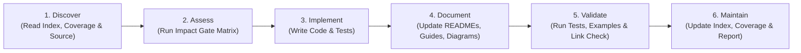

# AI Agent Documentation Policy & Engineering Contract

**Status:** Mandatory Contract for AI Coding Agents (Antigravity, Subagents, Swarms, and Automated Workflows)  
**Authoritative Standard:** [docs/DOCUMENTATION_STANDARDS.md](DOCUMENTATION_STANDARDS.md)

---

## Table of Contents

1. [Purpose](#1-purpose)
2. [Ten Mandatory AI Agent Rules](#2-ten-mandatory-ai-agent-rules)
3. [Mandatory Documentation Impact Gate](#3-mandatory-documentation-impact-gate)
4. [Documentation Lifecycle Workflow](#4-documentation-lifecycle-workflow)
5. [Required Task Completion Reporting Format](#5-required-task-completion-reporting-format)
6. [Related Documentation](#6-related-documentation)

---

## 1. Purpose

This policy binds all AI coding agents operating on `platform-core` to treat documentation as part of the software itself. Agents must prevent documentation drift, preserve existing technical explanations, and verify that all documentation links and examples remain synchronized with `src/platform_core/`.

---

## 2. Ten Mandatory AI Agent Rules

Every AI coding agent working in this repository MUST follow these ten rules:

1. **Inspect Existing Documentation First**: Before implementing code or documentation changes, consult [DOCUMENTATION_INDEX.md](DOCUMENTATION_INDEX.md), [DOCUMENTATION_COVERAGE.md](DOCUMENTATION_COVERAGE.md), and the relevant module `README.md`.
2. **Identify Affected Documentation Upfront**: Determine which files in `docs/`, root `README.md`, and module `README.md` files are affected by the proposed change before writing code.
3. **Preserve Existing Technical Explanations**: Never delete accurate architectural explanations, mathematical formulas, security rationale, or working examples during refactoring or restructuring.
4. **Update Documentation Alongside Code**: Update module READMEs, central guides, and API references within the same task whenever behavior, signatures, schemas, or CLI flags change.
5. **Synchronize Architecture Diagrams**: Update Mermaid diagrams in `docs/architecture/` and `docs/workflows/` whenever component relationships, lifecycle steps, or data flows change.
6. **Keep Configuration References Synchronized**: Update [docs/development/configuration.md](development/configuration.md) and [docs/api/README.md](api/README.md) whenever dataclass fields, CLI options, SQLite pragmas, or sandbox environment rules change.
7. **Document New APIs, Integrations, and Workflows**: Any new MCP tool, specialist agent behavior, reward oracle, benchmark spec, or CLI subcommand must be added to `docs/api/`, `docs/modules/`, `docs/DOCUMENTATION_INDEX.md`, and `docs/DOCUMENTATION_COVERAGE.md`.
8. **Never Invent Implementation Details**: Ground every statement in actual source code under `src/platform_core/`. Clearly distinguish implemented functionality from production-cluster deployment targets (such as physical multi-GPU FSDP2 or Linux `/dev/kvm` Firecracker hardware).
9. **Report Documentation Changes in Every Final Summary**: Include the mandatory `## Documentation Impact` and `## Documentation Assessment` blocks in the final task response.
10. **Explicitly Justify No-Op Documentation Assessments**: When a change does not require documentation updates (e.g., an internal test refactor that does not alter public contracts or line references), explicitly report `Status: Reviewed - No Changes Required` and state why.

---

## 3. Mandatory Documentation Impact Gate

Before marking any engineering task complete, evaluate the change against this matrix:

| Change Type | Mandatory Documentation Expectation | Primary Target Files |
| :--- | :--- | :--- |
| **New feature or domain** | Document feature architecture, module API, and How-To example | `README.md`, `docs/modules/`, `docs/HOW_TO_GUIDES.md`, `docs/DOCUMENTATION_COVERAGE.md` |
| **Modified functionality** | Update existing explanations, return signatures, and code examples | `src/platform_core/**/README.md`, `docs/modules/`, `docs/api/README.md` |
| **New CLI subcommand or API** | Update CLI/API reference and quickstart commands | `AGENTS.md`, `README.md`, `docs/api/README.md`, `docs/modules/cli.md` |
| **API or schema contract change** | Update `.manifest.json`, workflow JSON, JSONL, or MCP tool schema docs | `docs/api/README.md`, `docs/architecture/integrations.md`, `docs/CUSTOM_MODEL_GUIDE.md` |
| **Architecture change** | Update system/component/data-flow docs, Mermaid diagrams, and ADRs | `docs/architecture/*.md`, `docs/architecture/decisions/` |
| **SQLite / state schema change** | Update table definitions, checkpointing docs, and database playbook | `docs/architecture/data-flow.md`, `docs/guides/database-and-state-operations.md` |
| **Configuration change** | Update configuration tables, defaults, and validation rules | `docs/development/configuration.md` |
| **New MCP server or external integration** | Document tool manifest scopes, HMAC signing, and integration boundary | `docs/architecture/integrations.md`, `docs/security/README.md`, `docs/api/README.md` |
| **AI model, router, agent, or training pipeline change** | Update pool lineup, routing logic, 5-stage pipeline, or 10-step lifecycle | `docs/workflows/*.md`, `docs/modules/layer1-intelligence.md`, `docs/modules/layer2-execution.md` |
| **Deployment or sandbox change** | Update SGLang/vLLM launch flags, K8s CRDs, or seccomp/firewall docs | `docs/deployment/README.md`, `docs/security/README.md` |
| **Bug fix** | Add root cause and resolution to troubleshooting guides if user-facing | `docs/development/troubleshooting.md` |
| **Internal refactoring** | Update source references and module docs if class/method responsibilities move | `docs/DOCUMENTATION_COVERAGE.md`, `src/platform_core/**/README.md` |
| **Documentation-only change** | Run link checker, verify code examples, and update index/coverage registries | `docs/DOCUMENTATION_INDEX.md`, `docs/DOCUMENTATION_COVERAGE.md` |

Each assessment must classify the outcome as one of:
- `Updated` — Affected documentation was updated and verified in the same task.
- `Reviewed - No Changes Required` — Existing documentation was audited and confirmed accurate without modification.
- `Deferred` — Documentation update was deferred with an explicit technical reason and recorded gap in `docs/DOCUMENTATION_COVERAGE.md`.

---

## 4. Documentation Lifecycle Workflow

All engineering work follows the six-stage lifecycle:



---

## 5. Required Task Completion Reporting Format

Every future AI development task summary MUST include the following section:

```markdown
## Documentation Impact

- Documentation reviewed: [list of files inspected]
- Documentation created: [list of new files or "None"]
- Documentation updated: [list of modified files or "None"]
- Architecture diagrams updated: [list of updated diagrams or "None"]
- Configuration references updated: [list of updated config docs or "None"]
- Documentation validation: [test suite, example script, and link verification results]
- Outstanding documentation gaps: [explicit gaps or "None"]

## Documentation Assessment

- Status: Updated / Reviewed - No Changes Required / Deferred
- Reason: [concise technical explanation]
```

---

## 6. Related Documentation

- [Documentation Standards & Governance Policy](DOCUMENTATION_STANDARDS.md)
- [Living Documentation Index](DOCUMENTATION_INDEX.md)
- [Documentation Coverage & Traceability Matrix](DOCUMENTATION_COVERAGE.md)
- [Contributing Guidelines](../CONTRIBUTING.md)
- [Workspace Engineering & Domain Invariants (`AGENTS.md`)](../AGENTS.md)
