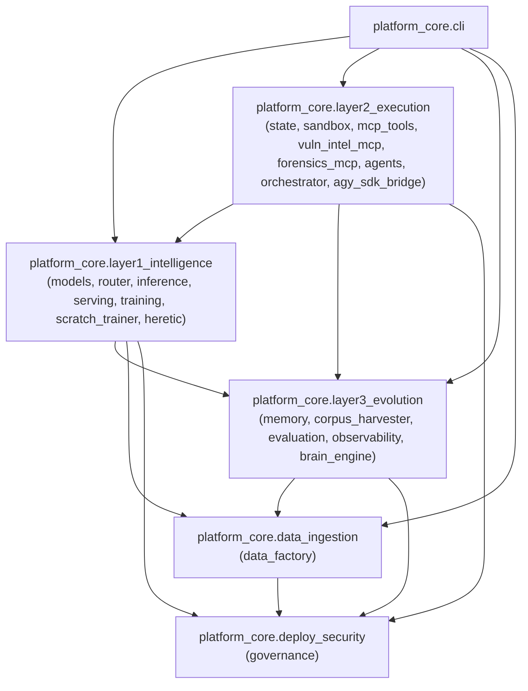
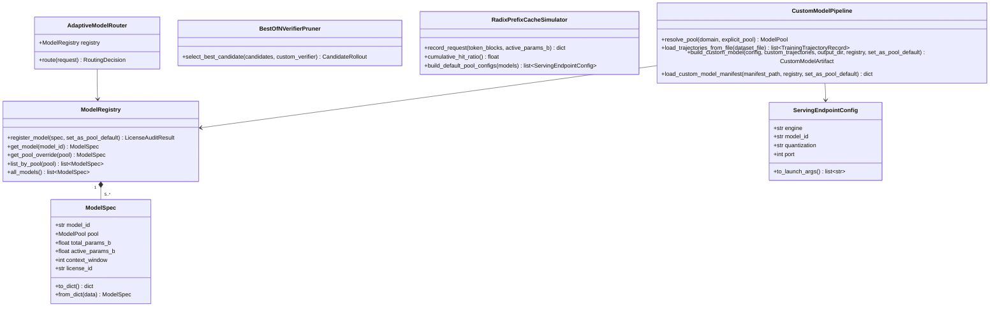
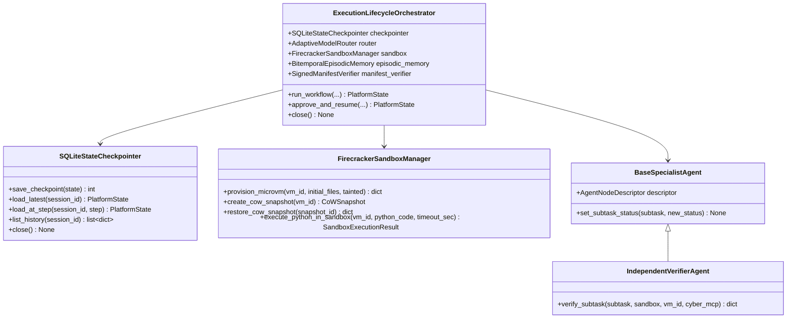

# Component Architecture & Package Boundaries

---

## Table of Contents

1. [Package Dependency Rules](#1-package-dependency-rules)
2. [Layer 1 (`layer1_intelligence`) Component Diagram & Classes](#2-layer-1-layer1_intelligence-component-diagram--classes)
3. [Layer 2 (`layer2_execution`) Component Diagram & Classes](#3-layer-2-layer2_execution-component-diagram--classes)
4. [Layer 3 & Data Ingestion (`layer3_evolution` & `data_ingestion`) Component Diagram & Classes](#4-layer-3--data-ingestion-layer3_evolution--data_ingestion-component-diagram--classes)
5. [Deploy & Security (`deploy_security`) Component Diagram & Classes](#5-deploy--security-deploy_security-component-diagram--classes)
6. [CLI Entrypoint (`cli.py`) Component Mapping](#6-cli-entrypoint-clipy-component-mapping)
7. [Related Documentation](#7-related-documentation)

---

## 1. Package Dependency Rules

`platform_core` enforces a strict directed acyclic dependency structure across subpackages:

**Dependency Invariants**:
- `platform_core.deploy_security` is the foundational zero-internal-dependency security layer; it imports only Python standard library modules (`dataclasses`, `enum`, `hashlib`, `hmac`, `ipaddress`, `json`, `math`, `pathlib`, `struct`, `typing`, `urllib.parse`).
- `platform_core.data_ingestion` depends only on `deploy_security` (`LicenseComplianceAuditor`) and standard library modules, and is re-exported by `layer3_evolution`.
- `platform_core.layer1_intelligence` depends on `deploy_security` (`LicenseComplianceAuditor`, `SafetensorsValidator`) and `data_ingestion` / `layer3_evolution` (`DatasetHygienePipeline`, factories, `BenchmarkEvaluator`).
- `platform_core.layer2_execution` orchestrates `layer1_intelligence` (`AdaptiveModelRouter`, `ModelPool`, `InferenceBackend`), `layer3_evolution` (`BitemporalEpisodicMemory`), and `deploy_security` (`SignedManifestVerifier`, `CyberGymFirewall`).
- `platform_core.layer3_evolution` provides bitemporal memory, corpus harvesting (`CyberGymFirewall`), `ProjectBrainEngine` (`CompactTransformerSLMTrainer`, `heretic.py`), executable `BenchmarkSuiteRunner` across Layers 1–2, and 8-step observability (`ControlledImprovementCycle`).

---

## 2. Layer 1 (`layer1_intelligence`) Component Diagram & Classes

Source directory: [`src/platform_core/layer1_intelligence/`](../../src/platform_core/layer1_intelligence/)

| File | Public Classes & Enums | Responsibility |
| :--- | :--- | :--- |
| [`models.py`](../../src/platform_core/layer1_intelligence/models.py) | `ModelPool`, `ThinkingMode`, `ModelSpec`, `ScenarioBudgetProfile`, `ModelRegistry`, `HardwareFeasibilityPlanner` | Model catalog, license-gated registration, pool default overrides, and Scenario A/B/C financial/GPU break-even planning. |
| [`router.py`](../../src/platform_core/layer1_intelligence/router.py) | `RoutingRequest`, `RoutingDecision`, `CandidateRollout`, `AdaptiveModelRouter`, `BestOfNVerifierPruner` | Domain/token/modality routing, entropy-bounded thinking budgets (`NON_THINK`, `THINK_HIGH`, `THINK_MAX`), and `TTS@N` rollout pruning. |
| [`serving.py`](../../src/platform_core/layer1_intelligence/serving.py) | `ServingEndpointConfig`, `RadixPrefixCacheSimulator` | Deterministic SGLang v0.5.19 / vLLM v0.28 CLI flag generation and RadixAttention prefix tree hit-rate/TTFT simulation. |
| [`training.py`](../../src/platform_core/layer1_intelligence/training.py) | `SWECyberEvaluationInput`, `SWECyberRewardOracle`, `StructFieldSpan`, `BinRevDecompileInput`, `BinRevDecompileRewardOracle`, `GRPORolloutSample`, `GRPOStepMetrics`, `GRPOTrainer`, `TeacherModelDescriptor`, `MOPDDistiller`, `DistributedTrainingSpecBuilder`, `DPOPreferencePair`, `DPOStepMetrics`, `DPOTrainer`, `CustomModelConfig`, `CustomModelArtifact`, `CustomModelPipeline` | 5-Stage post-training algorithms, verifiable execution reward oracles, FSDP2/ZeRO-3 sharding spec generation, and atomic `.safetensors` + `.manifest.json` creation/loading. |
| [`inference.py`](../../src/platform_core/layer1_intelligence/inference.py) | `InferenceBackend`, `OpenAICompatibleClient`, `MLXLocalBackend`, `DeterministicMockBackend`, `MemoryResidencyGuard`, `ModelDownloadManager` | OpenAI-compatible HTTP client, MLX local inference, residency eviction guard (`<= 82%` RAM), and license-gated HF weight downloads. |
| [`scratch_trainer.py`](../../src/platform_core/layer1_intelligence/scratch_trainer.py) | `ModelCreationPath`, `StrategyRecommendation`, `CreationStrategyAdvisor`, `BytePairTokenizer`, `ScratchSLMConfig`, `ScratchSLMArtifact`, `CompactTransformerSLMTrainer` | Strategy recommendation, UTF-8 BPE tokenizer, and from-scratch compact causal Transformer SLM trainer & `.safetensors` exporter. |
| [`heretic.py`](../../src/platform_core/layer1_intelligence/heretic.py) | `HereticConfig`, `HereticAbliterator`, `GAINAdaptiveScheduler`, `ColdFusionMergeConfig`, `ColdFusionModelMerger`, `ImatrixQuantizationCalibrator` | Arbitrary-rank refusal subspace abliteration under KL budget, GAIN per-sample scheduling, DARE-TIES/SLERP checkpoint merging, and IMatrix GGUF/MLX calibration. |

---

## 3. Layer 2 (`layer2_execution`) Component Diagram & Classes

Source directory: [`src/platform_core/layer2_execution/`](../../src/platform_core/layer2_execution/)

| File | Public Classes & Enums | Responsibility |
| :--- | :--- | :--- |
| [`interfaces.py`](../../src/platform_core/layer2_execution/interfaces.py) | `AbstractExecutionContext` | Typed `Protocol` contract for isolated sandbox execution contexts. |
| [`state.py`](../../src/platform_core/layer2_execution/state.py) | `TaintLevel`, `TaskStatus`, `LifecycleStep`, `EpistemicStatus`, `EpistemicClaim`, `EpistemicAssessment`, `ArtifactRef`, `ApprovalRequest`, `SubTask`, `PlatformState`, `SQLiteStateCheckpointer` | Typed shared workflow state, epistemic ledger, out-of-context artifact pointers, and thread-safe SQLite WAL checkpoint persistence. |
| [`sandbox.py`](../../src/platform_core/layer2_execution/sandbox.py) | `CoWSnapshot`, `SandboxExecutionResult`, `FirecrackerSandboxManager` | 24-syscall seccomp profile definition, credential env-var stripping, isolated `python3 -I` subprocess execution, symlink-safe sync-back, and `<15ms` CoW snapshot rollback. |
| [`mcp_tools.py`](../../src/platform_core/layer2_execution/mcp_tools.py) | `CodeSymbolNode`, `CodeGraphMCPServer`, `BinRevMCPServer`, `CPGVulnerabilityFinding`, `DefensiveCyberMCPServer`, `TransformationClass`, `VisualRegionObservation`, `DataAndVisualMCPServer` | Deterministic program analysis, binary decompilation (`SK²Decompile` + `ReCopilot`), CPG taint scanning, `SecVerifier` dual-gate verification, entropy/transformation classification, Kaitai `.ksy` synthesis, and epistemic visual grounding. |
| [`vuln_intel_mcp.py`](../../src/platform_core/layer2_execution/vuln_intel_mcp.py) | `VulnFindingClassification`, `AuthorizationScope`, `VulnerabilityIntelligenceRecord`, `PackageDependency`, `VulnIntelMCPServer` | Offline SQLite KEV/EPSS/OSV vulnerability mirror, fail-closed Rules-of-Engagement enforcement, and AST-taint correlation. |
| [`forensics_mcp.py`](../../src/platform_core/layer2_execution/forensics_mcp.py) | `ForensicVerdict`, `ForensicIndicator`, `ForensicFinding`, `ForensicAssessment`, `Stix2IocEngine`, `ForensicsMCPServer` | STIX 2.1 IOC matching and iOS/Android/Host spyware triage with SHA-256 anti-fabrication and `visibility_limitations` gates. |
| [`agents.py`](../../src/platform_core/layer2_execution/agents.py) | `AgentNodeDescriptor`, `AgentToolLoop`, `BaseSpecialistAgent`, `PrincipalOrchestratorAgent`, `SoftwareEngineeringAgent`, `ReverseEngineeringAgent`, `DefensiveCyberAgent`, `MultimodalDataAgent`, `IndependentVerifierAgent` | The 6 specialist agent nodes and structural enforcement of the `can_mark_completed` invariant. |
| [`orchestrator.py`](../../src/platform_core/layer2_execution/orchestrator.py) | `ExecutionLifecycleOrchestrator` | Executes Steps 1–10 of the reliable agent lifecycle, human `interrupt()` approval pause/resume, and CoW rollback + `TTS@4` retry escalation. |
| [`agy_sdk_bridge.py`](../../src/platform_core/layer2_execution/agy_sdk_bridge.py) | `AgyLocalAgentSpec`, `AgyExecutionResult`, `AgySkillDiscovery`, `AgyStdioMCPBridge`, `AgyLocalOrchestrator` | Workspace skill discovery, 18-tool JSON-RPC 2.0 stdio MCP server, and local Google Antigravity SDK / stdlib fallback orchestrator. |

---

## 4. Layer 3 & Data Ingestion (`layer3_evolution` & `data_ingestion`) Component Diagram & Classes

Source directories: [`src/platform_core/layer3_evolution/`](../../src/platform_core/layer3_evolution/) and [`src/platform_core/data_ingestion/`](../../src/platform_core/data_ingestion/)

| File | Public Classes & Enums | Responsibility |
| :--- | :--- | :--- |
| [`memory.py`](../../src/platform_core/layer3_evolution/memory.py) | `ProgressionEvent`, `BitemporalFactEdge`, `BitemporalEpisodicMemory`, `KnowledgeDocumentChunk`, `HybridKnowledgeStore`, `ProjectContextManager` | Append-only GAM event graph, bitemporal Graphiti fact edges with point-in-time queries, and 200K-token `DIRECT_PREFIX_CACHE` vs `HYBRID_PGVECTORSCALE_SEARCH` retrieval. |
| [`data_factory.py`](../../src/platform_core/data_ingestion/data_factory.py) | `TrainingTrajectoryRecord`, `SWEFuseFactory`, `SecBenchFactory`, `DecompileBenchFactory`, `DatasetHygienePipeline` | Canonical `data_ingestion` trajectory synthesis for SWE, CVE remediation, and stripped binary decompilation, plus 4-gate decontamination and Jaccard deduplication (re-exported by `layer3_evolution`). |
| [`corpus_harvester.py`](../../src/platform_core/layer3_evolution/corpus_harvester.py) | `PromptInjectionSanitizer`, `DomainChunker`, `PDFBookExtractor`, `RateLimitedWebHarvester`, `TeacherDistiller`, `CorpusHarvesterPipeline` | Firewall-gated book/PDF/web corpus extraction, code-intact chunking, prompt-injection stripping, RAG ingestion, and JSONL distillation. |
| [`brain_engine.py`](../../src/platform_core/layer3_evolution/brain_engine.py) | `BrainSyncReport`, `BrainQueryResult`, `BrainPipelineReport`, `ProjectBrainEngine` | `.agents/brain/` synchronization into Hybrid RAG + Bitemporal Memory and end-to-end GAIN + Heretic + Cold-Fusion + IMatrix SLM pipeline. |
| [`evaluation.py`](../../src/platform_core/layer3_evolution/evaluation.py) | `MultiRunBenchmarkResult`, `BenchmarkEvaluator`, `PropBenchSpec`, `PropBench9Suite`, `BenchmarkSuiteRunner` | Multi-run 95% confidence intervals, $\text{pass}@1$ and $\text{pass}^k$ consistency ratios, Canary Promotion Gate, 9 `PropBench-9` specs, and live executable benchmark suites. |
| [`observability.py`](../../src/platform_core/layer3_evolution/observability.py) | `TraceOutcome`, `FailureRootCauseBucket`, `ProductionTraceRecord`, `ControlledImprovementCycle` | 8-Step continuous improvement loop with automated failure clustering, root-cause attribution, unverified-prose filtering, and canary gating. |

---

## 5. Deploy & Security (`deploy_security`) Component Diagram & Classes

Source directory: [`src/platform_core/deploy_security/`](../../src/platform_core/deploy_security/)

| File | Public Classes & Enums | Responsibility |
| :--- | :--- | :--- |
| [`governance.py`](../../src/platform_core/deploy_security/governance.py) | `PickleSupplyChainError`, `SafetensorsValidationError`, `LicenseVerdict`, `LicenseAuditResult`, `LicenseComplianceAuditor`, `SafetensorsValidator`, `MCPToolManifest`, `SignedManifestVerifier`, `FirewallDecision`, `CyberGymFirewall`, `K8sAgentSandboxGenerator` | Supply-chain checkpoint verification, commercial/EU license auditing, HMAC-SHA256 tool manifest signing, taint-aware network firewall, and Kubernetes `agent-sandbox` CRD generation. |

---

## 6. CLI Entrypoint (`cli.py`) Component Mapping

[`src/platform_core/cli.py`](../../src/platform_core/cli.py) exposes the `platform-cli` console script (`project.scripts` in `pyproject.toml`) and top-level helper functions:

| CLI Subcommand | Backing Python Function in `cli.py` | Underlying Subsystems Invoked |
| :--- | :--- | :--- |
| `evaluate-blueprint` | `run_evaluate_blueprint(budget_usd)` | `ModelRegistry`, `RadixPrefixCacheSimulator`, `HardwareFeasibilityPlanner`, `PropBench9Suite` |
| `train-model` | `run_model_creation_pipeline(...)` | `CustomModelPipeline.load_trajectories_from_file`, `CustomModelPipeline.build_custom_model` |
| `create-custom-model` | `run_model_creation_pipeline(...)` | `CustomModelPipeline.load_trajectories_from_file`, `CustomModelPipeline.build_custom_model` |
| `run-workflow` | `run_demo_workflow(...)` | `ExecutionLifecycleOrchestrator.run_workflow`, `_load_custom_workflow_payload` |
| `run-custom-model` | `run_demo_workflow(...)` | `CustomModelPipeline.load_custom_model_manifest`, `ExecutionLifecycleOrchestrator.run_workflow` |
| `inspect-data` | `main()` (`args.command == "inspect-data"`) | `DataAndVisualMCPServer.classify_transformation`, `DataAndVisualMCPServer.synthesize_kaitai_struct_ksy` |
| *(remaining 17 subcommands)* | `hardware-check`, `download-model`, `sync-vuln-db`, `scan-forensics`, `audit-vulns`, `analyze-image`, `run-benchmarks`, `transparency-dashboard`, `harvest-corpus`, `recommend-strategy`, `train-scratch-slm`, `run-agy-local`, `mcp-stdio-bridge`, `brain-query`, `heretic-abliterate`, `cold-fusion-merge`, `brain-pipeline` | See [CLI Module Reference (`docs/modules/cli.md`)](../modules/cli.md) for all 23 subcommand contracts. |

---

## 7. Related Documentation

- [System Architecture](system-architecture.md)
- [Data Flow & State Lifecycles](data-flow.md)
- [Module Reference (`docs/modules/`)](../modules/README.md)
- [API & CLI Contracts (`docs/api/README.md`)](../api/README.md)
