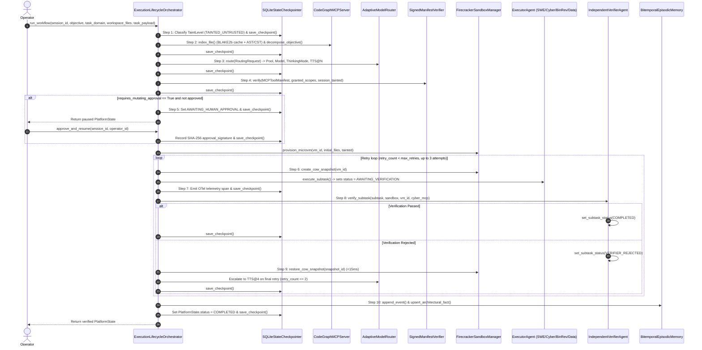
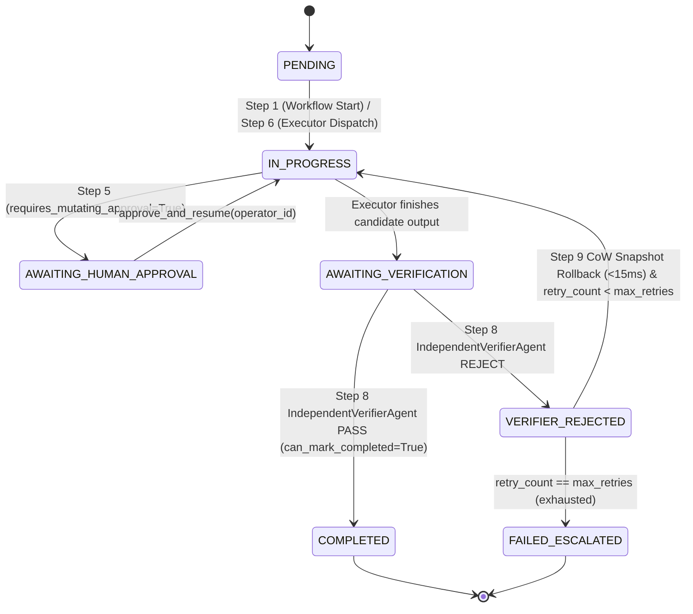
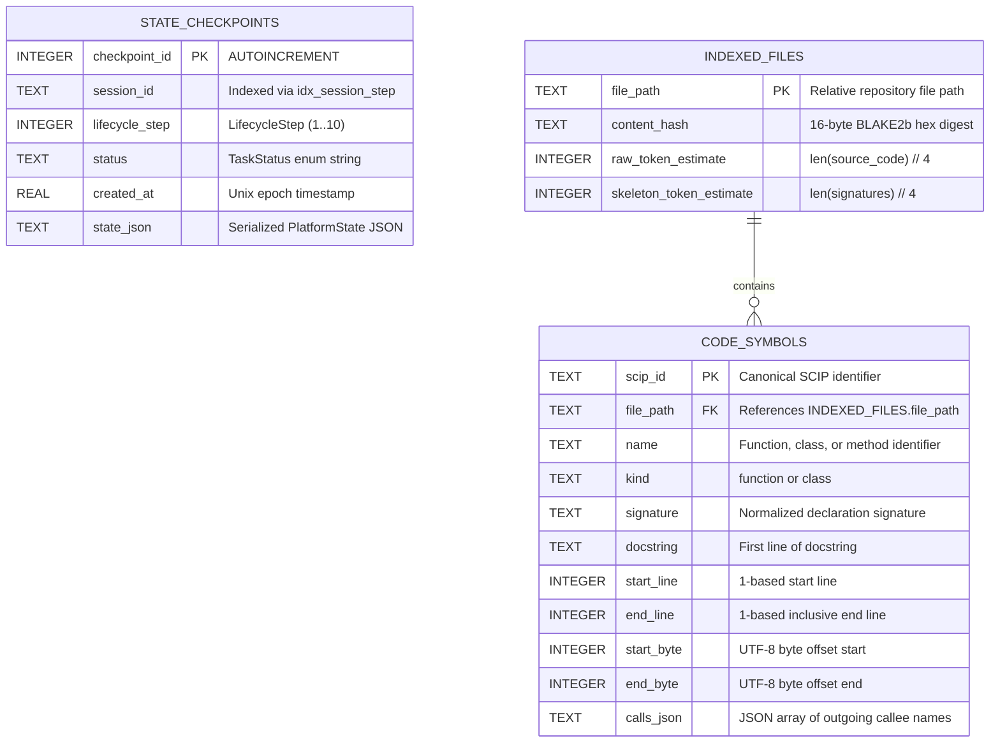

# Data Flow, State Transitions & Persistence Schemas

---

## Table of Contents

1. [10-Step Agent Execution Lifecycle Sequence](#1-10-step-agent-execution-lifecycle-sequence)
2. [Task & SubTask State Machine](#2-task--subtask-state-machine)
3. [SQLite Persistence Schemas (ER Diagram)](#3-sqlite-persistence-schemas-er-diagram)
4. [5-Stage Model Creation & Post-Training Data Flow](#4-5-stage-model-creation--post-training-data-flow)
5. [Bitemporal Memory & 200K-Token Knowledge Retrieval Flow](#5-bitemporal-memory--200k-token-knowledge-retrieval-flow)
6. [Related Documentation](#6-related-documentation)

---

## 1. 10-Step Agent Execution Lifecycle Sequence

When `ExecutionLifecycleOrchestrator.run_workflow()` ([src/platform_core/layer2_execution/orchestrator.py](../../src/platform_core/layer2_execution/orchestrator.py)) executes a task, data flows across the components in 10 deterministic steps, persisting a `PlatformState` JSON snapshot to `SQLiteStateCheckpointer` at every transition:

**Diagram Context**: Every step transition updates `state.current_step` (`LifecycleStep` enum `1..10`), appends a structured span to `state.telemetry_spans`, and writes a durable row into `state_checkpoints`. If `requires_mutating_approval=True`, execution halts cleanly at Step 5 (`TaskStatus.AWAITING_HUMAN_APPROVAL`) and can be resumed later via `approve_and_resume()`.

---

## 2. Task & SubTask State Machine

`TaskStatus` ([src/platform_core/layer2_execution/state.py](../../src/platform_core/layer2_execution/state.py)) governs both `PlatformState.status` and `SubTask.status`:

**Diagram Context**: Notice that there is no transition from `IN_PROGRESS` directly to `COMPLETED`. Every subtask must pass through `AWAITING_VERIFICATION`, where only `IndependentVerifierAgent` holds permission to transition to `COMPLETED`.

---

## 3. SQLite Persistence Schemas (ER Diagram)

`platform-core` uses two thread-safe SQLite stores configured with `check_same_thread=False`, `threading.RLock()`, `PRAGMA busy_timeout = 30000`, and `PRAGMA journal_mode = WAL` (when backed by disk files):

1. **`SQLiteStateCheckpointer`** ([src/platform_core/layer2_execution/state.py](../../src/platform_core/layer2_execution/state.py)): Persists workflow checkpoints in `state_checkpoints`.
2. **`CodeGraphMCPServer`** ([src/platform_core/layer2_execution/mcp_tools.py](../../src/platform_core/layer2_execution/mcp_tools.py)): Persists incremental file hashes in `indexed_files` and AST/CST/SCIP symbol definitions in `code_symbols`.

**Out-of-Context Artifact Pointers (`ArtifactRef`)**:
To prevent large binaries or core dumps from bloating `state_json` inside `STATE_CHECKPOINTS`, `PlatformState.artifact_refs` stores lightweight `ArtifactRef(artifact_id, uri, sha256, byte_length, media_type, byte_range)` pointers.

---

## 4. 5-Stage Model Creation & Post-Training Data Flow

`CustomModelPipeline.build_custom_model()` ([src/platform_core/layer1_intelligence/training.py](../../src/platform_core/layer1_intelligence/training.py)) transforms raw trajectory records into a cryptographically verified custom model bundle:

```mermaid
flowchart LR
    Raw["Trajectories\n(SWEFuse / SecBench / DecompileBench / .jsonl)"] --> S1["Stage 1: DatasetHygienePipeline\n(License + Decontam + Exec Verified + Jaccard Dedup)"]
    S1 --> S2["Stage 2: DistributedTrainingSpecBuilder\n(FSDP2 <100B vs ZeRO-3 >=100B, 15-30% Replay)"]
    S2 --> S3["Stage 3: MOPDDistiller\n(DeepSeek-V4-Pro MIT + Qwen3.5-397B Apache-2.0 Forward KL)"]
    S3 --> S4["Stage 4: GRPOTrainer + Reward Oracles\n(SWECyber {-1, -0.5, +1} & BinRev R_comp/R_exec/IoU)"]
    S4 --> S5["Stage 5: DPOTrainer\n(Decompiler Naming & Refusal Calibration)"]
    S5 --> S6["Stage 6: SafetensorsValidator\n(8-Byte Aligned Header + Contiguous Tensor Offsets + SHA-256)"]
    S6 --> S7["Stage 7: BenchmarkEvaluator Canary Gate\n(5-Run 95% CI, 0 Regressions, Significant Target Gain)"]
    S7 --> Bundle["Atomic Disk Export\n(<model-id>.safetensors + <model-id>.manifest.json)"]
```

**Diagram Context**: When `output_dir` is provided, Stage 6 and Stage 7 write `<model-id>.safetensors` and `<model-id>.manifest.json` atomically using `tempfile.NamedTemporaryFile` followed by `os.replace()`, validating the temporary `.safetensors` file on disk before replacing the target path.

---

## 5. Bitemporal Memory & 200K-Token Knowledge Retrieval Flow

1. **Bitemporal Fact Supersession (`BitemporalEpisodicMemory.upsert_architectural_fact`)**:
   - Searches active facts (`valid_to is None and invalid_at is None`) matching `(subject, predicate)`.
   - If an active fact already has the same `object_val`, returns it idempotently.
   - If `object_val` changed, closes the old edge (`existing.valid_to = v_from`, `existing.invalid_at = now`) and appends a new `BitemporalFactEdge` starting at `valid_from = v_from`.
2. **200K-Token Hybrid Knowledge Routing (`HybridKnowledgeStore.retrieve`)**:
   - Computes `total_tokens = sum(c.token_count for c in self._chunks)`.
   - If `0 < total_tokens < 200_000`, returns all chunks immediately with `"retrieval_mode": "DIRECT_PREFIX_CACHE"` so the inference engine can cache the entire corpus in SGLang's RadixAttention tree.
   - If `total_tokens >= 200_000` (or `total_tokens == 0`), ranks chunks by $0.65 \times \text{cosine\_similarity} + 0.35 \times \text{lexical\_overlap}$ and returns the top-$k$ chunks with `"retrieval_mode": "HYBRID_PGVECTORSCALE_SEARCH"`.

---

## 6. Related Documentation

- [System Architecture](system-architecture.md)
- [Component Architecture](component-architecture.md)
- [10-Step Agent Execution Lifecycle Workflow](../workflows/agent-execution-lifecycle.md)
- [5-Stage Model Post-Training Workflow](../workflows/model-post-training-pipeline.md)
