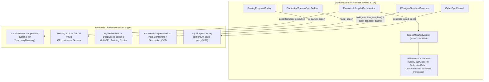

# Integrations & External System Boundaries

---

## Table of Contents

1. [Overview of Integration Boundaries](#1-overview-of-integration-boundaries)
2. [Scoped & Signed MCP Tool Integration (`SignedManifestVerifier`)](#2-scoped--signed-mcp-tool-integration-signedmanifestverifier)
3. [Inference Engine Integration (`SGLang v0.5.19` & `vLLM v0.28`)](#3-inference-engine-integration-sglang-v0519--vllm-v028)
4. [Distributed Training Integration (`PyTorch FSDP2` & `DeepSpeed ZeRO-3`)](#4-distributed-training-integration-pytorch-fsdp2--deepspeed-zero-3)
5. [MicroVM Sandbox & Kubernetes `agent-sandbox` Integration](#5-microvm-sandbox--kubernetes-agent-sandbox-integration)
6. [Network Egress & Squid Proxy Integration (`CyberGymFirewall`)](#6-network-egress--squid-proxy-integration-cybergymfirewall)
7. [Related Documentation](#7-related-documentation)

---

## 1. Overview of Integration Boundaries

`platform-core` executes all core orchestration, AST/CST parsing, CPG taint scanning, binary inspection, entropy analysis, reward calculation, and `.safetensors` validation natively in Python 3.11+ without requiring external network calls or third-party Python packages. For cluster-scale production deployment, it emits deterministic launch configurations, Kubernetes Custom Resource Definitions (CRDs), and Squid firewall policies.



---

## 2. Scoped & Signed MCP Tool Integration (`SignedManifestVerifier`)

At Step 4 (`STEP_4_SCOPED_MCP_BINDING`), `ExecutionLifecycleOrchestrator` verifies every tool bound to a `SubTask` using `SignedManifestVerifier` ([src/platform_core/deploy_security/governance.py](../../src/platform_core/deploy_security/governance.py)).

### Registered MCP Tool Contracts

| Tool Name | Server ID | Required Scope(s) | Underlying Method |
| :--- | :--- | :--- | :--- |
| `code_graph.query_symbol` | `code-graph-mcp` | `read_code` | `CodeGraphMCPServer.query_symbol` |
| `code_graph.apply_str_replace_edit` | `code-graph-mcp` | `write_code` | `CodeGraphMCPServer.apply_str_replace_edit` |
| `cyber.scan_cpg_taint` | `defensive-cyber-mcp` | `audit_security` | `DefensiveCyberMCPServer.scan_cpg_taint` |
| `binrev.inspect_binary` | `binrev-mcp` | `analyze_binary` | `BinRevMCPServer.inspect_binary` |
| `binrev.run_two_phase_sk2_decompile` | `binrev-mcp` | `decompile_binary` | `BinRevMCPServer.run_two_phase_sk2_decompile` |
| `data_visual.classify_transformation` | `data-visual-mcp` | `parse_data` | `DataAndVisualMCPServer.classify_transformation` |
| `data_visual.synthesize_kaitai_struct_ksy` | `data-visual-mcp` | `parse_data` | `DataAndVisualMCPServer.synthesize_kaitai_struct_ksy` |
| `data_visual.ground_visual_observations` | `data-visual-mcp` | `ground_visual` | `DataAndVisualMCPServer.ground_visual_observations` |
| `vuln_intel.audit_project` | `vuln-intel-mcp` | `audit_security` | `VulnIntelMCPServer.audit_project_dependencies` |
| `forensics.analyze_target` | `forensics-mcp` | `audit_security` | `ForensicsMCPServer.analyze_forensic_target` |

> [!NOTE]
> Above are the `10` HMAC-SHA256 signed tool manifests enforced inside `ExecutionLifecycleOrchestrator` (`orchestrator.py`). For external local agent runtimes, `AgyStdioMCPBridge` (`agy_sdk_bridge.py`, `platform-cli mcp-stdio-bridge`) exposes **18 JSON-RPC 2.0 stdio tools** across all 6 MCP servers when clean (`17` when `session_tainted=True`, stripping `vuln_sync_live_feeds`).

### Verification Invariants
1. **HMAC-SHA256 Integrity**: `SignedManifestVerifier` computes `hmac.new(key, manifest.canonical_payload(), hashlib.sha256).hexdigest()` (requiring `len(signing_key) >= 16` bytes) and verifies with constant-time `hmac.compare_digest()`.
2. **Scope Whitelist**: Only scopes in `SignedManifestVerifier.VALID_SCOPES` (`read_code`, `write_code`, `analyze_binary`, `decompile_binary`, `audit_security`, `parse_data`, `ground_visual`, `run_sandbox`, `network_egress`, `admin_deploy`) are permitted.
3. **Taint Lockdown**: When `session_tainted=True`, any manifest with `allows_tainted_execution=False` or requiring `network_egress` or `admin_deploy` is rejected (`verify() -> False`).

---

## 3. Inference Engine Integration (`SGLang v0.5.19` & `vLLM v0.28`)

`ServingEndpointConfig.to_launch_args()` ([src/platform_core/layer1_intelligence/serving.py](../../src/platform_core/layer1_intelligence/serving.py)) generates container entrypoint arguments for two supported inference engines:

- **SGLang (`engine="sglang"`)**:
  ```text
  python3 -m sglang.launch_server --model-path <model_id> --tp-size <tp> --context-length <ctx> --quantization <fp8|mxfp4> --mem-fraction-static 0.90 --port <port> --chunked-prefill-size=8192
  ```
- **vLLM (`engine="vllm"`)**:
  ```text
  vllm serve <model_id> --tensor-parallel-size <tp> --max-model-len <ctx> --quantization <fp8|mxfp4> --gpu-memory-utilization 0.90 --port <port> --enable-prefix-caching --enable-chunked-prefill
  ```

Quantization and tensor parallelism defaults in `RadixPrefixCacheSimulator.build_default_pool_configs()`:
- Models with `total_params_b >= 100.0` use `quantization="mxfp4"`; dense `<100B` models use `quantization="fp8"`.
- Models with `vram_4bit_gb > 192.0` use `tensor_parallel_size=2`; others use `tensor_parallel_size=1`.

---

## 4. Distributed Training Integration (`PyTorch FSDP2` & `DeepSpeed ZeRO-3`)

`DistributedTrainingSpecBuilder.build_spec()` ([src/platform_core/layer1_intelligence/training.py](../../src/platform_core/layer1_intelligence/training.py)) emits cluster training specifications:

- **Dense Models (`total_params_b < 100.0` and `framework="auto"`)**: Selects `"sharding_backend": "pytorch_fsdp2_dtensor"` with `"torch_compile": True` and `"mixed_precision": "bf16_fp8_hybrid"`.
- **Large MoE Models (`total_params_b >= 100.0` or `framework="deepspeed_zero3"`)**: Selects `"sharding_backend": "deepspeed_zero3"` with `"torch_compile": False`.
- **Deprecated Framework Guard**: Explicitly blocks `torchtune` (`FORBIDDEN_FRAMEWORKS = frozenset({"torchtune"})`) with a `ValueError`.
- **Catastrophic Forgetting Guard**: Requires `0.15 <= general_replay_ratio <= 0.30` during stage `"CPT"`.

---

## 5. MicroVM Sandbox & Kubernetes `agent-sandbox` Integration

Local execution uses `FirecrackerSandboxManager.execute_python_in_sandbox()` ([src/platform_core/layer2_execution/sandbox.py](../../src/platform_core/layer2_execution/sandbox.py)), which:
1. Materializes workspace files into an isolated `tempfile.TemporaryDirectory(prefix=f"fc_vm_{vm_id}_")`.
2. Strips all host credentials matching `SENSITIVE_ENV_PREFIXES` (`AWS_`, `GCP_`, `GOOGLE_`, `OPENAI_`, `ANTHROPIC_`, `GITHUB_`, `GITLAB_`, `HF_TOKEN`, `SSH_`, `DATABASE_URL`, `PGPASSWORD`) as well as `HOME`, `TMPDIR`, `USER`, `LOGNAME`, and `PYTHONPATH`.
3. Executes `["python3", "-I", "_sandbox_entry.py"]` with `timeout=timeout_sec`.
4. Syncs modified files back while rejecting symlinks (`path.is_symlink()`), verifying `path.resolve().is_relative_to(resolved_root)`, and deleting files removed during execution.

For Kubernetes cluster deployment, `K8sAgentSandboxGenerator` ([src/platform_core/deploy_security/governance.py](../../src/platform_core/deploy_security/governance.py)) emits:
- `SandboxTemplate` (`apiVersion: agentsandbox.x-k8s.io/v1alpha1`, `runtimeClassName: kata-fc`, `seccompSyscallLimit: 24`, `cowSnapshotRestoreTargetMs: 8.5`).
- `SandboxClaim` binding `platform.ai/session-id` and `platform.ai/taint-state` (`TAINTED_UNTRUSTED` or `CLEAN`) with `preExecutionCoWSnapshot: True` and `autoRollbackOnVerifierReject: True`.

---

## 6. Network Egress & Squid Proxy Integration (`CyberGymFirewall`)

`CyberGymFirewall` ([src/platform_core/deploy_security/governance.py](../../src/platform_core/deploy_security/governance.py)) enforces outbound network policy:
- When `session_tainted=True`: Denies 100% of outbound traffic (`internal=True` bridge lockdown).
- When `session_tainted=False`: Permits only `http`/`https` requests to hostnames in `DEFAULT_ALLOWLIST` (`mirror.internal.platform.local`, `pypi.internal.platform.local`, `crates.internal.platform.local`, `scip-registry.internal.platform.local`) while blocking raw IP literals, `localhost`, and `metadata.google.internal`.
- `generate_squid_conf()` renders the corresponding Squid ACL configuration file.

---

## 7. Related Documentation

- [System Architecture](system-architecture.md)
- [Security Architecture & Governance](../security/README.md)
- [Deployment & Cluster Configuration Guide](../deployment/README.md)
- [API & Contract Reference](../api/README.md)
