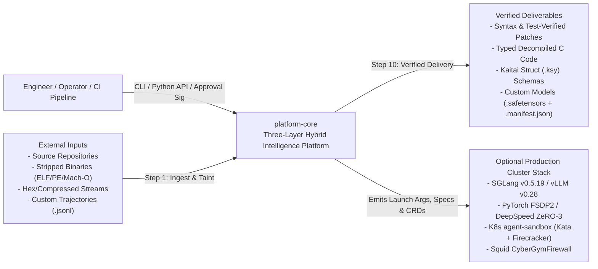
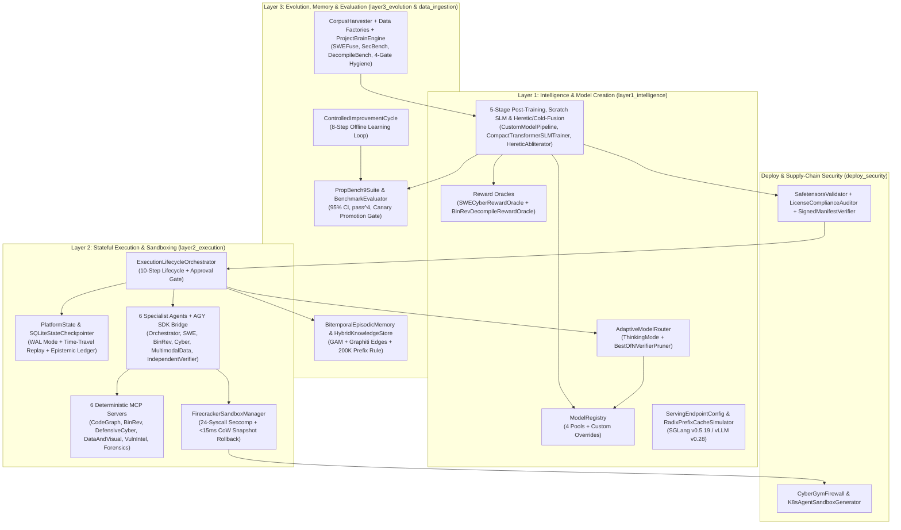

# System Architecture — Three-Layer Hybrid Technical Intelligence Platform

---

## Table of Contents

1. [System Context](#1-system-context)
2. [Three-Layer Hybrid Intelligence Topology](#2-three-layer-hybrid-intelligence-topology)
3. [Layer 1: Four-Pool Specialized Model Lineup](#3-layer-1-four-pool-specialized-model-lineup)
4. [Layer 2: Consolidation of 12 Candidate Roles into 6 Specialist Agents](#4-layer-2-consolidation-of-12-candidate-roles-into-6-specialist-agents)
5. [Layer 3: Evolution, Bitemporal Memory & Statistical Governance](#5-layer-3-evolution-bitemporal-memory--statistical-governance)
6. [Cross-Cutting Security & Deployment Architecture](#6-cross-cutting-security--deployment-architecture)
7. [Related Documentation](#7-related-documentation)

---

## 1. System Context

`platform-core` operates as a self-contained technical intelligence engine interacted with via the `platform-cli` command-line interface ([src/platform_core/cli.py](../../src/platform_core/cli.py)) or the Python API ([src/platform_core/__init__.py](../../src/platform_core/__init__.py)).

### System Context Diagram

**Diagram Context**: Operators submit tasks or training datasets via `platform-cli` or Python calls. External artifacts enter at Step 1 (`ExecutionLifecycleOrchestrator.run_workflow`), where untrusted inputs set `TaintLevel.TAINTED_UNTRUSTED`. All outputs must pass `IndependentVerifierAgent` before Step 10 delivery, while cluster configuration generators emit launch arguments and Kubernetes manifests for physical multi-GPU and KVM infrastructure.

---

## 2. Three-Layer Hybrid Intelligence Topology

The platform separates probabilistic neural reasoning (**Layer 1**) from deterministic program analysis and isolated execution (**Layer 2**) and offline continuous evolution (**Layer 3**).

### High-Level Architecture Diagram

**Diagram Context**:
- `ExecutionLifecycleOrchestrator` ([orchestrator.py](../../src/platform_core/layer2_execution/orchestrator.py)) coordinates all three layers: it checkpoints state via `SQLiteStateCheckpointer`, queries `AdaptiveModelRouter` for model and thinking-token allocation, verifies tool scopes via `SignedManifestVerifier`, dispatches tasks to the 5 executor agents, verifies results through `IndependentVerifierAgent` inside `FirecrackerSandboxManager`, and consolidates verified outcomes into `BitemporalEpisodicMemory`.
- `CustomModelPipeline` ([training.py](../../src/platform_core/layer1_intelligence/training.py)) consumes decontaminated trajectories from `DatasetHygienePipeline`, optimizes policies via `MOPDDistiller`, `GRPOTrainer`, and `DPOTrainer`, validates binary checkpoints via `SafetensorsValidator`, checks statistical gains via `BenchmarkEvaluator.evaluate_canary_promotion`, and registers custom models into `ModelRegistry`.

---

## 3. Layer 1: Four-Pool Specialized Model Lineup

`ModelRegistry._register_default_lineup()` ([models.py](../../src/platform_core/layer1_intelligence/models.py)) registers five default open-weight models across four specialized pools:

| Pool (`ModelPool`) | Model ID | Architecture | Total / Active Params | Context Window | License | 4-Bit / FP8 VRAM | Primary Role |
| :--- | :--- | :--- | :--- | :--- | :--- | :--- | :--- |
| `POOL_1_ORCHESTRATOR` | `DeepSeek-V4-Flash` | MoE with CSA + HCA Hybrid Sparse Attention | 284.0B / 13.0B | 1,000,000 | `MIT` | 192.0 GB / 310.0 GB | Long-context (>200K token) & non-visual architectural orchestration |
| `POOL_1_ORCHESTRATOR` | `Qwen3.5-397B-A17B` | Native VLM Hybrid Linear Attention (Gated DeltaNet 3:1) + MoE | 397.0B / 17.0B | 1,000,000 | `Apache-2.0` | 200.0 GB / 400.0 GB | Multimodal architectural orchestration & MOPD teacher |
| `POOL_2_SWE_CYBER` | `Qwen3.8-27B-SWE-Cyber` | Dense Native VLM with 3:1 Gated DeltaNet Linear Attention | 27.8B / 27.8B | 262,144 | `Apache-2.0` | 16.0 GB / 28.0 GB | Software engineering, CPG security remediation, and protocol synthesis |
| `POOL_3_BINREV` | `Qwen3.8-27B-BinRev` | Dense Native VLM with 3:1 Gated DeltaNet (`SK²Decompile` + `ReCopilot`) | 27.8B / 27.8B | 262,144 | `Apache-2.0` | 16.0 GB / 28.0 GB | Stripped binary reverse engineering & DWARF struct recovery |
| `POOL_4_VISUAL_OCR` | `OmniParser-V2-UI-TARS-GOT-OCR` | YOLOv9-E Region Detector + UI-TARS-1.5-7B + GOT-OCR-2.0 | 7.5B / 7.5B | 32,768 | `Apache-2.0` | 6.0 GB / 10.5 GB | Fast UI/diagram bounding-box detection & OCR pre-parsing |

Custom models registered via `ModelRegistry.register_model(spec, set_as_pool_default=True)` dynamically override the default model for their target pool (`_pool_overrides`).

---

## 4. Layer 2: Consolidation of 12 Candidate Roles into 6 Specialist Agents

To eliminate inter-agent message-passing latency and context fragmentation, [src/platform_core/layer2_execution/agents.py](../../src/platform_core/layer2_execution/agents.py) consolidates 12 conceptual agent roles into 6 stateful nodes sharing a single `PlatformState` schema:

| Agent Class | `agent_id` | Absorbed Candidate Roles (1–12) | Backing Pool | Allowed MCP Scopes | `can_mark_completed` |
| :--- | :--- | :--- | :--- | :--- | :--- |
| `PrincipalOrchestratorAgent` | `principal_orchestrator` | 1. Central Orchestrator 2. Principal Software Architect 10. Research Agent | `POOL_1_ORCHESTRATOR` | `read_code`, `parse_data`, `ground_visual` | `False` |
| `SoftwareEngineeringAgent` | `software_engineering` | 3. Senior Programming Agent 4. Code Analysis Agent 5. Debugging Agent | `POOL_2_SWE_CYBER` | `read_code`, `write_code`, `run_sandbox` | `False` |
| `ReverseEngineeringAgent` | `reverse_engineering` | 6. Reverse Engineering Agent | `POOL_3_BINREV` | `analyze_binary`, `decompile_binary`, `parse_data`, `run_sandbox` | `False` |
| `DefensiveCyberAgent` | `defensive_cyber` | 7. Defensive Cybersecurity Agent | `POOL_2_SWE_CYBER` | `read_code`, `write_code`, `audit_security`, `run_sandbox` | `False` |
| `MultimodalDataAgent` | `multimodal_data` | 8. Visual Intelligence Agent 9. Data Analysis Agent | `POOL_4_VISUAL_OCR` | `parse_data`, `ground_visual` | `False` |
| `IndependentVerifierAgent` | `independent_verifier` | 11. Testing & Validation Agent 12. Quality Assurance Agent | `POOL_2_SWE_CYBER` | `read_code`, `audit_security`, `parse_data`, `run_sandbox` | **`True`** |

> [!IMPORTANT]
> `BaseSpecialistAgent.set_subtask_status()` enforces at runtime that any agent with `can_mark_completed == False` raises a `PermissionError` if it attempts to set `TaskStatus.COMPLETED`.

---

## 5. Layer 3: Evolution, Bitemporal Memory & Statistical Governance

Layer 3 ([src/platform_core/layer3_evolution/](../../src/platform_core/layer3_evolution/)) prevents catastrophic forgetting, benchmark contamination, and unverified self-training:

1. **Bitemporal Episodic Memory (`BitemporalEpisodicMemory`)**: Decouples an append-only *Event Progression Graph* (`ProgressionEvent`) from a *Topic Associative Network* (`BitemporalFactEdge` with `valid_from`, `valid_to`, `invalid_at`). When an architectural fact changes in a new commit, the prior active edge is closed (`valid_to = v_from`, `invalid_at = now`) rather than overwritten, preserving point-in-time historical queries via `query_facts_as_of()`.
2. **200K-Token Hybrid Knowledge Store (`HybridKnowledgeStore`)**: Enforces prompt-injection redaction and SHA-256 provenance on ingested chunks. When total corpus tokens are `< 200,000`, `retrieve()` returns `DIRECT_PREFIX_CACHE` (leveraging SGLang RadixAttention prefix caching); at `>= 200,000` tokens, it switches to `HYBRID_PGVECTORSCALE_SEARCH` ($0.65 \times \text{cosine} + 0.35 \times \text{lexical}$).
3. **Proprietary Data Factories & 4-Gate Hygiene**: `SWEFuseFactory`, `SecBenchFactory`, and `DecompileBenchFactory` synthesize training tuples that must pass `DatasetHygienePipeline` (permissive license audit, benchmark repo/CVE blocklist, `execution_verified == True`, and 3-shingle BLAKE2b Jaccard deduplication $< 0.85$).
4. **PropBench-9 & 8-Step Controlled Improvement Cycle**: `PropBench9Suite` defines 9 internal benchmarks (1,100 total tasks), `BenchmarkEvaluator` computes 95% confidence intervals and $\text{pass}^4 / \text{pass}@1 \ge 0.85$ consistency, and `ControlledImprovementCycle` clusters production failures into `KNOWLEDGE_GAP_RAG_SCIP`, `TOOLING_PARSER_BUG`, or `MODEL_WEIGHT_REASONING_GAP` without online weight drift.

---

## 6. Cross-Cutting Security & Deployment Architecture

`platform_core.deploy_security.governance` enforces five defense-in-depth gates:
1. **`SafetensorsValidator`**: Blocks `.pkl`/`.pt`/`.pth`/`.bin`/`.ckpt`/`.joblib` files, detects disguised pickle magic headers (`\x80\x02`–`\x80\x05`), verifies SHA-256 digests, and checks exact contiguous tensor byte spans (`(end - start) == prod(shape) * dtype_size`).
2. **`LicenseComplianceAuditor`**: Approves commercial OSI licenses (`Apache-2.0`, `MIT`, `BSD-2-Clause`, `BSD-3-Clause`, `PostgreSQL`, `CC0-1.0`), flags `Modified-MIT`/`Mistral-Ecosystem`/`Elastic-2.0` for legal review, and blocks `Llama-4-Community` (EU ban), `GPL-2.0`/`GPL-3.0`/`AGPL-3.0`, `Proprietary-Closed-API`, and `Research-Only`.
3. **`SignedManifestVerifier`**: Signs and verifies `MCPToolManifest` objects using HMAC-SHA256, enforcing scope subsets and stripping `network_egress` and `admin_deploy` when `session_tainted=True`.
4. **`CyberGymFirewall`**: Blocks all outbound egress on `TAINTED_UNTRUSTED` sessions, blocks direct IP literals and cloud metadata endpoints (`169.254.169.254`, `localhost`, `metadata.google.internal`) on clean sessions, and generates hardened Squid proxy configs (`generate_squid_conf()`).
5. **`K8sAgentSandboxGenerator`**: Generates `agentsandbox.x-k8s.io/v1alpha1` `SandboxTemplate` (`kata-fc` runtime, 24-syscall seccomp, `<15ms` CoW restore target) and `SandboxClaim` manifests.

---

## 7. Related Documentation

- [Component Architecture](component-architecture.md)
- [Data Flow & State Lifecycles](data-flow.md)
- [Integrations & Boundaries](integrations.md)
- [Architecture Decision Records](decisions/README.md)
