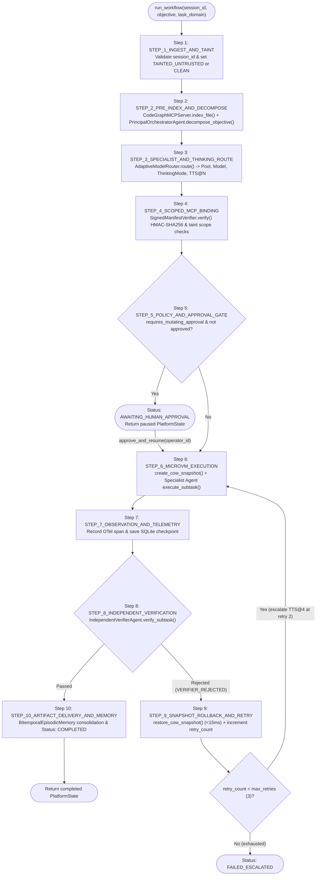

# The 10-Step Reliable Agent Execution Lifecycle

**Source Implementation:** [`src/platform_core/layer2_execution/orchestrator.py`](../../src/platform_core/layer2_execution/orchestrator.py), [`state.py`](../../src/platform_core/layer2_execution/state.py), [`agents.py`](../../src/platform_core/layer2_execution/agents.py), [`sandbox.py`](../../src/platform_core/layer2_execution/sandbox.py)

---

## Table of Contents

1. [Overview](#1-overview)
2. [Lifecycle Flowchart](#2-lifecycle-flowchart)
3. [Step-by-Step Technical Breakdown (Steps 1–10)](#3-step-by-step-technical-breakdown-steps-110)
4. [Human-in-the-Loop Approval Gate (`interrupt()` & `approve_and_resume()`)](#4-human-in-the-loop-approval-gate-interrupt--approve_and_resume)
5. [CoW Snapshot Rollback & `TTS@4` Retry Escalation](#5-cow-snapshot-rollback--tts4-retry-escalation)
6. [Verified Execution Commands](#6-verified-execution-commands)
7. [Related Documentation](#7-related-documentation)

---

## 1. Overview

`ExecutionLifecycleOrchestrator.run_workflow()` executes tasks across six domains (`swe`, `cyber`, `binrev`, `data_protocol`, `architecture`, `visual_ocr`) through a deterministic 10-step state machine (`LifecycleStep` enum `1..10`). Every step saves a JSON-serialized `PlatformState` checkpoint to `SQLiteStateCheckpointer` and appends an OpenTelemetry-style span to `state.telemetry_spans`.

---

## 2. Lifecycle Flowchart



---

## 3. Step-by-Step Technical Breakdown (Steps 1–10)

### Step 1: `STEP_1_INGEST_AND_TAINT`
- Validates `session_id` against `^[A-Za-z0-9._-]+$` (rejecting empty strings, `.`, `..`, and path separators with `PermissionError`).
- Initializes `PlatformState` with `status = TaskStatus.IN_PROGRESS` and sets `taint_level = TaintLevel.TAINTED_UNTRUSTED` if `has_untrusted_artifacts=True` (default), or `TaintLevel.CLEAN` otherwise.
- Emits span `"lifecycle.step1_ingest_and_taint"` and saves checkpoint #1.

### Step 2: `STEP_2_PRE_INDEX_AND_DECOMPOSE`
- Iterates over `workspace_files` and indexes every string file via `CodeGraphMCPServer.index_file(fpath, content)` into `state.pre_index_summary`.
- Calls `PrincipalOrchestratorAgent.decompose_objective(state)` to populate `state.subtasks` with domain-appropriate `SubTask` nodes and minimal `scoped_tools`:
  - `swe` / `architecture` -> `software_engineering` (`code_graph.query_symbol`, `code_graph.apply_str_replace_edit`)
  - `cyber` -> `defensive_cyber` (`cyber.scan_cpg_taint`, `code_graph.apply_str_replace_edit`)
  - `binrev` -> `reverse_engineering` (`binrev.inspect_binary`, `binrev.run_two_phase_sk2_decompile`)
  - `data_protocol` / `visual_ocr` -> `multimodal_data` (`data_visual.classify_transformation`, `data_visual.synthesize_kaitai_struct_ksy`, `data_visual.ground_visual_observations`)
- Emits span `"lifecycle.step2_pre_index_and_decompose"` and saves checkpoint #2.

### Step 3: `STEP_3_SPECIALIST_AND_THINKING_ROUTE`
- Constructs a `RoutingRequest` (`prompt_tokens=4096`, `uncertainty_entropy=0.45`, `has_visual_input=bool(task_payload.get("visual_regions"))`, `preferred_model_id=preferred_model_id`).
- Calls `AdaptiveModelRouter.route()` and stores `selected_pool`, `primary_model`, `thinking_mode`, `max_thinking_tokens_per_turn`, and `best_of_n_rollouts` in `state.routing_summary`.
- Emits span `"lifecycle.step3_routing"` and saves checkpoint #3.

### Step 4: `STEP_4_SCOPED_MCP_BINDING`
- For each subtask in `state.subtasks`, retrieves the assigned agent's `allowed_mcp_scopes` and verifies each tool's HMAC-SHA256 `MCPToolManifest` via `SignedManifestVerifier.verify(manifest, granted_scopes, session_tainted)`.
- Raises `PermissionError` if any tool signature is invalid, out of scope, or prohibited under `TAINTED_UNTRUSTED`.
- Emits span `"lifecycle.step4_scoped_mcp_binding"` and saves checkpoint #4.

### Step 5: `STEP_5_POLICY_AND_APPROVAL_GATE`
- Checks `state.requires_mutating_approval`. If `True` and not yet approved, transitions `state.status` to `TaskStatus.AWAITING_HUMAN_APPROVAL`, attaches `ApprovalRequest(request_id=f"apr-{session_id}", ...)`, saves the checkpoint, and returns immediately without provisioning a microVM or mutating files.

### Step 6: `STEP_6_MICROVM_EXECUTION`
- Provisions an isolated sandbox `vm_id = f"vm-{state.session_id}"` via `FirecrackerSandboxManager.provision_microvm()`.
- Captures a pre-execution Copy-on-Write snapshot via `sandbox.create_cow_snapshot(vm_id)` and stores `snapshot.snapshot_id` on `subtask.active_snapshot_id`.
- Dispatches the subtask to its assigned specialist executor (`SoftwareEngineeringAgent`, `DefensiveCyberAgent`, `ReverseEngineeringAgent`, or `MultimodalDataAgent`), which executes deterministic MCP tools and transitions `subtask.status` to `TaskStatus.AWAITING_VERIFICATION`.

### Step 7: `STEP_7_OBSERVATION_AND_TELEMETRY`
- Records span `"lifecycle.step7_observation"` containing `subtask_id`, `retry_attempt`, and `snapshot_id`, and checkpoints state.

### Step 8: `STEP_8_INDEPENDENT_VERIFICATION`
- Invokes `IndependentVerifierAgent.verify_subtask(subtask, sandbox, vm_id, cyber_mcp)`.
- If verification succeeds, `IndependentVerifierAgent` sets `subtask.verified_by_agent = "independent_verifier"` and transitions `subtask.status` to `TaskStatus.COMPLETED`.
- If verification fails, appends the failure reason to `subtask.verifier_feedback` and sets `subtask.status = TaskStatus.VERIFIER_REJECTED`.

### Step 9: `STEP_9_SNAPSHOT_ROLLBACK_AND_RETRY`
- Triggered only when `subtask.status != TaskStatus.COMPLETED` at Step 8.
- Calls `sandbox.restore_cow_snapshot(snapshot.snapshot_id)` to restore the workspace in `<15ms`, increments `subtask.retry_count`, and if `subtask.retry_count == subtask.max_retries - 1` (retry index `2`), re-routes with `uncertainty_entropy=0.65` and `retry_attempt=2` to escalate `best_of_n_rollouts` to `4` (`TTS@4`).
- If all `max_retries` (`3`) are exhausted without verification passing, sets `subtask.status = TaskStatus.FAILED_ESCALATED` and `state.status = TaskStatus.FAILED_ESCALATED` and returns.

### Step 10: `STEP_10_ARTIFACT_DELIVERY_AND_MEMORY`
- Reached when all subtasks are `COMPLETED`.
- Appends a `ProgressionEvent` (`event_type=f"verified_{state.task_domain}_delivery"`) and upserts a `BitemporalFactEdge` (`predicate="verified_domain_status"`, `object_val=f"{state.task_domain}:COMPLETED"`) into `BitemporalEpisodicMemory`.
- Populates `state.final_deliverable`, sets `state.status = TaskStatus.COMPLETED`, emits span `"lifecycle.step10_artifact_delivery"`, saves the final SQLite checkpoint, and returns `state`.

---

## 4. Human-in-the-Loop Approval Gate (`interrupt()` & `approve_and_resume()`)

When `requires_mutating_approval=True` is passed to `run_workflow()`, execution halts at Step 5. To resume:
1. Call `orchestrator.approve_and_resume(session_id, operator_id, workspace_files, task_payload)`.
2. `approve_and_resume()` loads the latest checkpoint from `SQLiteStateCheckpointer`, verifies `state.status == TaskStatus.AWAITING_HUMAN_APPROVAL`, computes `approval_signature = sha256(f"{session_id}:{operator_id}:{request_id}")`, sets `approved = True`, and executes Steps 6–10.

---

## 5. CoW Snapshot Rollback & `TTS@4` Retry Escalation

You can supply a dynamic `attempt_plan_provider: Callable[[int, list[str]], dict[str, Any]]` to `run_workflow()`. On each attempt `retry_count` (`0`, `1`, `2`), `ExecutionLifecycleOrchestrator` passes `(subtask.retry_count, subtask.verifier_feedback)` to `attempt_plan_provider` after restoring the clean pre-execution CoW snapshot.

---

## 6. Verified Execution Commands

```bash
# Run built-in 10-step workflows across all 6 domains
PYTHONPATH=src .venv/bin/python -m platform_core.cli run-workflow --domain swe
PYTHONPATH=src .venv/bin/python -m platform_core.cli run-workflow --domain cyber
PYTHONPATH=src .venv/bin/python -m platform_core.cli run-workflow --domain binrev
PYTHONPATH=src .venv/bin/python -m platform_core.cli run-workflow --domain data_protocol
PYTHONPATH=src .venv/bin/python -m platform_core.cli run-workflow --domain architecture
PYTHONPATH=src .venv/bin/python -m platform_core.cli run-workflow --domain visual_ocr
```

---

## 7. Related Documentation

- [Data Flow & State Lifecycles](../architecture/data-flow.md)
- [Layer 2 Execution Module Reference](../modules/layer2-execution.md)
- [Step-by-Step How-To Guides](../HOW_TO_GUIDES.md)
