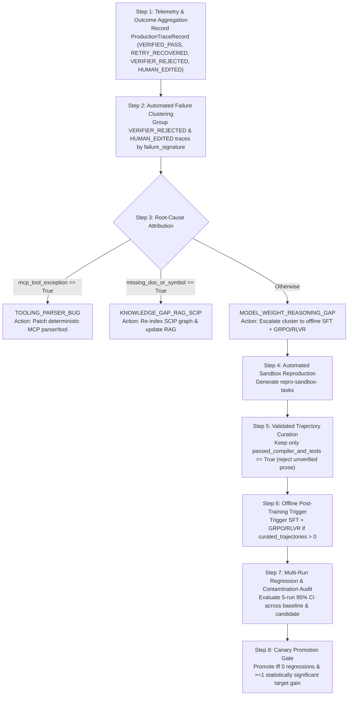

# The 8-Step Controlled Improvement Cycle

**Source Implementation:** [`src/platform_core/layer3_evolution/observability.py`](../../src/platform_core/layer3_evolution/observability.py), [`evaluation.py`](../../src/platform_core/layer3_evolution/evaluation.py)

---

## Table of Contents

1. [Purpose & Anti-Drift Guarantee](#1-purpose--anti-drift-guarantee)
2. [8-Step Improvement Cycle Diagram](#2-8-step-improvement-cycle-diagram)
3. [Detailed Step Breakdown (Steps 1–8)](#3-detailed-step-breakdown-steps-18)
4. [Verified Python Example](#4-verified-python-example)
5. [Related Documentation](#5-related-documentation)

---

## 1. Purpose & Anti-Drift Guarantee

`ControlledImprovementCycle` ([`observability.py`](../../src/platform_core/layer3_evolution/observability.py)) implements the platform's continuous evolution loop. Unlike naive online self-training—which suffers from model collapse when training on unverified LLM prose—this cycle enforces two strict invariants:
1. **Root-Cause Triaging Before Training**: Failures caused by missing documentation/SCIP symbols (`KNOWLEDGE_GAP_RAG_SCIP`) or deterministic parser bugs (`TOOLING_PARSER_BUG`) are routed to index or tooling fixes rather than model weight updates.
2. **Compiler & Test Gate on Training Data**: Step 5 strictly rejects any trace with `passed_compiler_and_tests == False`, ensuring offline SFT/GRPO only trains on execution-verified trajectories.

---

## 2. 8-Step Improvement Cycle Diagram



---

## 3. Detailed Step Breakdown (Steps 1–8)

1. **Step 1 — Telemetry & Outcome Aggregation (`record_trace`)**:
   - Ingests `ProductionTraceRecord` instances tagged with `TraceOutcome` (`VERIFIED_PASS`, `RETRY_RECOVERED`, `VERIFIER_REJECTED`, `HUMAN_EDITED`).
2. **Step 2 — Automated Failure Clustering**:
   - Groups all `VERIFIER_REJECTED` and `HUMAN_EDITED` traces by `failure_signature` (defaulting to `f"unclassified_{trace.domain}"`).
3. **Step 3 — Root-Cause Attribution**:
   - Inspects each failure cluster:
     - If any trace has `mcp_tool_exception=True` -> `FailureRootCauseBucket.TOOLING_PARSER_BUG`.
     - Else if any trace has `missing_doc_or_symbol=True` -> `FailureRootCauseBucket.KNOWLEDGE_GAP_RAG_SCIP`.
     - Else -> `FailureRootCauseBucket.MODEL_WEIGHT_REASONING_GAP`.
4. **Step 4 — Automated Sandbox Reproduction**:
   - Emits `"repro-sandbox-<cluster_sig>"` task identifiers for every cluster attributed to `MODEL_WEIGHT_REASONING_GAP`.
5. **Step 5 — Validated Trajectory Synthesis & Curation**:
   - Filters traces to retain only those where `passed_compiler_and_tests == True`, `outcome in {VERIFIED_PASS, RETRY_RECOVERED, HUMAN_EDITED}`, and `candidate_trajectory.strip()` is non-empty.
   - Counts and reports rejected unverified prose in `step5_rejected_unverified_count`.
6. **Step 6 — Offline Post-Training Trigger**:
   - Sets `step6_offline_training_triggered = len(curated_trajectories) > 0`.
7. **Steps 7 & 8 — Regression Audit & Canary Promotion Gate**:
   - Invokes `BenchmarkEvaluator.evaluate_canary_promotion(baseline_runs, candidate_runs, target_domains)` across 5-run trial arrays, promoting the candidate checkpoint only if `len(regressions) == 0` and `len(significant_target_gains) > 0`.

---

## 4. Verified Python Example

```python
from platform_core.layer3_evolution import (
    ControlledImprovementCycle,
    ProductionTraceRecord,
    TraceOutcome,
)

cycle = ControlledImprovementCycle()
cycle.record_trace(
    ProductionTraceRecord(
        trace_id="tr-01",
        domain="cyber",
        outcome=TraceOutcome.RETRY_RECOVERED,
        failure_signature="cwe78_secondary_sink",
        candidate_trajectory="diff --git a/service.py b/service.py ...",
        passed_compiler_and_tests=True,
    )
)
cycle.record_trace(
    ProductionTraceRecord(
        trace_id="tr-02",
        domain="cyber",
        outcome=TraceOutcome.VERIFIER_REJECTED,
        failure_signature="cwe78_secondary_sink",
        candidate_trajectory="unverified hallucinated patch",
        passed_compiler_and_tests=False,
    )
)

report = cycle.execute_cycle(
    baseline_benchmark_runs={"CyberGym-L1": [54.2, 54.5, 54.4, 54.6, 54.3]},
    candidate_benchmark_runs={"CyberGym-L1": [91.1, 91.4, 91.3, 91.2, 91.5]},
    target_domains={"CyberGym-L1"},
)
print("Curated trajectories:", report["step5_curated_verified_trajectory_ids"])  # ['tr-01']
print("Rejected unverified:", report["step5_rejected_unverified_count"])         # 1
print("Canary promoted:", report["step7_and_8_canary_gate"]["promoted"])         # True
```

---

## 5. Related Documentation

- [Layer 3 Evolution Module Reference](../modules/layer3-evolution.md)
- [5-Stage Model Post-Training Pipeline](model-post-training-pipeline.md)
- [Operations & Canary Diagnostics Guide](../operations/README.md)
