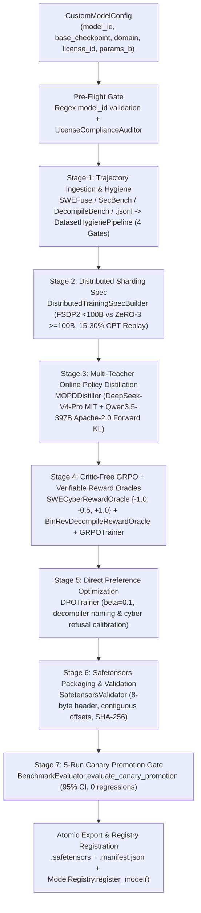

# The 5-Stage Model Post-Training & Custom Model Pipeline

**Source Implementation:** [`src/platform_core/layer1_intelligence/training.py`](../../src/platform_core/layer1_intelligence/training.py), [`data_factory.py`](../../src/platform_core/layer3_evolution/data_factory.py), [`evaluation.py`](../../src/platform_core/layer3_evolution/evaluation.py), [`governance.py`](../../src/platform_core/deploy_security/governance.py)

---

## Table of Contents

1. [Overview](#1-overview)
2. [Pipeline Architecture Diagram](#2-pipeline-architecture-diagram)
3. [Stage-by-Stage Technical Specification](#3-stage-by-stage-technical-specification)
4. [Programmatic Reward Oracles (Mathematical Formulations)](#4-programmatic-reward-oracles-mathematical-formulations)
5. [Safetensors Packaging & Atomic Disk Persistence](#5-safetensors-packaging--atomic-disk-persistence)
6. [Verified CLI & Python Execution](#6-verified-cli--python-execution)
7. [Related Documentation](#7-related-documentation)

---

## 1. Overview

`CustomModelPipeline.build_custom_model()` implements the 5-stage post-training lifecycle (`CPT -> SFT -> MOPD -> GRPO/RLVR -> DPO`) followed by binary `.safetensors` verification and the 5-run Canary Promotion Gate. It allows engineers to specialize open-weight models (`Qwen/Qwen3.8-27B` or `DeepSeek-V4-Flash`) on domain-specific trajectories and export a cryptographically verified `<model-id>.safetensors` + `<model-id>.manifest.json` bundle.

---

## 2. Pipeline Architecture Diagram



---

## 3. Stage-by-Stage Technical Specification

### Pre-Flight Validation
- Validates `config.model_id` against `^[A-Za-z0-9._-]+$` (blocking path traversal or empty strings).
- Validates positive integers (`context_window`, `num_gpus`, `serving_port`) and finite positive floats (`total_params_b`, `active_params_b`, `vram_4bit_gb`, `vram_fp8_gb`), explicitly rejecting Python booleans (`not isinstance(val, bool)`).
- Audits `config.license_id` via `LicenseComplianceAuditor.audit()`, raising `PermissionError` unless the verdict is `LicenseVerdict.APPROVED_COMMERCIAL`.
- Resolves the target `ModelPool` via `CustomModelPipeline.resolve_pool(domain, explicit_pool)`.

### Stage 1: Trajectory Ingestion & 4-Gate `DatasetHygienePipeline`
- Accepts user-supplied `custom_trajectories` (loaded via `CustomModelPipeline.load_trajectories_from_file()` from `.jsonl` or `.json`) or synthesizes default verified tuples via `SWEFuseFactory`, `SecBenchFactory`, and `DecompileBenchFactory`.
- Runs `DatasetHygienePipeline.filter_records()` enforcing four gates:
  1. **Gate 1 (`license_rejected`)**: Rejects any trajectory whose `license_id` is not `APPROVED_COMMERCIAL`.
  2. **Gate 2 (`benchmark_contaminated`)**: Rejects repos in `DEFAULT_BENCHMARK_REPO_BLOCKLIST` and CVEs in `DEFAULT_CVE_BLOCKLIST`.
  3. **Gate 3 (`execution_unverified`)**: Rejects records with `execution_verified == False` or empty `target_completion`.
  4. **Gate 4 (`near_duplicate`)**: Computes 3-token shingle BLAKE2b hashes and rejects records with Jaccard similarity $\ge 0.85$ against already accepted records.
- Raises `ValueError` if `accepted_count == 0`.

### Stage 2: Distributed Training Specification (`DistributedTrainingSpecBuilder`)
- Rejects deprecated frameworks (`torchtune`).
- Enforces `0.15 <= general_replay_ratio <= 0.30` during `CPT` to prevent catastrophic forgetting.
- Selects `"pytorch_fsdp2_dtensor"` (`torch_compile=True`) when `total_params_b < 100.0` and `"deepspeed_zero3"` (`torch_compile=False`) when `total_params_b >= 100.0`.

### Stage 3: Multi-Teacher Online Policy Distillation (`MOPDDistiller`)
- Audits every teacher in `teachers` (`DeepSeek-V4-Pro` `MIT` weight `0.55`, `Qwen3.5-397B-A17B` `Apache-2.0` weight `0.45`) to ensure commercial distillation is permitted.
- Computes the normalized weighted teacher distribution $P_T$ and forward KL divergence:
  $$\mathcal{L}_{\text{MOPD}} = \sum_{v} P_T(v) \log \frac{P_T(v)}{P_S(v)}$$

### Stage 4: Critic-Free GRPO + RLVR (`GRPOTrainer`)
- Evaluates rollouts using `SWECyberRewardOracle` and `BinRevDecompileRewardOracle`.
- For a group of $G \ge 2$ trajectories with rewards $\{r_1, \dots, r_G\}$, computes group-normalized advantages without a critic network:
  $$A_i = \frac{r_i - \mu_r}{\sigma_r + \epsilon}$$
- Weights advantages by sequence entropy deviation $w_i = \text{clip}(1 + \alpha (H_i - \bar{H}), 0.5, 1.5)$ (`entropy_weight_alpha = 0.15`) and subtracts the unbiased non-negative KL estimator ($\beta = 0.04$):
  $$\text{KL}_i = \exp(\log \pi_{\text{ref}} - \log \pi_\theta) - (\log \pi_{\text{ref}} - \log \pi_\theta) - 1$$

### Stage 5: Direct Preference Optimization (`DPOTrainer`)
- Optimizes preference pairs $(x, y_w, y_l)$ for decompiler variable naming (`binrev_naming`) and cybersecurity refusal calibration (`cyber_refusal_calibration`) with temperature $\beta = 0.1$:
  $$\mathcal{L}_{\text{DPO}} = -\mathbb{E}\left[\log \sigma\left(\beta (\log \frac{\pi_\theta(y_w|x)}{\pi_{\text{ref}}(y_w|x)} - \log \frac{\pi_\theta(y_l|x)}{\pi_{\text{ref}}(y_l|x)})\right)\right]$$

---

## 4. Programmatic Reward Oracles (Mathematical Formulations)

1. **`SWECyberRewardOracle.compute_reward()`**:
   - Returns **`+1.0`** iff `tool_json_valid` AND `compiles_cleanly` AND `fail_to_pass_resolved` AND `pass_to_pass_passed == pass_to_pass_total` AND `secondary_cwe_entry_points_remaining == 0`.
   - Returns **`-0.5`** if the primary bug/PoC is resolved (`fail_to_pass_resolved == True`) but either `pass_to_pass_passed < pass_to_pass_total` (over-correction breaking existing tests) or `secondary_cwe_entry_points_remaining > 0` (partial fix).
   - Returns **`-1.0`** if compilation fails, tool JSON is invalid, or the primary bug/PoC is not resolved.
2. **`BinRevDecompileRewardOracle.compute_reward()`**:
   - Returns `-1.0` total reward if `compiles_cleanly == False`.
   - Otherwise computes:
     $$R_{\text{total}} = 0.25 R_{\text{comp}} + 0.55 R_{\text{exec}} + 0.20\,\text{IoU}_{\text{struct}}$$
     where $R_{\text{comp}} = 1.0$, $R_{\text{exec}} = \frac{\text{unit\_tests\_passed}}{\text{unit\_tests\_total}}$, and $\text{IoU}_{\text{struct}}$ is the greedy bipartite byte-interval `[offset, offset + size)` Intersection-over-Union across DWARF struct fields.

---

## 5. Safetensors Packaging & Atomic Disk Persistence

When `output_dir` is provided to `build_custom_model()`:
1. Rejects symlinked `output_dir` or existing symlinked target files with `PermissionError`.
2. Writes `<model-id>.safetensors` to a hidden `NamedTemporaryFile` in `output_dir`, validates its binary structure and SHA-256 on disk via `SafetensorsValidator.validate_file()`, and atomically moves it into place with `os.replace()`.
3. Writes `<model-id>.manifest.json` to a hidden `NamedTemporaryFile` and atomically moves it into place with `os.replace()`.

---

## 6. Verified CLI & Python Execution

```bash
# Run default 5-stage pipeline
PYTHONPATH=src .venv/bin/python -m platform_core.cli train-model

# Create and export a custom model bundle to disk
PYTHONPATH=src .venv/bin/python -m platform_core.cli create-custom-model \
  --model-id Acme-SecCoder-27B-v1 \
  --base-checkpoint Qwen/Qwen3.8-27B \
  --domain cyber \
  --dataset-file examples/sample_custom_trajectories.jsonl \
  --output-dir ./artifacts/custom_models
```

---

## 7. Related Documentation

- [Custom Model Creation & Execution Guide](../CUSTOM_MODEL_GUIDE.md)
- [Layer 1 Intelligence Module Reference](../modules/layer1-intelligence.md)
- [8-Step Controlled Improvement Cycle](controlled-improvement-cycle.md)
