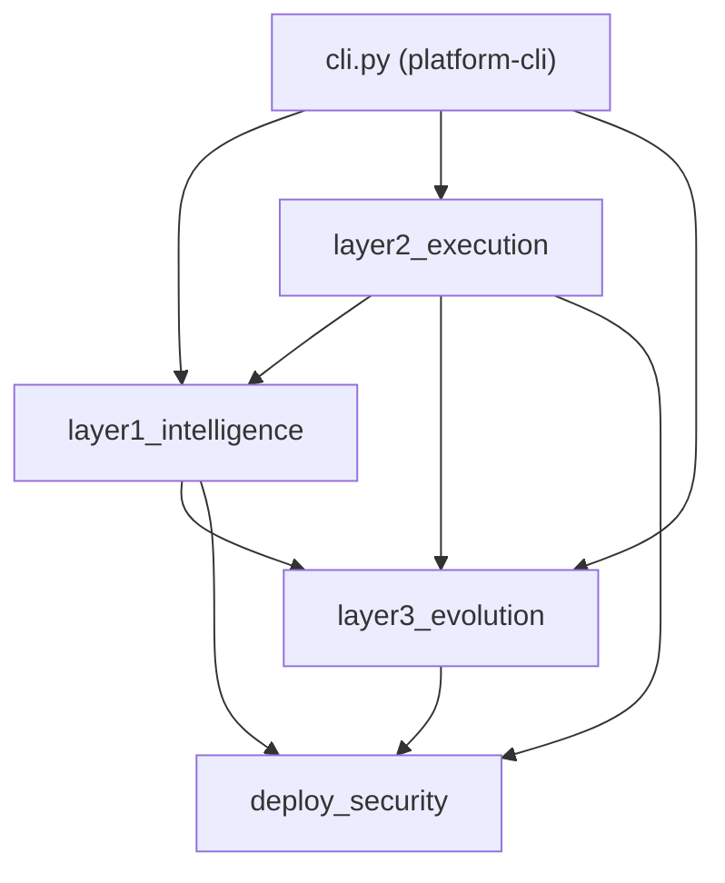

# `platform_core` — Core Python Package

---

## 1. Module Responsibilities and Boundaries

`platform_core` (`src/platform_core/`) is the installable root Python package (`version = "1.0.0"`) for the **Proprietary Technical Intelligence Platform**. It exposes the unified command-line interface (`cli.py`) and organizes the platform into four strictly bounded subpackages:
1. [`layer1_intelligence`](layer1_intelligence/README.md) — Model registry, routing, serving configs, 5-stage post-training, strategy advising, and compact scratch SLM training.
2. [`layer2_execution`](layer2_execution/README.md) — 10-step checkpointed execution, 6 specialist agents, 6 MCP tool servers, Firecracker CoW sandboxing, and the Google Antigravity SDK / MCP stdio bridge.
3. [`layer3_evolution`](layer3_evolution/README.md) — Bitemporal episodic memory, 200K-token hybrid knowledge store, corpus harvesting & distillation, data factories, and `PropBench-9` evaluation.
4. [`deploy_security`](deploy_security/README.md) — Safetensors validation, license compliance, HMAC-signed tool manifests, `CyberGymFirewall`, and Kubernetes sandbox CRDs.

---

## 2. Internal Architecture



---

## 3. Main Components

| File / Subpackage | Primary Exports | Purpose |
| :--- | :--- | :--- |
| [`__init__.py`](__init__.py) | `__version__ = "1.0.0"` | Package version and top-level docstring. |
| [`cli.py`](cli.py) | `main`, `run_evaluate_blueprint`, `run_model_creation_pipeline`, `run_demo_workflow`, `run_harvest_corpus`, `run_recommend_strategy`, `run_train_scratch_slm`, `run_agy_local_command`, `run_mcp_stdio_bridge` | Unified CLI (`platform-cli`, 18 subcommands) and programmatic orchestration helpers. |
| [`layer1_intelligence/`](layer1_intelligence/README.md) | `ModelRegistry`, `AdaptiveModelRouter`, `ServingEndpointConfig`, `CustomModelPipeline`, `CreationStrategyAdvisor`, `BytePairTokenizer`, `CompactTransformerSLMTrainer` | Layer 1 Intelligence, Post-Training & Compact Scratch SLM Creation. |
| [`layer2_execution/`](layer2_execution/README.md) | `ExecutionLifecycleOrchestrator`, `PlatformState`, `SQLiteStateCheckpointer`, `FirecrackerSandboxManager`, 6 Agents, 6 MCP Servers, `AgyLocalOrchestrator`, `AgyStdioMCPBridge` | Layer 2 Stateful Execution, Sandboxing & Google Antigravity SDK Bridge. |
| [`layer3_evolution/`](layer3_evolution/README.md) | `BitemporalEpisodicMemory`, `HybridKnowledgeStore`, `CorpusHarvesterPipeline`, `DatasetHygienePipeline`, `BenchmarkEvaluator`, `ControlledImprovementCycle` | Layer 3 Evolution, Corpus Harvesting, Memory & Evaluation. |
| [`deploy_security/`](deploy_security/README.md) | `SafetensorsValidator`, `LicenseComplianceAuditor`, `SignedManifestVerifier`, `CyberGymFirewall`, `K8sAgentSandboxGenerator` | Cross-cutting supply-chain and runtime security. |

---

## 4. Dependencies and Integrations

- **External Runtime Dependencies**: Zero (`dependencies = []` in [`pyproject.toml`](../../pyproject.toml)).
- **Standard Library Dependencies**: `argparse`, `ast`, `base64`, `collections`, `copy`, `dataclasses`, `enum`, `gzip`, `hashlib`, `hmac`, `ipaddress`, `json`, `math`, `os`, `pathlib`, `re`, `sqlite3`, `statistics`, `struct`, `subprocess`, `sys`, `tempfile`, `threading`, `time`, `typing`, `urllib.parse`, `zlib`.

---

## 5. Execution and Data Flow

See [docs/architecture/data-flow.md](../../docs/architecture/data-flow.md) for sequence and state diagrams covering both `ExecutionLifecycleOrchestrator.run_workflow()` (Steps 1–10) and `CustomModelPipeline.build_custom_model()` (Stages 1–7).

---

## 6. Configuration Requirements

Requires Python `>= 3.11`. When running without an editable install, set `PYTHONPATH=src`. See [docs/development/configuration.md](../../docs/development/configuration.md).

---

## 7. Usage Examples

```bash
# Run CLI subcommands from repository root
PYTHONPATH=src .venv/bin/python -m platform_core.cli evaluate-blueprint --budget 1800000
PYTHONPATH=src .venv/bin/python -m platform_core.cli run-workflow --domain swe
```

---

## 8. Testing and Troubleshooting

```bash
PYTHONPATH=src .venv/bin/python -W error -m unittest discover -s tests -v
```

See [docs/development/troubleshooting.md](../../docs/development/troubleshooting.md) for error resolution.

---

## 9. Related Documentation

- [Root Repository README](../../README.md)
- [Central Documentation Hub](../../docs/README.md)
- [CLI Module Reference](../../docs/modules/cli.md)
