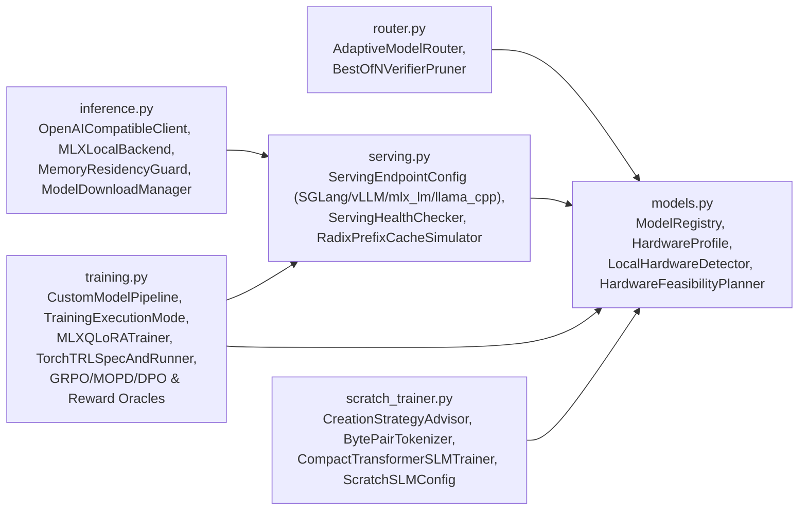

# `platform_core.layer1_intelligence` — Layer 1: Intelligence & Model Creation

---

## 1. Module Responsibilities and Boundaries

`platform_core.layer1_intelligence` owns hardware-aware model catalog management (`ModelRegistry`, `HardwareProfile`, `LocalHardwareDetector`), local & HTTP inference clients (`OpenAICompatibleClient`, `MLXLocalBackend`, `DeterministicMockBackend`, `MemoryResidencyGuard`, `ModelDownloadManager`), hardware/financial capacity planning (`HardwareFeasibilityPlanner`), entropy-aware request routing and `TTS@N` rollout pruning (`AdaptiveModelRouter`, `BestOfNVerifierPruner`), serving configuration & health probing (`ServingEndpointConfig`, `ServingHealthChecker`, `RadixPrefixCacheSimulator`), the 5-stage post-training and custom model packaging pipeline (`CustomModelPipeline`, `TrainingExecutionMode`, `MLXQLoRATrainer`, `TorchTRLSpecAndRunner`, `GRPOTrainer`, `MOPDDistiller`, `DPOTrainer`, reward oracles), and hardware-aware strategy advising plus from-scratch byte-level BPE & compact causal Transformer SLM creation (`CreationStrategyAdvisor`, `ModelCreationPath`, `BytePairTokenizer`, `ScratchSLMConfig`, `CompactTransformerSLMTrainer`, `ScratchSLMArtifact`).

---

## 2. Internal Architecture



---

## 3. Main Components

| File | Classes & Enums | Key Methods |
| :--- | :--- | :--- |
| [`models.py`](models.py) | `HardwareProfile`, `LocalHardwareInfo`, `LocalHardwareDetector`, `ModelPool`, `ThinkingMode`, `ModelSpec`, `ScenarioBudgetProfile`, `ModelRegistry`, `HardwareFeasibilityPlanner` | `detect()`, `for_profile()`, `register_model()`, `get_model()`, `get_pool_override()`, `recommend_scenario()`, `calculate_gpu_break_even_months()` |
| [`inference.py`](inference.py) | `ToolDefinition`, `ToolCall`, `ChatMessage`, `InferenceRequest`, `InferenceResponse`, `MemoryResidencyGuard`, `InferenceBackend`, `OpenAICompatibleClient`, `MLXLocalBackend`, `DeterministicMockBackend`, `ModelDownloadManager` | `complete()`, `can_load()`, `acquire()`, `download_from_huggingface()` |
| [`router.py`](router.py) | `RoutingRequest`, `RoutingDecision`, `CandidateRollout`, `AdaptiveModelRouter`, `BestOfNVerifierPruner` | `route()`, `select_best_candidate()` |
| [`serving.py`](serving.py) | `ServingEndpointConfig`, `ServingHealthChecker`, `RadixPrefixCacheSimulator` | `to_launch_args()`, `probe()`, `record_request()`, `build_default_pool_configs()` |
| [`training.py`](training.py) | `TrainingExecutionMode`, `MLXQLoRATrainer`, `TorchTRLSpecAndRunner`, `SWECyberRewardOracle`, `BinRevDecompileRewardOracle`, `GRPOTrainer`, `MOPDDistiller`, `DistributedTrainingSpecBuilder`, `DPOTrainer`, `CustomModelConfig`, `CustomModelArtifact`, `CustomModelPipeline` | `prepare_mlx_dataset()`, `build_fuse_command()`, `train()`, `compute_reward()`, `compute_struct_layout_iou()`, `build_custom_model()`, `load_custom_model_manifest()` |
| [`scratch_trainer.py`](scratch_trainer.py) | `ModelCreationPath`, `StrategyRecommendation`, `CreationStrategyAdvisor`, `BytePairTokenizer`, `ScratchSLMConfig`, `ScratchSLMArtifact`, `CompactTransformerSLMTrainer` | `recommend()`, `train()`, `encode()`, `decode()`, `preset_tier()`, `train_and_export()`, `load_artifact_manifest()`, `generate_sample()` |

---

## 4. Dependencies and Integrations

- **Internal Dependencies**:
  - `platform_core.deploy_security.governance` (`LicenseComplianceAuditor`, `LicenseVerdict`, `SafetensorsValidator`)
  - `platform_core.layer3_evolution` (`DatasetHygienePipeline`, `SWEFuseFactory`, `SecBenchFactory`, `DecompileBenchFactory`, `BenchmarkEvaluator`)
- **External Integrations**: Generates launch arguments for `SGLang v0.5.19` and `vLLM v0.28`, and distributed sharding configs for `PyTorch FSDP2` (`DTensor`) and `DeepSpeed ZeRO-3`.

---

## 5. Execution and Data Flow

1. **Routing Flow**: `RoutingRequest` -> `AdaptiveModelRouter.route()` -> resolves `ModelPool` and `ModelSpec` (checking `_pool_overrides` or `preferred_model_id`), computes `ThinkingMode` (`0`, `512..1024`, or `2048` max thinking tokens/turn), and sets `best_of_n_rollouts` (`1`, `4`, or `8`).
2. **Training Flow**: `CustomModelConfig` -> `CustomModelPipeline.build_custom_model()` -> runs Stage 1 (`DatasetHygienePipeline`), Stage 2 (`DistributedTrainingSpecBuilder`), Stage 3 (`MOPDDistiller`), Stage 4 (`SWECyberRewardOracle`, `BinRevDecompileRewardOracle`, `GRPOTrainer`), Stage 5 (`DPOTrainer`), Stage 6 (`SafetensorsValidator`), and Stage 7 (`BenchmarkEvaluator.evaluate_canary_promotion`), atomically writing `<model-id>.safetensors` and `<model-id>.manifest.json`.

---

## 6. Configuration Requirements

- All numeric fields on `ModelSpec` and `CustomModelConfig` reject Python booleans (`not isinstance(val, bool)`) and require positive finite values.
- `model_id` must match `^[A-Za-z0-9._-]+$`.
- `license_id` must pass `LicenseComplianceAuditor` (`APPROVED_COMMERCIAL`).

---

## 7. Usage Examples

```python
from platform_core.layer1_intelligence import AdaptiveModelRouter, RoutingRequest

router = AdaptiveModelRouter()
decision = router.route(
    RoutingRequest(
        task_id="req-1",
        task_domain="binrev",
        prompt_tokens=8192,
        uncertainty_entropy=0.50,
    )
)
print(decision.primary_model.model_id, decision.thinking_mode.value, decision.max_thinking_tokens_per_turn)
```

---

## 8. Testing and Troubleshooting

- **Run Layer 1 Tests**:
  ```bash
  PYTHONPATH=src .venv/bin/python -W error -m unittest tests.test_platform_core.TestLayer1IntelligenceAndTraining -v
  ```
- **Common Errors**:
  - `PermissionError: Cannot register model ...`: Use an approved commercial license (`Apache-2.0`, `MIT`, `BSD-3-Clause`).
  - `ValueError: Domain CPT requires a 15%-30% general replay mix`: Ensure `0.15 <= general_replay_ratio <= 0.30`.

---

## 9. Related Documentation

- [Central Layer 1 Module Reference](../../../docs/modules/layer1-intelligence.md)
- [5-Stage Model Post-Training Pipeline](../../../docs/workflows/model-post-training-pipeline.md)
- [Custom Model Creation & Execution Guide](../../../docs/CUSTOM_MODEL_GUIDE.md)
