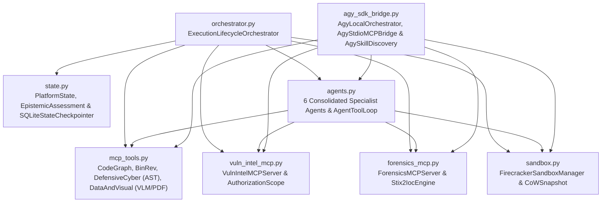

# `platform_core.layer2_execution` — Layer 2: Stateful Execution, Agents, MCP Tools & Sandboxing

---

## 1. Module Responsibilities and Boundaries

`platform_core.layer2_execution` implements the stateful runtime of the platform:
- Typed shared state (`PlatformState`, `EpistemicAssessment`, `EpistemicClaim`, `EpistemicStatus`, `SubTask`, `ArtifactRef`) and thread-safe SQLite WAL checkpointing (`SQLiteStateCheckpointer`).
- Hardware-isolated microVM sandboxing (`FirecrackerSandboxManager`) with 24-syscall seccomp rules, credential stripping, and `<15ms` Copy-on-Write (CoW) snapshot rollback.
- Six deterministic MCP servers (`CodeGraphMCPServer`, `BinRevMCPServer`, `DefensiveCyberMCPServer`, `DataAndVisualMCPServer`, `VulnIntelMCPServer`, `ForensicsMCPServer`).
- Six consolidated specialist agents (`PrincipalOrchestratorAgent`, `SoftwareEngineeringAgent`, `ReverseEngineeringAgent`, `DefensiveCyberAgent`, `MultimodalDataAgent`, `IndependentVerifierAgent`) plus `AgentToolLoop` for multi-turn tool calls.
- The 10-step `ExecutionLifecycleOrchestrator` with Step 10 `EpistemicAssessment` generation.
- The Google Antigravity SDK & stdio MCP bridge (`agy_sdk_bridge.py`: `AgyLocalOrchestrator`, `AgyStdioMCPBridge`, `AgySkillDiscovery`, `AgyLocalAgentSpec`, `AgyExecutionResult`).

---

## 2. Internal Architecture



---

## 3. Main Components

| File | Primary Classes | Key Responsibilities |
| :--- | :--- | :--- |
| [`state.py`](state.py) | `PlatformState`, `EpistemicStatus`, `EpistemicClaim`, `EpistemicAssessment`, `SubTask`, `ArtifactRef`, `ApprovalRequest`, `SQLiteStateCheckpointer`, `TaintLevel`, `TaskStatus`, `LifecycleStep` | Shared state serialization, Step 10 epistemic fact/hypothesis/uncertain tracking, and thread-safe SQLite WAL checkpointing. |
| [`sandbox.py`](sandbox.py) | `FirecrackerSandboxManager`, `CoWSnapshot`, `SandboxExecutionResult` | MicroVM workspace provisioning, `<15ms` CoW snapshot creation/restoration, `python3 -I` execution with sanitized env vars, and symlink-safe file sync-back. |
| [`mcp_tools.py`](mcp_tools.py) | `CodeGraphMCPServer`, `BinRevMCPServer`, `DefensiveCyberMCPServer`, `DataAndVisualMCPServer` | Polyglot AST/CST + SCIP code graph, ELF/PE/Mach-O inspection + `SK²Decompile` + `ReCopilot`, Python AST intraprocedural taint + `SecVerifier` Dual-Gate, entropy classification + streaming decompression + Kaitai `.ksy` + image/PDF & Epistemic Visual Grounding. |
| [`vuln_intel_mcp.py`](vuln_intel_mcp.py) | `VulnIntelMCPServer`, `AuthorizationScope`, `VulnFindingClassification`, `VulnerabilityIntelligenceRecord`, `PackageDependency` | Offline/mirror-first SQLite correlation for OSV, NVD, CISA KEV, FIRST EPSS & CWEs, polyglot manifest parsing, confirmed-vs-weakness classification, and fail-closed RoE enforcement. |
| [`forensics_mcp.py`](forensics_mcp.py) | `ForensicsMCPServer`, `Stix2IocEngine`, `ForensicVerdict`, `ForensicIndicator`, `ForensicFinding`, `ForensicAssessment` | STIX 2.0/2.1 pattern matching and iOS/Android/Host forensic triage for mercenary spyware (Pegasus, Predator, Graphite, Candiru, TriangleDB) with anti-fabrication SHA-256 chain & visibility reporting. |
| [`agents.py`](agents.py) | `AgentToolLoop`, `PrincipalOrchestratorAgent`, `SoftwareEngineeringAgent`, `ReverseEngineeringAgent`, `DefensiveCyberAgent`, `MultimodalDataAgent`, `IndependentVerifierAgent` | Specialist execution, local/HTTP model tool-call loops, `vuln_intel`/`forensics` handlers, and structural enforcement of `can_mark_completed=True` on `IndependentVerifierAgent` only. |
| [`orchestrator.py`](orchestrator.py) | `ExecutionLifecycleOrchestrator` | Executes Steps 1–10 (`run_workflow`), human approval pause/resume (`approve_and_resume`), signed MCP manifest verification, and Step 10 epistemic ledger build. |
| [`agy_sdk_bridge.py`](agy_sdk_bridge.py) | `AgyLocalAgentSpec`, `AgyExecutionResult`, `AgySkillDiscovery`, `AgyStdioMCPBridge`, `AgyLocalOrchestrator` | Symlink-safe `.agents/skills` discovery, taint-filtered JSON-RPC 2.0 stdio MCP server (`18` clean / `17` tainted tools across all 6 MCP servers), LiteRT/LocalOpenAI config building, and `IndependentVerifierAgent`-gated local execution. |

---

## 4. Dependencies and Integrations

- **Internal Dependencies**:
  - `platform_core.layer1_intelligence` (`AdaptiveModelRouter`, `RoutingRequest`, `ModelPool`)
  - `platform_core.layer3_evolution` (`BitemporalEpisodicMemory`)
  - `platform_core.deploy_security` (`SignedManifestVerifier`, `MCPToolManifest`, `CyberGymFirewall`, `FirewallDecision`)
- **Resource Lifecycle**: `ExecutionLifecycleOrchestrator`, `SQLiteStateCheckpointer`, and `CodeGraphMCPServer` hold SQLite connections and must be closed via `.close()` when finished.

---

## 5. Execution and Data Flow

1. `run_workflow()` classifies taint at Step 1 (`TAINTED_UNTRUSTED` if `has_untrusted_artifacts=True`), pre-indexes files and decomposes subtasks at Step 2, routes via `AdaptiveModelRouter` at Step 3, and verifies HMAC-SHA256 tool manifests at Step 4.
2. If `requires_mutating_approval=True`, pauses at Step 5 (`AWAITING_HUMAN_APPROVAL`) until `approve_and_resume()` is called.
3. Steps 6–9 run each subtask inside `FirecrackerSandboxManager` with a pre-execution CoW snapshot, verify via `IndependentVerifierAgent` at Step 8, and roll back the CoW snapshot in `<15ms` at Step 9 on rejection (up to 3 retries).
4. Step 10 records the verified event and architectural fact in `BitemporalEpisodicMemory` and marks `state.status = TaskStatus.COMPLETED`.

---

## 6. Configuration Requirements

- `session_id` and `vm_id` must match `^[A-Za-z0-9._-]+$`.
- Sandbox workspace file paths must be relative without `..` segments.
- Decompressed payloads in `DataAndVisualMCPServer.safe_decode_or_decompress()` cannot exceed `MAX_DECOMPRESSION_BYTES` (`10 MiB`).

---

## 7. Usage Examples

```python
from platform_core.layer2_execution import ExecutionLifecycleOrchestrator

orchestrator = ExecutionLifecycleOrchestrator()
try:
    state = orchestrator.run_workflow(
        session_id="swe-example-01",
        objective="Fix bug in rate calculation",
        task_domain="swe",
        workspace_files={"app.py": "def rate(a: int, b: int) -> float:\n    return a / b\n"},
        task_payload={
            "target_file": "app.py",
            "old_str": "    return a / b",
            "new_str": "    return (a / b) if b > 0 else 0.0",
            "test_script": "from app import rate\nassert rate(0, 0) == 0.0\n",
        },
    )
    print(state.status.value, state.final_deliverable["verified_by"])
finally:
    orchestrator.close()
```

---

## 8. Testing and Troubleshooting

```bash
PYTHONPATH=src .venv/bin/python -W error -m unittest \
  tests.test_platform_core.TestLayer2MCPServersAndSandbox \
  tests.test_platform_core.TestLayer2OrchestratorAndAgents -v
```

See [docs/development/troubleshooting.md](../../../docs/development/troubleshooting.md) for common error causes and solutions.

---

## 9. Related Documentation

- [Central Layer 2 Module Reference](../../../docs/modules/layer2-execution.md)
- [10-Step Agent Execution Lifecycle Workflow](../../../docs/workflows/agent-execution-lifecycle.md)
- [Data Flow & SQLite Schemas](../../../docs/architecture/data-flow.md)
