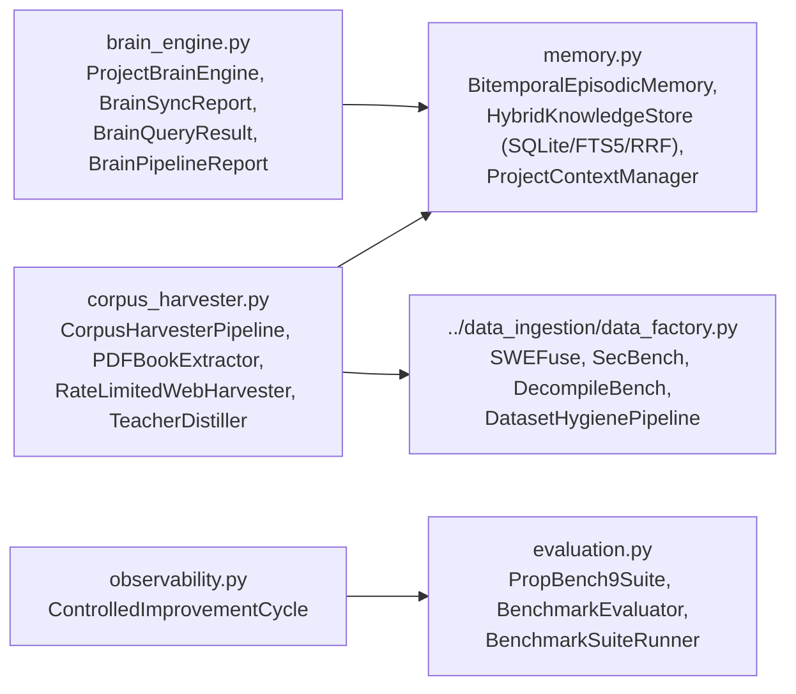

# `platform_core.layer3_evolution` — Layer 3: Evolution, Bitemporal Memory & Evaluation

---

## 1. Module Responsibilities and Boundaries

`platform_core.layer3_evolution` manages the long-term evolution and evaluation of the platform:
- **Bitemporal Episodic Memory & Hybrid Knowledge Store (`memory.py`)**: Thread-safe WAL SQLite persistence for GAM Event Progression Graph & Graphiti bitemporal fact edges (`valid_from`, `valid_to`, `invalid_at`), FTS5 BM25 + vector cosine RRF search via `HybridKnowledgeStore` (preserving the `< 200_000` token `DIRECT_PREFIX_CACHE` rule), `DeterministicHashEmbedder`, `InferenceBackendEmbedder`, and `ProjectContextManager`.
- **Project Brain Engine (`brain_engine.py`)**: `ProjectBrainEngine` synchronizes [`.agents/brain/`](../../../.agents/brain/README.md) (`brain-knowledge-graph.json` and curated corpus docs) into `HybridKnowledgeStore` and `BitemporalEpisodicMemory` (`sync_brain()`), executes combined RAG/graph/bitemporal queries (`query_brain()`), and orchestrates the end-to-end Brain -> GAIN -> Heretic -> Cold-Fusion -> IMatrix SLM pipeline (`run_brain_training_pipeline()`).
- **Proprietary Data Factories & Decontamination ([`data_ingestion/data_factory.py`](../data_ingestion/README.md))**: Re-exports `TrainingTrajectoryRecord`, `SWEFuseFactory`, `SecBenchFactory`, `DecompileBenchFactory`, and 4-gate `DatasetHygienePipeline` from `platform_core.data_ingestion`.
- **Corpus Harvesting, Sanitization & Teacher Distillation (`corpus_harvester.py`)**: `CorpusHarvesterPipeline`, `PDFBookExtractor` (`.pdf`, `.md`, `.txt`, `.rst`), `RateLimitedWebHarvester` (`CyberGymFirewall` egress gate, `time.monotonic()` pacing, `RateLimitError`), `PromptInjectionSanitizer`, `DomainChunker`, and `TeacherDistiller` (fail-closed `DatasetHygienePipeline` Gate 3 unless verified or explicitly opted into unexecuted text synthesis).
- **Statistical & Executable Benchmark Evaluation (`evaluation.py`)**: `PropBench9Suite` (9 internal benchmarks), `BenchmarkEvaluator` (5-run 95% CI, $\text{pass}@1$, $\text{pass}^k$, and Canary Promotion Gate), and `BenchmarkSuiteRunner` (5 default executable suites: `coding`, `reasoning`, `cyber_vuln`, `forensics`, `hallucination_resistance`, plus standalone `binary_analysis`, `exploit_mechanics`, `network_protocols`, and `roe_scope` sub-suites — 15 cases total across default run).
- **8-Step Controlled Improvement Cycle (`observability.py`)**: `ControlledImprovementCycle` for failure clustering, root-cause attribution, execution-verified trajectory curation, and canary gating.

---

## 2. Internal Architecture



---

## 3. Main Components

| File | Primary Classes | Key Methods |
| :--- | :--- | :--- |
| [`memory.py`](memory.py) | `ProgressionEvent`, `BitemporalFactEdge`, `BitemporalEpisodicMemory`, `KnowledgeDocumentChunk`, `HybridKnowledgeStore`, `DeterministicHashEmbedder`, `InferenceBackendEmbedder`, `ProjectContextManager` | `append_event()`, `upsert_architectural_fact()`, `query_active_facts()`, `query_facts_as_of()`, `ingest_document()`, `ingest_directory()`, `retrieve()`, `record_project_summary()` |
| [`brain_engine.py`](brain_engine.py) | `BrainSyncReport`, `BrainQueryResult`, `BrainPipelineReport`, `ProjectBrainEngine` | `sync_brain()`, `query_brain()`, `run_brain_training_pipeline()`, `close()` |
| [`../data_ingestion/data_factory.py`](../data_ingestion/data_factory.py) | `TrainingTrajectoryRecord`, `SWEFuseFactory`, `SecBenchFactory`, `DecompileBenchFactory`, `DatasetHygienePipeline` | `build_pair()`, `build_record()`, `filter_records()` |
| [`corpus_harvester.py`](corpus_harvester.py) | `RateLimitError`, `HarvestedDocument`, `HarvestReport`, `PromptInjectionSanitizer`, `DomainChunker`, `PDFBookExtractor`, `RateLimitedWebHarvester`, `TeacherDistiller`, `CorpusHarvesterPipeline` | `sanitize()`, `chunk_text()`, `extract_book()`, `extract_directory()`, `fetch_url()`, `synthesize_trajectories()`, `export_distilled_jsonl()`, `run_harvest()` |
| [`evaluation.py`](evaluation.py) | `MultiRunBenchmarkResult`, `BenchmarkEvaluator`, `PropBenchSpec`, `PropBench9Suite`, `BenchmarkCaseResult`, `BenchmarkSuiteRunner` | `evaluate_multi_run()`, `compute_pass_hat_k()`, `evaluate_canary_promotion()`, `all_specs()`, `run_all_suites()` |
| [`observability.py`](observability.py) | `TraceOutcome`, `FailureRootCauseBucket`, `ProductionTraceRecord`, `ControlledImprovementCycle` | `record_trace()`, `execute_cycle()` |

---

## 4. Dependencies and Integrations

- **Internal Dependencies**: `platform_core.deploy_security.governance` (`LicenseComplianceAuditor`, `LicenseVerdict` used in `DatasetHygienePipeline`).
- **Integration with Layers 1 & 2**:
  - `ExecutionLifecycleOrchestrator` writes verified task completions into `BitemporalEpisodicMemory` at Step 10.
  - `CustomModelPipeline` uses `DatasetHygienePipeline`, the three data factories, and `BenchmarkEvaluator.evaluate_canary_promotion()`.

---

## 5. Execution and Data Flow

- **Knowledge Retrieval Rule**: `HybridKnowledgeStore.retrieve()` sums `token_count` across all ingested chunks. When `0 < total_tokens < 200_000`, it returns `"retrieval_mode": "DIRECT_PREFIX_CACHE"`; at `>= 200_000` tokens, it ranks chunks by $0.65 \times \text{cosine} + 0.35 \times \text{lexical}$ and returns `"retrieval_mode": "HYBRID_PGVECTORSCALE_SEARCH"`.
- **Dataset Hygiene Flow**: `DatasetHygienePipeline.filter_records()` sequentially applies Gate 1 (Commercial License), Gate 2 (Benchmark Repo & CVE Blocklist), Gate 3 (`execution_verified == True`), and Gate 4 (3-shingle BLAKE2b Jaccard similarity `< 0.85`).

---

## 6. Configuration Requirements

- `DatasetHygienePipeline(jaccard_dedup_threshold=0.85)` requires `0.0 < jaccard_dedup_threshold <= 1.0`.
- `DecompileBenchFactory.build_record()` requires `opt_level in {"-O0", "-O1", "-O2", "-O3", "-Os"}`.

---

## 7. Usage Examples

```python
from platform_core.layer3_evolution import BitemporalEpisodicMemory, HybridKnowledgeStore

mem = BitemporalEpisodicMemory()
mem.upsert_architectural_fact("AuthService", "signing_alg", "RS256", "commit-1", valid_from=100.0)
mem.upsert_architectural_fact("AuthService", "signing_alg", "EdDSA", "commit-2", valid_from=200.0)
print("As of t=150:", mem.query_facts_as_of(150.0, subject="AuthService")[0].object_val)  # RS256

store = HybridKnowledgeStore()
store.ingest_document("doc-1", "file://spec.md", "EdDSA keys use Ed25519 curves.")
print("Mode:", store.retrieve("Ed25519")["retrieval_mode"])  # DIRECT_PREFIX_CACHE
```

---

## 8. Testing and Troubleshooting

```bash
PYTHONPATH=src .venv/bin/python -W error -m unittest tests.test_platform_core.TestLayer3EvolutionMemoryAndCLI tests.test_heretic_and_brain -v
```

---

## 9. Related Documentation

- [Central Layer 3 Module Reference](../../../docs/modules/layer3-evolution.md)
- [8-Step Controlled Improvement Cycle](../../../docs/workflows/controlled-improvement-cycle.md)
- [ADR-0004: Bitemporal Memory & 200K Knowledge Store](../../../docs/architecture/decisions/ADR-0004-bitemporal-memory-and-200k-hybrid-knowledge-store.md)
